<div align="center">

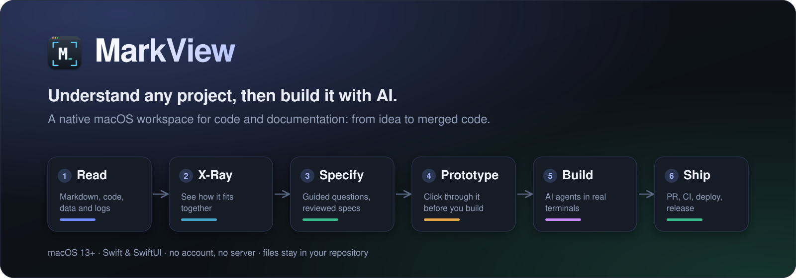

<br>

MarkView is a native macOS workspace for code and documentation. It starts as a plain
Markdown reader, and grows with you: it shows how a project fits together (**X-Ray**),
reviews documents, code and pull requests, turns ideas into specifications through guided AI
interviews, builds clickable **prototypes** from requirements or from your existing code, and
hands the result to **Claude Code, Codex, Cline, GitHub Copilot or Antigravity** running in real
terminals right next to your files.

[](https://github.com/t-boris/MarkView/releases/latest/download/MarkView.dmg)


**[⬇ Download the latest MarkView.dmg](https://github.com/t-boris/MarkView/releases/latest/download/MarkView.dmg)** · [All releases](https://github.com/t-boris/MarkView/releases) · [Presentation (PDF)](MarkView-Presentation.pdf)

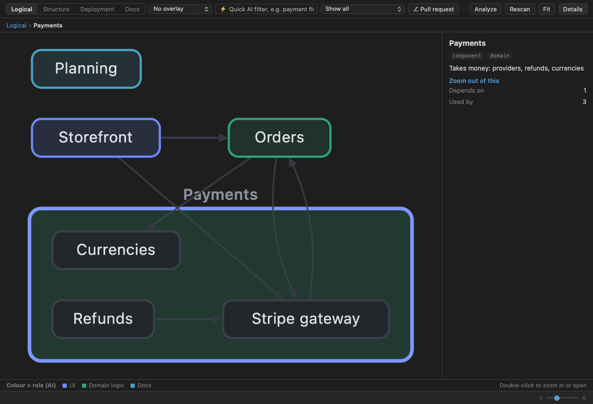

</div>

---

## Why MarkView

- **See the whole system in minutes.** X-Ray groups files into components and subsystems
  by how they are really connected, and keeps going inside every file — down to a single
  requirement, endpoint or function.
- **Specify before you build.** A feature starts as a sentence. MarkView asks the few
  questions that matter, writes requirements and decisions as plain Markdown files, reviews
  them from a dozen perspectives, and keeps the specification consistent as you decide.
- **Your agents, in your workspace.** Claude Code, Codex, Cline, GitHub Copilot and Antigravity
  run in real terminals inside the window. Pages and files they open land in MarkView tabs, not
  in another app.
- **Everything is a file in your repo.** Features, bugs, research and decisions live in
  `docs/` as Markdown with YAML front matter — readable, diffable, reviewable in pull
  requests. No server, no account, no lock-in.
- **Native and fast.** SwiftUI and AppKit, a local search index, no Swift package
  dependencies. AI runs through the CLIs you already use and are signed in to.

---

## What you can do with MarkView

From the simplest to the most involved. Each step stands on its own; use only what you need.

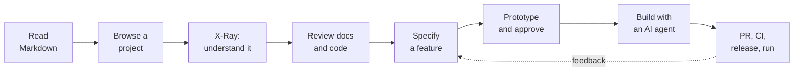

**1. Read and write documents.** Open a Markdown file (or double-click one in Finder) and read it
in a clean window: WYSIWYG or source, Mermaid diagrams, math, task lists, front matter and
`[[wikilinks]]`. Export to PDF. Nothing else is required: no project, no AI, no account.
→ [Reading and writing](#reading-and-writing)

**Read PDFs.** Open a PDF in a dedicated read-only tab, including multipage scans.
Scroll, zoom, fit the page or width, jump to a page, or navigate thumbnails and the document outline.
Search embedded text, select and copy it when permitted, and follow internal or safe external links.
Scans display without OCR. Password-protected documents can be unlocked for reading; source PDFs
are never saved or annotated. PDF reading adds no AI processing or workspace content indexing.

**PDF books.** Select files and folders in Files (⌘-click or ⇧-click), then choose **Export PDF Book…**
from the context menu or the selection bar. A single file/folder has the same command;
right-click empty space to export the current folder, or use **File → Export PDF Book…** (⌘⇧E).
Add sources and arrange chapters before exporting. Books include a cover, linked contents with page
numbers, native PDF bookmarks, internal/cross-document links, external links, footnotes, images,
Mermaid diagrams and formulas. Tables repeat their headers across pages; long cells continue
without clipping. Choose warm paper, classic white or midnight, and A4, landscape A4 or Letter.

At **0% shortening** and **Document language**, the complete source text is typeset locally without
an assistant, including unsaved editor drafts. Translation and shortening use the project's existing
CLI assistant/model. The shortening slider runs from 0% to 90% in steps of 10; at **50%** the book keeps
about half the prose, while tables, code, formulas and illustrations stay complete. The app measures the
result, retries a missed word budget and reports the actual retained prose volume. PDF bytes and page
count also depend on images and layout. Source files are never rewritten. Supported sources are Markdown,
HTML, UTF-8/UTF-16 text, source code, CSV/TSV and system-decodable images; unsupported files found inside
folders are listed. Links to local documents outside the selected book are listed as notices. A book holds
up to 1,000 chapters and 12 MB of text, and remote `http(s)` images in it are downloaded for the PDF.

**2. Browse a folder as a project.** Open a folder to get a file tree, project search
(**⌘⇧K**), git status, a code viewer for 40+ languages, and viewers for images, JSON, YAML,
CSV, Parquet, SQLite, Excel, logs, archives and HTML.
→ [Reading and writing](#reading-and-writing), [Workspace](#workspace)

**3. Understand an unfamiliar project: X-Ray.** See layers, subsystems, components and dependencies,
then zoom into a single file, requirement or function. Overlays show where documentation,
tests or freshness are missing. The **⚡ Ask the project** box answers a question with clickable
evidence. Book X-Ray does the same for a folder of documents.
→ [X-Ray](#x-ray-from-system-to-single-item)

**4. Check a document or a specification.** *Docs ↔ code* finds statements the code no
longer backs. Feature *Review* reads a specification from twelve perspectives, *Find
Contradictions* and *Find outdated* keep it consistent, and Explain lenses mark what changed
or matters. Selection actions challenge, expand or find edge cases in any passage.
→ [Review](#from-idea-to-merged-code), [Reviews of every kind](#reviews-of-every-kind)

**5. Review code.** Review uncommitted changes, review whatever changed on disk since you
opened the project (including by agents), review a pull request in its architecture context,
run a security review or a codebase audit.
→ [Reviews of every kind](#reviews-of-every-kind)

**6. Research.** A mind map of the question that grows from the centre outwards, with every
finding labelled and every web query recorded, or a quick page clip from the built-in browser saved as Markdown.
→ [Understand and research](#from-idea-to-merged-code)

**7. Turn an idea into a specification.** Guided questions, requirements and decisions as
plain Markdown files in your repository.
→ [From idea to merged code](#from-idea-to-merged-code)

**8. Prototype before you build: Prototype Studio.** Give it a requirements file or folder; it builds a
deep, fully clickable HTML prototype you review in a studio tab until you approve it.
→ [Prototype Studio](#prototype-studio-click-through-before-you-build)

**9. Change the real interface: UI Studio.** Run your own web app (or an Electron renderer) in a tab
with simulated, resettable test data, select an element, ask about it or have the assistant change its
source, then keep or undo the change with before and after pictures.
→ [UI Studio](#ui-studio-the-real-app-with-test-data)

**10. Build with an AI agent.** Hand the approved specification to Claude Code, Codex, Cline,
Copilot or Antigravity in a real terminal beside your files; track issues, pull requests and CI.
→ [AI agents and terminals](#ai-agents-and-terminals)

**11. Let agents use your browser tabs.** Agents drive pages you are logged in to, in a window
you watch, without your password.
→ [AI agents and terminals](#ai-agents-and-terminals)

**12. Start, run and ship a project.** *New Project…* from an idea, preview the web app, see where
it runs and look inside its servers and databases, run deploy and install commands with
confirmation, publish to GitHub.
→ [Deployments](#deployments-see-where-it-runs), [Workspace](#workspace)

---

## How it fits together

MarkView is one native process with one window per project. The web view only renders; Swift owns
the files, tabs and state. AI work goes through the agent CLIs you installed, and the agents reach
back into the app through three small local MCP servers.

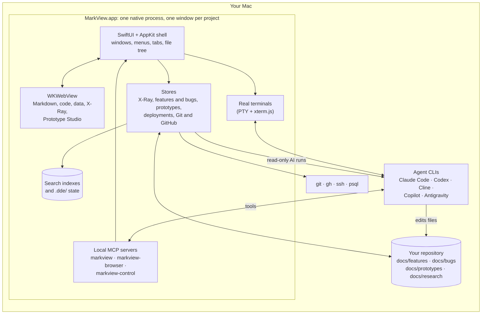

**Where your data lives**

| What | Where |
|---|---|
| Features, requirements, decisions, questions, findings, sources | `docs/features/<slug>/` in your project |
| Bugs | `docs/bugs/` |
| Research maps, older research reports and web clips | `docs/research/` |
| Prototypes | `docs/prototypes/<name>/`; export ZIPs in `.dde/exports/prototypes/` |
| Machine state: document search index, X-Ray caches, deployments, definition of done | `.dde/` in the project (regenerable) |
| Shared operations (deploy, install…) | `.markview/operations.json` |
| Lifecycle events (cycle time) | `~/Library/Application Support/MarkView/lifecycle-events.jsonl` (one append-only file per Mac) |
| Browser passwords | your login Keychain |

---

## X-Ray: from system to single item

Press **⌘4**, or right-click a folder and choose **X-Ray**. In a project with source code the
**Code** view opens by default.

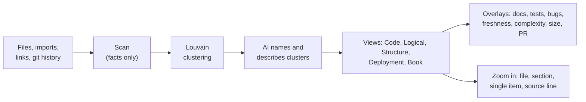

| | |
|---|---|
| 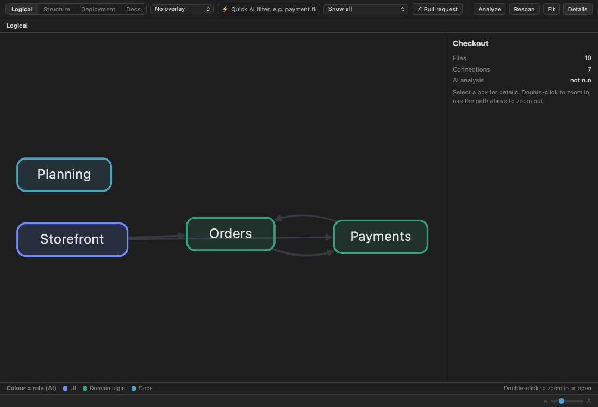 | 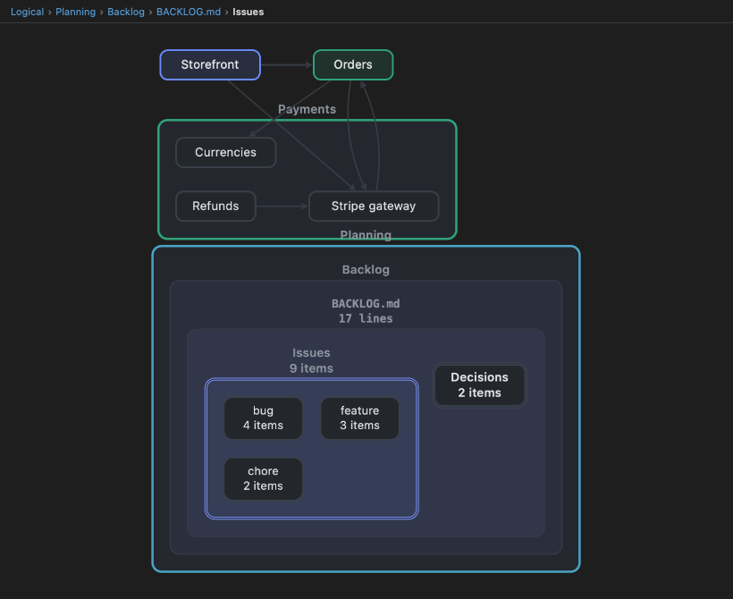 |
| **Logical view**: subsystems and their dependencies, coloured by role. | **Double-click to zoom in**: component → file → its sections → a single item. |

*These screenshots come from an earlier release: the toolbar has since gained the **Code** and **Book** views.*

- **Five views:** *Code* (source-derived layers and nested components), *Logical* (AI-named
  components and subsystems), *Structure* (folders and imports), *Deployment* (mapped from
  build and deploy files) and *Book* (documents only).
- **Code architecture, drawn in layers.** Open a source folder and press **⌘4**: a layered overview
  (presentation → application → domain → data, with cross-cutting concerns alongside and external
  systems below) appears at once from facts and sharpens as the analysis finishes. A status line says what is
  happening: *Analyzing code in the background…*, *Analyzed 5 minutes ago*, or that automatic analysis is
  off. Solid arrows are facts from the scanner, dashed arrows are AI inferences with a citation, dotted
  arrows are drafts guessed from paths. A *What was understood* table lists, per language, what was
  fully, partly or not analyzed.
- **Automatic, and yours to switch off.** Code projects are analyzed in the background when you open
  them and after changes (60 seconds of quiet, at most one AI run per 15 minutes, up to 5,000 source
  files). *DDE Settings → Analyze code projects automatically (X-Ray)* turns it off; **Refresh** runs it
  by hand. Dependencies are extracted for 17 languages, and JavaScript, TypeScript, HTML, Python, Go,
  Rust, Ruby, Swift, Java, Kotlin and C# get a full analysis. The model used is the **X-Ray · …** menu in
  the toolbar.
- **Sequence diagrams from the code.** The analysis traces three to five scenarios by itself; type your
  own in *Scenario to trace* (“How is a document saved?”) and press **Draw sequence**. Every message
  links to `path:line` evidence. Saved scenarios show a *stale* badge when a cited file changes.
- **Built from facts, named by AI.** The scan reads imports, note links and git co-changes, then
  clusters folders (Louvain). In Logical, AI names and describes what the structure already shows; its
  naming results are cached by input. Code uses a separate read-only source analysis and saves the
  resulting model and scenarios.
- **Inside every file.** Documents split into collections of like things (issues,
  requirements, decisions, endpoints), long code files into responsibilities and every type
  and function. Every leaf opens the file at that exact line.
- **Overlays:** documentation (docs older than the code they mention), tests (including lcov and
  Cobertura coverage), bug history, freshness, complexity, size and pull request, plus AI *Importance*
  and your own saved AI filters (“payment flow”, “security”).
- **⚡ Ask the project.** Type a question in the X-Ray toolbar: the answer comes as **What, Why, How and
  Origin** with clickable sources, and the relevant boxes turn red. **Save to docs/research** keeps it.
  In Book X-Ray the same box is *Ask the book*.
- **Book X-Ray** turns a folder of documents (md, txt, rst, adoc, org) into parts, chapters
  and sections with AI summaries, related-chapter links and *Describe this chapter*.
- **PR X-Ray** shows where a pull request lands in the architecture, with the diff, a verdict
  (*looks good*, *needs attention*, *risky*), impact, findings with **Fix it**, **Explain** and
  **Comment on PR**, a chat, and approve, request changes or merge (squash, merge or rebase). It also
  compares a local branch with `main` without GitHub.
- **Explain** puts section-by-section margin notes on code, configuration and Markdown, with
  Explanation, Pull request, Freshness (time of the last change, from `git blame`) and Importance
  lenses. In the code viewer **⌘-click** goes to a definition and **⌥⌘-click** finds usages (a text
  search, no language server), and the ✦ menu asks the AI about a line or symbol.
- **Recursive Insight** turns a folder of Markdown or a long document into a browsable site of
  interactive pages you can dive into (depth 1–3) and export as a ZIP.

---

## From idea to merged code

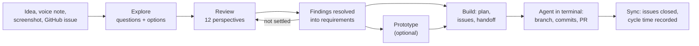

The **Issues** sidebar holds the project's features and bugs, with status filters, sorting by date or
priority and `#12` chips that open the GitHub issue. **+ → New Feature** (or *New from This Document*,
or a GitHub issue) starts one; voice notes, screenshots, files and URLs are welcome as input.
**Quick Feature…** writes a one-page specification with no question rounds and opens it straight in
Build. Each feature is a folder under `docs/features/<slug>/`: `requirements/`, `decisions/`,
`questions/`, `findings/`, `references/`, `research/`, a discussion log and an implementation plan — all
plain Markdown.

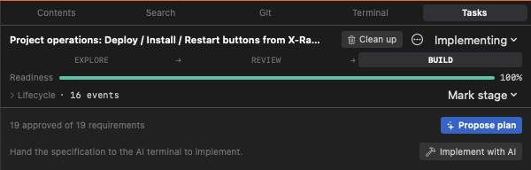

*A feature moves Explore → Review → Build; readiness and approved requirements show how far along it is.*

**Explore** — guided discovery.
- Rounds of at most three questions, each with two to four concrete options and a recommended answer.
  The AI reads your code and documents first, so it never asks what the project already
  answers.
- Answer, write your own, or **Let the AI decide**; per question you can also ask for *another
  approach*, *research this*, *pros and cons*, or *skip for now*. *Decide the rest and finish* when
  you have seen enough. Readiness and an understanding model show how far along you are.
- Add sources from the **+** menu: files, a URL, a GitHub issue, notes or a pasted conversation, or a
  recorded voice note.

**Review** — a specification that converges.
- *Run review* looks at the whole specification from twelve perspectives — Product, UX, Architecture,
  Backend, Frontend, Security, QA, Reliability, Operations, Data, Privacy and Business — and reports
  findings with severity (blocker, high, medium, low) and quotes.
- Resolve each finding by choosing an option, typing your own, **Decide for me**, **Accept Risk** or
  **Dismiss**; **Decide all for me** does the rest. Every resolution is **written back into the
  requirements** — statement and acceptance criteria — so the next review reads one consistent
  specification and never raises a settled point again. Details an implementer would decide are left to
  the implementer.
- **Before Build** collects what is left: blocking questions, AI decisions to confirm,
  open assumptions and research gaps.
- *Consolidate requirements* (offered above 30 active requirements), *Find outdated* and *Clean up* keep
  large specifications small. Delete requirements or decisions you no longer want — links are cleaned up
  and **Re-explore** asks about what they used to settle. **Start over** rebuilds a feature from its
  overview.

**Build** — hand off and track.
- *Propose plan* splits the work into issues; one click creates them and an epic on GitHub. A
  coverage check shows how many requirements the plan covers.
- **Implement with AI** sends a binding handoff to the agent in the terminal (Claude Code and Codex get
  a one-line `/goal`, Copilot gets `/autopilot`, Cline and Antigravity get plain text); answered
  questions and accepted decisions are treated as requirements, not reopened. The handoff carries the
  project's [definition of done](#workspace).
- **Lifecycle analytics** record 11 stages of a feature — from idea created to merged and verified — and
  *Project Cycle Time…* shows the median and mean per step, per AI model, and where CI time goes. The
  log is a per-Mac file, not part of the repository. Events from GitHub (pull request, review, CI)
  follow a feature once its implementation has started, and need the GitHub integration.
- **Sync** closes a GitHub issue once every feature and bug linked to it is done. It follows explicit
  links only, never reopens an issue and never edits your documents.

**Bugs** get the same care: *New Bug* writes a structured report (and optionally a GitHub
issue), *Investigate* asks up to three focused questions, and the **bug basket** fixes two or more bugs
with AI — one branch, one commit per bug. Before every analysis of an existing report — *Investigate*,
an answer, a discussion message — MarkView checks whether the bug still exists on the project's `main`
branch (a read-only look at one commit, never your working tree or other branches). A problem that is
already fixed there is closed automatically, with the commit, the evidence and the reason kept in the
report's *Validity check* section; not being able to reproduce a bug is never enough. The closure is
local: GitHub changes only when you run **Sync**. An inconclusive check keeps the status and goes on
with the analysis.

**Understand and research.** *I Need to Understand* (the ⚡ box in X-Ray, or **+ → I Need to
Understand…**) answers a question about the project with **What, Why, How and Origin** and clickable
evidence from code, documents, commits and pull requests; save an answer as research when it is worth
keeping. *New Research* opens a **mind map** at once and runs in the background (20 minutes by default;
5–120 in Settings): the assistant builds the map from the central subject outwards, main branches first,
and each node carries findings labelled project fact, external fact, AI inference or open assumption with
their sources; every web query is recorded. The map is a Markdown file in `docs/research/` that you can also
edit as text. Review it in the map: add, edit, delete and drag nodes, move a branch to another parent,
connect nodes, arrange a branch with one of seven layouts (applied to the whole branch), or ask the
assistant to *Develop with AI* in a direction you give (options become separate branches). *Stop* keeps
every node received, marked incomplete, and *Continue* picks the map up. Older Markdown research reports
stay as they are, with *Continue / Deepen Research*.

---

## Reviews of every kind

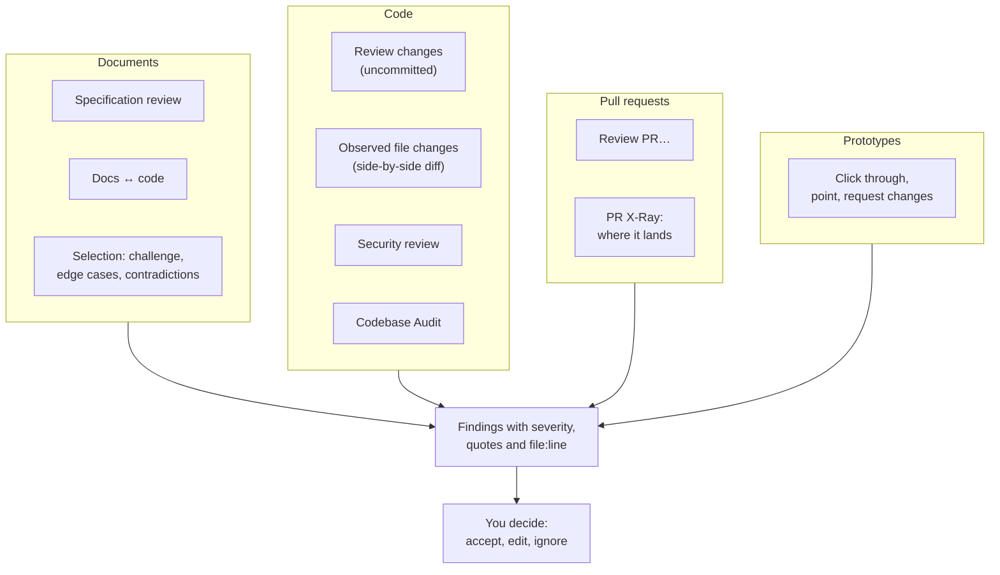

| What you review | How |
|---|---|
| **A specification** | Feature **Review** from twelve perspectives; findings are resolved into the requirements. |
| **A document against the code** | **Docs ↔ code** terminal prompt; the documentation overlay in X-Ray flags documents older than the code they mention. |
| **A passage** | Selection actions: challenge, find edge cases, find contradictions, explain, ask, find related documentation. |
| **Uncommitted changes** | **Review changes** terminal prompt: bugs, edge cases, leftovers and missing tests with `file:line`. |
| **Whatever changed on disk** | The **observed file changes** bar counts files added, modified or deleted since the project opened — by you, an agent or a build — and **Review** shows each as a side-by-side diff. |
| **A pull request** | **Review PR…** prompt, or **PR X-Ray**: where the PR lands in the architecture, the diff, AI findings and impact, chat, approve or merge. A failed CI run offers **Explain Failure** and **Fix with AI**. |
| **Security** | **Security review** prompt. |
| **The whole codebase** | **Codebase Audit** (8–16 documents in `docs/generated-architecture/`), **Constructive Critic** (a review file plus a task list) and **Code Structure Map** in AI Tools. |
| **An approach** | **New Research** with cited sources. |
| **A prototype** | Prototype Studio: click through it, point at what to change, approve when it is right. |

Review prompts never modify files; they report and wait for you.

---

## Prototype Studio: click through before you build

Build a clickable HTML prototype you can review like a real product, then pack it for
implementation. Start from **AI Tools → Prototype**:

- **New Prototype…** builds it from a requirements file or folder.
- **New Prototype from Code…** opens [UI Studio](#ui-studio-the-real-app-with-test-data) on the app
  itself instead of rebuilding its interface as a copy.

Everything lives in `docs/prototypes/<name>/` in your project (the prototype, its versions, the
conversation and attachments, `SPEC.md`), so a prototype can be committed and shared through the
repository. Prototypes made by earlier versions in `.dde/prototypes/` move there automatically when the
project opens.

### From requirements

- **Build in steps you can watch.** The assistant plans the screens (up to ten); MarkView writes the
  shared runtime itself; then the assistant writes the styles, the sample data and the screens, four
  at a time. A step header and a per-screen checklist show progress, and a Stop button ends the run — there
  is no time limit per step. Every step runs through your regular assistant and model.
- **Deep, not a picture.** Routes, forms with validation, roles and permissions, filters,
  empty and error states, and sample data that links across screens. Everything is plain
  HTML, CSS and JavaScript that opens in any browser.
- **A check before you see it.** MarkView opens every screen and reports blank, stuck-loading, error,
  placeholder and clipped ones, then makes one repair round.
- **Review in a studio tab.** The live preview sits next to a chat. Ask for a change in your
  own words or by voice: *"change this, remove that, add this"*. Each accepted change is a
  new version; the **Versions** menu takes you back to any earlier one.
- **Point at things.** Click **Point**, then an element in the preview; the assistant gets its
  HTML and, optionally, a screenshot of it. Paste (**⌘V**), drop or choose images — a sketch,
  a screenshot of another product — and the assistant reads them with the request.
- **Retry and history.** A failed or stopped request offers **Retry** or **Edit in the
  field**. The whole conversation is saved with the prototype and is back when you reopen it
  (AI Tools → Prototype → Open Prototype).
- **Approve and hand off.** Approving writes the specification and packs a ZIP in
  `.dde/exports/prototypes/`: the prototype, `SPEC.md` (screens, states, transitions, data, rules,
  traceability to your requirements), `CHANGES.md` (the review history) and a README. An implementer,
  human or AI, builds from that package. **Copy reference** gives agents a `markview://prototype/<name>`
  link that always resolves to the latest version.

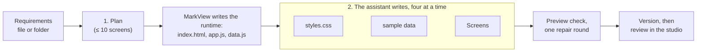

### Prototypes saved from existing code

Earlier versions could rebuild an existing app's interface as an HTML prototype. Those prototypes stay
in `docs/prototypes/` and open as before, labelled **Historical reconstruction** (agents see the same
label through `markview_list_prototypes` and `markview_get_prototype`): they are a copy made at one
moment, not the current application. **Sync from code** on one opens UI Studio on the real app;
**Hand off to code** still writes a brief for an agent from the review requests.

### How a prototype is reviewed and handed off

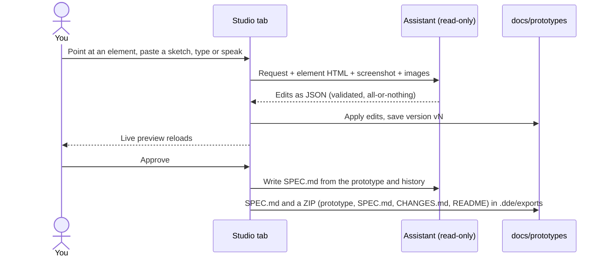

## UI Studio: the real app with test data

**View → UI Studio (⌘7)**, **AI Tools → UI Studio (Existing Code)**, or **New Prototype from Code…**
opens the project's own web interface in a tab: the same launch discovery as *Preview Web App*
(Vite, webpack, Next, Angular, Svelte, Astro, Django, Rails, a static `index.html`…; an Electron app
runs its renderer as a web page). One session per window. A dev server that is already running is
used and left running; one UI Studio starts runs in its own process group and stops with the tab,
the folder or the window.

- **Test data, not your backend.** `fetch` and `XMLHttpRequest` calls that ask for JSON are answered by
  a simulation with shared records: a rename shows in the list and the detail, a delete is gone
  everywhere, a repeated write with the same key happens once. A request the simulation does not know
  is prepared once by the assistant (read-only, no web), checked, and then served without it; anything
  that fails gives the page a clear error and never reaches a real service. **Reset** goes back to the
  scenario's data. GraphQL, WebSockets, server-sent events and anything a server renders are reported as
  not simulated.
- **Scenarios.** Populated, empty, loading and error come built in; save your own with the route, data,
  role, viewport, theme, locale, time zone, a fixed clock, a seed for random numbers and the clicks that
  lead to a detail or an editing state (**Record**). Scenarios live in `.markview/studio/` and can be
  committed; one whose data no longer fits a changed contract says so and needs an explicit update.
- **Select, don't click.** **Interact** uses the app; **Select** highlights the element under the pointer
  and selects it without running its action. Move to the parent or a child, see the other instances of
  a repeated component, and zoom the preview without changing the page's own viewport. Where the dev
  build carries source locations (React, Vue, Svelte, Angular or inspector attributes) the selection
  names its file and line; otherwise it says why it cannot.
- **Ask or change.** **Ask** answers a question about the element and changes nothing. **Change** has the
  assistant edit the real source in your project's own conventions: it names the scope first and asks
  when the request is ambiguous. MarkView applies the edits itself, refuses them when a file changed
  under it (including unsaved editor tabs), waits for the rebuild, restores the scenario, checks for
  build and runtime errors and takes before and after pictures. A broken build is shown with the old
  preview marked stale.
- **Keep or undo.** The history lists every request with its diff and checks. **Undo** removes one change
  and keeps everything done since; an undo that overlaps a later edit shows the conflict instead of
  writing.
- **Evidence for a feature.** Compare two pictures side by side or as a difference, then **Export
  feature**: a feature with the description, one requirement per change with its diff, the baseline and
  final revisions, the scenario, the rendering conditions, the pictures and the checks. When the files
  change later the package is marked for revalidation and keeps its pictures. Pictures and history stay
  in `.dde/studio/`, which ignores itself in Git.
- **Trust.** The project's own processes run with your permissions: open only projects you trust. The
  page may reach only its dev server and the addresses you allow; this is a connection policy, not
  operating-system isolation. Secrets are removed from the environment the dev server gets and from
  everything sent to the model or exported.

---

## AI agents and terminals

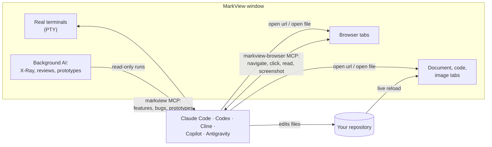

- **Real terminals** (**⌘3**): xterm.js on a pseudo-terminal owned by the app. Open Claude Code,
  Codex, Cline, GitHub Copilot, Antigravity or a plain shell — several at once — in the project folder;
  Claude Code, Codex, Copilot and Antigravity sessions resume when you reopen the project. Paste an
  image or Finder files into a terminal and its path is typed for the agent. Right-click a folder →
  **Open Terminal Here** opens a shell as an editor tab.
- **Agent activity at a glance.** A status dot per terminal tab, a banner with the current step and the
  agent's task list with progress, a toolbar chip when other agents work, and quota chips for Claude
  Code and Codex. The **cpu** menu in the Agents header switches the model: for Claude Code it types
  `/model` into the live session and the conversation continues; the project remembers its last model.
- **One-click prompts:** *GitHub → MarkView…*, *Review PR…*, *Review changes*, *Docs ↔ code*, *Explain file*,
  *Find bugs*, *Write tests*, *Run tests*, *Security review*, *Update docs*,
  *Commit message*. ⌥-click types a prompt without sending it.
- **GitHub → MarkView…** checks recent issue activity, creates missing local features and bugs,
  updates existing records, and reports recommended priorities. Choose weekdays, calendar hours,
  or exact dates and preview the bounds before sending. The default is 48 weekday hours:
  Monday at 09:00 starts on Thursday at 09:00 the previous week. Saturday and Sunday extend
  the lookback; all activity inside the resulting interval is included, including weekends.
  Holidays count as weekdays. The agent updates records without starting implementation or
  modifying GitHub issues.
- **Per-project assistant and model**, plus a separate fast model for X-Ray, filters and
  explanations (the **X-Ray · …** menu in the toolbar). AI output can follow the document's language or
  use one of eight others.
- **Pages and files open in MarkView.** When an agent runs `open https://…`, `open notes.md`
  or uses `$BROWSER`, web pages appear in the window's browser tab, local HTML renders there
  too, and documents, code and images open as tabs. Folders, apps and other files still go
  to macOS. Clicked links and `path:line` references in the terminal work the same way.
- **Agents work in your browser tabs.** Claude Code, Codex, Copilot and Antigravity get a
  *markview-browser* MCP server (13 tools): they navigate, read the page, click and type (as real mouse
  clicks and keystrokes), run JavaScript, read the console and take screenshots in the window's
  browser tabs — where you watch — instead of driving your Chrome. Sign in to a platform once in a
  tab, name the tab ("Jira", "Stripe") and say *"in tab Jira, follow these steps"*; the agent uses
  your session and never needs your password. **Stop** on a tab takes it back. The element picker in a
  browser tab pastes a clicked element's selector, HTML and a screenshot path into the agent.
- **The browser tab downloads, remembers passwords and saves PDFs.** Files download to `~/Downloads`
  (links with a `download` attribute, attachments and `blob:` links) with a banner to open or reveal
  them. After a sign-in the tab offers to save the password in your login Keychain, and fills it on
  that exact site when you press **Fill**; nothing is filled while an agent drives the tab. The key
  menu lists and deletes saved logins and imports a Chrome export (Chrome → Password Manager →
  Settings → Export passwords); MarkView does not read Chrome's encrypted store. **Save Page as
  PDF** writes the whole page as A4 pages next to the Markdown option.
- **Agents that understand MarkView.** A second local MCP server, *markview* (34 tools), tells the
  agents what features, requirements, decisions, questions, bugs, prototypes and deployments are, how the
  work flows (branch, pull request, statuses), and lets them read the project and add to it — *"turn this
  prototype into features"* — through the app, which writes the files in its own exact format, so ids and
  links stay valid. Writes go only to the project of the window the agent works in, and only while
  MarkView is running: with the app closed there are no tools and nothing is written. Where an
  organisation blocks MCP servers (Copilot at work, for one), **Connect Agents to MarkView…** (globe
  menu) installs a Skill instead, which calls the same tools through `MarkView --project-call`.
- **An agent that runs MarkView.** A third local MCP server, *markview-control* (18 tools), lets an agent
  outside the app do what you do in it: list the open windows (many can be open, in several MarkView
  apps) and open a project in one, start Claude Code, Codex and the others in a window's AI panel, give
  one a prompt or a goal, read its screen and wait for it, press a key it asks for — and take a feature
  through the whole flow: New Feature, the Explore questions, review, plan, GitHub issues, then the
  implementation handed to an agent with the project's definition of done. You register it yourself for
  the agent that orchestrates
  (`claude mcp add markview-control -- /Applications/MarkView.app/Contents/MacOS/MarkView --mcp-control`);
  it is not added to the agents in the panel. What is yours to decide — an answer you chose, leaving
  Explore, filing issues, starting an implementation — happens only when the agent says it asked you
  (`by_user`); `delegate` is the app's own "let the AI decide", kept as proposed decisions.
- **Remote Assistants (advanced, still being verified).** Run Claude Code or Codex on a "home" Mac and
  work on another Mac: the work Mac supplies the files, Git, commands and browser tabs, and needs no CLI,
  VPN or SSH. Connections go through an encrypted relay that you deploy yourself (`tools/remote-relay`)
  and are saved in the Keychain. Set it up under *DDE Settings → Remote Assistants → Connections…* or
  **+ → Connect to Home…** in the Agents panel.
- **Usage at a glance:** quota chips for Claude Code and Codex in the terminal header.
- **Live reload:** files an agent changes on disk refresh in their tabs.
- **AI Tools** (✨): architecture, data-flow, pipeline, deployment, sequence and ER
  diagrams; Constructive Critic, New Research, Codebase Audit, Code Structure Map; Prototype;
  Deployments and Discussions; Recursive Insight.

---

## Deployments: see where it runs

Most projects end up running somewhere. **Deployments** (**⌃⌘D**, or ✨ → *Deployments…*) shows
each place as one picture, so you do not open five terminals to know whether production is well.

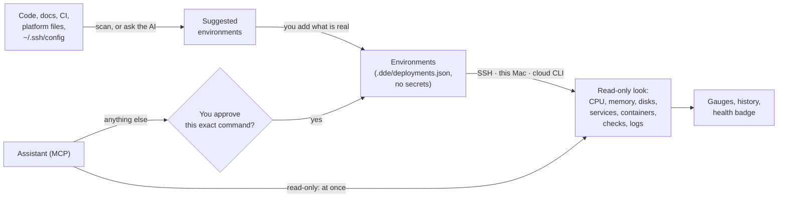

- **Services of a cloud place** — a Firebase, Fly or Vercel place lists what it runs, one row each: Firebase functions and hosting channels, Fly app and machines, Vercel deployments. Each row has a state badge (a hosting site's answer to a request from this Mac, a machine's state and health checks, a deployment's state), a button for its log (read-only, filterable, hand it to the assistant), and links to open it and its console page. Environment variables and secrets the CLIs print are never read.
- **Finds where it runs** — servers, platforms that are configured by files (Firebase: one place per project of `.firebaserc`, with hosting, functions and a signed-in CLI; Vercel, Fly.io, Heroku, Kubernetes, AWS, Google Cloud), and also the cloud database or cache behind them (Neon, Supabase,
  PlanetScale, Turso, Upstash, Amazon RDS, Azure, Aiven, CockroachDB, MongoDB Atlas: found by the
  hostnames the docs name and the libraries the code uses; the connection URL with its password is a
  secret: it is read only when you connect the database, see below). A scan reads the GitHub workflows, platform files (Vercel, Fly,
  Heroku, Netlify, Render, AWS, Google Cloud, Kubernetes, Terraform, Docker Compose), deploy
  scripts, docs and your `~/.ssh/config`, and lists the servers and services it finds with the
  evidence. **Ask AI to find where it runs** sends the assistant to read the same, look at the
  repository's GitHub environments with `gh`, and ask you for what it cannot know (a host behind a
  secret, the user, the key). It proposes; you add.
- **The whole picture.** For a server (over SSH) or this Mac: uptime, CPU load and memory with a
  short history, every disk, busiest processes, Docker containers, failed systemd services, and
  *checks* you define — a service, a container, a port, an HTTP health URL, PostgreSQL, Redis or
  MySQL answering, or any read-only command — as green and red lights, with one health badge. For a
  cloud service: the read-only commands of its CLI (`vercel ls`, `fly status`, `aws sts
  get-caller-identity`…) and HTTP checks. Logs of each place need no setup — the system's journal, errors, one log per service and per
  container — and any log can be sent to the assistant with **Ask AI**; every environment also has an
  **Ask the AI** box (*"Is the database fine?"*, *"Why is it slow?"*). When a provider's CLI is missing or signed
  out, the tab says how to install it and sign in.
- **Look into the database.** Connect a PostgreSQL database (Neon, Supabase, RDS, or one on your
  own server) from a `.env` file in the project or by pasting its connection string into your
  Keychain, and the environment shows how big it is, its connections, every table with an estimated
  row count and size, a table's columns, indexes, constraints and first rows, and a SQL box. Reads run
  at once inside a transaction the server itself keeps read-only (20 s limit, 500 rows); an `INSERT`,
  `UPDATE`, `DELETE` or `DROP` is shown to you and runs only after you approve that exact statement;
  psql meta-commands and `COPY … PROGRAM` never run. The password is read when you look, kept in
  memory, handed to `psql` over standard input (never in a command line) and removed from everything
  shown or logged; `.dde/deployments.json` names the file and variable, never the URL. `psql` is
  found in Homebrew's `libpq` (the tab offers to install it). The assistant has the same view through
  `markview_deployments_db`, without ever seeing the password.
- **Safe by construction.** SSH uses your agent or key file without prompts; MarkView stores no
  passwords or keys, and an unknown host key must be checked against its fingerprint before it is
  trusted (a *changed* key is never trusted). Everything MarkView runs is classified first:
  **read-only** commands (uptime, df, `docker ps`, `journalctl`, `systemctl status`, `kubectl get`…)
  run at once; **anything else** — a restart, an edit, a deploy — is shown to you with the host and
  runs only after you approve that exact command; commands that shut a machine down, wipe a disk
  or pipe a download into a shell **never run**. Every command is noted in
  `.dde/deployments-log.jsonl`.
- **The AI can work it too.** Through the *markview* MCP server (or the Skill, for agents without
  MCP) an assistant can read the state, look now, read logs, and run commands — with the same
  rules: it gets the answer of a read-only command at once, and for a restart it waits for you in the
  app; if you say no, it is told so. *"Why is staging slow? Look at the logs and the database."*

---

## Reading and writing

- **Markdown, WYSIWYG or source** (**⌘⇧P**) with Mermaid (full-screen viewer), interactive
  graph diagrams you edit by instruction, KaTeX math, footnotes, task lists, front matter,
  `[[wikilinks]]` and `file.ts#L40-L60` links. The WYSIWYG toolbar inserts images, rules, tables and
  diagrams.
- **Selection actions:** translate (RU / EN), explain, ask, challenge, expand, find edge
  cases, find contradictions, find related documentation, generate a diagram, research — or turn the
  text into a requirement, decision or question of the current feature.
- **Viewers:** CodeMirror 6 for 40+ languages, collapsible XML / plist trees, JSON Canvas,
  and an image viewer (PNG, JPEG, HEIC, WebP, SVG, RAW…) with zoom around the cursor, ←/→ through the
  folder and a slideshow on **Space**. **Archives** (zip, tar, tgz, 7z, rar, jar…) open as a list of
  entries you can extract.
- **Code navigation:** **⌘-click** (or **F12**) goes to a definition, **⌥⌘-click** (or **⇧F12**) finds
  usages, **⌘[** and **⌘]** go back and forward.
- **JSON and YAML you can edit** in the tree — double-click a value or a key, **+** and **×**
  on any line — or in a source editor with syntax checking. YAML keeps its comments; JSON keeps
  its indentation.
- **Data files as tables, with SQL.** CSV, TSV, PSV, JSON Lines / NDJSON, **Parquet** (snappy,
  zstd, gzip, brotli, lz4), **Arrow IPC / Feather**, **Avro** (null, deflate, snappy), **SQLite**
  databases, **Excel** and **OpenDocument** spreadsheets (every sheet) and **HAR** network logs
  open in a fast grid: sort by any column, filter each column (`>10`, `=x`, `null`),
  search everything, see column statistics and a schema panel, and query with real SQL (SQLite in
  WebAssembly) — `SELECT plant, AVG(height) FROM data GROUP BY plant`. Export or copy the result.
  Parquet and Arrow load up to 500,000 rows, and a SQL result shows up to 200,000.
- **Log viewer** for `.log` and `.out` files: levels (error, warn, info, debug…) with counts
  and filters, JSON log lines and stack traces understood, search with regex and *only
  matches*, **Next error**, wrap, and **Follow** to watch a growing log.
- **Search the whole project** (**⌘⇧K**): file names, the text of any UTF-8 file (up to 2 MB each),
  archive entry names, linked folders and **commands** (Git Pull, Show Deployments, New Feature, Toggle
  Theme…) in one palette. The index lives in memory and is rebuilt when you open the project. A meaning
  search over your Markdown documents (SQLite FTS5, kept in `.dde/state.db`) is the **Search → Documents**
  mode of the right panel. Find in file (**⌘F**) has case and regex.
- **Dictation** (🎤) in the terminal, intake forms, discussions, the feature chat and Prototype Studio —
  speech to text, up to ten minutes. In the terminal it types at the prompt and does not press Enter.
  Works without any key through macOS's built-in recognition on your Mac (pick its language in
  Settings → Voice input); with an OpenAI key it uses `whisper-1`, `gpt-4o-transcribe` or
  `gpt-4o-mini-transcribe` instead.
- **PDF export** (**⌘E**).

**Browser and app preview** (🌐)
- **Preview Web App (⌘6)** finds the project's web app (Vite, Next, Angular, Astro,
  Django, Rails, a static `index.html`…), starts its dev server when needed and shows
  `localhost` in a tab. Electron apps are previewed as a web page without starting Electron.
- **Browser (⌘5)** opens any address in a tab. **Save as Markdown** turns a page or a
  selection into a clean document in `docs/research` with its source and date.

---

## Workspace

| | |
|---|---|
| 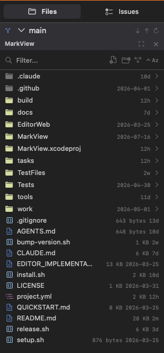 | 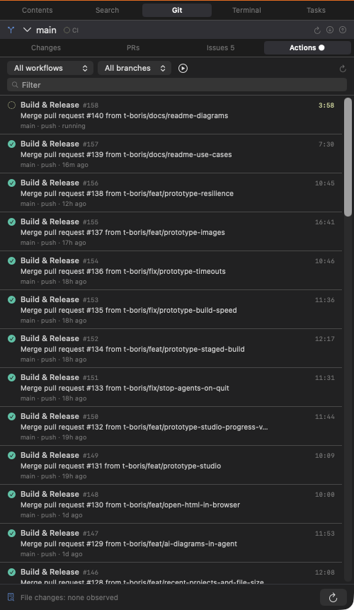 |
| **File tree**: branch, filter, sizes and ages at a glance. | **Git panel**: changes, pull requests, issues and Actions runs (GitHub is opt-in). |

- **File tree** with breadcrumbs, filter, sort and git status. Select several items
  (click, ⌘-click, ⇧-click) to **move, trash, stage, discard or copy paths** at once;
  **Rename…** any file or folder — open tabs follow. **Compress to .zip** and **Extract Here** work on
  archives.
- **Linked folders** bring outside folders into a project for browsing, search and AI
  context while git, features and bugs stay with the project.
- **Windows remember everything:** each window is its own project, and every window — its
  tabs, panels and size — comes back after a restart.
- **Project colours** tell windows apart at a glance, even in Mission Control.
- **A definition of done for Implement with AI.** Before a run you see what “done” means. There are 12
  built-in items: a fresh branch from `origin/main`, feature records and GitHub issues kept current,
  tests run, everything committed, a pull request with green CI (these seven are *Require* by default),
  merge (*Ask me*), and a version bump, deploy, MarkView browser check and manual test list (*Skip*). Mark
  each item *Require*, *Ask me* or *Skip*, add your own, and save it as the project's default
  (`.dde/definition-of-done.json`, also in Settings). The assistant gets it with the goal and must show
  evidence for every required item.
- **Edit source files** — code and text files (`.gitignore`, `.env`, `.swift`, `.js`, configs…) open read-only with syntax highlighting; **Edit** makes them editable (undo, Tab indents), the tab shows it is modified and ⌘S saves it. Tables, databases and logs keep their viewers.
- **Git** built in: branches, stage, commit, push, pull, diffs. The branch menu compares this branch with any other (or shows what another branch adds) in the PR X-Ray, and lists the repository's other working copies (worktrees) with their branches so you can open the one an agent works in. Right-click any file in the Git tab's Changes list to stage, unstage, commit just that file, discard, stop tracking, add to `.gitignore`, resolve a conflict (**Resolve with AI**, **Take Ours**, **Take Theirs**) or trash it. **GitHub** (opt-in, via
  `gh`): pull requests with review and merge, issues, Actions runs and logs with *Explain
  Failure* and *Fix with AI*, and a notification when a run on your branches finishes.
- **New Project…** starts a project from an idea in four steps (Idea, Clarify, Create, GitHub): the AI
  clarifies it, writes the first specification and README, initialises git and can publish it to GitHub.
  Drafts persist, and nothing is committed until you publish.
- **Project operations:** *Discover operations* in the X-Ray Deployment view finds the
  project's deploy, install, build, clean and restart commands. The **Deploy** button runs the
  deploy command after you confirm the exact command, with live output, Cancel and a notification when
  done; the other kinds start from **Run** in the Deployment details panel. The list is shared in
  `.markview/operations.json`.
- Light, dark and system themes; interface text from 80% to 200%.

---

## Keyboard shortcuts

| Keys | Action |
|---|---|
| ⌘O / ⌘⇧O | Open file / open folder |
| ⌘S | Save |
| ⌘⇧K | Search the project and run commands |
| ⌘1 · ⌘2 | File tree · Contents panel |
| ⌘3 | Agents (terminals) |
| ⌘4 | X-Ray |
| ⌘5 | Browser |
| ⌘6 | Preview Web App |
| ⌘7 | UI Studio |
| ⌃⌘D | Deployments |
| ⌃⌘I | Discussions |
| ⌘⇧P | WYSIWYG ↔ source |
| ⌘F | Find in file |
| ⌘E · ⌘⇧E | Export PDF · Export PDF Book… |
| ⌘⇧T | Toggle theme |
| ⌘⇧, | DDE Settings… |

---

## Install

1. **[Download MarkView.dmg](https://github.com/t-boris/MarkView/releases/latest/download/MarkView.dmg)**
   (the latest release; earlier versions are on the [Releases](https://github.com/t-boris/MarkView/releases) page).
2. Open it and drag **MarkView** onto **Applications**.

The app is signed with a Developer ID and notarized by Apple, so it opens without warnings.

### Requirements

- macOS 13 Ventura or later.
- **For AI**, one or more of these command-line agents, installed and signed in:
  [Claude Code](https://docs.anthropic.com/en/docs/claude-code),
  [Codex](https://github.com/openai/codex),
  [Cline](https://cline.bot) (3.x or newer),
  [GitHub Copilot CLI](https://github.com/github/copilot-cli) (1.x or newer) or
  Antigravity (`agy`, which signs in on first start).
  MarkView uses their sign-in and needs no provider key of its own.
- **Optional:** `git`; [`gh`](https://cli.github.com) for GitHub; an OpenAI API key
  (Settings) for cloud dictation — without it, dictation uses macOS's built-in recognition.

Settings (**⌘⇧,**, titled *DDE Settings…*) choose the assistant and model, the language of AI output, CLI
paths, the dictation language (built-in recognition) and the cloud model; the X-Ray model is the
**X-Ray · …** menu in the toolbar.

### Privacy and how AI runs

- Your files stay on your Mac. The project search index (⌘⇧K) lives in memory; the Markdown-documents
  index and other machine state live in the project's `.dde/` folder; features, bugs and research are
  ordinary files in your repository. MarkView is not sandboxed: it reads your project and runs your CLIs
  with your permissions.
- AI requests go through the agent CLIs you installed, under their accounts and terms.
  MarkView's own background calls (X-Ray, reviews, explanations) run them read-only. The
  agent terminals run with the agents' full-access flags — they act on your project as
  they would in any terminal.
- Network calls MarkView makes itself: the **usage chips** read your agents' stored sign-in and ask
  Anthropic's and ChatGPT's usage endpoints every five minutes while a chip is visible (turn them off
  under *Agent usage* in Settings); GitHub, only when you turn the integration on; OpenAI, only for
  dictation with a key; **remote images** in a PDF book are downloaded when you export it; HTTP checks
  you define in Deployments run from this Mac; and Remote Assistants use the relay you deploy. The
  editor loads two small scripts (Turndown, for saving WYSIWYG edits as Markdown) from jsDelivr; every
  other web library is bundled.
- Dictation without a key is recognized on your Mac and sends nothing anywhere; with an
  OpenAI key it sends the audio to OpenAI.

---

## Build from source

### Set up Xcode

Install the full [Xcode app](https://developer.apple.com/xcode/) and open it once. The
standalone Command Line Tools do not include `xcodebuild`, which the build scripts need.

```bash
sudo xcode-select --switch /Applications/Xcode.app/Contents/Developer
xcodebuild -version      # should print an Xcode version and build number
```

If `DEVELOPER_DIR` is set in your shell, update or unset it — it overrides `xcode-select`.
See Apple's [command-line tools guide](https://developer.apple.com/documentation/xcode/configuring-command-line-tools-settings).

### Build and install

```bash
git clone https://github.com/t-boris/MarkView.git
cd MarkView
./install.sh                 # Release build → /Applications (for development)
./release.sh --install       # signed build + DMG installer in build/, installed from the DMG
```

- `project.yml` is the source of truth for the Xcode project: after adding files or targets, run
  `./setup.sh` (it needs [XcodeGen](https://github.com/yonaskolb/XcodeGen)) to regenerate
  `MarkView.xcodeproj`.
- `release.sh` signs with the first *Developer ID Application* identity in your keychain and
  enables the hardened runtime. With a `notarytool` profile (`NOTARY_PROFILE`, default
  `markview-notary`) it notarizes and staples the DMG; `--publish` creates the GitHub
  release, only from a clean checkout of `origin/main`.
- CI compiles every push and pull request (Xcode 16). The signed DMG is published by
  `./release.sh --publish`; the manual *Publish Release* workflow can build one in CI when the signing
  secrets are configured.
- The bundled web libraries (CodeMirror, Cytoscape + ELK, xterm.js and the data-viewer bundle with
  SQLite WebAssembly, Parquet, Arrow, Avro and spreadsheet readers) are rebuilt with
  `cd tools/web-vendor && npm ci && ./build.sh`.
- There is no XCTest target; 96 focused standalone scripts live in `tools/tests/` (for example
  `tools/tests/lifecycle-tests.sh`), each checking a pure module, mostly by compiling it with `swiftc`.

<details>
<summary><b>Project layout</b></summary>

```
MarkView/
├── App/            MarkViewApp.swift: windows, menus, shortcuts, Finder "Open With"
├── Models/         ~170 files
│   ├── WorkspaceManager.swift        central state: tabs, files, AI routing, terminals
│   ├── ArchitectureStore / Scanner, XRayCluster, CodeArchitecture
│   │                                 X-Ray: scan, clustering, AI naming, overlays, PR X-Ray
│   ├── FeatureStore / FeatureAI, Discussion*, Research*, Prototype*
│   │                                 features, bugs, questions, reviews, research, prototypes
│   ├── AIAssistants / CLICompletion / ACPAssistant, Agent*
│   │                                 Claude Code, Codex, Cline, Copilot, Antigravity
│   ├── Deployment*, CloudServices, DatabaseExplorer, CommandPolicy   Deployments
│   ├── BookPDF*, BookBuilder, BookAnnotator                          PDF books, Book X-Ray
│   ├── TerminalSession.swift         PTY (forkpty) + xterm.js web view
│   ├── Browser*, TerminalBrowserBridge, WebAppPreview, WebClip       in-app browser, pages opened by agents
│   ├── GitClient, GitHubClient / Store / Publisher, IssueSync        Git and GitHub (gh)
│   ├── SemanticDatabase.swift        SQLite + FTS5 documents index (.dde/state.db)
│   ├── ProjectSearch.swift           in-memory ⌘⇧K index
│   ├── LifecycleAnalytics / LifecycleLog, DefinitionOfDone
│   ├── ProjectToolRunner, ControlToolRunner       the markview and markview-control MCP servers
│   └── Remote/                       Remote Assistants (relay client)
├── Views/          ~50 SwiftUI files: ContentView, EditorView (WKWebView), FileTreeView,
│                   FeaturePanelView, TerminalView, BrowserTabView, GitView, DeploymentsView,
│                   PrototypeStudioView…
├── Bridge/         WebViewBridge (Swift ↔ JS), PDFExporter, BookPDFRenderer,
│                   DataFileSchemeHandler, PrototypeSchemeHandler
└── Resources/Editor/
    ├── index.html, terminal.html, discussion.html, book.html
    └── vendor/js/  markview-*.js (editor, X-Ray, code viewer, data, canvas…),
                    CodeMirror, Cytoscape + ELK, xterm.js, d3, Mermaid, KaTeX, markdown-it, Prism
tools/              web-vendor (esbuild), tests (standalone checks), remote-relay
docs/               features, bugs, architecture, plans, images
```

Architecture notes: [`docs/architecture/`](docs/architecture/) — a reverse-engineered snapshot taken
at 2.17.0; its principles still hold, but when it disagrees with the code, the code wins.

</details>

## Tech stack

| | |
|---|---|
| App | Swift 5.9, SwiftUI + AppKit, WKWebView; 236 Swift files, about 85,000 lines; no Swift packages |
| Editor | markdown-it, Turndown, Mermaid, KaTeX, Prism, d3, Chart.js |
| Code viewer | CodeMirror 6 (47 grammars) |
| Data viewers | SQLite WebAssembly, Papa Parse, hyparquet, Apache Arrow, fflate |
| X-Ray | Cytoscape.js + ELK, Louvain clustering, git history |
| Terminals | xterm.js on a Swift-owned PTY |
| Storage | SQLite (C API) + FTS5; features and bugs as Markdown + YAML |
| AI | Claude Code, Codex and Antigravity CLIs; Cline and Copilot over ACP; macOS speech recognition or OpenAI for dictation |
| Agent tools | three local MCP servers: `markview`, `markview-browser`, `markview-control` |
| Distribution | Developer ID signed, notarized DMG |

## License

MIT, see [LICENSE](LICENSE).
