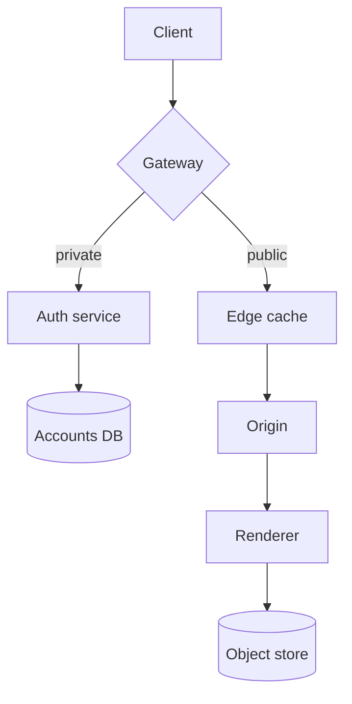
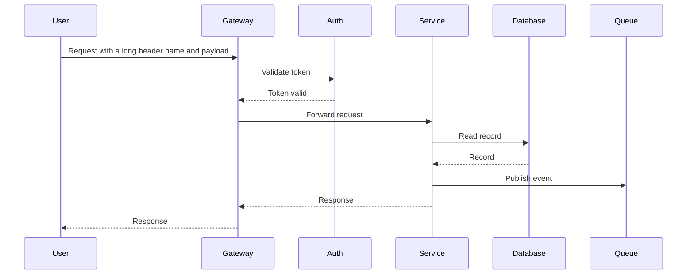
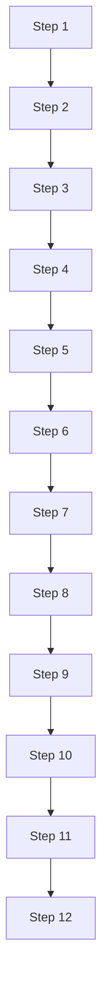

# Quarterly Platform Review

A short introduction that explains what this document is for. It mixes prose, lists, tables, code, formulas, diagrams and pictures so that every kind of block meets a page boundary somewhere in the PDF.

## 1. Summary

The platform shipped **three** major releases this quarter. Latency fell by *31 %*, and the on-call load fell by half. See the [project site](https://example.com/platform) for details, or the `deploy` command below.

> A good export keeps a quotation together with its author. This block should never be torn across two pages when it is short enough to fit on one.

- First point with a reasonably long sentence so that the list item wraps onto a second line inside the page width and shows the hanging indent properly.
- Second point
  - Nested point one
  - Nested point two with `inline code`
- Third point

1. Ordered step one
2. Ordered step two
3. Ordered step three

- [x] Done task
- [ ] Open task

## 2. Results

| Metric | Q2 | Q3 | Change |
| --- | ---: | ---: | ---: |
| p50 latency (ms) | 120 | 83 | -31 % |
| p99 latency (ms) | 910 | 540 | -41 % |
| Incidents | 14 | 7 | -50 % |
| Deploys per week | 22 | 35 | +59 % |

A wide table with many columns and long cell contents, which has to fit the printable width without being cut at the right edge:

| Service | Owner | Region | Runtime | Memory | CPU | Replicas | Notes |
| --- | --- | --- | --- | --- | --- | --- | --- |
| gateway-public-edge | Platform Networking | eu-central-1 | Go 1.22 | 512 MiB | 0.5 | 12 | Terminates TLS and applies rate limits to every inbound request |
| billing-reconciliation-worker | Payments | us-east-1 | Java 21 | 2 GiB | 2 | 4 | Runs nightly; long-running transactions are retried with backoff |
| search-indexer | Discovery | eu-west-1 | Rust 1.78 | 1 GiB | 1 | 6 | Rebuilds shards incrementally |

### 2.1 Pictures

A wide picture:


A tall picture that is taller than a page and must be scaled down, not cut:


A small picture should stay small and not be stretched:


### 2.2 Diagrams



A wide sequence diagram:



A tall flowchart:



## 3. Code

```swift
struct Release {
    let version: String
    let date: Date

    func summary() -> String {
        // A deliberately long line that has to wrap rather than run past the right margin of the page, because code is never clipped
        return "Release \(version) shipped on \(date.formatted(date: .abbreviated, time: .omitted)) with a very long description that keeps going"
    }
}
```

```bash
./release.sh --publish && gh release view v5.40.0 --json url,tagName,publishedAt,assets --jq '.assets[].name'
```

A long block of code that crosses a page boundary:

```python
def handler_00(event, context):
    return {'status': 'ok', 'handler': 0, 'echo': event.get('id')}

def handler_01(event, context):
    return {'status': 'ok', 'handler': 1, 'echo': event.get('id')}

def handler_02(event, context):
    return {'status': 'ok', 'handler': 2, 'echo': event.get('id')}

def handler_03(event, context):
    return {'status': 'ok', 'handler': 3, 'echo': event.get('id')}

def handler_04(event, context):
    return {'status': 'ok', 'handler': 4, 'echo': event.get('id')}

def handler_05(event, context):
    return {'status': 'ok', 'handler': 5, 'echo': event.get('id')}

def handler_06(event, context):
    return {'status': 'ok', 'handler': 6, 'echo': event.get('id')}

def handler_07(event, context):
    return {'status': 'ok', 'handler': 7, 'echo': event.get('id')}

def handler_08(event, context):
    return {'status': 'ok', 'handler': 8, 'echo': event.get('id')}

def handler_09(event, context):
    return {'status': 'ok', 'handler': 9, 'echo': event.get('id')}

def handler_10(event, context):
    return {'status': 'ok', 'handler': 10, 'echo': event.get('id')}

def handler_11(event, context):
    return {'status': 'ok', 'handler': 11, 'echo': event.get('id')}

def handler_12(event, context):
    return {'status': 'ok', 'handler': 12, 'echo': event.get('id')}

def handler_13(event, context):
    return {'status': 'ok', 'handler': 13, 'echo': event.get('id')}

def handler_14(event, context):
    return {'status': 'ok', 'handler': 14, 'echo': event.get('id')}

def handler_15(event, context):
    return {'status': 'ok', 'handler': 15, 'echo': event.get('id')}

def handler_16(event, context):
    return {'status': 'ok', 'handler': 16, 'echo': event.get('id')}

def handler_17(event, context):
    return {'status': 'ok', 'handler': 17, 'echo': event.get('id')}

def handler_18(event, context):
    return {'status': 'ok', 'handler': 18, 'echo': event.get('id')}

def handler_19(event, context):
    return {'status': 'ok', 'handler': 19, 'echo': event.get('id')}

def handler_20(event, context):
    return {'status': 'ok', 'handler': 20, 'echo': event.get('id')}

def handler_21(event, context):
    return {'status': 'ok', 'handler': 21, 'echo': event.get('id')}

def handler_22(event, context):
    return {'status': 'ok', 'handler': 22, 'echo': event.get('id')}

def handler_23(event, context):
    return {'status': 'ok', 'handler': 23, 'echo': event.get('id')}

def handler_24(event, context):
    return {'status': 'ok', 'handler': 24, 'echo': event.get('id')}

def handler_25(event, context):
    return {'status': 'ok', 'handler': 25, 'echo': event.get('id')}

def handler_26(event, context):
    return {'status': 'ok', 'handler': 26, 'echo': event.get('id')}

def handler_27(event, context):
    return {'status': 'ok', 'handler': 27, 'echo': event.get('id')}

def handler_28(event, context):
    return {'status': 'ok', 'handler': 28, 'echo': event.get('id')}

def handler_29(event, context):
    return {'status': 'ok', 'handler': 29, 'echo': event.get('id')}

def handler_30(event, context):
    return {'status': 'ok', 'handler': 30, 'echo': event.get('id')}

def handler_31(event, context):
    return {'status': 'ok', 'handler': 31, 'echo': event.get('id')}

def handler_32(event, context):
    return {'status': 'ok', 'handler': 32, 'echo': event.get('id')}

def handler_33(event, context):
    return {'status': 'ok', 'handler': 33, 'echo': event.get('id')}

def handler_34(event, context):
    return {'status': 'ok', 'handler': 34, 'echo': event.get('id')}

def handler_35(event, context):
    return {'status': 'ok', 'handler': 35, 'echo': event.get('id')}

def handler_36(event, context):
    return {'status': 'ok', 'handler': 36, 'echo': event.get('id')}

def handler_37(event, context):
    return {'status': 'ok', 'handler': 37, 'echo': event.get('id')}

def handler_38(event, context):
    return {'status': 'ok', 'handler': 38, 'echo': event.get('id')}

def handler_39(event, context):
    return {'status': 'ok', 'handler': 39, 'echo': event.get('id')}

def handler_40(event, context):
    return {'status': 'ok', 'handler': 40, 'echo': event.get('id')}

def handler_41(event, context):
    return {'status': 'ok', 'handler': 41, 'echo': event.get('id')}

def handler_42(event, context):
    return {'status': 'ok', 'handler': 42, 'echo': event.get('id')}

def handler_43(event, context):
    return {'status': 'ok', 'handler': 43, 'echo': event.get('id')}

def handler_44(event, context):
    return {'status': 'ok', 'handler': 44, 'echo': event.get('id')}

def handler_45(event, context):
    return {'status': 'ok', 'handler': 45, 'echo': event.get('id')}

def handler_46(event, context):
    return {'status': 'ok', 'handler': 46, 'echo': event.get('id')}

def handler_47(event, context):
    return {'status': 'ok', 'handler': 47, 'echo': event.get('id')}

def handler_48(event, context):
    return {'status': 'ok', 'handler': 48, 'echo': event.get('id')}

def handler_49(event, context):
    return {'status': 'ok', 'handler': 49, 'echo': event.get('id')}

def handler_50(event, context):
    return {'status': 'ok', 'handler': 50, 'echo': event.get('id')}

def handler_51(event, context):
    return {'status': 'ok', 'handler': 51, 'echo': event.get('id')}

def handler_52(event, context):
    return {'status': 'ok', 'handler': 52, 'echo': event.get('id')}

def handler_53(event, context):
    return {'status': 'ok', 'handler': 53, 'echo': event.get('id')}

def handler_54(event, context):
    return {'status': 'ok', 'handler': 54, 'echo': event.get('id')}

def handler_55(event, context):
    return {'status': 'ok', 'handler': 55, 'echo': event.get('id')}

def handler_56(event, context):
    return {'status': 'ok', 'handler': 56, 'echo': event.get('id')}

def handler_57(event, context):
    return {'status': 'ok', 'handler': 57, 'echo': event.get('id')}

def handler_58(event, context):
    return {'status': 'ok', 'handler': 58, 'echo': event.get('id')}

def handler_59(event, context):
    return {'status': 'ok', 'handler': 59, 'echo': event.get('id')}

def handler_60(event, context):
    return {'status': 'ok', 'handler': 60, 'echo': event.get('id')}

def handler_61(event, context):
    return {'status': 'ok', 'handler': 61, 'echo': event.get('id')}

def handler_62(event, context):
    return {'status': 'ok', 'handler': 62, 'echo': event.get('id')}

def handler_63(event, context):
    return {'status': 'ok', 'handler': 63, 'echo': event.get('id')}

def handler_64(event, context):
    return {'status': 'ok', 'handler': 64, 'echo': event.get('id')}

def handler_65(event, context):
    return {'status': 'ok', 'handler': 65, 'echo': event.get('id')}

def handler_66(event, context):
    return {'status': 'ok', 'handler': 66, 'echo': event.get('id')}

def handler_67(event, context):
    return {'status': 'ok', 'handler': 67, 'echo': event.get('id')}

def handler_68(event, context):
    return {'status': 'ok', 'handler': 68, 'echo': event.get('id')}

def handler_69(event, context):
    return {'status': 'ok', 'handler': 69, 'echo': event.get('id')}

```

## 4. Mathematics

Inline math such as $E = mc^2$ sits within a sentence, and display math stands alone:

$$
\int_0^\infty e^{-x^2}\,dx = \frac{\sqrt{\pi}}{2}
$$

## 5. Long prose

**Paragraph 1.** Reliable systems are built from boring parts that are understood completely. A long paragraph is useful in a test because it must break across lines and, when it is near the bottom edge of a page, across pages without losing a single line of text. Reliable systems are built from boring parts that are understood completely. A long paragraph is useful in a test because it must break across lines and, when it is near the bottom edge of a page, across pages without losing a single line of text. Reliable systems are built from boring parts that are understood completely. A long paragraph is useful in a test because it must break across lines and, when it is near the bottom edge of a page, across pages without losing a single line of text. 

**Paragraph 2.** Reliable systems are built from boring parts that are understood completely. A long paragraph is useful in a test because it must break across lines and, when it is near the bottom edge of a page, across pages without losing a single line of text. Reliable systems are built from boring parts that are understood completely. A long paragraph is useful in a test because it must break across lines and, when it is near the bottom edge of a page, across pages without losing a single line of text. Reliable systems are built from boring parts that are understood completely. A long paragraph is useful in a test because it must break across lines and, when it is near the bottom edge of a page, across pages without losing a single line of text. 

**Paragraph 3.** Reliable systems are built from boring parts that are understood completely. A long paragraph is useful in a test because it must break across lines and, when it is near the bottom edge of a page, across pages without losing a single line of text. Reliable systems are built from boring parts that are understood completely. A long paragraph is useful in a test because it must break across lines and, when it is near the bottom edge of a page, across pages without losing a single line of text. Reliable systems are built from boring parts that are understood completely. A long paragraph is useful in a test because it must break across lines and, when it is near the bottom edge of a page, across pages without losing a single line of text. 

**Paragraph 4.** Reliable systems are built from boring parts that are understood completely. A long paragraph is useful in a test because it must break across lines and, when it is near the bottom edge of a page, across pages without losing a single line of text. Reliable systems are built from boring parts that are understood completely. A long paragraph is useful in a test because it must break across lines and, when it is near the bottom edge of a page, across pages without losing a single line of text. Reliable systems are built from boring parts that are understood completely. A long paragraph is useful in a test because it must break across lines and, when it is near the bottom edge of a page, across pages without losing a single line of text. 

**Paragraph 5.** Reliable systems are built from boring parts that are understood completely. A long paragraph is useful in a test because it must break across lines and, when it is near the bottom edge of a page, across pages without losing a single line of text. Reliable systems are built from boring parts that are understood completely. A long paragraph is useful in a test because it must break across lines and, when it is near the bottom edge of a page, across pages without losing a single line of text. Reliable systems are built from boring parts that are understood completely. A long paragraph is useful in a test because it must break across lines and, when it is near the bottom edge of a page, across pages without losing a single line of text. 

**Paragraph 6.** Reliable systems are built from boring parts that are understood completely. A long paragraph is useful in a test because it must break across lines and, when it is near the bottom edge of a page, across pages without losing a single line of text. Reliable systems are built from boring parts that are understood completely. A long paragraph is useful in a test because it must break across lines and, when it is near the bottom edge of a page, across pages without losing a single line of text. Reliable systems are built from boring parts that are understood completely. A long paragraph is useful in a test because it must break across lines and, when it is near the bottom edge of a page, across pages without losing a single line of text. 

**Paragraph 7.** Reliable systems are built from boring parts that are understood completely. A long paragraph is useful in a test because it must break across lines and, when it is near the bottom edge of a page, across pages without losing a single line of text. Reliable systems are built from boring parts that are understood completely. A long paragraph is useful in a test because it must break across lines and, when it is near the bottom edge of a page, across pages without losing a single line of text. Reliable systems are built from boring parts that are understood completely. A long paragraph is useful in a test because it must break across lines and, when it is near the bottom edge of a page, across pages without losing a single line of text. 

**Paragraph 8.** Reliable systems are built from boring parts that are understood completely. A long paragraph is useful in a test because it must break across lines and, when it is near the bottom edge of a page, across pages without losing a single line of text. Reliable systems are built from boring parts that are understood completely. A long paragraph is useful in a test because it must break across lines and, when it is near the bottom edge of a page, across pages without losing a single line of text. Reliable systems are built from boring parts that are understood completely. A long paragraph is useful in a test because it must break across lines and, when it is near the bottom edge of a page, across pages without losing a single line of text. 

**Paragraph 9.** Reliable systems are built from boring parts that are understood completely. A long paragraph is useful in a test because it must break across lines and, when it is near the bottom edge of a page, across pages without losing a single line of text. Reliable systems are built from boring parts that are understood completely. A long paragraph is useful in a test because it must break across lines and, when it is near the bottom edge of a page, across pages without losing a single line of text. Reliable systems are built from boring parts that are understood completely. A long paragraph is useful in a test because it must break across lines and, when it is near the bottom edge of a page, across pages without losing a single line of text. 

**Paragraph 10.** Reliable systems are built from boring parts that are understood completely. A long paragraph is useful in a test because it must break across lines and, when it is near the bottom edge of a page, across pages without losing a single line of text. Reliable systems are built from boring parts that are understood completely. A long paragraph is useful in a test because it must break across lines and, when it is near the bottom edge of a page, across pages without losing a single line of text. Reliable systems are built from boring parts that are understood completely. A long paragraph is useful in a test because it must break across lines and, when it is near the bottom edge of a page, across pages without losing a single line of text. 

**Paragraph 11.** Reliable systems are built from boring parts that are understood completely. A long paragraph is useful in a test because it must break across lines and, when it is near the bottom edge of a page, across pages without losing a single line of text. Reliable systems are built from boring parts that are understood completely. A long paragraph is useful in a test because it must break across lines and, when it is near the bottom edge of a page, across pages without losing a single line of text. Reliable systems are built from boring parts that are understood completely. A long paragraph is useful in a test because it must break across lines and, when it is near the bottom edge of a page, across pages without losing a single line of text. 

**Paragraph 12.** Reliable systems are built from boring parts that are understood completely. A long paragraph is useful in a test because it must break across lines and, when it is near the bottom edge of a page, across pages without losing a single line of text. Reliable systems are built from boring parts that are understood completely. A long paragraph is useful in a test because it must break across lines and, when it is near the bottom edge of a page, across pages without losing a single line of text. Reliable systems are built from boring parts that are understood completely. A long paragraph is useful in a test because it must break across lines and, when it is near the bottom edge of a page, across pages without losing a single line of text. 

**Paragraph 13.** Reliable systems are built from boring parts that are understood completely. A long paragraph is useful in a test because it must break across lines and, when it is near the bottom edge of a page, across pages without losing a single line of text. Reliable systems are built from boring parts that are understood completely. A long paragraph is useful in a test because it must break across lines and, when it is near the bottom edge of a page, across pages without losing a single line of text. Reliable systems are built from boring parts that are understood completely. A long paragraph is useful in a test because it must break across lines and, when it is near the bottom edge of a page, across pages without losing a single line of text. 

**Paragraph 14.** Reliable systems are built from boring parts that are understood completely. A long paragraph is useful in a test because it must break across lines and, when it is near the bottom edge of a page, across pages without losing a single line of text. Reliable systems are built from boring parts that are understood completely. A long paragraph is useful in a test because it must break across lines and, when it is near the bottom edge of a page, across pages without losing a single line of text. Reliable systems are built from boring parts that are understood completely. A long paragraph is useful in a test because it must break across lines and, when it is near the bottom edge of a page, across pages without losing a single line of text. 

## 6. Notes

Every section above is a candidate for a page break. The heading of this section must never be left alone at the bottom of a page.[^1]

[^1]: A footnote that explains where this fixture came from and why it exists.

---

The end.
