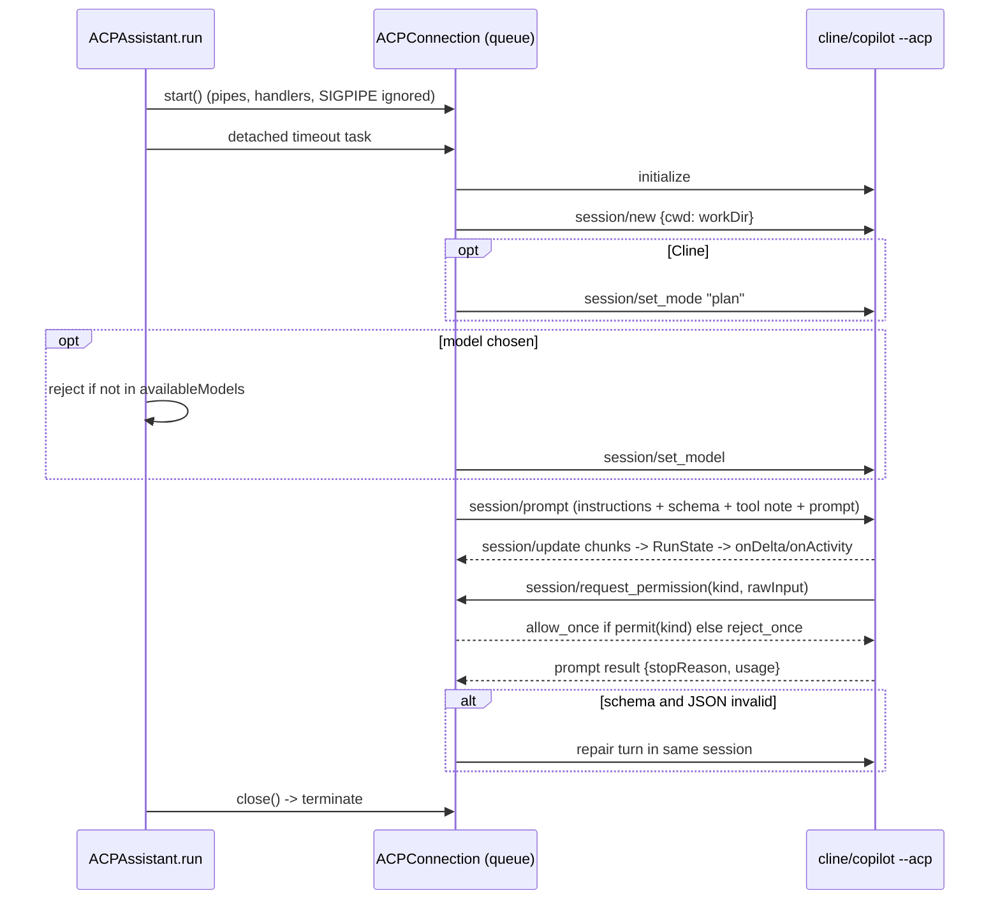
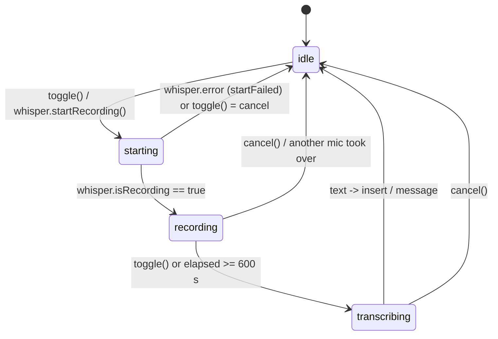

# AI Assistants, Code Explanation/Navigation, Embeddings and Dictation

Status (2026-11-15): every path and symbol in this doc was looked up mechanically in the code at `ac3001ba`; line citations were removed (they drift). Re-read against the code for this edit: where the moved handlers live (`CodeAndXRayCoordinator`, `DocumentTranslator`), the audit and AI-tool runs, and the embedding client. The rest keeps its 2.17.0 narrative and was not re-read.

Module documentation for the layer that turns "ask the AI" into a local CLI process
(Claude Code, Codex, Cline, GitHub Copilot) or an OpenAI HTTP call (Whisper, embeddings),
plus the code viewer's Explain / Go-to-definition / Ask-about-selection features and
voice dictation.

Sibling modules: [app-shell-and-workspace](app-shell-and-workspace.md) ·
[editor-and-bridge](editor-and-bridge.md) · [feature-workflow](feature-workflow.md) ·
[architecture-and-xray](architecture-and-xray.md) ·
[semantic-index-and-insight](semantic-index-and-insight.md) ·
[git-github-terminal-lifecycle-usage](git-github-terminal-lifecycle-usage.md) ·
[build-release-testing](build-release-testing.md)

---

## 1. Purpose and responsibilities

**Owns**

- Discovery, probing and login of the four assistant CLIs (`CLITool`, `CLIToolLocator`) —
  `MarkView/Models/AI/AIAssistants.swift`.
- The user's assistant/model choice, including a separate X-Ray model
  (`AIAssistantPreferences`) — `AIAssistants.swift`.
- An operation tied to an open window (End-to-End QA) takes the shown agent's tool but the model
  chosen for that tool in the project (`CLICompletion.Assistant.chosen`), never the model a running
  agent tab reports after a `/model` switch.
- One-shot, read-only completions for every in-app AI feature (`CLICompletion`), with
  streaming, structured (JSON Schema) output, token/cost accounting, timeout and
  cancellation — `MarkView/Models/AI/CLICompletion.swift`.
- The Agent Client Protocol (JSON-RPC over stdio) client for Cline and Copilot, including
  the read-only permission policy — `MarkView/Models/AI/ACPAssistant.swift`.
- The AI output language setting and the SHA-256 content hash helper —
  `MarkView/Models/AI/OutputLanguage.swift`.
- Canned prompts for the AI terminal (`AIPrompts`, `TerminalPrompt`) —
  `MarkView/Models/AI/AIPrompts.swift`.
- Code viewer margin notes (`CodeExplainStore`) — `MarkView/Models/Architecture/CodeExplainer.swift`.
- LSP-less navigation and "Ask AI about the selection" (`CodeNavigator`,
  `CodeNavigationStore`) — `MarkView/Models/Architecture/CodeNavigation.swift`.
- OpenAI clients: embeddings (`EmbeddingClient`) and Whisper transcription
  (`WhisperClient`) — `MarkView/Models/Insight/EmbeddingClient.swift`, `MarkView/Models/Dictation/WhisperClient.swift`.
- Dictation state machine and its SwiftUI controls — `MarkView/Models/Dictation/DictationController.swift`,
  `MarkView/Views/Dictation/DictationViews.swift`.
- The assistant/model picker used in DDE Settings — `MarkView/Views/AI/AIAssistantPickerView.swift`.

**Does not own**

- The interactive AI terminals (PTY, `TerminalSession`, `startupCommand`) — see
  [git-github-terminal-lifecycle-usage](git-github-terminal-lifecycle-usage.md). This module
  only supplies `CLITool`, the resolved path and `modelArgs`.
- The prompts/schemas of X-Ray, filters, Insight, GraphRAG, feature facilitation, PR
  review; those callers build `CLICompletion.Request`s themselves (see §4).
- Usage accounting storage (`SemanticDatabase.addUsage`) — only called via
  `CLICompletion.Result.record(in:)` (`Models/Insight/SemanticUsage.swift`: the AI layer knows no database).
- The JS side of the code viewer (`markview-code.js`) and the bridge transport — see
  [editor-and-bridge](editor-and-bridge.md).
- The toolbar assistant menu `AIToolbarMenu` lives in
  `MarkView/Views/Workspace/ContentView.swift` but edits the same keys documented here.

---

## 2. Files

| Path | Role |
|---|---|
| `MarkView/Models/AI/AIAssistants.swift` | `CLITool` enum, `AIModelOption`, `AIAssistantPreferences` (UserDefaults-backed choice + model catalogs), `CLIToolLocator` (path resolution, probing, generic process runner, Terminal login) |
| `MarkView/Models/AI/CLICompletion.swift` | `CLICompletion` (request/result/failure/activity types, argv building for Claude/Codex, strict-schema transform) and private `Invocation` (one CLI process: stdin feed, NDJSON stream parsing, timeout) |
| `MarkView/Models/AI/ACPAssistant.swift` | `ACPAssistant` (Cline/Copilot run, prompt composition, JSON repair, model refresh/cache) and private `ACPConnection` (JSON-RPC 2.0 over stdio, permission answers) |
| `MarkView/Models/AI/AIPrompts.swift` | The `TerminalPrompt` catalog for the AI terminal prompt bar. (The codebase-audit prompt is no longer here: `WorkspaceManager.runAudit` in `WorkspaceManager+AIToolRuns.swift` builds its own requests.) |
| `MarkView/Models/AI/OutputLanguage.swift` | `ActionOutputLanguage` (AI output language setting and prompt lines); `ContentHash` (SHA-256 hex) |
| `MarkView/Models/Architecture/CodeExplainer.swift` | `String.editorLines`, `CodeSection`, `CodeExplanation`, `@MainActor CodeExplainStore` (explain, rate, freshness, cache) |
| `MarkView/Models/Architecture/CodeNavigation.swift` | `CodeNavigator` (git grep / walk + regex definition detection), `@MainActor CodeNavigationStore` (history, go-to-definition, usages, AI Q&A), `AnswerBuffer`, `Notification.Name.codeNavEvent` |
| `MarkView/Models/Insight/EmbeddingClient.swift` | OpenAI embeddings client (`text-embedding-3-small`, 1536 dims), vector file I/O, cosine similarity, OpenAI key storage |
| `MarkView/Models/Dictation/WhisperClient.swift` | `@MainActor WhisperClient`: microphone permission, WAV recording, multipart upload to `/v1/audio/transcriptions`, self-test |
| `MarkView/Models/Dictation/DictationController.swift` | `@MainActor DictationController`: phase machine (idle/starting/recording/transcribing), elapsed timer, cap warning, cancel |
| `MarkView/Views/AI/AIAssistantPickerView.swift` | Settings picker: assistant segmented control, model list, custom model entry |
| `MarkView/Views/Dictation/DictationViews.swift` | `DictationButton`, `DictationStatusView`, `DictationInsertion` (cursor-aware insertion into an `NSTextView`) |

---

## 3. Key types

### `CLITool` (`AIAssistants.swift`)
`enum` of `claude`, `codex`, `cline`, `copilot`. `usesACP` is true for Cline/Copilot. Per-tool knowledge: binary name (= raw value), override key, auth
status args (`claude auth status`, `codex login status`, none for ACP tools),
login command, model flag (`--model` for Claude/Copilot, `-m` for Codex/Cline).

### `AIAssistantPreferences` (`AIAssistants.swift`)
Stateless namespace over `UserDefaults.standard`.
- `backend` — defaults to `.claude`.
- `model(for:)` — nil when empty (CLI default).
- `xrayModel(for:)` — X-Ray/Explain/rater model; defaults `sonnet` (Claude),
  `gpt-5.6-luna` (Codex), "" for ACP tools; "" falls back to `model(for:)`.
- `modelOptions(for:)` — Claude: fixed aliases `""`, `fable`, `opus`, `sonnet`,
  `haiku`; Codex: reads `~/.codex/models_cache.json` (entries with `visibility == "list"`,
  sorted by `priority`) and labels "Default" with `model =` from `~/.codex/config.toml`;
  Cline/Copilot: cached ACP model list. Must be called off-main for Codex (~350 KB JSON).
- `configuredModel(for:)` — reads `~/.claude/settings.json` `"model"` or Codex config.

### `CLIToolLocator` (`AIAssistants.swift`)
- `resolve(_:)` — override (must be executable) else first hit in
  `searchDirectories()`: extra PATH entries, `~/.local/bin`, `/opt/homebrew/bin`,
  `/usr/local/bin`, `~/.claude/local`, `~/bin`, `/usr/bin`, then every
  `~/.nvm/versions/node/*/bin` newest first. Pure filesystem; main-safe.
- `resolveViaLoginShell` — `/bin/zsh -lc "command -v <binary>"`, 10 s timeout.
- `resolveThorough` — scan, then login shell unless an override is set.
- `subprocessPath(toolPath:)` — the `PATH` given to every spawned CLI
  (tool dir, extra entries, Homebrew, system dirs, `~/.local/bin`, nvm bins; de-duplicated).
  Also reused by `GitHubClient` (`GitHubClient.swift`).
- `probe(_:)` / `probeACP` — version + auth status without spending
  tokens; for ACP tools, enforces min versions (Cline ≥ 3, Copilot ≥ 1) and opens an ACP
  session to list models.
- `run(_:_:timeout:)` — generic async process runner (see §7). Also used by
  `AgentUsageTracker` to call `/usr/bin/security` (`AgentUsageTracker.swift`).
- `openLoginInTerminal` — writes `~/Library/Application Support/MarkView/login-<tool>.command`
  (mode 0755) and opens it with `NSWorkspace` (no Apple Events).

### `CLICompletion` (`CLICompletion.swift`)
- `Request`: `prompt`, `systemPrompt`, `jsonSchema`, `readableFolder` (nil = no file
  access), `timeout` (default 180 s), `tool` (default `backend`), `model`, `effort`, `allowWeb`.
- `Result`: `text`, `structured`, token counts, `costUSD` (Claude only);
  `@MainActor record(in:)` adds to `SemanticDatabase` usage.
- `Failure`: `toolNotFound`, `failed`, `timedOut`, `invalidOutput`.
- `Activity`: `read`, `search`, `run`, `thinking`, `writing(Int)`, `answerDelta`.
- `run(_:onDelta:onActivity:)` — entry point for every in-app AI feature.
- `strictSchema` — OpenAI strict-mode transform for Codex.
- Private `Invocation` — `@unchecked Sendable`, all state on serial
  `DispatchQueue "markview.cli-completion"`.

### `ACPAssistant` / `ACPConnection` (`ACPAssistant.swift`)
- `ACPAssistant.run`, `refreshModels`, `cachedModels`,
  `parseJSON`.
- `ACPConnection` — `@unchecked Sendable`; state on `DispatchQueue "markview.acp"`; pending requests are `CheckedContinuation`s keyed by JSON-RPC id.
- `RunState` — lock-protected answer accumulator and token totals.

### `CodeExplainStore` — `@MainActor`, `ObservableObject` (`CodeExplainer.swift`)
Published `explanations`, `working`, `errors`, `revision`. Methods: `load`, `explain`,
`rate`, `freshness`, `isStale`, `payloadJSON`, `reset`. Limits: 4000 lines,
400 chars/line.

### `CodeNavigator` (enum) and `CodeNavigationStore` — `@MainActor` (`CodeNavigation.swift`)
`CodeNavigator.find` is synchronous and must run off-main. `CodeNavigationStore` holds back/forward stacks (max 100) and per-question answer `Task`s.

### `EmbeddingClient` (`EmbeddingClient.swift`)
Plain class (not actor-isolated). `embed`, `embedBatch`, `cosineSimilarity`,
`saveEmbedding`/`loadEmbedding` (raw little-endian `Float` bytes), `loadKey`/`saveKey`.

### `WhisperClient` — `@MainActor`, `ObservableObject` (`WhisperClient.swift`)
Published `isRecording`, `transcribedText`, `error`, `errorOpensSettings`. `static weak var active` enforces one
microphone app-wide. `generation` counter invalidates in-flight work on
`cancel()`.

Transcription failures go through `TranscriptionFailure` (end of `WhisperClient.swift`): the HTTP status and
OpenAI's `error.code` (or `type`, only if it is a snake_case identifier) become a problem, a next step and a tag
such as `(HTTP 401 · invalid_api_key)`; `URLError`s are mapped the same way. The response body is never shown or
logged — it is JSON and echoes part of the key (BUG-009). `fixInSettings` (key, model, unexplained 4xx) sets
`errorOpensSettings`, which `DictationController.opensSettings` carries to the **Open DDE Settings** button of
`DictationStatusView` (`DDESettingsWindow.show`, `MarkViewApp.swift`).

### `DictationController` — `@MainActor`, `ObservableObject` (`DictationController.swift`)
Owns a private `WhisperClient`; `Phase` = `idle | starting | recording(since:) | transcribing`.

---

## 4. Internal interfaces

### Who calls in

| Caller | Entry used | Notes |
|---|---|---|
| `CodeAndXRayCoordinator.handleSelectionAction` (`Models/Architecture/CodeAndXRayCoordinator.swift`) | `CLICompletion.run` | Translate/explain selection, 120 s |
| `DocumentTranslator.translate(markdown:targetLang:)` + chunk translation (`Models/Workspace/DocumentTranslator.swift`) | `AIAssistantPreferences.backend/model`, `CLIToolLocator.resolve`, `CLICompletion.run` | Engine fixed per document, 240 s |
| Recursive Insight start (`InsightCoordinator.start`, `Models/Insight/InsightCoordinator.swift`) | `CLIToolLocator.resolve` | Pre-flight check |
| `CodeAndXRayCoordinator.handleCodeAction` / `handleNavigation` | `CodeExplainStore.explain/rate/freshness`, `CodeNavigationStore.*` | From bridge `codeAction` messages (`EditorView.swift`) |
| `AITerminalsController.startupCommand` (`Models/Terminal/AITerminalsController.swift`) | `CLIToolLocator.resolve`, `CLITool.modelArgs`, `AIAssistantPreferences.model` | Interactive terminals |
| `WorkspaceManager.runAITool` (`runCritic`, `runAudit`, `runCodemap` in `WorkspaceManager+AIToolRuns.swift`) | `CLICompletion.Request` through the window's `aiJobs` | AI Tools menu; each run is an AI job shown in the jobs banner |
| `ArchitectureStore` (12 requests, e.g. `ArchitectureStore.swift`) | `CLICompletion.Request/run`, `xrayModel` | X-Ray; see [architecture-and-xray](architecture-and-xray.md) |
| `XRaySearch` (`XRaySearch.swift`) | `CodeNavigator.find/rank/sortUsages`, `CLICompletion.Request` | Symbol hints for ⚡ search, 900 s |
| `ImportanceRater.request` (`ImportanceRater.swift`) | `CLICompletion.Request`, `xrayModel` | 240 s, low effort |
| `FilterSearch` (`FilterSearch.swift`) | `CLICompletion.run` | 90 s, low effort |
| `InsightSession` (`InsightSession.swift`), `GraphRAG` (`GraphRAG.swift`) | `CLICompletion.run` | up to 1800 s; see [semantic-index-and-insight](semantic-index-and-insight.md) |
| `FeatureAssistant.run` (`FeatureAI.swift`) | `CLICompletion.run` with `readableFolder` + `allowWeb` | See [feature-workflow](feature-workflow.md) |
| `GitHubStore` (`GitHubStore.swift`) | `CLICompletion.run` | 300 s |
| `FeatureAssistant.voice` (`FeatureAI.swift`), `SourcesSection` (`FeaturePanelView.swift`) | `WhisperClient` | Voice notes |
| `FeatureIngest` (`FeatureIngest.swift`) | `WhisperClient().transcribe(fileURL:)` | Audio attachments |
| `TerminalSession.dictation` (`TerminalSession.swift`), `SessionDictationButton` (`TerminalView.swift`) | `WhisperClient` | Pasted at the prompt, not submitted |
| Intake sheet (`FeatureNavigatorView.swift`) | `DictationController`, `DictationButton`, `DictationInsertion`, `DictationStatusView` | Mic shown only when key set |
| `DDESettingsView` (`DDESettingsView.swift`) | key save, `AIAssistantPickerView`, probes, login, Whisper self-test | |
| `AIToolbarMenu` (`ContentView.swift`) | same `@AppStorage` keys, `modelOptions`, `ACPAssistant.refreshModels` | |
| `AgentUsageTracker` (`AgentUsageTracker.swift`) | `CLIToolLocator.resolve/run` | |

### What it calls

- `Process` (CLIs, `git`, `zsh`), `URLSession.shared` (OpenAI), `AVAudioRecorder` /
  `AVCaptureDevice` (mic), `NSWorkspace.open` (login script, System Settings URL).
- `SemanticDatabase.addUsage` via `Result.record` (`CLICompletion.swift`).
- `ArchitectureScanner.runTool` / `listFiles` for `git grep`, `git blame`, file walks
  (`CodeNavigation.swift`; `CodeExplainer.swift`).
- `ImportanceRater`, `FilterSearch`, `XRayDigest` from the X-Ray module for ratings and
  incremental JSON parsing (`CodeExplainer.swift`).
- `NotificationCenter` `.codeNavEvent` → `EditorView` (`EditorView.swift`) →
  `WebViewBridge.sendCodeNavEvent` → `window.onCodeNavEvent` (`WebViewBridge.swift`,
  `markview-code.js`).

---

## 5. Provider / CLI integration table

| Integration | Binary / endpoint | Model ids | Auth & where stored | Request / response format | Timeouts | Process & pipes | Cancellation |
|---|---|---|---|---|---|---|---|
| **Claude Code** (one-shot) | `claude` resolved by `CLIToolLocator.resolve` (`AIAssistants.swift`) | `--model` alias `fable`/`opus`/`sonnet`/`haiku` or custom; X-Ray default `sonnet` | CLI's own login (`claude auth login`); MarkView stores nothing. Status via `claude auth status` JSON `loggedIn` | argv: `-p --safe-mode --no-session-persistence --output-format stream-json --verbose --include-partial-messages --tools <Read,Grep,Glob?,WebSearch,WebFetch?>` + `--effort`, `--system-prompt`, `--json-schema` (`CLICompletion.swift`). Prompt on stdin. NDJSON events `stream_event` (text/input_json deltas), `assistant` (tool_use), `result` (`result`, `structured_output`, `total_cost_usd`, `usage`) | `Request.timeout` default 180 s, callers 90–1800 s; `queue.asyncAfter` → `terminate()` | `Invocation`: stdout/stderr `readabilityHandler` → serial queue; stdin written on a global queue then closed; stdout drained to EOF in `terminationHandler`; stderr tail 4000 chars | `withTaskCancellationHandler` → `Invocation.cancel()` → `terminate()` |
| **Codex** (one-shot) | `codex` | `-m <slug>` from `~/.codex/models_cache.json`; X-Ray default `gpt-5.6-luna` (`AIAssistants.swift`) | CLI's own login (`codex login`); status text match | argv: `[--search] exec --sandbox read-only --skip-git-repo-check --ephemeral --json --color never -C <dir>` + `-m`, `-c model_reasoning_effort=`, `--output-schema <tmp file>`, `-` (stdin) (`CLICompletion.swift`). System prompt prefixed as `<instructions>`. Events `item.started`, `item.completed` (`agent_message`), `turn.completed` usage, `turn.failed`, `error` | same as Claude | same `Invocation`; schema file `$TMPDIR/markview-cli/schema-<uuid>.json` deleted in `defer` | same |
| **Cline** (ACP) | `cline --acp [--thinking <effort>]` (`ACPAssistant.swift`) | Account models from ACP `session/new` → `models.availableModels[].modelId`, cached | `cline auth` in Terminal; MarkView stores nothing. No status command; sign-in inferred from error text (`AIAssistants.swift`) | JSON-RPC 2.0 NDJSON over stdio: `initialize` (protocolVersion 1, fs/terminal capabilities false), `session/new {cwd, mcpServers: []}`, `session/set_mode plan`, `session/set_model`, `session/prompt`; notifications `session/update` (`agent_message_chunk`, `agent_thought_chunk`, `tool_call`) (`ACPAssistant.swift`) | Detached `Task.sleep(request.timeout)` → `connection.fail(.timedOut)`. `refreshModels` has **no** timeout | `ACPConnection`: `readabilityHandler` on stdout/stderr → serial queue; line-buffered parse; stderr tail 3000 chars; writes are synchronous `FileHandle.write` on the queue | `onCancel` → `session/cancel` notification, fail pending, `terminate()` after 1 s |
| **GitHub Copilot CLI** (ACP) | `copilot --acp --no-auto-update --no-ask-user --disable-builtin-mcps --no-custom-instructions [--reasoning-effort e] --available-tools view grep glob` (`ACPAssistant.swift`) | Account models from ACP; `_meta.copilotUsage` shown as premium-request cost | `copilot login`; model list non-empty ⇒ signed in (`AIAssistants.swift`) | As Cline, no `set_mode`; `result.usage.inputTokens/outputTokens` summed (`ACPAssistant.swift`); chunks starting `Info: Disabled tools:` dropped | as Cline | as Cline | as Cline |
| **OpenAI Whisper** | `POST https://api.openai.com/v1/audio/transcriptions` (`WhisperClient.swift`) | `whisper-1` (default), `gpt-4o-transcribe`, `gpt-4o-mini-transcribe` | `Authorization: Bearer <key>`; key in **UserDefaults** `com.markview.dde.openai.apikey` (plaintext) | multipart/form-data: `model`, `prompt` (fixed domain hint), `file` named `audio.wav`, `Content-Type: audio/wav`; response JSON `text` | `30 + bytes/200_000` s | `URLSession.shared.data(for:)` | `Task.cancel()` via `cancel()`; `URLError.cancelled` swallowed |
| **OpenAI Embeddings** | `POST https://api.openai.com/v1/embeddings` (`EmbeddingClient.swift`) | `text-embedding-3-small`, `dimensions: 1536` | Bearer; same UserDefaults key | JSON `{model, input, dimensions}`; response `data[].embedding` (batch sorted by `index`) | 30 s single, 60 s batch | `URLSession.shared` | none (caller task) |
| **OpenAI key check** | `GET https://api.openai.com/v1/models` (`DDESettingsView.swift`) | — | Bearer, key from the text field | status 200 = valid; body `invalid_api_key` / `insufficient_quota` mapped | 10 s | `URLSession.shared` | none |
| **Login shell lookup** | `/bin/zsh -lc "command -v <binary>"` (`AIAssistants.swift`) | — | — | stdout path | 10 s | `CLIToolLocator.run` | timeout only |
| **git** (navigation, blame) | `/usr/bin/env git grep -n -I -w -F -z --untracked --max-count 400 …` (`CodeNavigation.swift`); `git blame --line-porcelain` (`CodeExplainer.swift`) | — | — | NUL-separated `path\0line\0text` | **none** | `ArchitectureScanner.runTool`: reads stdout to EOF then `waitUntilExit`, stderr → `/dev/null` (`ArchitectureScanner.swift`) | none |

---

## 6. Runtime flows

### 6.1 Pick an assistant and model

1. User picks in DDE Settings (`AIAssistantPickerView`) or the toolbar (`AIToolbarMenu`,
   `ContentView.swift`). Both write `@AppStorage` keys `settings.ai.backend` and
   `settings.cli.<tool>Model` (`AIAssistantPickerView.swift`).
2. On appear, the picker loads catalogs in `Task.detached` (`AIAssistantPickerView.swift`).
   For ACP tools with only the "Default" row, it resolves the binary and calls
   `ACPAssistant.refreshModels`, which starts the CLI, runs `initialize` + `session/new` in
   `$TMPDIR`, caches the list in `settings.cli.<tool>Models` and closes (`ACPAssistant.swift`).
3. `AITerminalPanel` observes the same keys and calls `aiBackendChanged` / `aiModelChanged`,
   which restart the shown terminal (`TerminalView.swift`, `WorkspaceManager.swift`).
4. In-app features read `AIAssistantPreferences` at send time (`CLICompletion.swift`).
5. A model switched *inside* a Claude Code session (`/model`) never passes through the pickers
   (BUG-048). `AgentActivityMonitor` already tails each terminal's own session log every 3 s;
   for Claude it also reads the model with `ClaudeSessionModel.reading` (replies of the session
   itself, `/model` confirmations, not subagents, only lines since the shell started).
   `AITerminalsController.liveModelReported` then renames that tab, and
   `AIAssistantPreferences.remember` stores the model for the project and for the defaults, so the
   next start uses it instead of the old choice. Nothing restarts: `aiModelChanged` restarts an
   agent only for a pick made in MarkView after it started (`ModelPickLog`, set by
   `AssistantChoice.setModel`), never for a remembered model.
6. The Agents header has its own model menu (`AgentModelMenu`, `AITerminalsController.switchModel`).
   For Claude Code it pastes `/model <alias>` and Enter into the running session, so the
   conversation goes on and step 5 renames the tab and remembers the model once the log confirms it
   (`TerminalSession.pendingModelPick` tells such a pick from the model the session started with).
   The menu is off while the agent works. Any other assistant is relaunched with the chosen model,
   continuing its last conversation where the CLI can (`CLITool.continueArgs`; not Cline). The relaunch
   is explicit because the panel's observer follows only the project's own assistant, so a Copilot tab
   beside a Claude project would not restart. `AgentActivityParser.claude` ignores the entries of the CLI's
   own commands (`<command-name>`, `<local-command-*>`): after `/model` the agent still waits for the user.

### 6.2 One-shot completion via Claude/Codex

```mermaid
sequenceDiagram
    participant F as Feature (MainActor)
    participant C as CLICompletion.run
    participant I as Invocation (queue)
    participant P as claude / codex
    F->>C: Request(prompt, system, schema, folder, timeout)
    C->>C: resolve tool path (throws toolNotFound)
    C->>C: build argv; Codex: write schema tmp file
    C->>I: start() within withTaskCancellationHandler
    I->>P: run(); stdin <- prompt (global queue), close
    I->>I: schedule terminate() after timeout
    P-->>I: NDJSON on stdout (readabilityHandler)
    I-->>F: onDelta / onActivity callbacks (background threads)
    P-->>I: exit -> terminationHandler drains stdout
    I->>C: finish(): cancelled / timedOut / error / exit!=0 / empty / Output
    C->>C: Codex: parse text as JSON if schema
    C-->>F: Result (text, structured, tokens, cost)
    F->>F: result.record(in: db)
```

Working directory: `readableFolder` or the empty `$TMPDIR/markview-cli` (`CLICompletion.swift`). Claude gets `Read,Grep,Glob` only with a folder, `WebSearch,WebFetch` only with
`allowWeb`. Codex always runs `--sandbox read-only`.

### 6.3 ACP session (Cline / Copilot)



Permission policy (`ACPAssistant.swift`): no `readableFolder` ⇒ deny all; `search` ⇒
allow; `read` ⇒ allow only when every path in `files[].path`, `path`, `paths` resolves
inside the root; anything else (`execute`, `edit`, `fetch`, …) ⇒ deny. Unknown
agent→client requests get JSON-RPC error `-32601`.

### 6.4 Embedding request

`EmbeddingClient.embed(text:)` / `embedBatch(texts:)` POST to OpenAI and return `[Float]`
(`Models/Insight/EmbeddingClient.swift`). **Nothing creates an `EmbeddingClient` now** (`git grep "EmbeddingClient("` finds no
call): only its two static key helpers are used, `loadKey()` / `saveKey(_:)` from `DDESettingsView`, and they delegate to
`WhisperClient.loadAPIKey` / `saveAPIKey` (the Keychain). `SemanticDatabase` has a
`chunks.embedding_file` column and `.dde/cache/embeddings` is created by `ProjectContext.openDatabase`, but nothing writes vectors.

### 6.5 Dictation: record → transcribe → insert (intake sheet)



1. `DictationButton` captures `NSApp.keyWindow` and calls `toggle` (`DictationViews.swift`).
2. `WhisperClient.startRecording` checks `AVCaptureDevice` authorization, prompting if
   undetermined; a `generation` check drops a late grant after cancel (`WhisperClient.swift`).
3. `beginRecording` cancels any other active client, records 16 kHz mono 16-bit PCM WAV to
   `$TMPDIR/markview_whisper_<uuid>.wav` with `record(forDuration: 600)`.
4. Ticker (0.5 s `Timer`) updates `elapsed`; at 600 s the controller stops itself
   (`DictationController.swift`); `nearLimit` warns in the last 30 s.
5. `stop()` → `whisper.stopRecording()` validates file size > 100 bytes, runs
   `transcribe` in a child `Task`, deletes the file in `defer` (`WhisperClient.swift`).
6. If `session` is unchanged, a trimmed non-empty transcript goes to
   `DictationInsertion.insert`: into the focused `NSTextView` of the original window at the
   selection via `insertText(_:replacementRange:)` (one undo step), else appended to the
   binding, adding spaces as needed (`DictationViews.swift`). Empty ⇒ "No speech recognized."

Terminal variant: `SessionDictationButton` (`TerminalView.swift`) owns no controller;
it calls `stopRecording` and `session.paste(text)` without Enter.

### 6.6 Explain a code file

`codeAction "explain"` → `CodeExplainStore.explain` (`CodeExplainer.swift`):
numbered lines (≤4000, ≤400 chars each) → `CLICompletion.Request` with the explain schema,
`xrayModel`, `effort = "low"`, `timeout = 600`, **no** readable folder. `answerDelta`
activity feeds `receive`, which every 700 ms re-parses completed `sections` objects with
`XRayDigest.completedObjects` for a live preview. The final result is clamped,
sorted and saved to `.dde/cache/explain/<sha256(path)[0..24]>.json`.
`rate` first applies provisional keyword levels from `FilterSearch`, then asks
`ImportanceRater`. `freshness` runs `git blame` detached, no AI.

### 6.7 Go to definition / usages / ask about selection

`CodeNavigationStore.goToDefinition` (`CodeNavigation.swift`) runs
`CodeNavigator.find` in `Task.detached`, ranks definitions (kind, same file, non-test,
same language family, shared folder depth), jumps directly if exactly one
(non-test) declaration, else sends a list; on a declaration or with none it lists usages.
`ask` sends the snippet (≤40 000 chars), the last 6 Q/A turns and the question
with `readableFolder: root`, `timeout = 600`, streaming via `AnswerBuffer` (≤ every 150 ms). All results reach JS as `.codeNavEvent` JSON.

---

## 7. State and persistence

### UserDefaults / `@AppStorage` keys

| Key | Type | Written by | Read by |
|---|---|---|---|
| `settings.ai.backend` | String (`CLITool.rawValue`) | picker, toolbar menu | `AIAssistantPreferences.backend` (`AIAssistants.swift`) |
| `settings.cli.<tool>Model` (`claudeModel`, `codexModel`, `clineModel`, `copilotModel`) | String, "" = CLI default | picker, toolbar | `model(for:)` |
| `settings.xray.<tool>Model` | String, "" = general model | toolbar menu (`ContentView.swift`) | `xrayModel(for:)` (`AIAssistants.swift`) |
| `settings.cli.<tool>Path` | String, "" = auto-detect | Settings (`setOverride`) | `override(for:)` |
| `settings.cli.extraPATH` | String, `:` or newline separated | Settings (`DDESettingsView.swift`) | `extraPathEntries` (`AIAssistants.swift`) |
| `settings.cli.clineModels`, `settings.cli.copilotModels` | Data (JSON `[{id,name,detail}]`) | `refreshModels` (`ACPAssistant.swift`) | `cachedModels` |
| `actions.outputLanguage` | String (`"document"` or language name) | Settings (`DDESettingsView.swift`) | `ActionOutputLanguage.current` (`OutputLanguage.swift`) |
| `com.markview.dde.openai.apikey` | String (**plaintext OpenAI key**) | `EmbeddingClient.saveKey` (`EmbeddingClient.swift`) | `EmbeddingClient.loadKey`, `WhisperClient.apiKey/hasAPIKey` (`WhisperClient.swift`), intake sheet `@AppStorage` (`FeatureNavigatorView.swift`) |
| `settings.whisper.model` | String | Settings picker (`DDESettingsView.swift`) | `WhisperClient.selectedModel` (`WhisperClient.swift`) |

### Files

| Path | Content | Lifetime |
|---|---|---|
| `<workspace>/.dde/cache/explain/<sha256(path) prefix 24>.json` | `CodeExplanation` (ISO-8601 dates; temporary filter ratings stripped, `CodeExplainer.swift`) | Until "Remove Metadata" |
| `~/Library/Application Support/MarkView/login-<tool>.command` | Login shell script, 0755 (`AIAssistants.swift`) | Overwritten per login; never deleted |
| `$TMPDIR/markview-cli/` | Empty cwd for folderless runs (`CLICompletion.swift`) | Persistent directory |
| `$TMPDIR/markview-cli/schema-<uuid>.json` | Codex strict schema (`CLICompletion.swift`) | Deleted after the run |
| `$TMPDIR/markview_whisper_<uuid>.wav` | Recording | Deleted after stop or cancel (`WhisperClient.swift`) |
| Read-only: `~/.claude/settings.json`, `~/.codex/config.toml`, `~/.codex/models_cache.json` | Model defaults / catalog | Owned by the CLIs |

In-memory only: `CodeNavigationStore.back/forward` (≤100), answer tasks; `CodeExplainStore`
`activity`, `liveAnswers`, `errors`.

---

## 8. Concurrency and threading

- **Main-actor types**: `CodeExplainStore`, `CodeNavigationStore`, `WhisperClient`,
  `DictationController`. `CLICompletion`, `ACPAssistant`, `CLIToolLocator`, `CodeNavigator`,
  `EmbeddingClient` are non-isolated.
- **`CLIToolLocator.run`** (`AIAssistants.swift`): the whole run is on
  `DispatchQueue.global(.userInitiated)`; each pipe is drained by `readDataToEndOfFile` on
  its own `.utility` queue; the waiter polls `isRunning` every 50 ms up to the
  deadline, then `terminate()`, then `waitUntilExit()` and waits up to
  5 s for the drains. `waitUntilExit` is never on the main thread here.
- **`Invocation`** (`CLICompletion.swift`): no `waitUntilExit` at all; completion is driven
  by `terminationHandler`. Pipes are drained continuously via `readabilityHandler`; stdin
  is written off the queue so a big prompt cannot deadlock against stdout.
  SIGPIPE is ignored process-wide once.
- **`ACPConnection`**: same handler pattern; `signal(SIGPIPE, SIG_IGN)` on every `start()`
  (`ACPAssistant.swift`). Continuations resumed only on the serial queue; `failAll`
  resumes every pending one.
- **Callbacks**: `onDelta`/`onActivity` fire on the private queues; main-actor callers
  hop with `Task { @MainActor in … }` (`CodeExplainer.swift`, `CodeNavigation.swift`).
- **`ArchitectureScanner.runTool`** (used for `git grep`, `git rev-parse`, `git blame`) reads
  stdout to EOF before `waitUntilExit` — synchronous, so callers must be off-main:
  `CodeNavigator.find` is called from `Task.detached` (`CodeNavigation.swift`)
  and `freshness` uses `Task.detached` (`CodeExplainer.swift`). `XRaySearch.symbolHints`
  calls `find` synchronously (`XRaySearch.swift`) — its caller must be off-main (see
  [architecture-and-xray](architecture-and-xray.md)).
- **`WhisperClient.transcribe`** is main-actor isolated: `Data(contentsOf:)` of up to
  ~19 MB and the multipart body build happen on the main thread (`WhisperClient.swift`).
  The network await itself suspends.
- **Timers**: `DictationController` ticker is a main run-loop `Timer` (`DictationController.swift`).

---

## 9. Error handling and edge cases

- **Missing CLI**: `CLICompletion.run` throws `toolNotFound` with the searched directories or
  the bad override (`CLICompletion.swift`). Translation and Insight pre-check with
  `resolve` and show an alert/message (`WorkspaceManager.swift`).
- **Exit/termination**: `finish()` ordering — cancelled → timed out → reported error → non-zero
  exit (with last 600 chars of stderr) → empty answer (Codex warning if any) → success
  (`CLICompletion.swift`).
- **Codex errors**: raw JSON errors are unwrapped; model-related messages point to the model
  menu. `error` events are non-fatal warnings.
- **Claude `is_error`**: turns the result text into a failure.
- **Structured output**: Claude supplies `structured_output`; Codex's text is parsed as JSON; an ACP answer whose JSON is still open is continued for up to 10 turns, joined
  without the repeats and restarts a resuming model produces (`ACPAssistant.answer`/`join`), then
  gets one repair turn, then `invalidOutput` naming the turns spent (BUG-045).
  Completeness is read from `jsonRegions`, every top-level brace region of the answer: a model
  that narrates before answering can close an object inside the narration, and only the last
  region decides whether the answer is finished (BUG-049). `parseJSON` accepts raw, fenced,
  any complete brace region (largest first) or outermost-brace JSON with all `required` keys.
- **ACP model**: an id not in `availableModels` fails fast (Cline would otherwise answer
  nothing). `stopReason` `cancelled` → `CancellationError`; `refusal` → failure.
- **ACP process death**: `terminationHandler` fails all pending requests with the stderr tail;
  a Cline SIGKILL is explained as the npm package's invalid code signature with the
  `codesign` fix (`ACPAssistant.swift`; also `AIAssistants.swift`).
- **Auth hints**: JSON-RPC errors mentioning auth append the login command
  (`ACPAssistant.swift`).
- **Explain**: sections are clamped to the file (`CodeExplainer.swift`); unknown
  importance → `normal`; files over 4000 lines explain only the head. Stale
  detection = content hash or output language changed. Cache write failure is
  shown as an error.
- **Navigation**: non-navigable names (keywords, <2 or >120 chars) return nothing
  (`CodeNavigation.swift`); >4000 hits ⇒ `truncated`; lines >1000 chars are
  skipped; non-git folders use a walk that skips dotfiles and files ≥1 MB.
  `navOpen` only opens files inside the root (`WorkspaceManager.swift`).
- **Whisper**: denied mic, missing key, empty file (<100 bytes), non-200 status (body prefix
  300) and parse failures set `error` (`WhisperClient.swift`); cancellation is silent. Starting a second microphone cancels the first; the
  controller then returns to idle without inserting (`DictationController.swift`).
- **Dictation insertion** never replaces the whole field and never touches another window's
  text view (`DictationViews.swift`).

---

## 10. Extension recipes

**Add a new CLI assistant (one-shot, like Claude/Codex)**
1. Add a case to `CLITool` and fill `displayName`, `usesACP`, `authStatusArgs`, `loginCommand`,
   `modelArgs` (`AIAssistants.swift`).
2. Add catalog/default logic to `AIAssistantPreferences.modelOptions`, `defaultXRayModel`,
   `configuredModel` and login parsing in `CLIToolLocator.probe`.
3. Add argv construction in `CLICompletion.run`'s `switch tool` (`CLICompletion.swift`)
   and an event parser in `Invocation.consume`/`handle<Tool>`.
4. Add `@AppStorage` bindings in `AIAssistantPickerView` (`AIAssistantPickerView.swift`),
   `AIToolbarMenu` (`ContentView.swift`) and `AITerminalPanel` (`TerminalView.swift`).
5. Add the startup command case in `WorkspaceManager.startupCommand` (`WorkspaceManager.swift`)
   and a `TerminalProfile` (`TerminalSession.swift`).

**Add an ACP-based assistant**: set `usesACP` true, add a `Profile` in
`ACPAssistant.profile` (arguments, read-only mode, notice prefix; `ACPAssistant.swift`),
the minimum version in `probeACP` (`AIAssistants.swift`), and steps 4–5 above.

**Add an AI feature**: build a `CLICompletion.Request` (set `readableFolder` only if the
model must read files, `jsonSchema` for structured output — declare every key, since Codex's
strict transform drops open objects, `CLICompletion.swift`), call `CLICompletion.run`
from a cancellable `Task`, and call `result.record(in: db)`. Append
`ActionOutputLanguage.explanationLine()` or `promptLine(for:)` to the system prompt.

**Add a terminal prompt button**: append a `TerminalPrompt` to `TerminalPrompt.all`
(`AIPrompts.swift`), using `{file}` / `{pr}` and `input`.

**Add a dictation field**: hold a `@StateObject DictationController`, overlay a
`DictationButton` only when the OpenAI key is non-empty, call `DictationInsertion.insert`
with the field's focus state, place `DictationStatusView` below, and `cancel()` on disappear
(pattern: `FeatureNavigatorView.swift`).

**Add an output language**: append to `ActionOutputLanguage.options` (`OutputLanguage.swift`).

---

## 11. Risks, tech debt, oddities

1. **OpenAI key in plaintext UserDefaults**, not Keychain (`EmbeddingClient.swift`,
   `WhisperClient.swift`). It lands in `~/Library/Preferences/<bundle>.plist`. The key
   constant is duplicated in two files and bound via `@AppStorage` in a view
   (`FeatureNavigatorView.swift`).
2. **Transcript logged to the system log**: `NSLog("[Whisper] Transcribed: \(text.prefix(100))")`
   (`WhisperClient.swift`) writes user speech to unified logging, contrary to the
   CLAUDE.md rule on document contents.
3. **`EmbeddingClient` is dead code** for requests: `embed`/`embedBatch` have no callers;
   the Settings box is titled "OpenAI (Whisper voice input)" yet saves via
   `EmbeddingClient.saveKey` (`DDESettingsView.swift`). `chunks.embedding_file` and
   `.dde/cache/embeddings` are unused scaffolding.
4. **ACP permission gaps** (`ACPAssistant.swift`): `search` is allowed regardless of
   the paths it names; `read` path checks use `standardizedFileURL`, which does not resolve
   symlinks, so a symlink inside the project can expose files outside it. When
   `readableFolder` is nil the model is told not to use tools but `cwd` is the shared
   `$TMPDIR/markview-cli`.
5. **No SIGKILL escalation**: timeouts and cancel call `terminate()` (SIGTERM) only
   (`CLICompletion.swift`; `ACPAssistant.swift`; `AIAssistants.swift`). A
   CLI that ignores SIGTERM keeps `Invocation` pending forever and makes
   `CLIToolLocator.run` block a GCD worker in `waitUntilExit()` (`AIAssistants.swift`).
6. **`refreshModels` has no timeout** (`ACPAssistant.swift`) and is triggered
   automatically on picker/menu appear (`AIAssistantPickerView.swift`,
   `ContentView.swift`) and on every probe (`AIAssistants.swift`). A CLI stuck on
   `initialize` (e.g. waiting for sign-in) leaks a process and never finishes the task.
7. **`CLIToolLocator.run` busy-polls** with `usleep(50_000)` on a global-queue thread for up
   to the timeout (`AIAssistants.swift`) — blocks a worker per probe (up to 5 probes
   × 2 runs on Settings appear, `DDESettingsView.swift`).
8. **System prompt and JSON schema passed as argv for Claude** (`CLICompletion.swift`):
   visible in `ps`, and bounded by `ARG_MAX`, unlike the prompt (stdin).
9. **Whisper upload metadata hard-coded**: `filename="audio.wav"`, `Content-Type: audio/wav`
   (`WhisperClient.swift`), but `FeatureIngest` sends arbitrary audio files
   (`FeatureIngest.swift`) with no 25 MB check; errors there are discarded (fresh
   client, `?? ""`).
10. **Main-thread file I/O in `transcribe`** (`WhisperClient.swift`) — up to ~19 MB
    read and copied into the multipart body on the main actor.
11. **Explain tasks are not cancellable or folder-scoped**: `explain`/`rate` start unstored
    `Task`s (`CodeExplainer.swift`); `reset()` does not cancel them,
    so a result for the previous folder can be written into the new store and saved to the
    old directory. `freshness` can overwrite a newer explanation captured before its await.
12. **`git` calls without timeout**: `ArchitectureScanner.runTool` has none
    (`ArchitectureScanner.swift`); a huge repo `git grep` / `git blame` has no bound
    beyond `--max-count 400` per file. `runTool` returns nil on non-zero exit, so a real git
    error in `gitGrep` looks like "no matches" (`CodeNavigation.swift`).
13. **`git grep --untracked`** searches untracked-but-not-ignored files, including dotfiles,
    while the walk fallback deliberately skips dotfiles as possible secrets
    (`CodeNavigation.swift` vs). Results are shown and, via `XRaySearch`,
    only paths/lines are sent to the AI.
14. **AI terminal runs Claude with `--dangerously-skip-permissions` after `claude update`**
    (`WorkspaceManager.swift`) — the read-only guarantees of this module apply to
    `CLICompletion` only, not the terminal.
15. **Login script interpolation**: the user-configurable tool path is embedded in a
    double-quoted zsh string (`AIAssistants.swift`); a path containing `"`/`$()`
    would be executed by the shell. Low impact (user-controlled).
16. **Hard-coded model ids** that may go stale: `gpt-5.6-luna` X-Ray default
    (`AIAssistants.swift`), Claude aliases, Whisper list (`WhisperClient.swift`),
    embedding model (`EmbeddingClient.swift`).
17. **Toolbar/Settings duplication**: the `@AppStorage` key set and model-loading logic are
    repeated in `AIAssistantPickerView`, `AIToolbarMenu` and `AITerminalPanel`; adding
    a tool needs edits in all three.
18. **`EmbeddingClient.loadEmbedding` trusts file length** — binds bytes to `Float` with no
    dimension check (`EmbeddingClient.swift`).
19. **Terminal mic button** is shown without a key and only reports the missing key in its
    tooltip (`TerminalView.swift`), unlike the intake sheet, which hides it (DEC-002).

---

## Glossary

- **ACP** — Agent Client Protocol: JSON-RPC 2.0 over the CLI's stdio (`<cli> --acp`), used for
  Cline and Copilot.
- **Assistant / backend** — the selected `CLITool` (`settings.ai.backend`).
- **X-Ray model** — per-tool model override for large structured answers (X-Ray, Explain,
  ratings).
- **Effort** — reasoning effort passed as `--effort` (Claude), `model_reasoning_effort`
  (Codex), `--thinking` (Cline), `--reasoning-effort` (Copilot).
- **Readable folder** — the directory a completion may read with its tools; nil = no file access.
- **Strict schema** — OpenAI structured-output form: every object closed and fully required.
- **Plan mode** — Cline session mode with editing tools disabled.
- **Margin notes / Explain** — per-section AI explanations beside the code viewer.
- **Filter / rating** — an importance or topic criterion applied to explained sections.
- **Freshness** — newest `git blame` author time per section.
- **Output language** — `actions.outputLanguage`; `"document"` means the source's language.
- **Dictation** — Whisper-based voice input into a field or terminal.
