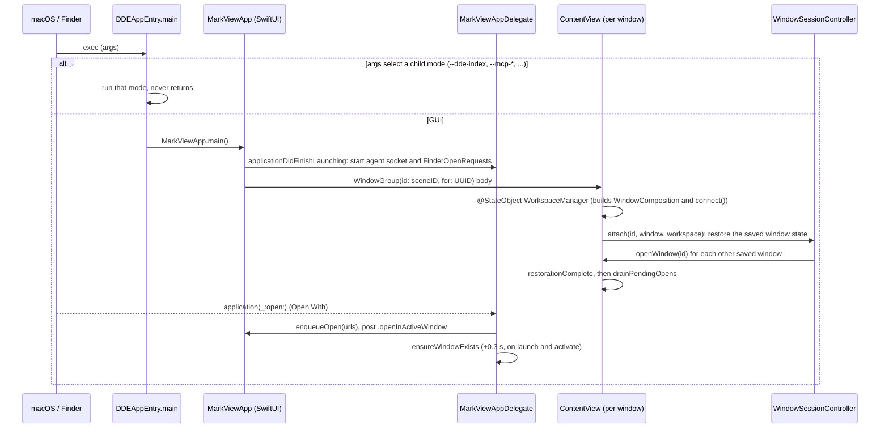
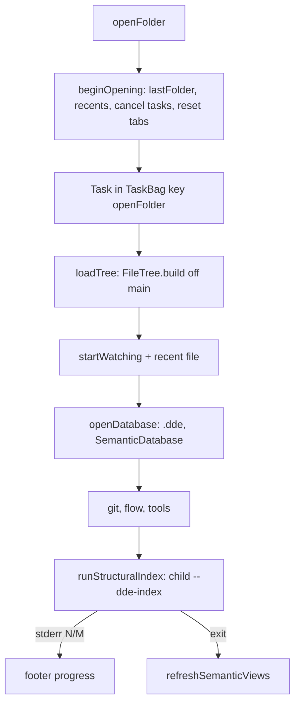

# App Shell & Workspace

Checked against the code at `ac3001ba` (6.26.2 plus the architecture-review finish, 2026-11-15). The doc names files and symbols, not
line numbers. Paths are relative to the repository root. Where a statement comes from reading the code and was not run, the text says so.

## 1. Purpose and responsibilities

This subsystem is the process entry point, the window shell, and the per-window workspace. It covers:

- **Process entry**: a normal GUI launch, or one of the headless child modes selected by an argument: `--dde-index <folder>` (the
  structural indexer), `--mcp-browser`, `--mcp-project`, `--mcp-control`, `--project-call`, `--remote-workspace-mcp`,
  `--remote-workspace-guard` (`MarkView/App/MarkViewApp.swift`, `DDEAppEntry`).
- **Scene and menus**: one `WindowGroup` (id `WindowSessionController.sceneID`, value `UUID`), the File/View/Settings commands, and
  routing of a command to the focused window's `WorkspaceManager` through `FocusedValue`.
- **External open requests**: Finder "Open With" (`application(_:open:)`), the Finder Quick Action file `markview_open_path.txt`
  (`FinderOpenRequests`), drag and drop onto a window, and the restore of the saved windows (`WindowSessionController`).
- **Workspace lifecycle**: open folder, single-file workspace, close folder, remove or recreate metadata; `.dde/`, the
  `SemanticDatabase`, and the out-of-process structural index.
- **Tabs**: open, switch, reorder, close, save, reload from disk, and the tab kinds (`TabsController`, `DocumentState.swift`).
- **File tree and Files browser**: `WorkspaceFileTreeStore` (the folder on disk), `FileBrowserModel` and the Files views, file
  operations (`FileOperationsController`: create, rename, move, copy, trash, with the tabs that follow or close).
- **Window composition**: `WindowComposition` builds every part of a window in one place (section 3.3).

What it does **not** own. It calls into these, but the logic lives in sibling modules:

| Concern | Owner | Doc |
|---|---|---|
| WKWebView, JS bridge, rendering, PDF export | `EditorView`, `WebViewBridge`, `TypedWebBridge` | [editor-and-bridge](./editor-and-bridge.md) |
| CLI completions, ACP, Whisper | `CLICompletion`, `AIOperation`, `ACPAssistant`, `WhisperClient` | [ai-assistants-and-dictation](./ai-assistants-and-dictation.md) |
| Features, intake, bug reports | `FeatureStore`, `FeatureFlowCoordinator`, `IntakeSheet` | [feature-workflow](./feature-workflow.md) |
| X-Ray, PR X-Ray, Explain, code navigation | `CodeAndXRayCoordinator`, `ArchitectureStore`, `ChangeReviewStore`, `CodeExplainStore` | [architecture-and-xray](./architecture-and-xray.md) |
| SQLite, structural indexer, GraphRAG, Recursive Insight | `SemanticDatabase`, `StructuralIndexer`, `GraphRAG`, `InsightCoordinator`, `InsightSession` | [semantic-index-and-insight](./semantic-index-and-insight.md) |
| Git, GitHub, terminals, lifecycle, usage | `GitClient`, `GitHubStore`, `AITerminalsController`, `TerminalSession`, `AgentUsageTracker` | [git-github-terminal-lifecycle-usage](./git-github-terminal-lifecycle-usage.md) |
| Build, versioning, release | `MarkView.xcodeproj`, `Packages/MarkViewCore`, scripts | [build-release-testing](./build-release-testing.md) |

## 2. Files

| Path | Role |
|---|---|
| `MarkView/App/MarkViewApp.swift` | `@main` `DDEAppEntry`, `DDEIndexerRunner`, `MarkViewApp` scene and menus, `MarkViewAppDelegate`, the external-open queue (`pendingOpenURLs`, `enqueueOpen`), `DDESettingsWindow`, per-window notification helpers (`post(_:for:)`, `isFor`), notification names, and the unused `MarkdownDocument` and `MarkViewApplication` |
| `MarkView/Views/Workspace/ContentView.swift` | `ContentView` (owns the window's `WorkspaceManager`), `WorkspaceWindow` (layout, toolbar, welcome screen, drop target, open-request draining), `observingParts(of:)` |
| `MarkView/Models/Workspace/WorkspaceManager.swift` | The window facade: forwards to the parts of `WindowComposition`, `openFolder`, `openFile`, `closeFolder`, `removeMetadata`, and the host-protocol conformances (section 3.3) |
| `MarkView/Models/Workspace/WindowComposition.swift` | Builds the parts of a window, `connect()` joins them, `close()` shuts them down |
| `MarkView/Models/Workspace/ProjectContext.swift` | The open project: folder and tree, linked and excluded folders, `SemanticDatabase`, structural index process, recent files and recent projects, metadata items |
| `MarkView/Models/Workspace/TabsController.swift` | The tabs of the window: open, update, save, close, reload, watch open files |
| `MarkView/Models/Workspace/WorkspaceFileTreeStore.swift`, `FileNode.swift` | The folder tree (`FileNode`, built from a `FileTree` value), exclusions, sort order, the root watcher |
| `MarkView/Models/Workspace/FileBrowserModel.swift`, `Views/Workspace/FileBrowserViews.swift`, `FileTreeView.swift` | How Files shows a folder (views, filters, selection) |
| `MarkView/Models/Workspace/FileOperationsController.swift`, `FileTransfer.swift` | File operations of the project; non-overwriting move and copy |
| `MarkView/Models/Workspace/DocumentState.swift` | `FileType`, `HeadingItem`, `TabKind`, `GitHubItem`, `OpenTab` |
| `MarkView/Models/Workspace/PanelLayout.swift`, `WindowChrome.swift`, `WindowRequests.swift`, `WindowUIState.swift`, `Views/Workspace/WindowStorage.swift` | Per-window panel selection, panels shown, requests for sheets and popovers, interface state (`@WindowStorage`) |
| `MarkView/Models/Workspace/WindowSessionController.swift`, `WindowSession.swift`, `WindowSessionSnapshotter.swift` | Saving and restoring the windows (`windowSessions.json`) |
| `MarkView/Models/Workspace/FinderOpenRequests.swift` | The Finder Quick Action hand-off, a job of `PollingScheduler` |
| `MarkView/Models/Workspace/ToolRegistry.swift`, `ToolTabsRouter.swift`, `ToolOpener.swift`, `Views/Workspace/ToolTabViews.swift` | The tools that have a tab per window: identity, opening, view |
| `MarkView/Models/Workspace/ProjectProviding.swift` | The narrow protocol a feature reads the open project through (`ProjectContext` implements it) |
| `MarkView/Models/Workspace/DocumentTranslator.swift`, `MarkdownDocumentChunker.swift` | Document translation |
| `MarkView/Models/Workspace/WikiLinkResolver.swift`, `LinkedFolders.swift`, `ExcludedFolders.swift`, `FilterSearch.swift`, `FrontMatter.swift` | Wiki-links, linked and excluded folders, AI filter terms, YAML front matter |
| `MarkView/Models/Workspace/BackgroundFileScans.swift` | File-system walks a window needs and must not run on the main thread (`AR-42`) |
| `MarkView/Models/Workspace/EditorDocumentRouting.swift`, `EditorPage.swift`, `EditorWindowPrefs.swift`, `DocumentFiles.swift` | Which tab an editor message belongs to; the editor page and its CSP; the page's per-window preferences; the `markview-doc:///` rule for files next to a document |
| `MarkView/Models/Workspace/SchemaVersionedStore.swift` | Versioned JSON stores (`AR-36`) |
| `MarkView/Models/Appearance/AppTheme.swift`, `WindowTheme.swift`, `MarkView/Views/Appearance/*` | Themes: one `WindowTheme` per window |
| `MarkView/Views/Workspace/TabBarView.swift`, `TOCView.swift`, `ContentsPanelView.swift`, `ImageViewerView.swift`, `DDESettingsView.swift` | Tab strip, right panel, image tab, settings window |
| `MarkView/Info.plist`, `MarkView.entitlements`, `MarkViewDebug.entitlements` | Document types and usage strings; sandbox off |

## 3. Key types

### 3.1 App layer (`MarkView/App/MarkViewApp.swift`)

| Type | Responsibility |
|---|---|
| `DDEAppEntry` (`@main` enum) | Reads `CommandLine.arguments`. Each child-mode argument above runs its runner, which never returns. Otherwise `MarkViewApp.main()`. |
| `DDEIndexerRunner` | `--dde-index <folder>`: opens the folder's `SemanticDatabase`, refuses a file the app must leave alone (newer schema or failed migration), `ensureProject`, loads the linked folders, runs `StructuralIndexer.indexAll()`, writes `[mvindexer] ...` lines to stderr, then `exit(0/1)`. `dispatchMain()` keeps the process alive. |
| `MarkViewApp: App` | `@FocusedValue(\.workspaceManager)` and `(\.workspaceHasFolder)`; the `WindowGroup`; all menu commands (`LayoutCatalog` presets, `ToolRegistry` tool items). Statics: `version`, `pendingOpenURLs`, `enqueueOpen(_:)`, `pendingNewProject`, `pendingFolderURL`. |
| `MarkViewAppDelegate` | `applicationDidFinishLaunching` starts the agent tool socket and `FinderOpenRequests`; `ensureWindowExists()` opens a window 0.3 s after launch or activation when none is visible; `application(_:open:)` enqueues URLs; `applicationShouldTerminate` stops project operations, finishes the remote relay, saves the window session and cancels Cockpit agents before it replies; `applicationWillTerminate` stops the agent server and child processes. |
| `DDESettingsWindow` | One cached `NSWindow` for DDE Settings, bound to the focused window's workspace. |
| `MarkViewApplication`, `MarkdownDocument` | Dead code: `Info.plist` sets `NSPrincipalClass` to `NSApplication`, and no scene uses `MarkdownDocument`. `MarkViewApplication.launchURLs` is never read (grep in `MarkView/`). |

Menu commands (File, View, Settings; shortcut in parentheses): Open File (⌘O), Open Folder (⇧⌘O, posts `.showFolderPicker`),
New Project, Publish to GitHub, Close Folder, Link Folder, Recreate and Remove Metadata, Save (⌘S), Export PDF Book (⇧⌘E) and Export
PDF (⌘E), Search Project (⇧⌘K), Theme (⇧⌘T), Toggle File Tree (⌘1), Toggle Right Panel (⌘2), Agents (⌘3), X-Ray (⌘4), Browser (⌘5),
Preview Web App (⌘6), DDE Settings (⇧⌘,), plus the tool items generated from `ToolRegistry`.

### 3.2 `ContentView` (`MarkView/Views/Workspace/ContentView.swift`)

- `ContentView` owns `@StateObject WorkspaceManager` (one per window) and shows `WorkspaceWindow`. It publishes the manager to the
  menus with `.focusedSceneValue`.
- `observingParts(of:)` puts the parts a view redraws with into the environment: `TabsController`, `PanelLayout`, `WindowChrome`,
  `WindowRequests`, `WorkspaceFileTreeStore`, `GitClient`, `DocumentTranslator`. A view observes only the part it shows, so typing in
  the editor redraws what shows the tabs and nothing else (`AR-15`).
- `WorkspaceWindow` lays out the left panel, `TabBarView` with `EditorView` (kept mounted under the overlays of terminal, image and
  GitHub tabs) and the tool tab views, the right panel, the toolbar, the welcome screen and the drop target.
- `drainPendingOpens(trigger:)` takes the whole `MarkViewApp.pendingOpenURLs` queue, but only after the window's session
  restoration finished (`restorationComplete`) and only when the window is the key window, or the frontmost visible one while none is
  key. Plain files on their own open as documents (`openDocumentsOnly`) in an empty window, or in a new document window
  (`WindowSessionController.openDocumentWindow`); a request with a folder in it opens as `openFolder` or `openFile`.
- `.showFolderPicker` is observed by every window, and each one returns early unless it is the active window.
  `.exportPDFRequested` is posted for one workspace (`post(_:for:)`) and ignored by the others (`isFor`).

### 3.3 The window: `WorkspaceManager` and `WindowComposition`

`WorkspaceManager` (`@MainActor`, 730 lines, `ObservableObject`) is the facade of one window. It owns one `WindowComposition` and
exposes its parts as computed properties. `WindowComposition` builds each part once and passes a part only what it needs.

| Part | Type | Role |
|---|---|---|
| `project` | `ProjectContext` | The open project: `rootNode`, `projectFolder`, `database`, linked and excluded folders, recent files and projects, the structural index process and its progress, `indexingProgress`, `semanticRefreshVersion`, metadata items. Implements `ProjectProviding` |
| `layout` | `PanelLayout` | Which tab each panel shows (never shared with other windows, BUG-004) |
| `windowUI` | `WindowUIState` | The rest of a window's interface state, read through `@WindowStorage` |
| `chrome` | `WindowChrome` | Which panels are shown |
| `requests` | `WindowRequests` | What the window was asked to show in a sheet, popover or alert; never saved |
| `theme` | `WindowTheme` | The theme of the window |
| `tabs` | `TabsController` | The tabs |
| `taskBag`, `polling` | `TaskBag`, `PollingScheduler` (both in `MarkViewCore`) | Keyed cancellable background tasks; the window's polls, which run while the app is active and the window is on screen (`AR-19`) |
| `aiJobs`, `gitClient` | `AIToolJobs`, `GitClient` | AI tool runs; the Git state |
| `research`, `terminals`, `flow`, `fileOperations`, `translator`, `browser`, `codeXRay`, `insight`, `toolTabs` | `ResearchMapController`, `AITerminalsController`, `FeatureFlowCoordinator`, `FileOperationsController`, `DocumentTranslator`, `BrowserHost`, `CodeAndXRayCoordinator`, `InsightCoordinator`, `ToolTabsRouter` | Built lazily, the first time a view or a command uses them |

Each coordinator holds the window only through a host protocol (`WindowHost` is the union): `AITerminalsHost`, `BrowserHostWindow`,
`CodeXRayHost`, `FeatureFlowTabs`, `FileOperationsHost`, `InsightHost`, `ResearchHost`, `ToolTabsWindow`. `WorkspaceManager`
conforms to them in extensions. A part takes what it needs at construction; nothing is wired afterwards by assigning a closure.

`connect()` joins the parts that react to each other's events, once: the GitHub repository of the flow reaches the X-Ray review;
the file tree's beat refreshes Git status while the app is in front; `tabs.events` (`.saved`, `.reloadedFromDisk`, `.terminalClosed`,
`.insightClosed`) refresh the code analysis and the tree, end a terminal's shell and close an Insight session; the app becoming
active refreshes Git. `close()` is the ordered shutdown: tabs, project (index process, watcher, jobs), polls, code and X-Ray, flow,
browser, tool tabs, the task bag, the subscriptions.

Operations kept on `WorkspaceManager` itself: `openFolder(_:completion:)`, `openFile(_:)` and its `line` / `lineFragment` variants,
`openWikiLink`, `openCanvasFileReference`, `closeFolder()`, `removeMetadata(recreate:)`, `revealInFileTree`, `openTool(_:)`,
`openDocumentsOnly`, `openTerminal(in:)`, `runAITool(named:)`, `runGraphEdit`, `presentGraphCreator`, the window-session hooks
(`windowFolder`, `windowWillClose`, `restoreArchitectureTab`, `restoreTerminal`, `restoreBrowser`).

### 3.4 Document and tab model (`MarkView/Models/Workspace/DocumentState.swift`)

- `FileType` maps extensions and file names to a viewer or a CodeMirror language id (`from(url:)`, `isOpenable`, `isData`,
  `codeLanguage(for:)`).
- `TabKind`: `.file`, `.insight(InsightSession)`, `.architecture(scope:)`, `.terminal(UUID)`, `.image`, `.pdf(PDFReaderController)`,
  `.archive`, `.github(GitHubItem)`, `.browser(BrowserSession)`, `.data`, `.tool(ToolID)`, `.prototype(PrototypeSession)`,
  `.uiStudio(StudioSession)`, `.cockpit(CockpitSession)`. `pullRequestScope = "#pr"`.
- `OpenTab` (value type, `id` is a fresh `UUID` per instance): `url`, `content`, `originalContent`, `isModified`, `kind`, `headings`,
  `notesView`, `dataRevision`. The scroll position and active heading are not fields: `DocumentScrollSideTable` keeps them off the
  published model (`AR-15`).
- A tab that has no file behind it has a placeholder URL (`ProjectPaths.placeholderName`, `.markview-<kind>`) that is never read or
  written.

### 3.5 Other types

| Type | Notes |
|---|---|
| `TabsController` | `@MainActor ObservableObject`. `openTabs`, `activeTabIndex`, `lastSaveError`, `events` (a publisher). Operations: `openDocument`, `openTextFile`, `updateTabContent`, `saveActiveFile` / `saveFile(at:)`, `closeTab(at:)`, `closeOtherTabs`, `closeTabsToRight`, `closeDocuments`, `closeAllTabs`, `resolveUnsavedChanges(at:before:)`, `follow(moved:)`, `startWatchingOpenFiles`, `reloadChangedOpenFiles`, `shutdown`. `TabClosing` (Foundation only) decides which tab is active after a bulk close. |
| `WorkspaceFileTreeStore` | `rootNode`, `excludedFolders`, `sortOrder`, `hasMarkdownFiles` (found by a background walk, so the menu never touches the disk). Root watcher: a `DispatchSourceFileSystemObject` on the root directory with a debounce, plus a 10 s mtime poll as a `PollingScheduler` job. `timerBeats` fires on each beat. |
| `FileNode` | `ObservableObject` built from a `FileTree` value (`FileTree.build(from:sortOrder:)`, run off the main thread); the tree is published only once it is complete. |
| `ProjectContext` | See section 3.3; `runStructuralIndex(at:)` starts the index child through `MarkViewCore.Subprocess.start` (stdout discarded, stderr streamed). |
| `FinderOpenRequests` | `shared`; one 1 s poll for the whole app, started by the app delegate. Opens the request file with `O_NOFOLLOW`, requires a regular file owned by the user of at most 64 KB, deletes it as soon as it is read (`AR-12`, `FU-09`). |
| `WindowSessionController` | `shared`. `attach(id:window:workspace:openWindow:)` restores the saved state of a window (frame, folder, tabs, panels, theme, interface state) and subscribes to `sessionChanges` to save it (delayed, replaced by a newer request). Migrates the old single `workspace.lastFolder` into one window state once. `openWorkspaceWindow(folder:)` and `openDocumentWindow(files:)` open windows for agents and Finder. `saveBeforeTermination()` runs on quit. |
| `DocumentTranslator` | Translates a document chunk by chunk (`MarkdownDocumentChunker.splitForTranslation`, at most 4000 characters) through an `AIOperation` runner; see 5.8. |
| `FileOperationsController` | Create, rename, move, copy, trash; asks the tabs to follow or close; refuses a taken or invalid name and a folder moved into itself. |
| `ImageCanvasController`, `ImageCanvasView` (`ImageViewerView.swift`) | The image tab: reads the image off the main thread; wheel zooms, drag pans. |

## 4. Internal interfaces

### Inbound: who calls this subsystem

| Caller | Calls |
|---|---|
| `EditorView.Coordinator` and the typed bridge (`MarkView/Bridge/WebViewBridge.swift`) | `tabs.updateTabContent` (routed by `EditorDocumentRouting`), heading and block updates, `openFile`, `openWikiLink`, `openCanvasFileReference`, the code and X-Ray actions through `codeXRay`, the Insight requests through `insight` |
| SwiftUI views | the parts of the window, as `@EnvironmentObject` (section 3.2) or `workspaceManager` |
| Menus | `FocusedValue(\.workspaceManager)` |
| The coordinators | `WorkspaceManager` through their host protocol |
| Agents (MCP tools) | `WindowSessionController.openWorkspaceWindow`, `openDocumentWindow`, and the tool servers of `BrowserHost` |

### Outbound: what this subsystem calls

| Callee | From |
|---|---|
| `SemanticDatabase`, `StructuralIndexer` (child process), `GraphRAG`, `InsightCoordinator` | `ProjectContext`, `WorkspaceManager`, `DDEIndexerRunner` |
| `ArchitectureStore`, `CodeAndXRayCoordinator` | `WorkspaceManager`, `WindowComposition` |
| `CLICompletion` through `AIOperation` | `DocumentTranslator`, `FilterSearch` |
| `GitClient`, `FeatureFlowCoordinator`, `AITerminalsController`, `BrowserHost` | `WindowComposition` |

Coupling through `NotificationCenter`:

| Name | Poster | Observer |
|---|---|---|
| `.showFolderPicker` | the Open Folder menu item | every `ContentView`; only the active window shows its picker |
| `.exportPDFRequested`, `.performPDFExport` | the Export PDF menu item, posted for one workspace | the window it is for, then the editor |
| `.openInActiveWindow` | `enqueueOpen` | every window; `drainPendingOpens` decides which one takes the queue |
| `.scrollToHeading`, `.scrollToText`, `.revealCodeLine`, `.revealStructure` | the Contents panel and the workspace | the editor of the window the notification is for |

## 5. Runtime flows

### 5.1 Launch

The restored window state goes through `WindowSessionSnapshotter.restore`, which calls `openFolder`, `openFile` and the
`restoreArchitectureTab` / `restoreTerminal` / `restoreBrowser` hooks of the workspace.

### 5.2 Open folder

`WorkspaceManager.openFolder(url)`:

1. `ProjectOperationsStore.forRoot(url)`; `project.beginOpening(url)` writes `workspace.lastFolder` (`Setting.lastFolder`), moves the
   folder to the top of the recent projects, cancels the project's own tasks and resets the tree; `browser.register()`;
   `taskBag.cancelAll()` and `flow.cancelWork()` cancel the previous folder's work; `tabs.reset()` and `codeXRay.reset()`.
   **Open tabs are discarded here without a save prompt**: a prompt is asked only by `closeFolder()` (section 5.7); the
   open-folder callers in `ContentView` and `MarkViewApp` do not call `resolveUnsavedChanges` (read, not run).
2. The setup runs as one `Task` stored in the window's `TaskBag` under the key `openFolder`, so a second `openFolder` cancels it.
   It sleeps 100 ms between steps so progress text can render, and checks `Task.isCancelled` after each.
3. `PrototypeFiles.migrateLegacy(root:)` (a detached task) moves prototypes made before DEC-006 from `.dde/prototypes` to
   `docs/prototypes`.
4. `project.loadTree(of:)` builds the `FileTree` off the main thread, then sets the root node, the excluded folders and the linked
   folders; it returns false when the task was cancelled meanwhile.
5. `project.startWatching(url)` starts the root watcher and records the recent file.
6. `initDDEWorkspaceAsync`: `project.openDatabase(at:)` creates `.dde/` and its cache folders, opens `SemanticDatabase`, and returns
   false when the window moved on; then `terminals.workspaceRoot`, `gitClient.setup(at:)`, `flow.setUp(at:)`,
   `toolTabs.projectOpened(url)`; then `indexingProgress = nil`, `refreshSemanticViews()` and `project.runStructuralIndex(at:)`.
7. `runStructuralIndex` starts `<executable> --dde-index <path>` with `Subprocess.start` (no timeout, stdout discarded). Only
   `[mvindexer] N/M` lines become `structuralIndexProgress`. On exit, if this process is still the current one, the footer is cleared
   and `refreshSemanticViews()` runs.
8. `ArchitectureScanner.looksLikeCodeProject` runs detached; for a code project whose root is unchanged,
   `codeXRay.architecture.startAutomaticCodeAnalysis` starts.

### 5.2a Linked folders

- `LinkedFolders` keeps, per project, the folders attached as aliases, in local settings under `project.linkedFolders[<project key>]`
  (never a file in the project). A folder can be linked when it exists, is not the project, is not inside it, does not contain it, and
  is not nested with another linked folder either way. The linking rules are in `Models/Workspace/LinkedFolders.swift`; the store
  is in `Models/AI/LinkedFolderStore.swift`, because an assistant run reads it.
- `ProjectContext.linkedFolders` is loaded with the folder and cleared on close; `linkFolders` and `unlinkFolder` save the list
  and re-run the structural index; `chooseFoldersToLink()` is "Link Folder...".
- Document ids of files in a linked folder are `@linked/<name>/<path>` (`LinkedFolders.documentId`,
  `ProjectContext.documentId(for:)`, `fileURL(forDocumentId:)`); the `--dde-index` child reads the same settings and walks the
  linked folders after the project; `ProjectSearch` shows and resolves the same prefix. Git, X-Ray, exclusions and research stay
  project-only.

### 5.3 Open file

`WorkspaceManager.openFile(url)`:

1. Shows the Files area. If the file is `.md`, no project folder is open, and the file is outside the current workspace
   (`isFileInCurrentWorkspace`), `initSingleFileWorkspace` releases the engines, sets the terminal root and Git to the file's folder
   and calls `project.openSingleFile`, which opens `.dde/file_<name>.db` in the file's folder and indexes that one file
   (`indexSingleFile`: headings, FTS, a hash).
2. If the file belongs to a feature, the feature context is shown.
3. `tabs.openDocument(url)`: an equal URL selects the existing tab; a PDF, an archive, a data file (`FileType.isData`) or an image
   gets its own tab kind (the viewer reads the file itself); any other file is read by `openTextFile` in a task stored in the
   `TaskBag` under the key `open:<path>`, then appended; a read failure is shown (`showReadError`).

`openFile(_:line:endLine:)` then posts `.revealCodeLine`. `openWikiLink` resolves through `WikiLinkResolver` (own folder first, then
the shortest path), beeps when nothing is found, and scrolls to the heading.

### 5.4 Tab switch, reorder, close

- Switch: `activeTabIndex = index` from `TabBarView`. Reorder: drag payload `"markview-tab:<uuid>"` as plain text, then
  `tabs.moveTab(id:to:)` keeps the active tab.
- `closeTab(at:)`:
  - terminal: the tab is removed and `.terminalClosed` is sent, which ends the shell (`WindowComposition.connect`);
  - browser, UI Studio, Cockpit: the session is closed or cancelled, then the tab is removed;
  - Insight: `.insightClosed` is sent and `InsightCoordinator.close` removes the tab after its ordered cleanup;
  - a modified file: Save / Don't Save / Cancel. After Save the tab is removed even when the write failed (`saveFile` only sets
    `lastSaveError`, which `ContentView` shows as a banner with a Dismiss button).
- `closeOtherTabs` and `closeTabsToRight` cancel Cockpit sessions and then keep the chosen tabs; they do not ask about unsaved
  changes. `closeDocuments()` asks once for all unsaved documents (`resolveUnsavedChanges`) and keeps the tool tabs. `closeAllTabs()`
  cancels Cockpit sessions, closes UI Studio sessions and resets, without a prompt.

### 5.5 Edit and save

- The editor pushes content, `tabs.updateTabContent` sets `isModified = content != originalContent` for the tab that
  `EditorDocumentRouting` names.
- Cmd-S: `saveActiveFile` then `saveFile(at:)`: `AtomicFile.write`, then `isModified = false`, a new `originalContent`, and a
  `.saved(url)` event (which refreshes the code analysis for files under the root). A failure sets `lastSaveError` (a banner in the window) and logs through
  `AppLog.workspace`.
- Block deltas are stored by `ProjectContext.saveBlocks` (a serialized chain of database writes on the actor).

### 5.6 File watching

| Watcher | Scope | Mechanism | Effect |
|---|---|---|---|
| Root directory source (`WorkspaceFileTreeStore`) | writes to the root directory entry only (`O_EVTONLY`, `.write`) | `DispatchSource` on the main queue, 1 s debounce | reload the tree unless auto refresh is paused |
| Root mtime poll | the root's modification date | `PollingScheduler` job, every 10 s | same |
| Open-files poll (`TabsController.startWatchingOpenFiles`) | file-backed, unmodified tabs | `PollingScheduler` job, every 2 s, started with the first terminal or research run | reload content changed on disk, then refresh the tree |
| Finder hand-off (`FinderOpenRequests`) | `markview_open_path.txt` in the temporary directory and `/tmp` | `PollingScheduler` job on the app scheduler, every 1 s | `enqueueOpen` |

The polls pause while the app is in the background or the window is hidden, except `FinderOpenRequests`, which keeps its cadence
because the Quick Action writes while Finder is in front. No `Timer` is left in the app (`tools/lint/task-ownership.sh`).

### 5.7 Close folder / remove metadata

- `closeFolder()`: if project operations are running, an alert asks to stop them first (and closes again once they ended); then
  `tabs.resolveUnsavedChanges(at: all tabs, before: "closing the folder")` (Save / Don't Save / Cancel; false when cancelled or a
  save failed). It removes `workspace.lastFolder`, cancels Insight sessions, stops terminals, cancels the task bag, resets tabs,
  project, engines, X-Ray, Git and the flow.
- `removeMetadata(recreate:)`: an alert lists `project.metadataItems()` (`.dde`, `.markview-insight`, and a `.claude/CLAUDE.md`
  only when it starts with the generated header). It stops terminals, the index and Insight sessions, closes the tabs that are not
  file-backed, releases the engines, deletes the items, and with `recreate` runs `initDDEWorkspaceAsync` again.

### 5.8 Document translation

`DocumentTranslator` fixes one assistant for the whole document and fails early if its CLI is missing. It creates an unsaved tab
`<name>_<lang>.md` next to the source, splits the document with `MarkdownDocumentChunker.splitForTranslation` (front matter and fences are never sent; chunks are at most
4000 characters and never split a table, list or quote), translates each chunk through an `AIOperation` of `CLICompletion`,
compares the `skeleton(of:)` of source and result (heading levels, table rows, list items, fences, quote lines), retries once in strict mode on a mismatch, then falls back to the source text,
and writes progress into the tab. The job is stored in the window's `TaskBag`.

## 6. State and persistence

Settings keys are declared once in `Packages/MarkViewCore/Sources/MarkViewCore/SettingsKeys.swift`; the tables are in
[configuration](../configuration.md), and every file the window writes is in [data-and-storage](../data-and-storage.md).

Per-window state, in short:

- `PanelLayout` (which tab each panel shows) and `WindowChrome` (which panels are shown) belong to one window; the keys only seed the
  next window and a relaunch. `@AppStorage` would switch every window at once (BUG-004).
- Everything else a window shows of itself (expanded sections, widths, the Search mode, the Files view and filters) lives in
  `WindowUIState`; views declare `@WindowStorage(Setting.x)`. The window saves the dictionary in its session; UserDefaults receives
  each change only as the starting value of the next window, which takes a snapshot when it is created and never reads the keys again.
- The editor page's text size and its X-Ray details and code-notes widths are `localStorage` keys that WebKit shares between all
  windows' pages. `EditorWindowPrefs` puts a script at the top of the page that answers those keys from the window's own copy and
  reports each save to Swift, which files it in `windowUI`.
- Notifications that act on one window are posted with `NotificationCenter.post(_:for:)` and ignored elsewhere (`Notification.isFor`).
- A model the running assistant reports changes the project's choice only, never the default.
- The saved windows are `~/Library/Application Support/MarkView/windowSessions.json` (the bundle id adds a suffix for a build with
  another id).

Caches in memory: `OpenTab.content` and `headings` per tab, `DocumentScrollSideTable`, the file tree, the terminals of the window.

## 7. Concurrency and threading

- `WorkspaceManager`, `WindowComposition`, `TabsController`, `ProjectContext`, `WorkspaceFileTreeStore`, `WindowTheme` and
  `ImageCanvasController` are `@MainActor`. `FileTree` is a value built off the main thread and wrapped in a `FileNode` on the main
  actor only when complete.
- Work off the main thread: `FileTree.build`, `looksLikeCodeProject`, `PrototypeFiles.migrateLegacy`, the walks in
  `BackgroundFileScans`, the image read, every `SemanticDatabase` call (an actor), and the structural index (a separate process).
- Every background task of a window goes in its `TaskBag` (keyed, so a new task of the same key cancels the old one) or in the
  `PollingScheduler`; the window's `close()` cancels them. Lint rule `unowned-task` counts the asynchronous starts that no one can
  cancel: 263 sites in 70 files remain (`tools/lint/task-ownership.sh --report`, 2026-11-15), most of them SwiftUI button actions in
  `Views/`. The same script on the 6.26.2 tree reports 391 in 87 files, with 8 `Timer` and 36 unjustified `asyncAfter`; both are 0 now.
- The index child runs through `Subprocess.start`, which drains the pipes concurrently; nothing calls `waitUntilExit` on the main
  thread.
- Still on the main thread (by reading): `NSAlert.runModal` and `NSOpenPanel.runModal` in the welcome screen, file tree,
  `closeFolder`, `removeMetadata` and `ContentView.openFolder`; `FileTransfer` copies and moves; `FilterSearch.scoreFiles` blocks its
  caller while `concurrentPerform` runs, so callers must call it off the main thread; `initSingleFileWorkspace` opens a single-file
  workspace. The directory listings of the Files browser (`FileBrowserModel`) are not traced.

## 8. Error handling and edge cases

- A file read failure is shown (`showReadError`); a save failure sets `lastSaveError`, shown as a banner. Both log through
  `AppLog.workspace`.
- A database open failure in `initDDEWorkspaceAsync` logs, clears the progress and leaves the folder browsable without the engines.
  A file that is newer than the app, or whose migration failed, opens as an in-memory database and the indexer child refuses to write.
- Paths from untrusted sources: `openCanvasFileReference` rejects absolute paths and `..`; `openWikiLink` rejects `..`; the Finder
  request file is checked (section 3.5); the editor's relative images go through the `markview-doc:///` rule of `DocumentFiles`.
- File tree: new names and renames reject `/`, `:`, `.`, `..` and existing names. A drop copies when any source is outside the root
  or Option is held. `FileTransfer` refuses self-nesting and never overwrites.
- Remove Metadata lists exactly what it will delete and deletes the generated `.claude/CLAUDE.md` only when the header matches.
- `FrontMatter.isLossless` prevents writing back front matter the parser could not model.

## 9. Extension points and how to change them safely

The recipes with the exact lists are in the "How to Add" section of `CLAUDE.md`. In short:

- **Add a tool with a tab per window**: add a `ToolID` case and a `ToolDescriptor` in `ToolRegistry` (title, icon, shortcut, menu
  slot), the view in `ToolTabViews`, and an entry in `ToolTabsRouter` only if opening it needs more than showing the tab. The menu,
  the toolbar and the session restore read the registry.
- **Add a tab kind that is not a tool**: add a `TabKind` case in `DocumentState.swift`; `isFileBacked` stays false. The switches over
  `TabKind` are exhaustive, so the compiler lists what to extend (tab bar icon, display name, close handling in
  `TabsController.closeTab`, the session form in `WindowSession.swift`).
- **Add a part to a window**: give it a host protocol for what it needs of the window, add it to `WindowComposition` (lazy when it
  needs the host), add it to `connect()` only if it reacts to another part, and to `close()` if it starts work.
- **Add a menu command**: add a `Button` in `MarkViewApp.commands` that uses `activeWorkspace?`; disable it with
  `activeWorkspaceHasFolder` when it needs a folder.
- **Add a bridge action handled by the workspace**: declare the message in `Editor/js/bridge-contract.json`, add its payload type to
  `Bridge/PageMessages.swift` and its handler in `WebViewBridge` / `EditorView`; update the JavaScript sender in the same change.
- **Add a setting**: declare a `SettingsKey` in `SettingsKeys.swift` (scope `.app`, `.project` or `.window`); a literal key anywhere
  else fails lint rule `settings-literal`. Interface state of one window is a `@WindowStorage` value, not `@AppStorage`. A rename of a
  released key is a **major** bump.
- **Add something under `.dde/`**: name its location in `ProjectPaths` (lint rule `project-paths`), with a test in
  `MarkViewCoreTests`; `metadataItems()` already covers the whole folder.
- **Add a file type**: update `FileType` in `DocumentState.swift` and `Info.plist` `CFBundleDocumentTypes`.

## 10. Risks, tech debt and oddities

Status of the findings of the 2026-09 audit (2.17.0), re-read against `ac3001ba`. "Fixed" names what is now in the code; nothing was
reproduced at runtime.

| # | Observation (2.17.0) | Status at `ac3001ba` |
|---|---|---|
| 1 | `ImageViewerView` needs `@EnvironmentObject WorkspaceManager` that `ContentView` did not inject | Fixed: `ContentView` calls `.environmentObject(workspaceManager)` on the image view |
| 2 | "Save" in the close-tab prompt removes the tab even when the write failed | Open: `closeTab` removes the tab after `saveFile`; the failure is shown through `lastSaveError` but the tab is gone |
| 3 | Bulk closes skip prompts and leak terminals and Insight sessions | Partly fixed: `closeDocuments` and `closeFolder` ask once; `closeOtherTabs`, `closeTabsToRight` and `closeAllTabs` still skip the prompt (terminal and Insight cleanup of those paths was not traced) |
| 4 | `openFolder` resets tabs with no save prompt | Open (section 5.2, step 1) |
| 5 | `openFolder`'s task is never cancelled | Fixed: stored in the `TaskBag` under the key `openFolder` and cancelled by the next `openFolder`; `loadTree` and `openDatabase` return false when cancelled |
| 6 | `MarkViewApplication` Apple-Event capture is dead | Open: the class and `launchURLs` still exist, `NSPrincipalClass` is `NSApplication` |
| 7 | Dead code: `MarkViewApp.openFolder()`, `pendingFolderURL`, `MarkdownDocument` | Open: all still present (`openFolder()` has no caller in `MarkViewApp.swift`). `recentFiles` is saved with no UI |
| 8 | A new 1 s `Timer` per window appearance polls a world-writable `/tmp` path | Partly fixed: one app-wide `PollingScheduler` job reads the file safely (no symbolic link, owner, 64 KB, deleted at once). `/tmp` is still a candidate, so any local process can still ask the app to open a path |
| 9 | Several windows show a folder picker or export at once | Fixed: the picker is gated by `isActiveWindow`, the export is posted for one workspace |
| 10 | Per-window themes | Fixed in 5.41.0; unchanged |
| 11 | `DDESettings` window stays bound to its first window's manager | Reworked: `DDESettingsWindow.show` rebinds when the focused workspace differs; with no focused window it binds a throwaway `WorkspaceManager()` |
| 12 | OpenAI key in plaintext UserDefaults | Fixed: Keychain (`AR-10`) |
| 13 | "Open in Terminal.app" builds AppleScript from the path | Fixed: `NSWorkspace.open(_:withApplicationAt:)` (`AR-11`) |
| 14 | `isExcluded` uses `hasPrefix` without a separator | Open: `WorkspaceFileTreeStore.isExcluded` still uses `relativePath.hasPrefix($0)` |
| 15 | `indexSingleFile` uses `lastPathComponent` as the document id | Open: still `fileURL.lastPathComponent` in `ProjectContext.indexSingleFile` |
| 16 | The tree model is a root holder plus a redraw trigger | Not re-checked after `FileBrowserModel` |
| 17 | Main-thread file system and SQLite work | Partly fixed: SQLite is on an actor, `hasMarkdownFiles` is a stored flag (`AR-42`); directory listings in `FileBrowserModel` and `FileTransfer` were not traced |
| 18 | `~/markview_debug.log` appended forever | Fixed: no file; `AppLog` (see runbook) |
| 19 | Claude AI terminals start with `--dangerously-skip-permissions` | Open: `ClaudeProvider` and `AntigravityProvider` still pass it for full access; the `claude update &&` prefix is gone |
| 20 | Unknown extensions map to `.markdown` | Not re-checked |
| 21 | `WorkspaceManager` is a 3.7k-line god object | Fixed for size: 730 lines (lint `file-size` 0 files over the limit); the parts are in section 3.3 |
| 22 | Hard-coded Russian selection-action title in Swift | Fixed in Swift: no Cyrillic text in `WorkspaceManager.swift`; the same string (`'Перевод на русский'`) is now in `Resources/Editor/js/markview-find.js` |
| 23 | `DiagnosticsBarView` has two trailing spacers | Not re-checked |
| 24 | ATS allows arbitrary loads app-wide | Fixed: `NSAllowsArbitraryLoads` is false; `NSAllowsArbitraryLoadsInWebContent` is true |
| 25 | Comment drift in `startRecursiveInsight` | Superseded: that code moved to `InsightCoordinator` |
