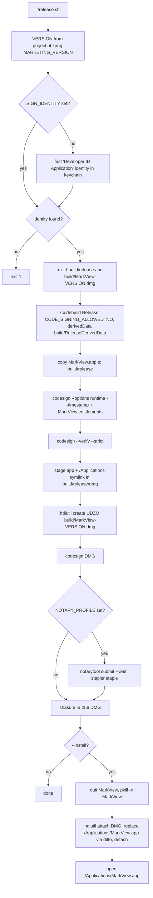

# Build, Release and Testing

How MarkView is configured, built, signed, packaged, installed and tested. Every statement
cites the file it comes from. Day-to-day procedures are in
[operations-runbook.md](../operations-runbook.md).

Related modules: [app-shell-and-workspace](app-shell-and-workspace.md) ·
[editor-and-bridge](editor-and-bridge.md) ·
[ai-assistants-and-dictation](ai-assistants-and-dictation.md) ·
[feature-workflow](feature-workflow.md) · [architecture-and-xray](architecture-and-xray.md) ·
[semantic-index-and-insight](semantic-index-and-insight.md) ·
[git-github-terminal-lifecycle-usage](git-github-terminal-lifecycle-usage.md)

---

## 1. Toolchain

| Tool | Needed for | Source |
|---|---|---|
| Xcode 15+ (project format), Swift 5.9 | every build | `MarkView.xcodeproj/project.pbxproj` |
| macOS SDK, deployment target 13.0 | every build | `MarkView.xcodeproj/project.pbxproj` |
| `xcodebuild` | Debug/Release builds | `CLAUDE.md` Verification, `release.sh` |
| `codesign`, `security`, `hdiutil`, `ditto`, `shasum` | release | `release.sh` |
| Developer ID Application certificate in the keychain | release signing | `release.sh` |
| `xcrun notarytool` + keychain profile, `xcrun stapler` | optional notarization | `release.sh` |
| Node.js + npm (`npx esbuild` 0.28.2) | rebuilding vendored JS only | `tools/web-vendor/build.sh`, `tools/web-vendor/package.json` |
| `swift`, `swiftc`, `python3` | package & standalone tests | `Packages/MarkViewCore`, `tools/tests/run.sh`, `tools/tests/*.sh` |
| `gh` | CI release job; PR X-Ray at runtime | `.github/workflows/build-release.yml`, `release.sh --publish` |

Local Swift package: `Packages/MarkViewCore` is linked directly into the `MarkView` app target
in `MarkView.xcodeproj` (XcodeGen/`project.yml`, `setup.sh`, and `EditorWeb/` have been removed).

## 2. Project structure (`MarkView.xcodeproj` + `Packages/MarkViewCore`)

- `MarkView.xcodeproj/project.pbxproj` is the single source of truth (`CLAUDE.md` Working Rules).
  It defines one application target, `MarkView`, and links `Packages/MarkViewCore`.
- Non-code markdown scaffold docs (`BUILD_NOTES.md`, `FILES_CREATED.txt`, `MANIFEST.md`) were
  removed in 6.26.0 so they are not bundled into app resources.
- `Assets.xcassets`, `Resources/Editor/`, and Swift source memberships are maintained directly
  in `MarkView.xcodeproj` (no generated-pbxproj drift from XcodeGen).

## 3. Build configurations and settings

Shared settings (`MarkView.xcodeproj/project.pbxproj`): `SWIFT_VERSION 5.9`, `MACOSX_DEPLOYMENT_TARGET 13.0`,
`ARCHS $(ARCHS_STANDARD)`, `CODE_SIGN_STYLE Automatic`, `INFOPLIST_FILE MarkView/Info.plist`,
`GENERATE_INFOPLIST_FILE false`, `SWIFT_STRICT_CONCURRENCY = targeted`, `MARKETING_VERSION` = `CURRENT_PROJECT_VERSION`.
Bundle identifier: `com.markview.MarkView`.

| Setting | Debug | Release |
|---|---|---|
| Entitlements | `MarkView/MarkViewDebug.entitlements` | `MarkView/MarkView.entitlements` |
| Swift optimization | `-Onone` (`:654`) | `-O`, whole module (`:567-568`) |
| Conditions | `DEBUG` (`:653`) | none |
| Debug info | `dwarf` (`:626`) | `dwarf-with-dsym` (`:547`) |
| Other | `ONLY_ACTIVE_ARCH YES` (`:649`), `ENABLE_TESTABILITY YES` (`:628`) | `ENABLE_NS_ASSERTIONS NO` (`:548`) |

Not set in `project.pbxproj`: `ENABLE_HARDENED_RUNTIME`, `DEVELOPMENT_TEAM` (`SWIFT_STRICT_CONCURRENCY = targeted` is set in both configurations).
The hardened runtime is applied only by `release.sh` at signing time (`release.sh:29`).

`Info.plist` highlights:
- Versions come from build settings (`MarkView/Info.plist:21-26`).
- Document types: Markdown and JSON Canvas at rank Default, JSON/XML/YAML/folders at Alternate
  (`Info.plist:33-137`); imported UTIs `net.daringfireball.markdown`, `com.markview.jsoncanvas`
  (`:140-183`).
- Privacy strings: Apple Events and microphone (`:186-189`).
- ATS: `NSAllowsArbitraryLoads`, `...InWebContent`, `NSAllowsLocalNetworking` all true
  (`:192-200`).
- `NSPrincipalClass` is `NSApplication` (`:27-28`), although `MarkView/App/MarkViewApp.swift:10-12`
  says it should be `MarkViewApplication`.

## 4. Pre-build script: "Build Web Editor (optional)"

Defined in `MarkView.xcodeproj/project.pbxproj` (`alwaysOutOfDate = 1`).
It copies the checked-in editor into the bundle:

1. `DEST=$TARGET_BUILD_DIR/$UNLOCALIZED_RESOURCES_FOLDER_PATH/Editor`
2. `ditto` top-level editor HTML files (`index.html`, `terminal.html`, `discussion.html`, `book.html`) into `DEST`.
3. If `Resources/Editor/vendor` exists, delete `DEST/vendor` and `ditto` the folder.

A new top-level page in `Resources/Editor` must be added to the script in `project.pbxproj`, otherwise `Bundle.main.url(...)` returns nil and the web view stays blank (`tasks/lessons.md`).

## 5. Resource bundling

| Bundle path | Put there by | Loaded by |
|---|---|---|
| `Contents/Resources/Editor/index.html` | pre-build script | `MarkView/Views/EditorView.swift:26` |
| `Contents/Resources/index.html` (flat copy) | Resources phase (`project.pbxproj:397`) | fallback, `EditorView.swift:27` |
| `Contents/Resources/Editor/terminal.html` | pre-build script | `MarkView/Models/TerminalSession.swift:110` |
| `Contents/Resources/Editor/vendor/{js,css}` | pre-build script | `index.html`, `terminal.html` (`terminal.html:19`) |
| `Assets.xcassets` (AppIcon) | Resources phase (`project.pbxproj:392`) | `ASSETCATALOG_COMPILER_APPICON_NAME` |
| `BUILD_NOTES.md`, `FILES_CREATED.txt`, `MANIFEST.md`, `README.md` | Resources phase (`project.pbxproj:393-396`) | nothing (stale docs, see section 12) |

Not fully offline: `index.html:1539-1544` loads D3, Dagre, Turndown and
turndown-plugin-gfm from `cdn.jsdelivr.net`, and the CSP allows that host (`index.html:21`).
README only mentions the D3/Dagre case (`README.md:162-163`). Turndown handles the WYSIWYG
HTML-to-Markdown save (`index.html:1542`), so that path needs network access.
`vendor/MANIFEST.txt` records versions, SHA-256 and CVE checks for the vendored libraries
(`MarkView/Resources/Editor/vendor/MANIFEST.txt:1-9`).

## 6. Versioning policy

- Every committed app change bumps the version with semver
  (`CLAUDE.md` Versioning): patch = fixes, minor = features, major = removed/reworked features
  or incompatible `.dde/` / settings-key changes. Docs, `tasks/` and build-script-only changes
  do not bump. Several changes in one commit get one bump at the highest level.
- `./bump-version.sh patch|minor|major`:
  - reads the current `MARKETING_VERSION` from `MarkView.xcodeproj/project.pbxproj`;
  - rewrites `MARKETING_VERSION` and `CURRENT_PROJECT_VERSION` in every configuration in `project.pbxproj` and verifies every target line updated;
  - build number equals marketing version.
- Release tags follow `v<version>` (for example `v6.26.0`, `v6.26.1` in `git tag`). The README badge reads
  `v*` releases (`README.md`). `./release.sh --publish` tags and publishes the DMG from a clean `origin/main` checkout.

## 7. Signing, entitlements and sandbox

**The App Sandbox is off in both configurations** (`MarkView/MarkView.entitlements:7-8`,
`MarkView/MarkViewDebug.entitlements:6-7`). Stated reason: sandboxing blocks `Process()` from
running the `claude` / `codex` CLIs (`MarkView.entitlements:5-6`). The app also reads other
tools' files, for example `~/.claude/.credentials.json`, `~/.codex/auth.json` and the Claude Code
keychain item via `/usr/bin/security` (`MarkView/Models/AgentUsageTracker.swift:483-493`).

| Entitlement | Release | Debug | What it enables |
|---|---|---|---|
| `com.apple.security.app-sandbox` = false | yes (`:7-8`) | yes (`:6-7`) | Unsandboxed: child processes, full file system, network |
| `com.apple.security.device.audio-input` | yes (`:11-12`) | yes (`:14-15`) | Microphone under the hardened runtime, for Whisper dictation (`MarkView/Models/WhisperClient.swift:60-101`) |
| `com.apple.security.automation.apple-events` | yes (`:13-14`) | **no** | Apple Events under the hardened runtime, for "Open in Terminal.app" via `NSAppleScript` (`MarkView/Views/FileTreeView.swift:522`) |
| `com.apple.security.network.client` | no | yes (`:10-11`) | Only matters inside a sandbox, so it has no effect here |

Signing paths:
- Local Debug verification builds use `CODE_SIGNING_ALLOWED=NO` (`CLAUDE.md` Verification), so
  entitlements are not applied.
- `release.sh` builds unsigned (`release.sh:24-25`), then signs the app with
  `--options runtime --timestamp --entitlements MarkView/MarkView.entitlements`
  (`release.sh:29-31`) and signs the DMG (`release.sh:39`).
- CI signs ad hoc (`CODE_SIGN_IDENTITY="-"`, `.github/workflows/build-release.yml`).

## 8. Release pipeline (`release.sh`)

Step references: `release.sh:13` (version), `:14-15` (identity), `:17-21` (clean),
`:23-26` (build), `:28-31` (sign), `:33-39` (DMG), `:41-45` (notarize), `:46` (checksum),
`:49-61` (install).

Without notarization, first launch needs "Open Anyway" in System Settings → Privacy & Security
(`release.sh:7-9`, `README.md:147-149`). `./release.sh --publish` publishes the DMG as release
`v<version>` marked Latest.

**Release from CI** (`.github/workflows/publish-release.yml`): a `workflow_dispatch` run on
`macos-15` that produces the same installer for the current `MARKETING_VERSION` on `main` and
publishes it as release `v<version>`. It refuses a version that already has a release, and
`dry_run` builds the DMG as a workflow artifact without publishing. Signing and notarization need
the repository secrets `MACOS_CERTIFICATE_P12`, `MACOS_CERTIFICATE_PASSWORD`, `NOTARY_KEY_P8`,
`NOTARY_KEY_ID` and `NOTARY_ISSUER_ID`: the certificate is imported into a temporary keychain and
`notarytool` is called with the App Store Connect key. Without them the run still publishes, but
as an unsigned pre-release that is never marked Latest — only a signed, notarized installer is.

**CI** (`.github/workflows/build-release.yml`): on every push to `main`, on `macos-15` with
`Xcode_16.app` (`:5-7`, `:14`, `:19`). It builds Release with ad-hoc signing (`:21-27`) and publishes nothing:
until 5.10.0 it also zipped the app and kept an unsigned `latest` pre-release with `MarkView.zip`, which was
removed so that the signed DMG is the only installer on GitHub. It runs no tests, and it does not
bump or check the version.

## 9. Install

| Command | What it does | Source |
|---|---|---|
| `./install.sh` | quits and `pkill -9 MarkView`, runs `xcodebuild ... archive` to `build/MarkView.xcarchive`, replaces `/Applications/MarkView.app`, copies the OpenAI key from the old sandbox container's preferences into the global domain, opens the app | `install.sh:5-27` |
| `./release.sh --install` | installs from the signed DMG (section 8) | `release.sh:49-61` |
| manual | open the DMG and drag the app to Applications | `README.md:145-149` |

Both scripts quit the running app. When the command runs inside a MarkView terminal, quitting
the app kills the script itself (see the runbook, "Install").

## 10. Rebuilding the vendored web libraries

`cd tools/web-vendor && npm ci && ./build.sh` (`tools/web-vendor/build.sh:3`, `README.md:183-184`):

- `esbuild` bundles `codemirror-entry.js` → `vendor/js/codemirror.bundle.js` and `xterm-entry.js`
  → `vendor/js/xterm.bundle.js`, as IIFE, minified, `--target=safari15` (`build.sh:8-12`).
- Copies `xterm.css` (`:13`), `cytoscape.min.js`, `elk.bundled.js`, `cytoscape-elk.js` (`:15-17`).
- Versions are pinned exactly in `package.json:8-40` with `package-lock.json`. `node_modules/` is
  git-ignored (`.gitignore:50-51`).
- Other vendor files (markdown-it, KaTeX, Mermaid, Prism, Chart.js, js-yaml) are not produced by
  this script. They are checked-in copies tracked in `vendor/MANIFEST.txt`.
- The bundles are shipping code: rebuild them, commit them, then build the app. Loading from a
  CDN is not allowed (`CLAUDE.md` Repository Map).

## 11. Test strategy

There is no XCTest target (`CLAUDE.md` Repository Map). Tests are standalone `swiftc` programs
that compile selected app source files together with a test `main`, then run the result:

| Script | Compiles | Covers | Needs |
|---|---|---|---|
| `tools/tests/cycle-time-tests.sh` | `Models/CycleTime.swift`, `Models/CycleTimeReport.swift`, `Models/EvidenceTimings.swift` + the workflow models + `CycleTimeChecks.swift` | Stays and rounds folded from journal records (baseline, replacement, reopen, rollback, external edit, forced step, unknown status, clock skew), the four measures by role for Kanban and the standard flow, missing-reason per item, distribution, pace colours (grey under 8 samples), trend, needs-attention list, exclusions and Measure since, the settings file round trip, model-name canonicalisation, delivery evidence per unit and per process; one check fails when a replacement counts as an event | CLI only |
| `tools/tests/agent-usage-tests.sh` | `Models/AgentUsage.swift`, `Models/AgentUsageLogs.swift` + `AgentUsageTests.swift` (`:10-11`) | usage levels 80/95%, headline window, pace, fallback windows (month clamping), official Claude/Codex usage parsing, token formatting (`AgentUsageTests.swift:29-149`) | CLI only |
| `tools/tests/dictation-insertion-tests.sh` | `enum DictationInsertion` cut out of `Views/DictationViews.swift` with awk (`:10`) | inserting at the cursor, replacing a selection, spacing, undo, append when the field is unfocused, never writing into another window (`DictationInsertionTests.swift:23-64`) | logged-in GUI session, briefly opens a window (`:3-4`) |
| `tools/tests/transcription-failure-tests.sh` | `struct TranscriptionFailure` cut out of `Models/WhisperClient.swift` with awk | readable message, next step and tag for OpenAI error bodies (the captured 401 `invalid_api_key` body, quota, rate limit, model, 403, 413, 5xx, non-JSON), free-text codes dropped, network errors; no JSON or key fragment in any message | CLI only |
| `tools/tests/terminal-link-tests.sh` | `Models/TerminalLink.swift`, `Models/TerminalSession.swift`, the `FileType` part of `DocumentState.swift` (`:9-21`); then `EditorLineLinkTests.swift` (`:24-26`) | terminal link resolution, OSC 8, Cmd-click under mouse-tracking TUIs, live shell cwd, the shipping `terminal.html` in a real WKWebView; editor go-to-line in the shipping `index.html` | GUI session. `--open-browser` also opens the real default browser (`TerminalLinkTests.swift:147-152`) |
Fixtures:
- `Tests/Fixtures/marker-cases/`, `sse-anthropic-sample.txt` and `insight-skeleton-sample.json`
  are referenced from the specs under `work/recursive-insight*/`.
- `TestFiles/` holds files for manual checks: `demo.md`, `demo.canvas`,
  `structured/test.{json,xml,yaml}`, `translation-fixture.md`, plus ad-hoc files.

## 12. Verification checklist

1. Debug build:
   `xcodebuild -project MarkView.xcodeproj -scheme MarkView -configuration Debug -derivedDataPath /tmp/MarkViewDerivedData CODE_SIGNING_ALLOWED=NO build`
   (`CLAUDE.md` Verification).
2. Package tests: `swift test --package-path Packages/MarkViewCore`.
3. Pure standalone suite: `./tools/tests/run.sh --tier pure` (or targeted `./tools/tests/run.sh --changed`).
4. Bundle check: `ls /tmp/MarkViewDerivedData/Build/Products/Debug/MarkView.app/Contents/Resources/Editor/`
   must list `index.html`, `terminal.html`, `discussion.html`, `book.html`, and `vendor/` (`tasks/lessons.md`).
5. Toolbar or menu changes: launch the built app. The build does not catch a missing
   `EnvironmentObject` in toolbar content (`tasks/lessons.md`).
6. Editor UI: check in real WebKit, not Chrome (`tasks/lessons.md`).
7. Bump the version before committing an app change (`./bump-version.sh`). Keep both build configurations in `MarkView.xcodeproj/project.pbxproj` in step.
8. Release: `./release.sh` (or `./release.sh --publish` from a clean `origin/main` checkout).

## 13. Historical cleanup notes

Obsolete scaffolds removed in 6.26.0 (`DEC-004`, `DEC-005`): `project.yml`, `setup.sh`, `install.sh`, `EditorWeb/`, `tools/importance-check.sh`, `QUICKSTART.md`, `EDITOR_IMPLEMENTATION.md`, `MarkView/BUILD_NOTES.md`, `MarkView/MANIFEST.md`, `MarkView/FILES_CREATED.txt`, and `MarkView/README.md`.
- `.gitignore`: sandbox-off entitlements are intentional for spawning local CLIs (`CLAUDE.md`).
- Web vendor libraries (including Turndown, DOMPurify, CodeMirror, Cytoscape, ELK, xterm.js) are bundled locally via `tools/web-vendor/build.sh` with zero CDN loads in `index.html`.
