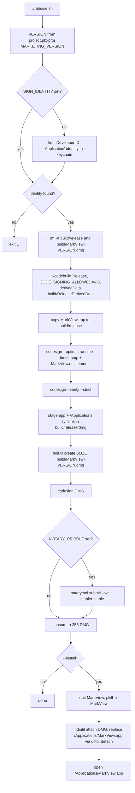

# Build, Release and Testing

How MarkView is configured, built, signed, packaged, installed and tested. Each section names the file it comes from.
Checked against the code at `ac3001ba` (2026-11-15): file names and symbols were looked up mechanically, and the ATS, entitlement and install
statements were re-read; the rest keeps its earlier text. Day-to-day procedures are in
[operations-runbook.md](../operations-runbook.md).

Related modules: [app-shell-and-workspace](app-shell-and-workspace.md) ·
[editor-and-bridge](editor-and-bridge.md) ·
[ai-assistants-and-dictation](ai-assistants-and-dictation.md) ·
[feature-workflow](feature-workflow.md) · [architecture-and-xray](architecture-and-xray.md) ·
[semantic-index-and-insight](semantic-index-and-insight.md) ·
[git-github-terminal-lifecycle-usage](git-github-terminal-lifecycle-usage.md)

---

## 1. Toolchain

| Tool | Needed for | Source |
|---|---|---|
| Xcode 15+ (project format), Swift 5.9 | every build | `MarkView.xcodeproj/project.pbxproj` |
| macOS SDK, deployment target 13.0 | every build | `MarkView.xcodeproj/project.pbxproj` |
| `xcodebuild` | Debug/Release builds | `CLAUDE.md` Verification, `release.sh` |
| `codesign`, `security`, `hdiutil`, `ditto`, `shasum` | release | `release.sh` |
| Developer ID Application certificate in the keychain | release signing | `release.sh` |
| `xcrun notarytool` + keychain profile, `xcrun stapler` | optional notarization | `release.sh` |
| Node.js + npm (`npx esbuild` 0.28.2) | rebuilding vendored JS only | `tools/web-vendor/build.sh`, `tools/web-vendor/package.json` |
| `swift`, `swiftc`, `python3` | package & standalone tests | `Packages/MarkViewCore`, `tools/tests/run.sh`, `tools/tests/*.sh` |
| `gh` | CI release job; PR X-Ray at runtime | `.github/workflows/build-release.yml`, `release.sh --publish` |

Local Swift package: `Packages/MarkViewCore` is linked directly into the `MarkView` app target
in `MarkView.xcodeproj`. The XcodeGen setup and the `EditorWeb/` folder were removed in 6.26.0 (`DEC-004`, `DEC-005`).

## 2. Project structure (`MarkView.xcodeproj` + `Packages/MarkViewCore`)

- `MarkView.xcodeproj/project.pbxproj` is the single source of truth (`CLAUDE.md` Working Rules).
  It defines one application target, `MarkView`, and links `Packages/MarkViewCore`.
- The scaffold documents of the old build setup were removed in 6.26.0, so they are no longer bundled into the app resources.
- `Assets.xcassets`, `Resources/Editor/`, and Swift source memberships are maintained directly
  in `MarkView.xcodeproj` (no generated-pbxproj drift from XcodeGen).

## 3. Build configurations and settings

Shared settings (`MarkView.xcodeproj/project.pbxproj`): `SWIFT_VERSION 5.9`, `MACOSX_DEPLOYMENT_TARGET 13.0`,
`ARCHS $(ARCHS_STANDARD)`, `CODE_SIGN_STYLE Automatic`, `INFOPLIST_FILE MarkView/Info.plist`,
`GENERATE_INFOPLIST_FILE false`, `SWIFT_STRICT_CONCURRENCY = targeted`, `MARKETING_VERSION` = `CURRENT_PROJECT_VERSION`.
Bundle identifier: `com.markview.MarkView`.

| Setting | Debug | Release |
|---|---|---|
| Entitlements | `MarkView/MarkViewDebug.entitlements` | `MarkView/MarkView.entitlements` |
| Swift optimization | `-Onone` | `-O`, whole module |
| Conditions | `DEBUG` | none |
| Debug info | `dwarf` | `dwarf-with-dsym` |
| Other | `ONLY_ACTIVE_ARCH YES`, `ENABLE_TESTABILITY YES` | `ENABLE_NS_ASSERTIONS NO` |

Not set in `project.pbxproj`: `ENABLE_HARDENED_RUNTIME`, `DEVELOPMENT_TEAM` (`SWIFT_STRICT_CONCURRENCY = targeted` is set in both configurations).
The hardened runtime is applied only by `release.sh` at signing time (`release.sh`).

`Info.plist` highlights:
- Versions come from build settings (`MarkView/Info.plist`).
- Document types: Markdown and JSON Canvas at rank Default, JSON/XML/YAML/folders at Alternate
  (`Info.plist`); imported UTIs `net.daringfireball.markdown`, `com.markview.jsoncanvas`.
- Privacy strings: Apple Events and microphone.
- ATS: `NSAllowsArbitraryLoads` is false; `NSAllowsArbitraryLoadsInWebContent` and `NSAllowsLocalNetworking` are true (AR-41).
- `NSPrincipalClass` is `NSApplication`, although `MarkView/App/MarkViewApp.swift`
  says it should be `MarkViewApplication`.

## 4. Pre-build script: "Build Web Editor (optional)"

Defined in `MarkView.xcodeproj/project.pbxproj` (`alwaysOutOfDate = 1`).
It copies the checked-in editor into the bundle:

1. `DEST=$TARGET_BUILD_DIR/$UNLOCALIZED_RESOURCES_FOLDER_PATH/Editor`
2. `ditto` top-level editor HTML files (`index.html`, `terminal.html`, `discussion.html`, `book.html`) into `DEST`.
3. If `Resources/Editor/vendor` exists, delete `DEST/vendor` and `ditto` the folder.

A new top-level page in `Resources/Editor` must be added to the script in `project.pbxproj`, otherwise `Bundle.main.url(...)` returns nil and the web view stays blank (`tasks/lessons.md`).

## 5. Resource bundling

| Path inside `MarkView.app/Contents/` | Put there by | Loaded by |
|---|---|---|
| `Resources/Editor/index.html` | pre-build script | `MarkView/Views/Workspace/EditorView.swift` |
| `Resources/Editor/terminal.html` | pre-build script | `MarkView/Models/Terminal/TerminalSession.swift` |
| `Resources/Editor/vendor/{js,css}` | pre-build script | `index.html`, `terminal.html` |
| `Assets.xcassets` (AppIcon) | Resources phase (`project.pbxproj`) | `ASSETCATALOG_COMPILER_APPICON_NAME` |

Offline: `index.html` has no reference to a CDN (`git grep` for `jsdelivr`, `unpkg` and `cdnjs` finds nothing in it). Every library, Turndown
and DOMPurify included, is a vendored copy under `Resources/Editor/vendor/`.
`vendor/MANIFEST.txt` records versions, SHA-256 and CVE checks for the vendored libraries
(`MarkView/Resources/Editor/vendor/MANIFEST.txt`).

## 6. Versioning policy

- Every committed app change bumps the version with semver
  (`CLAUDE.md` Versioning): patch = fixes, minor = features, major = removed/reworked features
  or incompatible `.dde/` / settings-key changes. Docs, `tasks/` and build-script-only changes
  do not bump. Several changes in one commit get one bump at the highest level.
- `./bump-version.sh patch|minor|major`:
  - reads the current `MARKETING_VERSION` from `MarkView.xcodeproj/project.pbxproj`;
  - rewrites `MARKETING_VERSION` and `CURRENT_PROJECT_VERSION` in every configuration in `project.pbxproj` and verifies every target line updated;
  - build number equals marketing version.
- Release tags follow `v<version>` (for example `v6.26.0`, `v6.26.1` in `git tag`). The README badge reads
  `v*` releases (`README.md`). `./release.sh --publish` tags and publishes the DMG from a clean `origin/main` checkout.

## 7. Signing, entitlements and sandbox

**The App Sandbox is off in both configurations** (`MarkView/MarkView.entitlements`,
`MarkView/MarkViewDebug.entitlements`). Stated reason: sandboxing blocks `Process()` from
running the `claude` / `codex` CLIs (`MarkView.entitlements`). The app also reads other
tools' files, for example `~/.claude/.credentials.json`, `~/.codex/auth.json` and the Claude Code
keychain item via `/usr/bin/security` (`MarkView/Models/AI/AgentUsageTracker.swift`).

| Entitlement | Release | Debug | What it enables |
|---|---|---|---|
| `com.apple.security.app-sandbox` = false | yes | yes | Unsandboxed: child processes, full file system, network |
| `com.apple.security.device.audio-input` | yes | yes | Microphone under the hardened runtime, for Whisper dictation (`MarkView/Models/Dictation/WhisperClient.swift`) |
| `com.apple.security.automation.apple-events` | yes | **no** | Apple Events under the hardened runtime. The comment in `MarkView.entitlements` says "Open in Terminal.app" needs it, but `FileTreeView.swift` opens Terminal with `NSWorkspace` and no AppleScript (AR-11), so the entitlement may be unused (not checked further) |
| `com.apple.security.network.client` | no | yes | Only matters inside a sandbox, so it has no effect here |

Signing paths:
- Local Debug verification builds use `CODE_SIGNING_ALLOWED=NO` (`CLAUDE.md` Verification), so
  entitlements are not applied.
- `release.sh` builds unsigned (`release.sh`), then signs the app with
  `--options runtime --timestamp --entitlements MarkView/MarkView.entitlements`
  (`release.sh`) and signs the DMG (`release.sh`).
- CI signs ad hoc (`CODE_SIGN_IDENTITY="-"`, `.github/workflows/build-release.yml`).

## 8. Release pipeline (`release.sh`)

Step references: `release.sh` (version) (identity) (clean) (build) (sign) (DMG) (notarize) (checksum) (install).

Without notarization, first launch needs "Open Anyway" in System Settings → Privacy & Security
(`release.sh`, `README.md`). `./release.sh --publish` publishes the DMG as release
`v<version>` marked Latest.

**Release from CI** (`.github/workflows/publish-release.yml`): a `workflow_dispatch` run on
`macos-15` that produces the same installer for the current `MARKETING_VERSION` on `main` and
publishes it as release `v<version>`. It refuses a version that already has a release, and
`dry_run` builds the DMG as a workflow artifact without publishing. Signing and notarization need
the repository secrets `MACOS_CERTIFICATE_P12`, `MACOS_CERTIFICATE_PASSWORD`, `NOTARY_KEY_P8`,
`NOTARY_KEY_ID` and `NOTARY_ISSUER_ID`: the certificate is imported into a temporary keychain and
`notarytool` is called with the App Store Connect key. Without them the run still publishes, but
as an unsigned pre-release that is never marked Latest — only a signed, notarized installer is.

**CI** (five workflows in `.github/workflows/`):

- `ci.yml` (`CI`): on pull requests and pushes to `main` that change more than documentation; a newer run on the same ref cancels
  the older one. Job `pure-tests` runs `./tools/lint/architecture-lint.sh` and `./tools/tests/run.sh --tier pure`. Job `build`
  runs `swift test --package-path Packages/MarkViewCore`, compiles the app with a shared DerivedData cache
  (`tools/ci/build-cache-mtimes.py`) and feeds both logs to `tools/lint/build-warnings.sh`.
- `build-release.yml` (`Build & Release`): on pushes to `main` that change more than documentation. It compiles the Release
  configuration and publishes nothing; the signed DMG is the only installer on GitHub (until 5.10.0 it also kept an unsigned
  pre-release zip). It runs no tests, and it does not bump or check the version.
- `publish-release.yml`: the release from CI described above.
- `copilot-cockpit.yml` and `remote-workspace.yml`: path-filtered checks for the Cockpit and the remote workspace.

## 9. Install

| Command | What it does | Source |
|---|---|---|
| `./release.sh --install` | builds the signed DMG (section 8), quits a running MarkView (`osascript`, then `pkill -x MarkView`), replaces `/Applications/MarkView.app` from the mounted DMG and opens it | `release.sh` |
| manual | open the DMG and drag the app to Applications | `README.md` |

`release.sh --install` quits the running app. When the command runs inside a MarkView terminal, quitting the app kills the script
itself (see the runbook, "Install"). The old `install.sh` (an `xcodebuild archive` into `/Applications`) was removed in 6.26.0.

## 10. Rebuilding the vendored web libraries

`cd tools/web-vendor && npm ci && ./build.sh` (`tools/web-vendor/build.sh`, `README.md`):

- `esbuild` bundles `codemirror-entry.js` → `vendor/js/codemirror.bundle.js` and `xterm-entry.js`
  → `vendor/js/xterm.bundle.js`, as IIFE, minified, `--target=safari15` (`build.sh`).
- Copies `xterm.css`, `cytoscape.min.js`, `elk.bundled.js`, `cytoscape-elk.js`.
- Versions are pinned exactly in `package.json` with `package-lock.json`. `node_modules/` is
  git-ignored (`.gitignore`).
- Other vendor files (markdown-it, KaTeX, Mermaid, Prism, Chart.js, js-yaml) are not produced by
  this script. They are checked-in copies tracked in `vendor/MANIFEST.txt`.
- The bundles are shipping code: rebuild them, commit them, then build the app. Loading from a
  CDN is not allowed (`CLAUDE.md` Repository Map).

## 11. Test strategy

There is no XCTest target for the app. Two kinds of tests exist:

- **Package tests.** `swift test --package-path Packages/MarkViewCore` runs `MarkViewCoreTests` (`JSCallTests`, `PollingSchedulerTests`,
  `SettingsTests`, `SQLiteSchemaTests`, `SubprocessProcessGroupTests`, `SubprocessStartTests`, `MarkViewCoreTests`).
- **Standalone suites.** Each is a script in `tools/tests/` that compiles selected app source files together with a test `main`
  with `swiftc` (or runs a script, a probe app or a web page) and runs the result. They are cataloged in
  `tools/tests/manifest.json` (schema 1, 211 suites at ac3001ba: 136 `pure`, 70 `gui`, 5 `live`; each entry has `name`, `script`,
  `tier` and the `sources` it compiles) and run by `tools/tests/run.sh`:

| Command | What it does |
|---|---|
| `./tools/tests/run.sh --tier pure` | the pure suites (CLI only; default tier). CI runs this |
| `./tools/tests/run.sh --changed [<ref>]` | the suites whose `sources` changed against the ref; exit 3 when files changed but no suite was selected |
| `./tools/tests/run.sh --all` / `--tier gui` / `--tier live` | everything / suites that open a window or WebKit / suites that need a signed-in assistant or network |
| `./tools/tests/run.sh <name>` or `--suite <name>` | one suite |
| `./tools/tests/run.sh --list` / `--dry-run` | print the selection without running it |

  Every suite runs in its own process group with a time limit from its tier (pure 180 s, gui 600 s, live 1800 s, or
  `timeoutSeconds` in the manifest), and the group is killed on timeout or interrupt.
- **Lint.** `./tools/lint/architecture-lint.sh` is the structural gate (21 rules and ratchets, allow-lists in `tools/lint/*.txt`);
  it is checked by `tools/tests/architecture-lint-tests.sh`. `tools/lint/build-warnings.sh` ratchets compiler warnings and
  `tools/lint/domain-dependencies.py` measures the dependency cycles between model domains.

Fixtures:
- `Tests/Fixtures/` holds the data the suites read: `importance`, `insight-skeleton-sample.json`, `marker-cases`, `pdf-export`, `prototype-audit`, `qa-api-demo`, `qa-demo`, `qa-native-demo`, `sse-anthropic-sample.txt`, `themes`.
- `Tests/Fixtures/` holds fixtures used by automated tests.

## 12. Verification checklist

1. Debug build:
   `xcodebuild -project MarkView.xcodeproj -scheme MarkView -configuration Debug -derivedDataPath /tmp/MarkViewDerivedData CODE_SIGNING_ALLOWED=NO build`
   (`CLAUDE.md` Verification).
2. Package tests: `swift test --package-path Packages/MarkViewCore`.
3. Pure standalone suites: `./tools/tests/run.sh --tier pure` (or targeted `./tools/tests/run.sh --changed`), and the structural gate `./tools/lint/architecture-lint.sh`.
4. Bundle check: `ls /tmp/MarkViewDerivedData/Build/Products/Debug/MarkView.app/Contents/Resources/Editor/`
   must list `index.html`, `terminal.html`, `discussion.html`, `book.html`, and `vendor/` (`tasks/lessons.md`).
5. Toolbar or menu changes: launch the built app. The build does not catch a missing
   `EnvironmentObject` in toolbar content (`tasks/lessons.md`).
6. Editor UI: check in real WebKit, not Chrome (`tasks/lessons.md`).
7. Bump the version before committing an app change (`./bump-version.sh`). Keep both build configurations in `MarkView.xcodeproj/project.pbxproj` in step.
8. Release: `./release.sh` (or `./release.sh --publish` from a clean `origin/main` checkout).

## 13. Historical cleanup notes

Obsolete scaffolds removed in 6.26.0 (`DEC-004`, `DEC-005`): the XcodeGen configuration, the setup and install scripts, `EditorWeb/`, the importance-check script, and the scaffold documents of the old setup.
- `.gitignore`: sandbox-off entitlements are intentional for spawning local CLIs (`CLAUDE.md`).
- Web vendor libraries (including Turndown, DOMPurify, CodeMirror, Cytoscape, ELK, xterm.js) are bundled locally via `tools/web-vendor/build.sh` with zero CDN loads in `index.html`.
