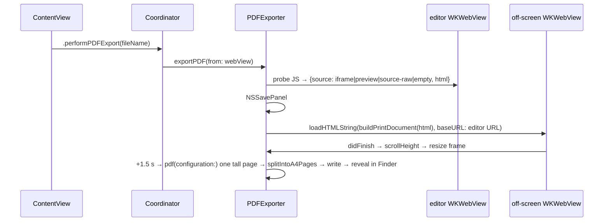

# Editor Web Layer and Swift↔JS Bridge

Scope: the bundled HTML/JS editor that ships in the app (`MarkView/Resources/Editor/`), the
Swift side that hosts it (`EditorView.swift`, `WebViewBridge.swift`), PDF export
(`PDFExporter.swift`), the embedded terminal page (`terminal.html`, JS side only), the
vendor build tooling (`tools/web-vendor/`). (The old dormant `EditorWeb/` prototype has been deleted.)

Status (2026-11-15, code at `ac3001ba`): sections 4, 5, 7, 8, 9 and 11 and the risk list in section 10 were re-read against the code for this
edit. The bridge is now declared by `Editor/js/bridge-contract.json` and decoded by `TypedWebBridge` (AR-28); the 2.17.0 text about hand-parsed
messages, the `/tmp` diagnostic log, CDN scripts and string-interpolated JS no longer holds and is replaced below. Sections 3 and 6, the
vendored-library table and the data-viewer section keep their 2.17.0 text; their paths and symbols were checked mechanically, their narrative
was not re-read.

Sibling docs: [app-shell-and-workspace](app-shell-and-workspace.md) ·
[ai-assistants-and-dictation](ai-assistants-and-dictation.md) ·
[feature-workflow](feature-workflow.md) ·
[architecture-and-xray](architecture-and-xray.md) ·
[semantic-index-and-insight](semantic-index-and-insight.md) ·
[git-github-terminal-lifecycle-usage](git-github-terminal-lifecycle-usage.md) ·
[build-release-testing](build-release-testing.md)

---

## 1. Purpose and responsibilities

The subsystem owns:

- One long-lived `WKWebView` (per `EditorView` instance) that renders every "document-like" tab:
  Markdown (WYSIWYG + source), structured data (JSON/XML/YAML tree; JSON and YAML editable in
  the tree and in the source view), JSON Canvas, read-only source code
  (CodeMirror 6), data files (tables, Parquet, SQLite, Excel, HAR, logs — `markview-data.js`),
  the X-Ray / Architecture graph host, and the Recursive Insight sandboxed iframe. The mode is switched in-page; the web view is never recreated per tab
  (`EditorView.swift`, `EditorView.swift`).
- The single script message handler `bridge` and its JSON-ish message protocol
  (`EditorView.swift`, `WebViewBridge.swift`).
- All Swift→JS calls into the editor (`WebViewBridge.swift`, plus a few inline in
  `EditorView.swift` and `PDFExporter.swift`).
- Markdown rendering (markdown-it + plugins, KaTeX, Mermaid, Prism), heading/TOC extraction,
  semantic block extraction and diffing, find-in-page, WYSIWYG formatting and Turndown
  HTML→Markdown conversion.
- PDF export of the active document: `PDFExporter.swift` asks for paper and style, then typesets the page by page with the PDF-book engine in its `document` mode (`book.html`, `markview-book.js`, `BookPDFRenderer.swift`).
- The terminal page's JS (`terminal.html`) and its `terminal` message protocol (Swift owner is
  `TerminalSession.swift`, documented in
  [git-github-terminal-lifecycle-usage](git-github-terminal-lifecycle-usage.md)).
- Building/vendoring third-party browser bundles (`tools/web-vendor/`).

It does **not** own:

- Tab state, file I/O, saving, dirty tracking — `WorkspaceManager` / tabs store
  ([app-shell-and-workspace](app-shell-and-workspace.md)). The bridge only forwards.
- AI calls behind `selectionAction`, `translateRequested`, `featureAction`, `generateGraph`,
  code-viewer `askAI`/`explain` ([ai-assistants-and-dictation](ai-assistants-and-dictation.md),
  [feature-workflow](feature-workflow.md)).
- X-Ray data model and `arch` action semantics
  ([architecture-and-xray](architecture-and-xray.md)); only the transport is here.
- Insight session generation
  ([semantic-index-and-insight](semantic-index-and-insight.md)).
- The PTY / process side of the terminal, and the GitHub HTML view
  (`GitHubViews.swift`, JavaScript disabled there).

---

## 2. Files

| Path | Role |
|---|---|
| `MarkView/Views/Workspace/EditorView.swift` | `NSViewRepresentable` hosting the editor `WKWebView`; `Coordinator` = navigation delegate + `WebViewBridgeDelegate`; routes tabs by kind; image inlining; notification observers |
| `MarkView/Bridge/WebViewBridge.swift` | The `bridge` channel: `registerHandlers` (one `messages.on` per contract message, each calling the `WebViewBridgeDelegate`), the Swift→JS commands (built with `JS.call` from `MarkViewCore`), the `WebViewBridgeDelegate` protocol; `AnyCodable` is declared here and used nowhere else |
| `MarkView/Bridge/TypedWebBridge.swift` | `BridgeContract` (reads `bridge-contract.json`), `TypedWebBridge` (checks each message against the contract, decodes the payload into its type, calls the one registered handler; a refusal is logged by type name only) |
| `MarkView/Bridge/PageMessages.swift` | One `BridgePayload` type per message (`EditorMessage`, the discussion and terminal messages) |
| `MarkView/Resources/Editor/js/bridge-contract.json` | The one declaration of every message a page may post, per channel (`bridge`, `discussion`, `terminal`); `mv-kit.js` (`mvBridge.send`) validates against it before posting |
| `MarkView/Bridge/PDFExporter.swift` | Entry points (active tab, research-map report), save panel with paper and style, `render` through `BookPDFRenderer` in `document` mode, atomic save |
| `MarkView/Bridge/PrototypeSchemeHandler.swift` | `mvproto://site/<path>`: serves a prototype's `site/` folder to the Prototype Studio preview so all files share one origin and a script error keeps its text and line (a `file://` page reports only "Script error."); paths are confined to the folder (`..`, encoded `..` and symlinks out of it → 403); no caching |
| `MarkView/Resources/Editor/index.html` | Editor page: CSP, ~1270 lines of inline CSS (`index.html`), DOM skeleton, ordered `<script>` tags |
| `MarkView/Resources/Editor/terminal.html` | xterm.js page for embedded terminals; `terminal` message handler protocol |
| `js/markview-early.js` | First script: global `error`/`unhandledrejection` capture → `jsError` |
| `js/markview-state.js` | Global `state`, `DOM` cache, markdown-it instance `md`, Mermaid init |
| `js/markview-mdext.js` | markdown-it rules: wikilinks, `$`/`$$` math (KaTeX), wikilink click → `linkClicked`; `window.scrollToHeadingText` |
| `js/markview-render.js` | `renderMarkdown`, frontmatter panel, Mermaid/Prism passes, headings, semantic blocks + diff, heading IntersectionObserver |
| `js/markview-edit.js` | Stats, font slider, Turndown, source/WYSIWYG mode switch, format commands, floating format bar, save/translate/refresh senders |
| `js/markview-find.js` | Selection actions (translate/explain), feature-action menu, action popup, `window.showSelectionResult`, find bar |
| `js/markview-themes.js` | The window theme: tokens of the eleven appearances (classic-dark, classic-light, darcula, midnight, graphite, tokyo-night, carbon-red, nord, forest, paper, daylight) as ~118 CSS custom properties on `<html>`, `data-preset` / `data-theme` / `data-accent`; `MarkViewThemes.apply(id, accent)`; shared by the editor, discussion and terminal pages. Its base colours are compared with `Models/Appearance/AppTheme.swift` by `tools/tests/theme-model-tests.sh` |
| `js/markview-bridge.js` | Theme entry (`applyTheme`), `sendToSwift`, second error capture, base `window.setContent` |
| `js/markview-structured.js` | JSON/XML/YAML tree view, format/minify, struct headings; `window.setStructuredContent` |
| `js/markview-insight-srcdoc.js` | Insight: escapes, lib map, blob materialisation, iframe `srcdoc` builder incl. the iframe script |
| `js/markview-insight-helpers.js` | Insight chrome: enter/leave view, breadcrumbs, status bar, 10 s ready timer |
| `js/markview-insight-handlers.js` | Insight: `stripCDNTags`, the five Swift→JS setters, parent `message` listener with allowlist |
| `js/markview-globals.js` | `setDocumentBase`, `setTheme`, `scrollToHeading`, `scrollToText`, `documentGotoLine`, `getHTML`, print-layout helpers |
| `js/markview-canvas.js` | JSON Canvas viewer (pan/zoom), wraps `setContent`/`scrollToHeading`; `canvasOpenFile` |
| `js/markview-panels.js` | `window.MVPanels.resizable` (drag-resizable side panels, width in localStorage) |
| `js/markview-code.js` | Code viewer (lazy-loads `codemirror.bundle.js`), margin notes, nav, AI ask; wraps `setContent`/`setStructuredContent`/`setTheme`; `code` messages |
| `js/markview-architecture-*.js` | X-Ray host (lazy-loads Cytoscape + ELK); wraps `setContent`/`setStructuredContent`/`setCodeContent`/`setTheme`; `arch` messages |
| `js/markview-diagram-viewer.js` | Full-window pan/zoom viewer for rendered Mermaid SVGs |
| `js/markview-d3-mermaid.js` | `%%INTERACTIVE` Mermaid → D3+dagre canvas; `generateGraph`; end-checkpoint sentinel; schedules `init` |
| `js/markview-init.js` | Textarea input, link interception, global shortcuts, `init()` (sends `ready`) |
| `vendor/css/markview-canvas.css` | Canvas viewer styles |
| `vendor/MANIFEST.txt` | Supply-chain manifest (version, SHA-256, source URL, CVE check) for the vendored libs it lists |
| `tools/web-vendor/build.sh`, `package.json`, `package-lock.json`, `codemirror-entry.js`, `xterm-entry.js` | esbuild bundling of CodeMirror (`MVCode`) and xterm (`MVTerm`); copies Cytoscape/ELK/xterm.css |
| `MarkView.xcodeproj/project.pbxproj` | Bundles `Resources/Editor` (including `vendor/`, `book.html`, `discussion.html`, `terminal.html`, `index.html`) |

### Third-party vendored assets

| File | Library / version | Source of version |
|---|---|---|
| `markdown-it.min.js` | markdown-it 13.0.1 | `MANIFEST.txt`, file header |
| `markdown-it-footnote.min.js` | 3.0.3 | `MANIFEST.txt` |
| `markdown-it-task-lists.min.js` | 2.1.1 (header says 2.1.0) | `MANIFEST.txt` |
| `markdown-it-container.min.js` | 4.0.0 | `MANIFEST.txt` |
| `mermaid.min.js` | mermaid 10.6.1 | `MANIFEST.txt` (hash matches on disk) |
| `katex.min.js`, `auto-render.min.js`, `vendor/css/katex.min.css`, `vendor/css/fonts/*` | KaTeX 0.16.9 | `MANIFEST.txt`, `version:"0.16.9"` in file |
| `prism*.min.js`, `prism-*.css` | Prism 1.29.0 (15 languages + line-numbers) | `MANIFEST.txt` |
| `js-yaml.min.js` | 4.1.0 | `MANIFEST.txt` |
| `chart-4.4.9.min.js` | Chart.js 4.4.9 (Insight iframe only) | `MANIFEST.txt`, file banner |
| `codemirror.bundle.js` | CodeMirror 6 (`@codemirror/view` 6.43.13, `state` 6.7.6, …) | `tools/web-vendor/package.json` |
| `xterm.bundle.js`, `vendor/css/xterm.css` | `@xterm/xterm` 6.0.0, addon-fit 0.11.0, addon-web-links 0.12.0 | `tools/web-vendor/package.json` |
| `cytoscape.min.js` | cytoscape 3.34.3 | `tools/web-vendor/package.json` |
| `elk.bundled.js` | elkjs 0.12.0 | `tools/web-vendor/package.json` |
| `cytoscape-elk.js` | cytoscape-elk 2.3.0 | `tools/web-vendor/package.json` |
| d3, turndown, turndown-plugin-gfm, DOMPurify | `vendor/js/d3.min.js`, `turndown.min.js`, `turndown-plugin-gfm.min.js`, `dompurify.min.js` (all vendored; versions are in `MANIFEST.txt`, not re-checked here) | `index.html` |

`MANIFEST.txt` does not cover the `tools/web-vendor` bundles. No editor script loads from a CDN: the CSP is `script-src 'self' 'wasm-unsafe-eval'` and `index.html` has no `https://` script tag.

---

## 3. Key types, modules and global JS state

### Swift

- **`EditorView`** (`EditorView.swift`) — `makeNSView` builds `WKWebViewConfiguration`, registers
  `bridge` as the `"bridge"` handler, builds its configuration through `WebHost.makeConfiguration` (`MarkViewCore`; the inspector is enabled in Debug builds only), reads `index.html` from the bundle, rewrites `data-preset="classic-dark" data-theme="dark"` to the window's
  `WindowTheme.htmlAttributes`, and loads it with `loadHTMLString(html, baseURL: <bundle>/Editor/)`.
  `updateNSView` pushes the active tab and theme on every SwiftUI update.
- **`EditorView.Coordinator`** — state: `isEditorReady`, `pendingContent/URL/Tab`,
  `lastLoadedContent` (dedupe key), `lastLoadedDocumentURL`, `currentDocumentBaseURL`,
  `currentCodeURL`, `pendingCodeReveal`, `currentLineRevealURL`, `lastTheme`, insight
  subscription state (`insightCancellables`, `currentInsightSessionId`,
  `lastForwardedSectionLength`), `architectureCancellable`/`architectureScope`,
  `codeNotesCancellable`.
  - `loadContentIfNeeded(_:documentURL:tab:)` — central router by `TabKind`
    (`.insight`, `.architecture`, `.terminal/.image/.github` = no-op, `.file`) and then by
    `FileType` (code / notes-view / structured / markdown).
  - `routeInsight`, `routeArchitecture`, `routeCodeNotes` —
    Combine subscriptions that push state into JS.
  - Pictures are not inlined any more (`resolveImagePaths` is gone): the page asks for them through the `markview-doc:///<path>` scheme (`DocumentFileSchemeHandler`, rule in `DocumentFiles`).
  - `webView(_:decidePolicyFor:)` — navigation policy.
  - NotificationCenter observers: `.performPDFExport`, `.scrollToHeading`,
    `.revealCodeLine`, `.codeNavEvent`, `.scrollToText`.
- **`TypedWebBridge`** (`TypedWebBridge.swift`) — the `WKScriptMessageHandler` of one channel. `receive` refuses a body without a string
  `type`, a type not in the contract, a message from a frame other than the top frame when the contract says `mainFrameOnly`, and a
  payload that does not match its spec; then it decodes the payload into the registered `BridgePayload` and calls the handler on the main
  actor. Every refusal is logged by type name only (`AppLog.bridge`).
- **`WebViewBridge`** (`WebViewBridge.swift`) — owns the `TypedWebBridge` for the `bridge` channel and registers one handler per message in
  `registerHandlers`; each handler calls the `weak var delegate: WebViewBridgeDelegate?`. `jsError` is the only message with no delegate
  call: it goes to `logInsightDiag`, which in a Debug build writes one `AppLog.insight` line and deletes a leftover
  `/tmp/markview-insight-diag.log` from an older release (AR-09).
- **`BridgeMessage<Payload>`** (`TypedWebBridge.swift`) — what a handler receives: the decoded `payload`, the `doc` (id of the tab the page
  described) and the raw dictionary, which the `code`, `arch` and `researchMap` handlers pass on because their owners read the fields by action.
  `AnyCodable` (`WebViewBridge.swift`) is still declared and nothing else uses it.
- **`WebViewBridgeDelegate`** — 27 methods; the only implementation is `EditorView.Coordinator` (`EditorView.swift`), which hops each to
  `@MainActor` and calls the window's objects (`TabsController`, `CodeAndXRayCoordinator`, `FeatureFlowCoordinator`, `InsightCoordinator`).
- **`PDFExporter`** (`PDFExporter.swift`) — `exportPDF(from:tab:fileName:documentFiles:)` prints a file tab from the text the tab holds
  (an insight tab from the page that shows it), `exportPDF(markdown:title:fileName:baseURL:documentFiles:)` prints a document the page builds
  on request (the report of a research map), `render(_:style:entry:allowFile:)` makes the PDF without a panel. The engine paginates page by
  page, so nothing is sliced: title page from the front matter, running head with the section, footer `n / N`, contents for a long document,
  bookmarks, links, Prism colours, KaTeX, Mermaid at its natural size; a picture is read only from the folders the document may use and a
  picture that cannot be read becomes a note. Checks: `tools/tests/pdf-export-tests.sh`.

### JavaScript globals (all classic scripts sharing one global scope)

| Global | Defined | Purpose |
|---|---|---|
| `state` | `markview-state.js` | `mode` (`source`/`preview`/`structured`/`structured-source`/`insight`/`code`; `arch-mode` is a body class), `theme`, `markdown`, `headings`, `activeHeadingId`, `isRendering`, `documentBaseURL`, `fileType` (`markdown`/`json`/`xml`/`yaml`/`canvas`/`code`), insight fields (`insightIframe`, `insightSessionId`, `insightCurrentNodeId`, `insightSkeleton`, `insightSectionLibsNeeded`, `insightBlobURLs`, `insightLibBytes`, `insightLoadTimer`, `insightIframeReady`, `insightPendingChunks`) |
| `DOM` | `markview-state.js` | Cached element refs (`editor` textarea, `rendered` contentEditable, panes, status, insight chrome) |
| `md` | `markview-state.js` | markdown-it instance (`html: true, breaks, linkify, typographer`) + footnote, task-lists, admonition containers (`info/warning/tip/danger`), image renderer override |
| `wysiwygDirty`, `turndownService` | `markview-edit.js` | Whether WYSIWYG DOM was edited; Turndown instance |
| `formatBarSelectedText`, `featureText` | `markview-edit.js`, `markview-find.js` | Captured selection for RU/EN/?/✦ buttons |
| `findState` | `markview-find.js` | Find bar state and `<mark>` highlights |
| `cv` | `markview-canvas.js` | JSON Canvas viewer state |
| `dv` | `markview-diagram-viewer.js` | Diagram viewer state |
| `window.MVPanels`, `window.MVCode`, `window.MVTerm` | `markview-panels.js`, `codemirror-entry.js` (last line), `xterm-entry.js` | Panel resizer; CodeMirror factory; xterm exports |
| `window.pendingCodeLine` | `markview-code.js` | Line reveal queued until the code viewer exists |

**Function wrapping chain.** Several `window.*` entry points are monkey-patched by later scripts,
so load order is semantic (`index.html` comments):

- `window.setContent`: base `markview-bridge.js` → canvas cleanup `markview-canvas.js` →
  leave code view `markview-code.js` → leave X-Ray `markview-architecture-*.js`.
- `window.setStructuredContent`: `markview-structured.js` → `markview-code.js` →
  `markview-architecture-*.js`.
- `window.setTheme`: `markview-globals.js` → `markview-code.js` →
  `markview-architecture-*.js`.
- `window.scrollToHeading`: `markview-globals.js` → `markview-canvas.js` (`cv-` ids pan the canvas).
- `window.setCodeContent`: `markview-code.js` → `markview-architecture-*.js`.

### Script load order (`index.html`)

1. `markview-themes.js`, `mv-kit.js`, then markdown-it + footnote, task-lists, container (vendored)
2. mermaid, katex, auto-render (vendored)
3. d3, DOMPurify, turndown, turndown-plugin-gfm (vendored)
4. Prism + 15 language components, js-yaml (vendored)
5. `markview-early` → `state` → `mdext` → `render` → `edit` → `find` → `bridge` → `structured`
   → `insight-srcdoc` → `insight-helpers` → `insight-handlers` → `globals` → `canvas` → `panels`
   → `code` → `architecture-model/graph/panels/details/toolbar` → `diagram-viewer` → `d3-mermaid` → `data` → `research-map-*` (seven files) → `init`. `markview-themes.js` and `mv-kit.js` load first, in `<head>`

Lazy loads: `codemirror.bundle.js` on first code view (`markview-code.js`); `cytoscape.min.js`
→ `elk.bundled.js` → `cytoscape-elk.js` on first X-Ray render (`markview-architecture-*.js`);
Insight iframe `<script src>` for prism/mermaid/chart/katex (`markview-insight-srcdoc.js`).

---

## 4. Internal interfaces

**Into this subsystem**

- SwiftUI: `ContentView.swift` instantiates `EditorView()`; environment objects
  `WorkspaceManager`, `WindowTheme`.
- Notifications posted elsewhere and observed in `EditorView.Coordinator.init`:
  `.performPDFExport` (posted `ContentView.swift`), `.scrollToHeading` (`TOCView.swift`),
  `.scrollToText` (`TOCView.swift`, `WorkspaceManager.swift`),
  `.revealCodeLine` (`WorkspaceManager.swift`), `.codeNavEvent` (`CodeNavigation.swift`).
- `InsightCoordinator.blobReleases` (a `PassthroughSubject`) is what the editor listens to while `routeInsight` (`EditorView.swift`) shows an
  insight tab; `InsightCoordinator.close` sends it, and the window runs `close` when `TabsController.closeTab` reports `TabsEvent.insightClosed`.
- Published stores observed: `InsightSession.$skeleton/$currentNodeSections/$lastError/$statusMessage`,
  `ArchitectureStore.$revision/$progress`, `codeExplain.$revision`, `architecture.$revision`.

**Out of this subsystem** (all through `EditorView.Coordinator` → `WorkspaceManager`, main actor):
`updateActiveTabContent` (`WorkspaceManager.swift`), `updateActiveTabHeadings`,
`updateActiveHeading`, `updateActiveTabScrollPosition` (never reached, see §10),
`handleCursorBlockChange`, `saveActiveFile`,
`reloadActiveTabFromDisk`, `translateDocument`, `handleSelectionAction`, `runFeatureAction`, `runGraphEdit`, `presentGraphCreator`,
`openCanvasFileReference`, `handleCodeAction`, `setNotesView`,
`handleArchitectureAction`, `openFile(_:lineFragment:)`, `openWikiLink`, `prepareCodeNotes`/`codeNotesJSON`, `xrayStore(for:)`,
`didReceiveInsightIframeReady` … `didRequestInsightRetrySection`.
Also `NSWorkspace.shared.open` for external URLs and non-openable local files.

---

## 5. Bridge message catalog

Transport: the page calls `window.mvBridge.send(type, payload, channel)` (`mv-kit.js`; the editor's helper is `sendToSwift` in
`markview-bridge.js`, which uses channel `bridge`), which validates the message against `window.mvBridgeContract` (the text of
`bridge-contract.json`) and then posts `{type, payload, doc}` to `window.webkit.messageHandlers.<channel>`. Swift checks the same
message again in `TypedWebBridge.receive` (section 9). There are three channels: `bridge` (27 messages, below), `discussion` (3: `copy`,
`ready`, `save`) and `terminal` (6, section 5.4). The tables below are generated from the contract and from `WebViewBridge.registerHandlers`;
the per-field detail (enums, bounds, which fields are optional) is in the contract.

### 5.1 JS → Swift (`bridge` channel)

| type | payload (from the contract) | Sent by | Delegate call in `WebViewBridge.registerHandlers` | Note |
|---|---|---|---|---|
| `ready` | `{}` | `markview-init.js` | `bridgeEditorReady` |  |
| `contentChanged` | `markdown: string`, `html: string?` | `markview-code.js`, `markview-edit.js`, `markview-init.js`, `markview-render.js`, `markview-structured.js` | `bridge(didUpdateContent)` |  |
| `headingsUpdated` | array of heading | `markview-canvas.js`, `markview-render.js`, `markview-structured.js` | `bridge(didExtractHeadings)` |  |
| `scrollPosition` | `activeHeadingId: string` | `markview-init.js`, `markview-render.js` | `bridge(didSelectHeading)` |  |
| `linkClicked` | `href: string` | `markview-canvas.js`, `markview-init.js`, `markview-mdext.js` | `bridge(didClickLink)` |  |
| `editorFontSize` | `size: number` | `markview-edit.js` | `bridge(didChangeEditorFontSize)` |  |
| `editorWindowPref` | `key: string`, `value: string` | `EditorWindowPrefs.swift` | `bridge(didSetWindowPref)` |  |
| `canvasOpenFile` | `path: string non-empty` | `markview-canvas.js`, `markview-d3-mermaid.js` | `bridge(didRequestCanvasOpenFile)` |  |
| `saveRequested` | `{}` | `markview-edit.js` | `bridgeSaveRequested` |  |
| `translateRequested` | `markdown: string`, `targetLang: string` | `markview-edit.js` | `bridge(didRequestTranslation)` |  |
| `selectionAction` | `action: string`, `text: string` | `markview-find.js` | `bridge(didRequestSelectionAction)` |  |
| `featureAction` | `action: string`, `text: string non-empty`, `question: string?` | `markview-find.js` | `bridge(didRequestFeatureAction)` |  |
| `refreshRequested` | `{}` | `markview-edit.js` | `bridgeRefreshRequested` |  |
| `generateGraph` | `type: string?`, `editInstruction: string?`, `currentMermaid: string?` | `markview-d3-mermaid.js` | `bridge(didRequestGraph)` |  |
| `code` | `action` (enum of 15 actions) plus the fields of that action | `markview-code.js` | `bridge(didReceiveCodeAction)` |  |
| `arch` | `action` (enum of 53 actions) plus the fields of that action | `markview-architecture-model.js` | `bridge(didReceiveArchitectureAction)` |  |
| `researchMap` | `action` (enum of 21 actions) plus the fields of that action | `markview-research-map-core.js` | `bridge(didReceiveResearchMapAction)` | top frame only |
| `jsError` | `where: string?`, `message: string?`, `source: string?`, `lineno: number?`, `colno: number?`, `stack: string?` | `markview-bridge.js`, `markview-d3-mermaid.js`, `markview-early.js`, `markview-insight-handlers.js`, `markview-research-map-core.js` | none (logged only) |  |
| `insightIframeReady` | `sessionId: string non-empty`, `nodeId: string non-empty` | `markview-insight-handlers.js` | `bridge(didReceiveInsightIframeReady)` | top frame only |
| `insightDeepDiveClicked` | `sessionId: string non-empty`, `sectionId: string non-empty`, `topicIndex: int 0..` | `markview-insight-handlers.js` | `bridge(didRequestInsightDeepDive)` | top frame only |
| `insightBreadcrumbClicked` | `sessionId: string non-empty`, `nodeId: string` | `markview-insight-handlers.js`, `markview-insight-helpers.js` | `bridge(didRequestInsightBreadcrumb)` | top frame only |
| `insightRequestSave` | `sessionId: string?` | `markview-insight-handlers.js` | `bridgeRequestInsightSave` | top frame only |
| `insightRequestUp` | `sessionId: string?` | `markview-insight-handlers.js`, `markview-insight-helpers.js` | `bridgeRequestInsightUp` | top frame only |
| `insightRequestRegenerate` | `sessionId: string?` | `markview-insight-handlers.js`, `markview-insight-helpers.js` | `bridgeRequestInsightRegenerate` | top frame only |
| `insightRequestCustomDeepDive` | `sessionId: string?`, `topic: string non-empty` | `markview-insight-handlers.js` | `bridgeRequestInsightCustomDeepDive` | top frame only |
| `insightRequestExploreAll` | `sessionId: string?`, `depth: int 1..3` | `markview-insight-handlers.js` | `bridgeRequestInsightExploreAll` | top frame only |
| `insightRequestRetrySection` | `sessionId: string?`, `sectionId: string non-empty` | `markview-insight-handlers.js` | `bridgeRequestInsightRetrySection` | top frame only |

Anything that is not in this list is refused by `TypedWebBridge` and logged by type name. The `code` actions are performed by
`CodeAndXRayCoordinator.handleCodeAction` / `handleNavigation`, the `arch` actions are parsed by `XRayCommand.parse` and performed by
`CodeAndXRayCoordinator.perform`, and the `researchMap` actions go to the research-map handler of the window. Semantic checks (paths inside
the project root, known action names) happen in those owners, after the schema check.

### 5.2 Insight iframe → parent (`window.postMessage`, not the WebKit bridge)

Sent by the iframe script via `postParent` (`markview-insight-srcdoc.js`, target `'*'`).
Accepted only when `ev.source === state.insightIframe.contentWindow` and `type` is in
`INSIGHT_ALLOWED_TYPES` (`markview-insight-handlers.js`); origin is **not** checked (the iframe is `sandbox="allow-scripts"`, a null origin). Types: `insightIframeReady` (`markview-insight-srcdoc.js`), `insightDeepDiveClicked
{sectionId, topicIndex}`, `insightRequestSave`, `insightRequestUp`,
`insightRequestCustomDeepDive {topic, lang}`, `insightRequestExploreAll {depth, lang}`, `insightRequestRetrySection {sectionId}`, `insightDebug {where, msg}`
(relayed to Swift as `jsError`). `lang` is dropped by the relay.

Parent → iframe (`contentWindow.postMessage(..., '*')`): `updateInsightSection {sessionId, sectionId,
htmlChunk}` (`markview-insight-handlers.js`), `initSectionLib {sectionId}`, `updateInsightProgress {message, phase}`. Iframe listener:
`markview-insight-srcdoc.js`.

### 5.3 Swift → JS (`evaluateJavaScript`)

Every command is built with `JS.call(function, args:)` (`Packages/MarkViewCore/Sources/MarkViewCore/JS.swift`), which encodes each argument as a
JSON literal (`JS.JSONText` passes an already-encoded JSON object through); a value that cannot be encoded is logged and the call is dropped
(`WebViewBridge.run`). `JS.sequence` joins several calls into one script. Every document-bound command is preceded by
`window.mvSetDocument(<tab id>)` (`markview-edit.js`), so a message the page posts afterwards names the tab it describes (BUG-031). The 2.17.0
text that listed single-quoted interpolation and the array-wrap idiom no longer applies.

| JS function | Args | Swift call site | JS definition |
|---|---|---|---|
| `window.setContent(md)` | JSON string literal (array-wrap) | `WebViewBridge.swift` (`loadContent`), called from `EditorView.swift` | `markview-bridge.js` (+ wrappers, §3) |
| `window.setStructuredContent(content, fileType)` | two JSON literals | `WebViewBridge.loadStructuredContent`, from `EditorView.swift` | `markview-structured.js` |
| `window.setCodeContent.apply(null, [text, language, fileName])` | JSON array | `WebViewBridge.swift`, from `EditorView.swift` | `markview-code.js` |
| `window.setCodeNotes(json)` | object literal from `codeNotesJSON` | `WebViewBridge.swift`, from `EditorView.swift` | `markview-code.js` |
| `window.onCodeNavEvent(json)` | `{type: state\|definitions\|usages\|answer, …}` | `WebViewBridge.swift`, from `EditorView.swift` | `markview-code.js` |
| `window.codeGotoLine(line, endLine)` | ints | `WebViewBridge.swift`, from `EditorView.swift` | `markview-code.js` |
| `window.documentGotoLine(line)` | int | `WebViewBridge.swift`, from `EditorView.swift` | `markview-globals.js` |
| `window.showArchitecture(json)` | payload object literal | `WebViewBridge.swift`, from `EditorView.swift` | `markview-architecture-*.js` |
| `window.setArchitectureProgress(json\|null)` | object literal | `WebViewBridge.swift`, from `EditorView.swift` | `markview-architecture-*.js` |
| `window.leaveCodeView(); window.leaveArchitectureView()` | — | `EditorView.swift` | `markview-code.js`, `markview-architecture-*.js` |
| `void window.loadInsightSkeleton(skeleton, sid, nid, crumbs)` | `JSONEncoder` skeleton, encoded strings, `[{nodeId,title}]` | `WebViewBridge.swift`, from `EditorView.swift` | `markview-insight-handlers.js` (async) |
| `window.updateInsightSection(sid, secId, html)` | encoded strings | `WebViewBridge.swift`, from `EditorView.swift` | `markview-insight-handlers.js` |
| `window.setInsightError(sid, msg, true\|false)` | encoded strings + bool literal | `WebViewBridge.swift`, from `EditorView.swift` | `markview-insight-handlers.js` |
| `window.setInsightStatus(sid, msg, phase)` | encoded strings | `WebViewBridge.swift`, from `EditorView.swift` | `markview-insight-handlers.js` |
| `window.releaseInsightBlobs()` | — | `WebViewBridge.swift`, via hook `EditorView.swift` | `markview-insight-handlers.js` |
| `window.setDocumentBase(url)` | JSON literal | `WebViewBridge.setDocumentBase`, from `EditorView.swift` | `markview-globals.js` |
| `window.setTheme('<appearance id>', '#RRGGBB'\|null)` | `WindowTheme.webArguments` (ids and hex only) | `WebViewBridge.setTheme`, from `EditorView.Coordinator.setTheme` | `markview-globals.js` → `markview-themes.js` (+ wrappers) |
| `window.scrollToHeading(id)` | JSON literal | `WebViewBridge.scrollToHeading`, from `EditorView.swift` | `markview-globals.js`, `markview-canvas.js` |
| `window.scrollToText` / `window.scrollToHeadingText` `.apply(null, [text])` | JSON array | `EditorView.swift` | `markview-globals.js`, `markview-mdext.js` |
| `window.showSelectionResult(title, markdown)` | JSON literals | `EditorView.swift` (translate error) (selection result) | `markview-find.js` |
| Load probe IIFE (returns JSON) | — | `EditorView.swift` | inline |
| Insight page probe IIFE | — | `PDFExporter.swift` (`insightProbe`) | inline, reads `window.state.mode` and `#insight-iframe` |
| `window.getHTML()` | — | none: `requestHTML` is gone from `WebViewBridge.swift` | `markview-globals.js` (defined, no Swift caller) |
| `window.preparePrintLayout()` / `window.restoreEditLayout()` | — | none: no Swift caller | `markview-globals.js` |
| `window.setDataContent(payload)` | one JSON object `{src, kind, name, reload}` | `WebViewBridge.loadDataContent` | `markview-data.js` |
| `window.mvResearchMapSet(documentId, snapshot, …)` | JSON literals | `WebViewBridge.setResearchMap` | `markview-research-map-tree.js` |
| `window.setProjectOperations(json)` | JSON object | `WebViewBridge.setProjectOperations` | `markview-architecture-toolbar.js` |
| `window.revealStructure(path, line)` | JSON literals | `WebViewBridge.revealStructure` | `markview-structured.js` |
| `window.mvSetDocument(id)` | JSON literal | `WebViewBridge.documentIDCall`, prefixed to the document commands | `markview-edit.js`, `markview-research-map-entry.js` |

JS functions exposed but never called from Swift: `toggleSourceMode`, `getMarkdown`
(`markview-globals.js`), `setCodeBaseSize` (called from JS `markview-edit.js`),
`architectureFocus` (called from JS `markview-architecture-*.js`), `struct*` (inline handlers).

### 5.4 Terminal page (`terminal` handler, `TerminalSession.swift`)

| Direction | Message / function | JS site | Swift site |
|---|---|---|---|
| JS→Swift | `{type:"ready", cols, rows}` | `terminal.html` | `TerminalSession.swift` |
| JS→Swift | `{type:"input", data}` | `terminal.html` | |
| JS→Swift | `{type:"resize", cols, rows}` | `terminal.html` | |
| JS→Swift | `{type:"pasteFiles"}` | `terminal.html` | |
| JS→Swift | `{type:"link", url}` | `terminal.html` | |
| JS→Swift | `{type:"resolveLinks", request:int, paths:[string]}` | `terminal.html` | (≤512 paths, request ≥0) |
| Swift→JS | `mvWrite('<base64>')` | `terminal.html` | `TerminalSession.swift` |
| Swift→JS | `mvResolvedLinks(request, [paths])` | `terminal.html` | |
| Swift→JS | `mvSetTheme('<appearance id>', accent\|null)`, `mvFocus()`, `mvReset()`, `mvExited(code)` | `terminal.html` (`discussion.html` has the same `mvSetTheme`) | `TerminalSession.applyTheme`, `DiscussionThreadView` |
| (diagnostics) | `mvMouseMode()`, `mvText()`, `mvSize()` | `terminal.html` | tests only |

The terminal page is loaded with `loadFileURL(page, allowingReadAccessTo: Editor/)`
(`TerminalSession.swift`), unlike the editor's `loadHTMLString`.

---

## 6. Runtime flows

### 6.1 Editor load

```mermaid
sequenceDiagram
  participant SUI as SwiftUI
  participant C as EditorView.Coordinator
  participant WV as WKWebView
  participant JS as index.html scripts
  SUI->>C: makeNSView
  C->>WV: add(bridge,"bridge"); loadHTMLString(index.html, baseURL: Editor/)
  SUI->>C: updateNSView → loadContentIfNeeded(tab)
  C-->>C: isEditorReady == false → pendingContent/pendingTab
  WV->>JS: parse; run scripts in order (early … d3-mermaid, init)
  JS->>C: jsError(init-checkpoint), jsError(end-checkpoint)
  Note over JS: d3-mermaid.js:393 references init before markview-init.js defines it → ReferenceError; init() never runs, "ready" never sent
  WV->>C: didFinish → isEditorReady = true; probe JS; loadContentIfNeeded(pending)
  C->>JS: setDocumentBase, setContent / setStructuredContent / setCodeContent
```

Steps: `EditorView.swift` → → (pending) → (didFinish).
Theme: HTML string rewrite of the `<html>` attributes at load (editor); discussion and terminal pages get the same attributes from a `WKUserScript` at document start (`WindowTheme.firstPaintScript`); later `setTheme` only when `isEditorReady` and changed.

### 6.2 Render markdown (file tab)

1. `loadContentIfNeeded` (`EditorView.swift`): `.file` branch clears insight subs,
   sends `setDocumentBase` when the directory changes, dedupes on
   `loadKey`/URL.
2. Routes: `FileType.code` or notes view → `setCodeContent`; non-markdown →
   `setStructuredContent`; markdown → `setContent` (pictures load through `markview-doc:///`; there is no inlining step).
3. JS `setContent` chain resets canvas/code/X-Ray views, sets `DOM.editor.value`,
   `wysiwygDirty=false`, `initTurndown()`, `switchToPreview()` (`markview-bridge.js`).
4. `switchToPreview` → `renderMarkdown()` (`markview-edit.js`):
   frontmatter extraction (`markview-render.js`), markdown-it parse with `data-line`
   attributes, `innerHTML`, `resolveLocalURLs`, Mermaid block
   conversion, async Prism, async `mermaid.run` + expand buttons, `extractHeadings` → `headingsUpdated`, `contentChanged {markdown, html}`.
5. `setupHeadingObserver` posts `scrollPosition` as headings cross the viewport.

### 6.3 Edit → save round trip

```mermaid
sequenceDiagram
  participant U as User
  participant JS as Editor JS
  participant B as WebViewBridge
  participant C as Coordinator
  participant WM as WorkspaceManager
  U->>JS: type in source textarea
  JS->>JS: input → renderMarkdown (markview-init.js:4-12)
  JS->>B: contentChanged{markdown, html}
  B->>C: didUpdateContent
  C->>WM: Task@MainActor: lastLoadedContent = md; updateActiveTabContent (isModified)
  U->>JS: edit in WYSIWYG
  JS->>JS: wysiwygDirty = true (no sync)
  U->>JS: ⌘S
  JS->>JS: syncWysiwygToMarkdown (Turndown) if dirty
  JS->>B: contentChanged{markdown}; saveRequested{}
  B->>C: bridgeSaveRequested
  C->>WM: saveActiveFile → tab.content.write(to: url) (main thread)
```

Code: `markview-edit.js`; `EditorView.swift`;
`WorkspaceManager.swift`. ⌘R → `refreshRequested` →
`reloadActiveTabFromDisk` → `loadContent` directly (`EditorView.swift`; no image inlining
on this path).

### 6.4 Mermaid / diagrams

- Standard fenced ```` ```mermaid ```` → `<div class="mermaid" data-source>` → `mermaid.run`
  (`markview-render.js`); `decorateMermaidDiagrams` adds expand buttons
  (`markview-diagram-viewer.js`); double-click/expand opens `openDiagramViewer`
  (`markview-diagram-viewer.js`) with wheel zoom, shift+wheel pan, drag pan.
- Source containing `%%INTERACTIVE` → `.mermaid-canvas` → `initMermaidCanvas` after 200 ms
  (`markview-render.js`), which needs vendored `d3` (`markview-d3-mermaid.js`; no editor script references `dagre` any more). AI edit from its popup posts `generateGraph{type:"edit"}` → `runGraphEdit`.
- Turndown rule writes `data-source` back as a mermaid fence (`markview-edit.js`).

### 6.5 Find

`⌘F` → `openFind` unless `state.mode === 'code'` (CodeMirror search panel via
`codeViewOpenSearch`) (`markview-find.js`). Rendered modes walk text nodes of
`DOM.rendered` and wrap matches in `<mark class="find-highlight">`; source modes use
`setSelectionRange` on the textarea. Case and regex toggles re-run the search. `clearHighlights` unwraps marks. Entirely in JS; no bridge traffic.

### 6.6 PDF export



Code: `ContentView.swift`, `EditorView.swift`, `PDFExporter.swift`. The print document has no scripts or vendor CSS, so it relies on
already-rendered SVG/KaTeX HTML from the live DOM. Width 595 pt, height 842 pt, margin 40 px.

### 6.7 Code viewer

1. `FileType.code` (or a markdown tab with `notesView == true`) → `loadCodeContent`
   (`EditorView.swift`).
2. `setCodeContent` → `enterCodeView` hides other panes (`markview-code.js`); markdown
   uses an internal formatted viewer; otherwise `loadBundle()` injects
   `codemirror.bundle.js` once and calls `MVCode.create` / `setDoc`.
3. `routeCodeNotes` subscribes to `codeExplain.$revision` + `architecture.$revision`, debounced
   120 ms, pushing `setCodeNotes(codeNotesJSON)` (`EditorView.swift`).
4. Line reveals: `.revealCodeLine` → `pendingCodeReveal` → `codeGotoLine` or `documentGotoLine`
   depending on whether the URL is the code URL (`EditorView.swift`); JS queues
   in `window.pendingCodeLine` until the viewer exists (`markview-code.js`).
5. User actions post `code` messages; results return via `.codeNavEvent` → `onCodeNavEvent`
   only if the event URL equals `currentCodeURL` (`EditorView.swift`).

### 6.8 Recursive Insight (transport only)

`routeInsight` (`EditorView.swift`) subscribes to four publishers. `$skeleton` →
`loadInsightSkeleton` (builds srcdoc, sets iframe `sandbox="allow-scripts allow-same-origin"`,
starts a 10 s ready timer; `markview-insight-handlers.js`). `$currentNodeSections` → per-section
suffix deltas via `lastForwardedSectionLength`, with shrink detection and a one-shot failure
placeholder (`EditorView.swift`). JS buffers chunks until `insightIframeReady`, strips
scripts/handlers per chunk, then posts into the iframe and debounces `initSectionLib` 100 ms
(`markview-insight-handlers.js`). Semantics are in
[semantic-index-and-insight](semantic-index-and-insight.md).

### 6.9 Link navigation

Clicks inside `DOM.rendered` are intercepted: `#anchor` scrolls in-page and posts `scrollPosition`;
other links post `linkClicked` with the resolved `link.href` (`markview-init.js`). Swift opens
openable `file://` targets as tabs (honouring `#L42` fragments), other `file://` targets with
`NSWorkspace.open`, `http/https/mailto` in the browser, and `markview-wikilink:` via
`openWikiLink` (`EditorView.swift`). Real navigations are filtered by
`decidePolicyFor` with the same rules; `.other` navigations are allowed, anything else cancelled
(`EditorView.swift`).

---

## 7. State and persistence

| Item | Where | Format | Owner |
|---|---|---|---|
| `markview-font-size` | localStorage | number string (10–20) | `markview-edit.js`, read `markview-code.js` |
| `markview-code-notes-width` | localStorage | px int | `markview-code.js` via `MVPanels` (`markview-panels.js`) |
| `markview-xray-details-width` | localStorage | px int | `markview-architecture-*.js` |
| `markview-xray-details-hidden` | localStorage | `"1"` / `""` | `markview-architecture-*.js` |
| Exported PDF | user-chosen path (`NSSavePanel`) | PDF | `PDFExporter.swift` |
| In-memory | `Coordinator` fields (§3), JS `state` | — | this module |

No `UserDefaults` or `@AppStorage` keys are read or written in this subsystem. The theme comes from the window's
`WindowTheme` (`webArguments`: appearance id and accent; `htmlAttributes` for the first paint). `WorkspaceManager` persists tab content;
the editor never writes files itself.

---

## 8. Concurrency and threading

- `WKScriptMessageHandler` callbacks arrive on the main thread; `TypedWebBridge.receive` runs the handler with
  `MainActor.assumeIsolated`, and `WebViewBridge` is not annotated `@MainActor`. Every delegate method in `EditorView.Coordinator` wraps its
  work in `Task { @MainActor in … }` (`EditorView.swift`), so ordering relative to other main-actor tasks is by enqueue order.
- `EditorView.Coordinator` is not `@MainActor` either; it is driven from `updateNSView`, main-queue
  notification observers (`queue: .main`) and Combine sinks with `.receive(on: DispatchQueue.main)`
  or main-scheduler `debounce`/`throttle` (`EditorView.swift`).
- **Main-thread I/O (2.17.0):** the per-load image inlining (`resolveImagePaths`) is gone: pictures are served by
  `DocumentFileSchemeHandler` on request. `logInsightDiag` no longer writes a file (section 5). Whether `saveFile` still writes on the
  main actor (`TabsController.saveFile`) was not re-checked here.
- `PDFExporter` is `@MainActor` (`PDFExporter.swift`). The 2.17.0 text about a fixed 1.5 s `asyncAfter` and static `pdfWebView`/`pdfDelegate` no
  longer matches the file (it has neither); the export now runs through `BookPDFRenderer`, whose concurrency was not re-read here. `showError`
  still uses `runModal`.
- `evaluateJavaScript` completions are main-thread; most calls ignore results. `loadInsightSkeleton`
  is async in JS and wrapped in `void` to avoid the "unsupported type" error (`WebViewBridge.swift`).
- JS timers: 10 s insight iframe-ready timeout (`markview-insight-helpers.js`), 100 ms
  per-section lib init debounce (`markview-insight-handlers.js`), 200 ms interactive canvas
  delay (`markview-render.js`), 100 ms heading observer attach.
- Terminal: `resolveLinks`/`activateLink` resolve paths in `Task.detached` and call back into JS
  (`TerminalSession.swift`); PTY output is batched at ~16 ms.

---

## 9. Error handling, edge cases, payload validation

- **Malformed or unknown messages** (AR-28): `TypedWebBridge.receive` refuses a body that is not a dictionary with a string `type`, a type that
  is not in the contract for that channel, a payload that does not match its spec (kinds, `nonEmpty`, bounds, `enum`, UUID format, item
  counts) and a type with no registered handler. Each refusal is one `AppLog.bridge` error line with the channel and type name (control
  characters replaced, 64 characters at most) and never a payload value. The page validates the same contract before it posts
  (`mvBridge.send`), so a malformed message is normally stopped on the JS side first.
- **Frame check**: the contract marks `researchMap` and the nine Insight messages `mainFrameOnly`; `receive` refuses them from any other
  frame. The other messages have no frame check.
- **Semantic validation** is not in the bridge: it lives in the owners (for example `CodeAndXRayCoordinator` for the X-Ray `openFile` root
  confinement and the canvas path check, `InsightCoordinator` for skeleton and manifest membership of an Insight click).
- **Swift→JS encoding**: every argument goes through `JS.call` as a JSON literal; there is no string interpolation left in
  `WebViewBridge.swift` (the commands are the ones in section 5.3).
- **`evaluateJavaScript` errors** are logged through `AppLog.bridge` (`WebViewBridge.run`); the `jsError` message exists because WebKit
  reports JS exceptions only as "<private>" (`markview-bridge.js`), and the Swift handler logs it by `where`/`message`.
- **Library absence**: markdown-it failure falls back to an escaped `<pre>` (`markview-render.js`);
  Mermaid/Prism/Turndown/d3 are feature-tested with `typeof`. If a script were missing,
  `TurndownService` is undefined, `syncWysiwygToMarkdown` returns early
  (`markview-edit.js`), and a WYSIWYG edit is **not** written back on ⌘S (the unchanged
  textarea is sent); all of these libraries are vendored now, so this is a defensive path. Interactive canvases show "Loading libraries..."
  (`markview-d3-mermaid.js`) when `d3` is missing. CodeMirror load failure shows an inline message
  (`markview-code.js`).
- **Structured parse errors** render an error view (`markview-canvas.js`, structured tree
  analogous); `structFormat`/`structMinify` swallow errors (`markview-structured.js`).
- **PDF**: empty probe → alert (`PDFExporter.swift`); write/pdf errors → alert;
  CG failures fall back to the unsplit tall PDF.
- **`window.confirm` unusable** (no `WKUIDelegate`), so whole-document translation confirmation is
  built in the popup (`markview-find.js`). `prompt()` is still used by WYSIWYG insert
  commands (`markview-edit.js`); without a `WKUIDelegate`
  these return `null` in WKWebView, so link/image/code-block/mermaid/table inserts from the toolbar
  likely do nothing or use defaults (verify manually).

---

## 10. Risks, tech debt, oddities

These are the 2.17.0 findings. Each item ends with its status at `ac3001ba` where the code was checked (by reading, nothing was run); an item
with no status line was not re-checked.

1. **`init()` never runs; `ready` never reaches Swift.** `markview-d3-mermaid.js` evaluates
   `init` while `markview-init.js` (which declares it) has not yet loaded
   (`index.html`). Evidence: the diag log contains one `Script error.` from
   `window.error` and `early-window.error` per page load and zero `IN type=ready` entries. Effects:
   `bridgeEditorReady` (`EditorView.swift`) is dead; startup relies on `didFinish`; the
   textarea focus and initial `applyTheme` in `init` (`markview-init.js`) do not happen.
   Status: not re-checked. The evidence (the diag log) is gone; a handler for `ready` exists (`EditorMessage.Ready` → `bridgeEditorReady`).
2. **Loading a document can rewrite it with inlined images.** `resolveImagePaths` replaces image
   paths with base64 data URIs before `setContent` (`EditorView.swift`); `renderMarkdown`
   immediately posts `contentChanged` with that text (`markview-render.js`), which becomes
   `tab.content` and sets `isModified` (`WorkspaceManager.swift`); `saveFile` writes
   `tab.content`. Traced statically; confirm with a document that has a relative image.
   Status: fixed by reading. `resolveImagePaths` no longer exists; a picture is requested through `markview-doc:///` and the text of the tab is not rewritten.
3. **CDN scripts in a supposedly offline app.** d3, dagre, turndown, turndown-plugin-gfm load from
   `cdn.jsdelivr.net` (`index.html`) with the CSP allowing it, contrary to
   `CLAUDE.md` ("never load them from a CDN") and `tools/web-vendor/build.sh`. No SRI hashes.
   Offline it breaks WYSIWYG save (§9) and interactive graphs.
   Status: fixed. `d3`, `turndown` and `turndown-plugin-gfm` are vendored (`vendor/js/`), `dagre` is no longer referenced, and the CSP is `script-src 'self' 'wasm-unsafe-eval'`.
4. **Untrusted Markdown runs in the bridge-privileged frame.** `md` uses `html: true`
   (`markview-state.js`) and output goes to `innerHTML` (`markview-render.js`); the CSP
   permits `'unsafe-inline'` scripts (`index.html`), so inline event handlers in a document
   execute and can call `webkit.messageHandlers.bridge` (e.g. `saveRequested`, `arch` actions such
   as `prTasksToTerminal`/`prAction`, `linkClicked` with `file://` which `NSWorkspace.open`s
   non-openable files, `EditorView.swift`). Additional unescaped `innerHTML` sinks:
   frontmatter keys/values (`markview-render.js`), TOC status built from heading text, AI results rendered with the same `md` (`markview-find.js`),
   `fmtImage` (`markview-edit.js`). `MANIFEST.txt` claims `html: false`, which is stale.
   Status: reworked. Rendered Markdown HTML is sanitised by vendored DOMPurify before it reaches the DOM (`index.html` comment, AR-01; hooks in `mv-kit.js`), and the CSP no longer allows inline scripts. `md` still has `html: true` (`markview-state.js`). Whether every `innerHTML` sink listed here goes through the sanitiser was not re-checked.
5. **Insight iframe is not null-origin.** Swift comments and `index.html` describe
   `sandbox="allow-scripts"`, but JS sets `allow-scripts allow-same-origin` at runtime
   (`markview-insight-handlers.js`), so iframe script shares the parent origin and can reach
   `window.parent`. The compensating control is regex stripping per chunk
   (`markview-insight-handlers.js`); chunks are concatenated in the iframe
   (`markview-insight-srcdoc.js`), so a tag split across chunks is not stripped. The
   iframe CSP allows `'unsafe-inline'` scripts (`markview-insight-srcdoc.js`). The
   `isMainFrame` guards exist only on insight types.
   Status: fixed for the sandbox: the iframe is created with `sandbox="allow-scripts"` only (AR-02, `markview-insight-handlers.js`). The chunk-splitting and srcdoc CSP points were not re-checked. The `mainFrameOnly` guard now covers the Insight messages and `researchMap`, set in the contract.
6. **Blob materialisation is dead weight.** `loadInsightSkeleton` fetches libs (mermaid is 2.9 MB)
   into `insightLibBytes` and creates blob URLs (`markview-insight-handlers.js`,
   `markview-insight-srcdoc.js`), but the srcdoc references direct `vendor/js` paths
   (`markview-insight-srcdoc.js`).
7. **String interpolation into JS** in `setDocumentBase('\(base)')` (`WebViewBridge.swift`) —
   `'` is legal in `URL.absoluteString`, so a folder name with an apostrophe breaks the call — and
   `scrollToHeading('\(headingId)')`, where the id can come from raw HTML in the document.
   Status: fixed. Every Swift→JS command uses `JS.call` with JSON-encoded arguments.
8. **Diagnostic log leaks content and grows unbounded.** Every message type, 300-char prefixes of
   evaluated JS (including insight HTML), and JS error stacks go to world-readable
   `/tmp/markview-insight-diag.log` (`WebViewBridge.swift`); the
   file was ~6.9 MB at time of writing. Insight JS emits a `jsError` diagnostic for every
   `postMessage` and chunk (`markview-insight-handlers.js`). Conflicts
   with the "do not print full user documents to logs" rule.
   Status: fixed (AR-09). `logInsightDiag` writes nothing to disk, logs through `AppLog.insight` in a Debug build only, and deletes a leftover `/tmp/markview-insight-diag.log`. A `jsError` is logged by its fields, not as a stack dump to a file.
9. **Payload bloat.** `contentChanged` carries the full rendered `html` on every keystroke
   (`markview-render.js`), including inlined base64 images, and Swift ignores it
   (`WebViewBridge.swift`). The whole document is re-rendered per `input` event with no
   debounce (`markview-init.js`).
10. **Dead code**: `BridgeMessage`/`AnyCodable` (`WebViewBridge.swift`); `textChanged`
    handler with no sender; `didChangeScrollPosition` delegate never invoked
    (`EditorView.swift`); `generateGraph` non-edit branch (`WebViewBridge.swift`);
    `requestHTML`, `preparePrintLayout`, `restoreEditLayout`; `PDFExporter`'s unused
    `bridge` parameter (`PDFExporter.swift`); the `headingsUpdated` case in `handleMessage`
    (`WebViewBridge.swift`); duplicate global error listeners (`markview-early.js`,
    `markview-bridge.js`).
    Status: partly. `handleMessage` and the `textChanged` message are gone, and `BridgeMessage` is now a generic type that handlers use. `AnyCodable` is declared and unused. `getHTML`, `preparePrintLayout` and `restoreEditLayout` are still defined in `markview-globals.js` with no Swift caller. The rest was not re-checked.
11. **Observer leaks**: three `addObserver(forName:…)` tokens are discarded
    (`EditorView.swift`) and never removed in `deinit`.
    `WKUserContentController` strongly retains `bridge` and is never cleaned up; the
    terminal uses a weak proxy (`TerminalSession.swift`) but the editor does not.
    Status: partly. The editor's handler is registered through `WebHost`, which wraps it in `WeakScriptMessageHandler`, so the controller no longer retains the bridge. The discarded observer tokens were not re-checked.
12. **Web Inspector enabled in all builds** via private `developerExtrasEnabled` KVC
    (`EditorView.swift`).
    Status: fixed. `developerExtrasEnabled` and `isInspectable` are set only `#if DEBUG` in `WebHost`.
13. **Global-scope coupling.** 20 classic scripts share one global namespace; behaviour depends on
    wrapper order (§3). `toggleModeWrapper` is referenced in an inline handler
    (`index.html`) and defined as a function declaration in `markview-structured.js`.
14. **PDF export fragility**: fixed 1.5 s wait (`PDFExporter.swift`); no vendor CSS in the
    print document, so KaTeX/Prism styling is lost; `source-raw` exports raw markdown in a `<pre>`; the off-screen view has JavaScript enabled and loads captured HTML with the editor
    base URL.
15. **Vendored library debt** recorded in `MANIFEST.txt`: mermaid 10.6.1 (DOMPurify advisory),
    KaTeX 0.16.9 (CVE-2024-28243..28246, CVE-2025-23207), Prism 1.29.0 (CVE-2024-53382), all
    "upgrade scheduled separately". Status: the manifest's mitigation text now describes the current posture (`html: true` with DOMPurify under a
    strict CSP, `securityLevel: 'strict'` for Mermaid, a null-origin Insight iframe); whether the pinned versions were upgraded was not re-checked.
16. **Odd defaults**: the WYSIWYG toolbar hard-codes RU/EN translation buttons
    (`index.html`); Mermaid theme is re-initialised on theme change but already rendered
    diagrams are not re-run (`markview-bridge.js`).

---

## 11. Extension points and recipes

### Add a JS → Swift bridge message

1. Declare it in `MarkView/Resources/Editor/js/bridge-contract.json` under the channel (`bridge` for the editor): the payload fields, their kinds,
   `nonEmpty`, bounds, `enum`, and `mainFrameOnly: true` when only the top frame may send it. For code viewer and X-Ray actions, prefer a new
   value of the `action` enum of `code` or `arch` (the fields of an action are read by its owner).
2. Swift: add a `BridgePayload` type with `static let messageType` in `Bridge/PageMessages.swift`, and register a handler with
   `messages.on(EditorMessage.<Name>.self)` in `WebViewBridge.registerHandlers`. A message in the contract with no handler, or a handler for a
   type not in the contract, is reported (an assertion in a Debug build, a logged refusal otherwise); `tools/tests/bridge-contract-tests.sh` compares the registered types with the contract (not run for this edit).
3. Add a method to `WebViewBridgeDelegate` and implement it in `EditorView.Coordinator` (`EditorView.swift`) as `Task { @MainActor in … }`
   calling the owner (`TabsController`, `CodeAndXRayCoordinator`, `FeatureFlowCoordinator`, `InsightCoordinator`).
4. JS: send it with `sendToSwift('<type>', {…})` (`markview-bridge.js`), which goes through `mvBridge.send` and the contract check.
5. Validate semantically in the owner (paths inside the root, known action names); the contract only checks the shape.

### Add a Swift → JS command

1. JS: define `window.<fn>` in the module that owns the state; if it replaces a view, make the other
   views' wrappers leave (pattern at `markview-architecture-*.js`).
2. Swift: add a method on `WebViewBridge` that builds the call with `JS.call("window.<fn>", args: […])` and runs it through `run(_:what:in:)`
   (`WebViewBridge.swift`); pass `ifDefined: true` when the script may not be loaded.
3. Call it from `EditorView.Coordinator`, only after `isEditorReady`.

### Add a new content mode / tab kind

Route in `loadContentIfNeeded` (`EditorView.swift`), add an `enter…View`/`leave…View` pair in
JS, and wrap `setContent`/`setStructuredContent`/`setCodeContent` so the new view hides when others
load. Reset `lastLoadedContent` when leaving the file pipeline (as `routeArchitecture` does at).

### Update a vendored library

- CodeMirror, xterm, Cytoscape, ELK, cytoscape-elk: edit versions in
  `tools/web-vendor/package.json`, then `npm ci && ./build.sh` in `tools/web-vendor/`; the script
  writes into `MarkView/Resources/Editor/vendor/{js,css}`. New CodeMirror languages go into
  `codemirror-entry.js` and must match `FileType.codeLanguage` ids on the Swift side.
- markdown-it family, mermaid, KaTeX (+fonts), Prism, js-yaml, Chart.js: replace the file in
  `vendor/js` (or `vendor/css`), then update the version, SHA-256 (`shasum -a 256`), source URL and
  CVE check in `vendor/MANIFEST.txt`. If Chart/mermaid/KaTeX file names change, update
  `INSIGHT_LIB_FILES` and `LIB_PATHS` (`markview-insight-srcdoc.js`).
- To add a library, add it to `tools/web-vendor/package.json`, copy its dist file in `build.sh`, and add a `vendor/js` script tag in
  `index.html`; the CSP allows only `'self'` scripts, so a CDN tag would not load.
- `MarkView.xcodeproj/project.pbxproj` copies the `Resources/Editor` resource files (and `tools/web-vendor/build.sh` updates `vendor/`).
  Rebuild the app afterwards (`CLAUDE.md` Verification).

### Add a script module

Add a `<script src="js/markview-<name>.js">` in `index.html` at the correct position of the
wrap chain (§3). Each module is a classic script; top-level `const`/`let` share the global lexical
scope, so names must be unique across modules.

---

## 13. Glossary

- **Bridge** — the `bridge` `WKScriptMessageHandler` (`WebViewBridge`) plus the Swift→JS command
  methods.
- **`sendToSwift`** — JS helper that posts `{type, payload}` to the `bridge` channel through `mvBridge.send`, which checks the contract first.
- **Bridge contract** — `bridge-contract.json`, the one declaration of the messages a page may post; read by `BridgeContract` in Swift and by `mv-kit.js` in the page.
- **`JS.call`** — the `MarkViewCore` helper that builds a JavaScript call with JSON-encoded arguments.
- **WYSIWYG / preview mode** — `#editor-rendered` contentEditable view; **source mode** — the
  `#editor-input` textarea.
- **`wysiwygDirty`** — the WYSIWYG DOM was edited; Turndown runs only on save or switch to source.
- **Notes view** — a markdown tab shown in the code viewer with AI margin notes (`tab.notesView`).
- **X-Ray** — the Architecture tab (`TabKind.architecture`), rendered by `markview-architecture-*.js`.
- **Recursive Insight** — LLM-generated multi-section pages in a sandboxed iframe; skeleton =
  section list, chunk = streamed section HTML.
- **`%%INTERACTIVE`** — marker inside a mermaid block that switches to the D3 canvas.
- **JSON Canvas** — `.canvas` files (jsoncanvas.org 1.0) shown by `markview-canvas.js`.
- **Wikilink** — `[[Note#Heading|label]]`, sent to Swift as `markview-wikilink:` URLs.
- **Diag log** — the old `/tmp/markview-insight-diag.log`; it no longer exists (see `logInsightDiag`, section 5).


## Data viewers and JSON/YAML editing (Task 84)

- **Routing.** `FileType` has `table` (csv, tsv, tab, psv, jsonl, ndjson, xlsx, xlsm, ods, har, arrow, feather,
  ipc, arrows, avro), `parquet`
  (parquet, pq), `sqlite` (sqlite, sqlite3, db, db3) and `log` (log, out, txt). `WorkspaceManager.openFile`
  opens them as `TabKind.data` tabs: no text is read and nothing is ever written back (`isFileBacked` false).
  `EditorView` calls `WebViewBridge.loadDataContent` → `window.setDataContent({src, kind, name, reload})`.
- **Bytes.** The page fetches `markview-data:///<path>` (`Bridge/DataFileSchemeHandler.swift`): only files open
  in a data tab of that window are served (else 403); memory-mapped read off the main thread. The page's CSP
  allows `connect-src markview-data:` and `'wasm-unsafe-eval'` (WebAssembly only) for sql.js.
- **Libraries** (`tools/web-vendor/data-entry.js` → `vendor/js/data.bundle.js`, `window.MVData`, loaded on first
  use): sql.js 1.14 (SQLite in WebAssembly, wasm inlined), papaparse 5.7, hyparquet 1.31 +
  hyparquet-compressors 1.1, yaml 2.9 (comment-preserving documents), fflate 0.8 (xlsx/ods unzip, Avro deflate),
  apache-arrow 21 (Arrow IPC file/stream and Feather v2; uncompressed buffers — LZ4/ZSTD-compressed Arrow buffers
  are not decoded in JS).
- **Avro** is decoded by `readAvro` (no library: the npm ones need Node's Buffer): object container header
  (`avro.schema`, `avro.codec`), blocks with null, deflate or snappy (hyparquet's snappy; the CRC is skipped), all
  types incl. named types, unions, maps, fixed and the logical types date, timestamp-millis/micros, time-millis and
  decimal. **OpenDocument** (`readOpenDocument`) expands repeated rows/cells only where they hold a value.
- **Tables** (`markview-data.js` `TableViewer`): rows go into an in-memory SQLite table `data` (Excel: one table
  per sheet; SQLite files are opened directly) with numeric columns typed NUMERIC. Sort, per-column filters
  (`>10`, `<=5`, `=x`, `!=x`, `null`, `!null`, text) and the global search become `WHERE`/`ORDER BY` around the
  current SQL; the grid is virtualised (25 px rows, up to 200 000 rows shown; Parquet reads at most 500 000).
  Side panel: column statistics, a row's record (double-click), schema (Parquet metadata, SQLite DDL). Export CSV,
  copy TSV, ⌘C copies a cell or row. Non-SELECT statements change only the in-memory copy.
- **Logs** (`LogViewer`): level per line from the first 200 characters, from `level`/`severity` in JSON lines,
  continuation lines (stack traces) inherit; timestamp highlight; level toggles (⌥-click: only that level);
  text/regex search with match navigation and *only matches*; Next error; Wrap (renders ≤ 20 000 lines);
  Follow. A data tab's file is polled with the open files (2 s); a change bumps `OpenTab.dataRevision` and the
  page reloads it (a followed log stays at the end).
- **JSON/YAML editing** (`markview-structured.js`): tree nodes carry `data-path`; double-click edits a value
  (JSON literal, else text) or renames a key; + adds (object: asks the key; array: appends null), × deletes.
  JSON is re-serialised with the file's indentation; YAML goes through `yaml`'s `parseDocument`/`setIn`/
  `deleteIn` so comments stay. The source view stays the plain editor (find, go to line and ⌘S keep working;
  an editable CodeMirror there broke both) with a status line that says whether the text parses; every change
  sends `contentChanged`, ⌘S saves as for any file.
- **Tests:** `tools/tests/data-viewers-tests.sh` (real page and bundles in a WKWebView, fixtures in
  `tools/tests/fixtures/data`).
