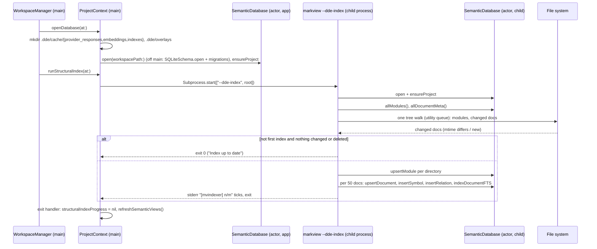
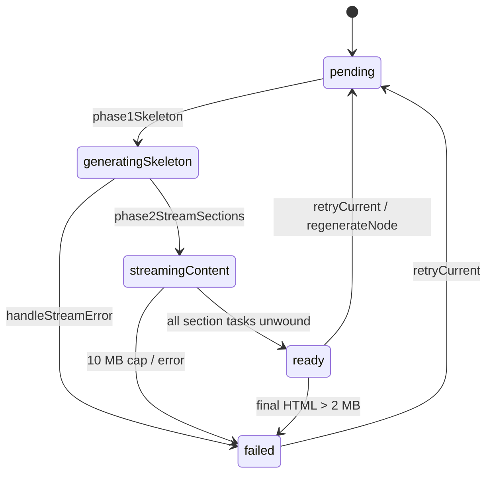

# Semantic Index, GraphRAG and Recursive Insight

Status (2026-11-15): every path and symbol in this doc was looked up mechanically in the code at `ac3001ba`; line citations were removed (they drift). The doc was rewritten for the `SemanticDatabase` actor, the migrations and the Insight coordinator against this code; statements the rewrite could not confirm by reading say so.

Module doc for the workspace SQLite index (`.dde/state.db`), the deterministic
structural indexer, the Recursive Insight prompt builder (`GraphRAG`), the insight
session engine, its disk cache and ZIP export, and the three editor-side JavaScript
files that render insight pages.

Sibling docs: [app-shell-and-workspace](app-shell-and-workspace.md),
[editor-and-bridge](editor-and-bridge.md),
[ai-assistants-and-dictation](ai-assistants-and-dictation.md),
[feature-workflow](feature-workflow.md),
[architecture-and-xray](architecture-and-xray.md),
[git-github-terminal-lifecycle-usage](git-github-terminal-lifecycle-usage.md),
[build-release-testing](build-release-testing.md).

---

## 1. Purpose and responsibilities

What this subsystem owns:

- **Workspace database engine.** `SemanticDatabase` is an `actor` over the system `SQLite3` C API (`AR-37`): the connection
  belongs to the actor, so no statement runs on the main thread. It opens `.dde/state.db` through `SQLiteSchema` and
  `SemanticSchema.migrations` (`AR-38`), which leave 32 tables, and gives typed helpers to the rest of the app
  (`MarkView/Models/Shared/SemanticDatabase.swift`, `SemanticSchema.swift`; the architecture snapshot helpers are in
  `MarkView/Models/Architecture/SemanticDatabase+Architecture.swift`).
- **Structural (no-LLM) indexing.** `StructuralIndexer` walks the folder once. It records directories as `modules`, each `.md`
  file as a `documents` row, headings, links and code fences as `symbols`, Markdown links as `struct_relations`, and the full
  text in the FTS5 table `fts_documents` (`MarkView/Models/Architecture/StructuralIndexer.swift`). The app runs it in a separate
  child process: `ProjectContext.runStructuralIndex` starts it with `Subprocess.start`, and `DDEIndexerRunner`
  (`MarkView/App/MarkViewApp.swift`) is its entry point.
- **Full-text search.** `SemanticDatabase.search(query:limit:)` runs an FTS5 `MATCH` query. The TOC search view (`TOCView`) and
  the feature assistant's "related documents" context (`FeatureAssistant`) use it.
- **Persisted AI usage counter.** A one-row `usage_stats` table that `CLICompletion.Result.record(in:)`
  (`MarkView/Models/Insight/SemanticUsage.swift`) adds to through `addUsage`. `getUsageStats()` has no caller.
- **Storage for the architecture snapshot and review cache.** These are the `arch_*` tables, written and read for
  `ArchitectureStore` through `SemanticDatabase+Architecture.swift`.
- **Recursive Insight.** This feature turns a folder of Markdown files into a tree of interactive HTML "insight" pages:
  - Phase 0: classify the content.
  - Phase 1: build a JSON skeleton.
  - Phase 2: stream up to 5 sections at a time.
  - Deep-dive children.
  - Snapshot and cache on disk, then export as a ZIP.

  Files involved: `GraphRAG.swift`, `InsightSession.swift`, `InsightCoordinator.swift`, `InsightModels.swift`,
  `InsightHTMLTemplate.swift`, `InsightTreeSnapshot.swift`, `InsightCache.swift`, `InsightArchiveExport.swift`,
  `InsightArchiveExporter.swift` (all in `MarkView/Models/Insight/`), and the `markview-insight-*.js` files.

What it does **not** own:

- Running the AI CLI (process spawning, streaming, tool flags, model choice). That is `CLICompletion` / `ACPAssistant`, reached
  through `AIOperation`; see [ai-assistants-and-dictation](ai-assistants-and-dictation.md).
- The Swift-to-JS bridge plumbing (`WebViewBridge`, `TypedWebBridge`, the `EditorView.Coordinator` Combine sinks) and
  `index.html` itself; see [editor-and-bridge](editor-and-bridge.md).
- Tab lifecycle, folder open and close (`TabsController`, `ProjectContext`, `WorkspaceManager`); see
  [app-shell-and-workspace](app-shell-and-workspace.md).
- The meaning of the architecture model stored in `arch_*`; see [architecture-and-xray](architecture-and-xray.md).
- **Embeddings and vector retrieval: they do not exist in practice.** The `chunks` table has no writer. `EmbeddingClient`
  (OpenAI `text-embedding-3-small`) is no longer created by the window; only its key storage is used, by `DDESettingsView`
  (the key is kept in the Keychain through `WhisperClient`, `AR-10`). "GraphRAG" is a historical name. The class does no graph
  retrieval. It builds prompts from raw file bodies.

## 2. Files

| Path | Role |
|---|---|
| `MarkView/Models/Shared/SemanticDatabase.swift` | The `actor`: open, typed helpers for documents, blocks, modules, symbols, relations, FTS, usage stats |
| `MarkView/Models/Shared/SemanticSchema.swift` | The ordered `SemanticSchema.migrations` (version 1 = docId scheme, version 2 = the 6.26 table set, version 3 = drop the never-read block tables), the pragmas and the busy timeout |
| `Packages/MarkViewCore/Sources/MarkViewCore/SQLiteSchema.swift` | `SQLiteMigration`, `SQLiteSchema.open`: version check, migration steps in one transaction each, backup of an unreadable file |
| `MarkView/Models/Architecture/SemanticDatabase+Architecture.swift` | `saveArchitecture` / `loadArchitecture` and the review cache over the `arch_*` tables |
| `MarkView/Models/Insight/SemanticUsage.swift` | `CLICompletion.Result.record(in:)`: queues `addUsage` on the database actor |
| `MarkView/Models/Architecture/StructuralIndexer.swift` | Deterministic tree walk + Markdown parse → modules, documents, symbols, relations, FTS |
| `MarkView/Models/Insight/GraphRAG.swift` | Insight prompt builder: Phase 0 classifier, Phase 1 skeleton (structured JSON call), Phase 2 per-section prompts, catalog mode, prompt-injection escaping |
| `MarkView/Models/Insight/InsightSession.swift` | `@MainActor` session: node tree, pipeline orchestration, caps, retries, snapshot |
| `MarkView/Models/Insight/InsightCoordinator.swift` | Per window: starts a session in a tab, answers the iframe player's bridge messages, exports the archive, ends sessions in order |
| `MarkView/Models/Insight/InsightModels.swift` | `InsightSkeleton`, `InsightSection`, `SectionType`, `InsightDeepDiveTopic`, `InsightContentType`, `SectionState` |
| `MarkView/Models/Insight/InsightHTMLTemplate.swift` | `InsightHTMLTemplate.html(...)`: the deterministic standalone HTML of a node |
| `MarkView/Models/Insight/InsightTreeSnapshot.swift` | `InsightTreeSnapshot`: the Codable full-tree restore file |
| `MarkView/Models/Insight/InsightCache.swift` | Disk cache under `<folder>/.markview-insight/`: node HTML, manifest, snapshot, vendored `_assets/` |
| `MarkView/Models/Insight/InsightArchiveExport.swift` | Export staging and rewriting (`defaultFilename`, `childMap`, `makeStagingCopy`, `rewriteForStandalone`) |
| `MarkView/Models/Insight/InsightArchiveExporter.swift` | Runs `/usr/bin/zip` through `Subprocess.run` to bundle the staging directory |
| `MarkView/Resources/Editor/js/markview-insight-srcdoc.js` | Escape helpers, lib selection, the iframe `srcdoc` builder (with the iframe-side script and CSS) |
| `MarkView/Resources/Editor/js/markview-insight-helpers.js` | View switching, loading overlay, breadcrumbs, status bar, the iframe load timer |
| `MarkView/Resources/Editor/js/markview-insight-handlers.js` | `stripCDNTags`, the Swift→JS setters, the parent `message` listener with the type allowlist |

All three JS files are plain globals loaded by `index.html`. They rely on `state`, `DOM` and `sendToSwift` defined there.

## 3. Key types

| Type | Isolation | Responsibilities / important members |
|---|---|---|
| `SemanticDatabase` | `actor` (`SemanticDatabase.swift`) | `static open(workspacePath:dbName:) async throws` (off-main open and migration); `ensureProject`, `upsertDocument`, `allDocumentMeta`, `forgetDocuments`; `upsertModule`, `allModules`, `insertSymbol`, `insertRelation`, `indexDocumentFTS`, `search`; `getUsageStats`, `addUsage`; `execute(_:params:)`. The architecture helpers are in `SemanticDatabase+Architecture.swift` |
| `SQLiteSchemaError` | enum (`SQLiteSchema.swift` in `MarkViewCore`) | `openFailed`, `newerSchema(found:supported:)`, `migrationFailed(version:name:message:)`, `statementFailed`, `invalidMigrations` |
| `SemanticDBError` | enum (`SemanticDatabase.swift`) | `openFailed` / `prepareFailed` / `executeFailed` wrapping `sqlite3_errmsg` |
| `StructuralIndexer` | `@unchecked Sendable` class (`StructuralIndexer.swift`) | `indexAll()`; private `scanTree` (utility queue), `writeModules`, `writeChangedDocs` (`await` on the database actor, 50 documents per chunk); `progress` callback |
| `GraphRAG` | `@MainActor`, `ObservableObject` with no `@Published` (`GraphRAG.swift`) | `classifyContent`, `buildSkeleton`, `buildSectionPrompt`, `static catalog(of:relativeTo:)`, `contentTypeAddendum`, private `escapeXMLEnvelopeBreakout` |
| `InsightSession` | `@MainActor final class`, `ObservableObject` (`InsightSession.swift`) | Published: `rootNodeId`, `currentNodeId`, `nodes`, `lastError`, `lastErrorRetryable`, `currentNodeSections`, `skeleton`, `skeletonReady`, `allSectionsReady`, `statusMessage`, `contentType`, `cachedNodeHTML`, plus the v1 shims `streamingBuffer` / `isStreaming`. API: `generateRoot`, `expand`, `expandCustom`, `expandAllTopicsOnCurrentNode`, `navigateTo`, `up`, `retryCurrent`, `retrySection`, `regenerateRoot`, `cancel`, `snapshot()` (an `InsightViewSnapshot`), `breadcrumbs`, `nonisolated static sanitizeForLog` |
| `InsightCoordinator` | `@MainActor final class` (`InsightCoordinator.swift`) | Per window. `start(at:title:)`, `close(_:)`, `cancelSessions()`, the `didRequestInsight*` / `didReceiveInsightIframeReady` handlers, `exportArchive(sessionId:)`. Owns the `GraphRAG` over `project.database`. Its tasks live in the window's `TaskBag` |
| `InsightHost` | `@MainActor` protocol (`InsightCoordinator.swift`) | What the coordinator needs of its window: `insightSessions`, `activeInsightSession`, `showInsightTab`, `removeInsightTab`. `WorkspaceManager` conforms |
| `InsightHTMLTemplate` | `enum` (`InsightHTMLTemplate.swift`) | `html(skeleton:sectionStates:breadcrumbs:libRefMode:cache:)`, `escape` |
| `InsightTreeSnapshot` | Codable struct (`InsightTreeSnapshot.swift`) | The persisted tree (`Entry` per node); `decode`, `encoded()`, `restoredNodes(rootTitle:)` |
| `InsightArchiveExport` | `enum` (`InsightArchiveExport.swift`) | Pure helpers of the export: `defaultFilename`, `sanitizeFilename`, `childMap`, `makeStagingCopy`, `rewriteForStandalone`, `rewriteDeepDiveButtons`, `rewriteBreadcrumbHrefs` |
| `InsightNode` | reference type, mutated on main actor | `id`, `parentId`, `level`, `title`, `scope: NodeScope`, `skeleton`, `sectionStates`, `children`, `status` (pending → generatingSkeleton → streamingContent → ready/failed), `generatedAt`, `model` (a `let`, default `"claude-sonnet-4-6"`; the model is chosen by the assistant settings, not by this field) |
| `NodeScope` | Codable enum | `.folderRoot` or `.topic(label, hint, files:[URL])`; files encoded as absolute path strings |
| `InsightSkeleton` / `InsightSection` / `InsightDeepDiveTopic` | Codable structs (`InsightModels.swift`) | Phase 1 output. `metadata` reuses `AnyCodable` from `Bridge/WebViewBridge.swift` |
| `InsightViewSnapshot` / `BreadcrumbEntry` | Codable structs (`InsightModels.swift`) | What the bridge layer gets for the current view |
| `SectionType` | enum, 9 cases (`InsightModels.swift`) | hero, prose, mermaidDiagram, chartJsChart, comparisonTable, timeline, cardsGrid, callout, collapsibleDetails |
| `InsightContentType` | enum, 13 cases (`InsightModels.swift`) | Phase 0 classes; `displayLabel` |
| `SectionState` | struct (`InsightModels.swift`) | `buffer` (accumulated HTML), `status` pending/streaming/ready/failed |
| `InsightCache` | value-type struct, not actor-isolated (`InsightCache.swift`) | `writeNode`, `readNode`, `deleteNode`, `updateManifest`, `loadManifest`, `writeSnapshotData` / `readSnapshotData` / `deleteSnapshot`, `hasSnapshot`, `cleanup`, `archiveStagingDirectory`, `vendoredLibURL`, `static deterministicRootUUID(forFolderPath:)` |
| `InsightManifest` | Codable (`InsightCache.swift`) | `sessionId`, `folderName`, `createdAt`, `nodes[]` |
| `InsightArchiveExporter` | stateless struct (`InsightArchiveExporter.swift`) | `bundle(stagingURL:to:) async throws` |

Model types in `SemanticModels.swift`: the editor's block types (`SemanticBlock`, `BlocksDelta`) are gone with the block tables.
`SemanticEntity`, `SemanticClaim`, `SemanticRelation`, `TemporalContext`, `Transition`, `EvidenceLink`, `AIJob` with its enums,
`BlockExtractionResult`, `Diagnostic`, `DocumentTemplate`, `CompletenessEvaluation` and `AnyCodableValue` are legacy "semantic
compiler" types: `git grep` finds no use of them outside that file at 585cfc9d.

## 4. Internal interfaces

### Who calls in

| Caller | Entry point |
|---|---|
| `WorkspaceManager.openFolder` → `ProjectContext.openDatabase(at:)` (`ProjectContext.swift`) | Creates `.dde/cache/{provider_responses,embeddings,indexes}` and `.dde/overlays`, then `SemanticDatabase.open(workspacePath:)` and `ensureProject`. `WorkspaceManager.initDDEWorkspaceAsync` then calls `runStructuralIndex(at:)` |
| `ProjectContext.openSingleFile` | `SemanticDatabase.open(workspacePath: parentDir, dbName: "file_<name>.db")`, then `indexSingleFile`, which writes one module, one FTS row, one document and the heading symbols inline |
| `DDEIndexerRunner.run` (`MarkViewApp.swift`), child process `--dde-index <folder>` | `SemanticDatabase.open`, `ensureProject`, `StructuralIndexer.indexAll()`; progress goes to stderr as `[mvindexer] N/M`. It exits 1 without indexing when the index file is left untouched (newer schema or failed migration) |
| `ProjectContext.runStructuralIndex` | Starts the child with `Subprocess.start`; stderr ticks become `structuralIndexProgress`; on exit the views that read the database refresh (`refreshSemanticViews()`) |
| `ProjectContext.excludeFolder` | `forgetDocuments(ids)` for the Markdown files under the folder, from a detached task |
| `TOCView.performSearch` (`MarkView/Views/Workspace/TOCView.swift`) | `await db.search(query:)` with the raw user text |
| `FeatureAssistant.relatedDocuments` (`MarkView/Models/Lifecycle/FeatureAI.swift`) | `db.search` with up to 6 terms of more than 3 characters joined by `OR` |
| `ArchitectureStore` | `loadArchitecture`, `saveArchitecture`, `loadArchitectureReview`, `saveArchitectureReview` (`SemanticDatabase+Architecture.swift`) |
| `CLICompletion.Result.record(in:)` | `addUsage` |
| `InsightCoordinator.start` (`Models/Insight/InsightCoordinator.swift`) | `ProjectProviding.markdownFiles(in:)`, `InsightCache(workspaceURL:sessionId:)`, `InsightSession(...)`, `generateRoot()`. The graph engine is `GraphRAG(db:)` over `project.database` |
| The editor bridge's insight messages → `InsightCoordinator.didRequestInsight*` / `didReceiveInsightIframeReady` / `exportArchive` | `expand`, `navigateTo`, `regenerateRoot`, `expandCustom`, `expandAllTopicsOnCurrentNode`, `retrySection`; each runs as a task of the window's `TaskBag` keyed by action and session |
| `TabsController.closeTab` → `TabsEvent.insightClosed` → `InsightCoordinator.close` | `session.cancel()`; the cache is intentionally **not** cleaned up |
| `EditorView.Coordinator.routeInsight` (`MarkView/Views/Workspace/EditorView.swift`) | Subscribes to `$skeleton`, `$currentNodeSections`, `$lastError`, `$statusMessage` and forwards to `WebViewBridge.loadInsightSkeleton / updateInsightSection / setInsightError / setInsightStatus` |

### What it calls out to

- `AIOperation` with `CLICompletion.Request` for every LLM call (`AIOperation<CLICompletion.Request, CLICompletion.Result>.ask`):
  - classifier: no schema, default 180 s timeout;
  - skeleton: `jsonSchema`, 600 s, or 1800 s in catalog mode;
  - sections: streamed through `onDelta`.

  `readableFolder` is set only when a payload is over budget, which turns on the CLI's read-only `Read,Grep,Glob` tools for
  Claude.
- `WebViewBridge.logInsightDiag` from `phase1Skeleton` (`InsightSession.swift`); it logs through `AppLog.insight` in Debug builds
  only and never writes a file.
- `Bundle.main` (`Editor/vendor/{js,css}`) in `InsightCache.copyVendoredLibs`.
- `/usr/bin/zip` through `Subprocess.run` (`InsightArchiveExporter.swift`).

### Bridge messages (JS ↔ Swift)

Swift → JS setters (`markview-insight-handlers.js`):

- `loadInsightSkeleton(skeleton, sessionId, nodeId, breadcrumbs)`
- `updateInsightSection(sessionId, sectionId, htmlChunk)`
- `setInsightError(sessionId, message, retryable)`
- `setInsightStatus(sessionId, message, phase)`
- `releaseInsightBlobs()`

Iframe → parent `postMessage` allowlist (`markview-insight-handlers.js`): `insightIframeReady`,
`insightDeepDiveClicked {sectionId, topicIndex}`, `insightBreadcrumbClicked {nodeId}`, `insightRequestSave`,
`insightRequestUp`, `insightRequestRegenerate`, `insightRequestCustomDeepDive {topic}`, `insightRequestExploreAll {depth 1-3}`,
`insightRequestRetrySection {sectionId}`, `insightDebug` (forwarded to Swift as `jsError`).

Parent → iframe messages: `updateInsightSection`, `initSectionLib`, `updateInsightProgress` (`markview-insight-srcdoc.js`).

The parent page forwards the iframe's requests to Swift through `mvBridge.send`; each message is declared in
`Resources/Editor/js/bridge-contract.json` and decoded by a payload type in `Bridge/PageMessages.swift`. The handlers are
registered in `WebViewBridge.swift` and implemented by `EditorView.Coordinator`, which hands them to `InsightCoordinator`.

## 5. Runtime flows

### 5.1 Open workspace and structural index



Steps, grounded in the code:

1. `SemanticDatabase.open` runs `openFile` on a detached task. It tries `<root>/.dde/`; if that cannot be created, it falls back to
   `~/Library/Application Support/MarkView/Projects/<ProjectPaths.projectCacheIdentifier>/` (`AR-39`).
2. `SQLiteSchema.open` applies `SemanticSchema.pragmas`, then the migrations whose version is above `PRAGMA user_version`, each in
   its own transaction that also writes the new version. A file written by a newer release, or a step that failed and rolled
   back, is left exactly as it was: the session then uses an empty in-memory index (`dbPath == nil`) and the indexer child exits
   without writing. An unreadable file is moved aside to a dated backup and rebuilt (`AR-38`).
3. `documentId` is the workspace-relative POSIX path (`@linked/<name>/<path>` inside a linked folder; `ProjectContext.documentId(for:)`,
   `LinkedFolders.documentId`). It falls back to the file name outside the root.
4. `scanTree` runs on `DispatchQueue.global(qos: .utility)` (`StructuralIndexer.swift`): a single walk registers every ancestor
   directory as a module and skips a file when the stored and current mtimes are equal. Otherwise it reads UTF-8 and computes a
   32-bit FNV-1a hex `contentHash`.
5. Per-line parse:
   - ATX headings (`^(#{1,6})\s+(.+)`) become `heading` symbols, with `context` set to the heading path joined by `" > "`.
   - `[text](target)` links that are not `http*` / `#` / `mailto:` become `link` symbols plus `links_to` relations to the resolved
     target docId.
   - Fence lines with a language tag become `code_block` symbols.
   - IDs are FNV-1a of `docId:line:text`, prefixed `sym_h_`, `sym_l_`, `sym_c_`, `rel_`, `mod_`.
6. Modules are written before documents, because of the `modules.parent_module_id` FK.
7. Documents are written in chunks of 50, each statement an `await` on the database actor, with `Task.yield()` between chunks.
   `dispatchMain()` keeps the child process alive while the indexing task runs.

### 5.2 Editor block deltas (removed)

The page's block extractor sent `blocksChanged` deltas that `ProjectContext.saveBlocks` and `SemanticDatabase.applyBlockDelta` wrote
into the `blocks` table. Nothing ever read the table back, so the extractor, the message, the Swift handlers and the write path are
removed, and `SemanticSchema` step 3 drops `blocks` with its two child tables `claims` and `block_compilation_cache`.

### 5.3 Search (retrieval)

`SemanticDatabase.search(query:limit:50)` runs on the database actor, so callers `await` it:

```sql
SELECT document_id, title, snippet(fts_documents, 2, '>>>', '<<<', '...', 40), rank
FROM fts_documents WHERE fts_documents MATCH ? ORDER BY rank LIMIT ?
```

The query string is bound as-is, so FTS5 syntax is live. A malformed query fails in `sqlite3_step` and returns an empty list. There
is no vector or hybrid retrieval, and no retrieval step feeds Insight prompts.

### 5.4 Recursive Insight session lifecycle

```mermaid
sequenceDiagram
    participant UI as Menu / iframe
    participant IC as InsightCoordinator (@MainActor, per window)
    participant S as InsightSession (@MainActor)
    participant G as GraphRAG (@MainActor)
    participant AI as AIOperation + CLICompletion
    participant C as InsightCache
    participant EV as EditorView.Coordinator
    participant JS as index.html + iframe
    UI->>IC: start(at:title:)
    IC->>IC: root open, assistant resolvable, graphRAG != nil, project.markdownFiles(in:)
    IC->>C: InsightCache(workspaceURL:sessionId:) (copies vendor/js + vendor/css to _assets)
    IC->>S: InsightSession(...); host.showInsightTab; TaskBag task "generate" → generateRoot()
    S->>S: root id = deterministicRootUUID(folder path, or the file path of a single document)
    S->>C: readSnapshotData()
    alt snapshot decodes and rootId matches
        S-->>EV: publish skeleton + all sectionStates (ready)
    else
        S->>G: classifyContent (Phase 0)
        G->>AI: ask("insight-classify")
        S->>G: buildSkeleton (Phase 1)
        G->>AI: ask("insight-skeleton", jsonSchema, 600 s / 1800 s)
        S-->>EV: $skeleton
        EV->>JS: loadInsightSkeleton → iframe srcdoc
        loop up to 5 concurrent sections (Phase 2)
            S->>G: buildSectionPrompt
            S->>AI: ask(onDelta)
            AI-->>S: delta → Task{@MainActor appendSectionDelta}
            S-->>EV: $currentNodeSections
            EV->>JS: updateInsightSection(delta)
        end
        S->>S: writeFinalHTMLToCache (2 MB cap)
        S->>C: writeNode, updateManifest
        S->>C: writeSnapshotData (main-actor Task)
    end
```

Phase details:

- **Phase 0 classify** (`GraphRAG.swift`):
  - Takes the first 1500 characters of each of up to 8 files, and stops adding files once the sample reaches 12,000 bytes.
  - The system prompt asks for a single category word. The answer is lowercased, stripped of quotes, and matched by first word and
    then by substring.
  - Any error returns `.general`.
- **Phase 1 skeleton** (`GraphRAG.swift`):
  - **Catalog mode.** If the summed file size (each file counted at no more than 50 KB) is over `inlinePayloadBudget = 600 KB`,
    the prompt carries a catalog instead of file bodies. The catalog is one line per file (path, size in KB, first heading read
    from the first 2 KB). It rolls up to one line per folder when it is over `catalogBudget = 120 KB`. The request then carries
    `readableFolder`, and its timeout is 1800 s instead of 600 s.
  - **Inline mode.** Each file is validated:
    - symlink-resolved containment with a trailing `/`;
    - truncated above 50 KB with `[truncated at 50KB]`;
    - envelope-escaped;
    - wrapped as `<file path="%-encoded">`.

    Files are then grouped into `<community name="files (chunk i/N)">` blocks of 200 KB or less.
  - The JSON schema requires `title` and `sections`: 8 to 12 sections, each with `id`, `type`, `metadata`, and optional
    `deepDiveTopics`.
  - CLI and transport errors are thrown. A decode failure or zero sections returns `fallbackSkeleton` (one prose section).
  - `InsightSession.phase1Skeleton` (`InsightSession.swift`):
    - for topic nodes, narrows files to paths that exist, else uses all files;
    - drops duplicate section ids and logs duplicate topic ids;
    - publishes the skeleton;
    - creates one `SectionState()` per section.
- **Phase 2 sections** (`InsightSession.swift`):
  - All prompts are pre-built on the main actor with `buildSectionPrompt` (`GraphRAG.swift`). File selection:
    - `scopeHint == nil` means all files;
    - `[]` means "No source files for this section.";
    - otherwise paths are matched by relative path, and traversal (`..`, `\`) is rejected;
    - over `sectionPayloadBudget = 200 KB`, the section gets a catalog plus `needsFolderAccess`.
  - `withTaskGroup`, gated to `maxConcurrentSectionStreams = 5` in flight.
  - Each task catches its own errors. `CancellationError` is silent. Other errors call `markSectionFailed`.
  - Deltas hop to the main actor through `Task { @MainActor … appendSectionDelta }`. `appendSectionDelta` appends only while the
    node is `.streamingContent` and enforces the 10 MB per-node cap and the 50 MB per-session cap.
  - At the end the node becomes `.ready` regardless of how many sections failed.
- **Deterministic HTML rebuild** (`InsightHTMLTemplate.html`, called by `InsightSession.writeFinalHTMLToCache`):
  - It escapes every skeleton string. It inserts section buffers **verbatim** and emits deep-dive `<button class="deep-dive">`
    elements.
  - `_assets` references are resolved by prefix through `vendoredLibURL` (`.exportRelative`; `writeFinalHTMLToCache` always uses
    this mode).
  - It adds a CSP meta, inline CSS, and a bootstrap script (Mermaid, Chart.js and lightbox).
  - Output over 2 MB fails the node without retry. The result goes to `cache.writeNode` and the manifest is upserted.
- **Snapshot** (`InsightTreeSnapshot.swift`, written by `InsightSession.writeSnapshotForRoot`):
  - A `nonisolated` method schedules a main-actor Task. It encodes every node that has a skeleton and at least one non-empty
    section buffer into `InsightTreeSnapshot { rootId, folderPath, createdAt, nodes: [Entry] }` with ISO-8601 dates. A failed
    save is logged and otherwise ignored.
  - `tryRestoreRootFromSnapshot` accepts the full tree, or the legacy root-only `skeleton` / `sectionBuffers`
    (`restoredNodes(rootTitle:)`). Restored nodes are all `.ready`, and sections with empty buffers are `.pending`.

Node state machine:



User actions (the coordinator answers each iframe message and runs the session method as a task of the window's `TaskBag`, keyed by
action and session):

- **Deep dive** — `InsightCoordinator.didRequestInsightDeepDive` checks that the session, its current skeleton, the section and the
  topic index exist; then `expand(sectionId:topicIndex:)`:
  - bounds-checks again (the parent JS checks as well);
  - reuses an existing child with the same label and hint;
  - otherwise validates `scopeHint` (`validateScopeHint`: containment, `.md`, exists), cancels the active task, creates the child,
    and runs Phase 1 → 2 → cache.
- **Custom deep dive** — `expandCustom(topic:)`: the child has `scope.topic(label: t, hint: t, files: [])`, where empty files means
  all files. Text selected in the iframe triggers it as well (`markview-insight-srcdoc.js`).
- **Explore all** — `expandAllTopicsOnCurrentNode(depth:)`: expands topics one after another, depth clamped to 1-3. It navigates back
  to the parent before each expand and awaits `activeTask.value`.
- **Navigate / Up** — `navigateTo` cancels any in-flight generation, publishes the node's state, and reads the cached HTML. A
  breadcrumb click reaches it through `didRequestInsightBreadcrumb`, which accepts only a UUID that is a member of the session.
- **Retry the node** — `retryCurrent`: limited to 3 per 60 s per node (sliding window), then non-retryable.
- **Retry one section** — `retrySection`: one `AIOperation ... ask(name: "insight-section-retry")` that does not run inside
  `activeTask`.
- **Regenerate** — `regenerateRoot`:
  - at the root: cancel, delete the snapshot and every node HTML, clear state, run `generateRoot`;
  - at a child: drop its descendants and their HTML, reset the node, and rerun it.
- **Close tab** — `TabsController.closeTab` emits `TabsEvent.insightClosed`, which calls `InsightCoordinator.close(_:)`, in the order
  Decision 11 §4 sets:
  1. `blobReleases.send()` (the page revokes its blob URLs);
  2. `await session.cancel()`;
  3. `host.removeInsightTab(sessionID:)`.

  The cache is **kept** (`.markview-insight/`), so reopening reuses it. Closing the folder ends the sessions through
  `InsightCoordinator.cancelSessions()` and the window's `TaskBag`.

### 5.5 Iframe rendering (web side)

1. `loadInsightSkeleton` (`markview-insight-handlers.js`):
   1. Synchronously resets `state.insightSessionId`, `insightCurrentNodeId`, `insightSkeleton`, `insightIframeReady=false`, and
      `insightPendingChunks`.
   2. Computes the required libs: Prism always, Mermaid and Chart.js by section type, KaTeX when `metadata.hasMath`
      (`markview-insight-srcdoc.js`).
   3. Reads the lib sources into `state.insightLibBytes` (`ensureLibSource`) and KaTeX CSS with its fonts inlined
      (`ensureKatexCSSInline`).
   4. Builds the srcdoc (`buildInsightSrcdoc`): a CSP meta with `default-src 'none'`, `connect-src 'none'` and a `script-src` that
      accepts only the per-load nonce, and the libs inlined as `<script nonce=...>` blocks.
   5. Sets `sandbox="allow-scripts"` (never `allow-same-origin`, so the frame has a null origin: `AR-02`) and assigns `srcdoc`.
   6. Starts a 10 s ready timer (`markview-insight-helpers.js`).
2. The nonce is made per page load by `EditorPage.prepare` (`MarkView/Models/Workspace/EditorPage.swift`), which writes it into
   the page's own policy and tells the page through `window.__markviewInsightNonce`. If the page's policy cannot take it, the
   frame gets `script-src 'none'` and stays inert; the miss is logged.
3. The srcdoc renders placeholders with skeleton loaders and `dd-btn` buttons, a footer (Up, a language select, Explore-all depth,
   custom topic, Export ZIP), and an inline IIFE.
4. `updateInsightSection` applies `stripCDNTags` to each chunk (`markview-insight-handlers.js`): it removes a code-fence wrapper the
   model added and then sanitizes the chunk with `mvKit.sanitizeHtml(html, 'insight')`.

   Before the iframe is ready, chunks are buffered. After that they are posted to the iframe, and a debounced (100 ms)
   `initSectionLib` follows.
5. Inside the iframe, chunks are appended to `sectionBuffers[sid]`. On `initSectionLib` the whole buffer replaces the placeholder via
   `innerHTML`, and then:
   - Mermaid runs, after converting `pre code.language-mermaid`, `pre.mermaid` and keyword-sniffed `<pre>` blocks, with
     `securityLevel: 'strict'`;
   - Chart.js runs on `canvas[data-chart]` (or `data-chart-config`) after a regex strips function-string callbacks;
   - KaTeX auto-render and Prism run last.

   See `markview-insight-srcdoc.js`.
6. Failed sections with an empty buffer get a retry placeholder (`data-retry-section`) from Swift (`EditorView.swift`).

### 5.6 Archive export

`InsightCoordinator.exportArchive(sessionId:)`:

1. Runs an `NSSavePanel` with the default name from `InsightArchiveExport.defaultFilename` (`<folder>_insight_<ISO8601 with - for
   :>.zip`) and forces a `.zip` extension.
2. Snapshots the child map (`InsightArchiveExport.childMap`, matched by `child.title == topic.label`).
3. Rewrites **every** in-memory node HTML into the cache with the current template (`InsightHTMLTemplate.html`).
4. `archiveStagingDirectory()` checks that the resolved root is a directory (`InsightCache.swift`).
5. `InsightArchiveExport.makeStagingCopy` copies the non-hidden cache contents to `NSTemporaryDirectory()/insight-export-<UUID>`.
6. `InsightArchiveExport.rewriteForStandalone`:
   - promotes the root to `index.html`;
   - rewrites `../_assets/` and breadcrumb hrefs;
   - turns expanded deep-dive buttons into `<a href="<child>.html">`.
7. `InsightArchiveExporter.bundle`:
   - runs `/usr/bin/zip -r -q <dest>.tmp .` through `Subprocess.run`, with `cwd = staging`, an argument array, a timeout derived from
     the staging size and a 64 KB output cap (`InsightArchiveExporter.swift`);
   - checks for cancellation before it looks at the exit status;
   - on a non-zero exit throws an error with sanitized stderr;
   - moves or replaces `.tmp` onto the destination.
8. `defer` removes the temp copy. The whole export is a task of the window's `TaskBag`, keyed by session.

## 6. Data model and persistence

### 6.1 Database files and pragmas

- Path: `<workspace>/.dde/state.db`. Single-file mode uses `<parentDir>/.dde/file_<basename>.db`
  (`ProjectContext.openSingleFile`). When `.dde/` cannot be created, the fallback is
  `~/Library/Application Support/MarkView/Projects/<ProjectPaths.projectCacheIdentifier(for:)>/` (`AR-39`).
- Pragmas (`SemanticSchema.pragmas`, applied to each connection before the migrations):
  - `foreign_keys=ON`
  - `journal_mode=WAL`
  - `synchronous=NORMAL`
  - `temp_store=MEMORY`
  - `cache_size=-20000` (about 20 MB)

  `busy_timeout` is 5000 ms (`SemanticSchema.busyTimeoutMilliseconds`).
- Versioning (`AR-38`, `SemanticSchema.migrations`, run by `SQLiteSchema.open`):
  - `PRAGMA user_version` is the number of the last migration step applied. Each step runs in its own transaction that also
    writes the new version.
  - Step 1 "docId scheme" clears the rows keyed by the old document ids (`fts_documents`, `struct_relations`,
    `entity_relations`, `claims`, `entities`, `documents`, `modules`) in a file that has a `documents` table and no version.
    Foreign keys cascade the dependent tables.
  - Step 2 "table set of release 6.26" creates every table that is missing and the `arch_nodes` columns later releases added, and
    drops the never-written `applied_migrations` table.
  - Step 3 "drop the never-read block tables" drops `block_compilation_cache`, `claims` and `blocks` (children first). With
    foreign keys on, dropping `blocks` alone would delete the rows of the two children and leave their foreign keys naming a
    table that is gone. `claims` had no writer, `block_compilation_cache` never had one, and no code read any of the three.
  - A file with a newer version, or a step that fails (and rolls back), is left untouched: the session uses an in-memory index
    (`dbPath == nil`). An unreadable file is moved to a dated backup and rebuilt.

### 6.2 Tables

Timestamps are Unix seconds (`INTEGER`). "Used" means some code outside
`SemanticDatabase.swift` reads or writes the table at runtime. The 32 tables are the ones that remain after `SemanticSchema` step 3 (step 2 creates 35; step 3 drops `blocks`, `claims` and `block_compilation_cache`).

| Table | Columns (PK first) | Indexes / FKs | Used? |
|---|---|---|---|
| `projects` | `project_id` TEXT PK, `project_name` NN, `root_path` NN UNIQUE, `created_at` NN, `updated_at` NN, `dde_version`, `schema_version` NN, `config_json` | – | yes (`ensureProject`, schema_version `'1.0'`) |
| `documents` | `document_id` PK, `project_id` NN, `file_path` NN, `file_name` NN, `file_ext` NN, `file_mtime`, `file_size_bytes`, `content_hash` NN, `frontmatter_json`, `language`, `status` DEFAULT 'active', `created_at`, `updated_at`; UNIQUE(project_id, file_path) | `idx_documents_project`; FK project_id→projects CASCADE | yes |
| `entities` | `entity_id` PK, `name`, `type`, `canonical_name` (NN), `aliases_json`, `attributes_json`, `description`, `status` DEFAULT 'active', `source_file`, `source_block_id`, `created_at`, `updated_at` | `idx_entities_canonical`, `idx_entities_type` | no (no writer) |
| `entity_relations` | `relation_id` PK, `source_id` NN, `target_id` NN, `type` NN, `source_file`, `source_block_id`, `confidence` 0.5, `created_at` | `idx_relations_source`, `idx_relations_target` | no |
| `temporal_contexts` | `temporal_context_id` PK, `label` NN, `kind` NN, `order_index` 0, `start_time`, `end_time`, `parent_temporal_context_id` | self-FK SET NULL | no |
| `transitions` | `transition_id` PK, `entity_id` NN, `from_state`, `to_state` NN, `from/to_temporal_context_id`, `preconditions_json`, `postconditions_json`, `rollback_strategy`, `trigger`, `evidence_block_ids_json` | FK entity→entities CASCADE | no |
| `diagnostics` | `diagnostic_id` PK, `type`, `severity`, `message` NN, `explanation`, `document_id` NN, `block_id`, `claim_ids_json`, `entity_ids_json`, `suggested_fix`, `is_suppressed` 0, `created_at` | `idx_diagnostics_doc`; FK document CASCADE | no |
| `ai_jobs` | `job_id` PK, `job_type`, `priority`, `status` DEFAULT 'pending', `document_id`, `block_ids_json`, `input_hash` NN, `model_policy`, `privacy_mode` NN, `result_ref`, `error_state`, `created_at`, `started_at`, `completed_at`, `retry_count` 0, `cost_tokens` | `idx_ai_jobs_hash`, `idx_ai_jobs_status` | no |
| `compile_profiles` | `profile_id` PK, `name`, `description`, `audience`, `required_claim_types_json`, `required_entity_types_json`, `section_order_json`, `strictness` 'moderate', `language` 'en' | – | no |
| `compile_jobs` | `compile_job_id` PK, `profile_id` NN, `status`, `created_at`, `completed_at` | FK profile CASCADE | no |
| `compile_artifacts` | `artifact_id` PK, `compile_job_id` NN, `artifact_kind`, `section_key`, `content` NN, `content_hash`, `source_block_ids_json`, `source_claim_ids_json`, `created_at` | FK job CASCADE | no |
| `document_templates` | `template_id` PK, `name`, `description`, `sections_json`, `required_claim_types_json`, `required_entity_types_json` | – | no |
| `completeness_evaluations` | `evaluation_id` PK, `document_id` NN, `template_id`, `structural_score`, `semantic_score`, `overall_score`, `missing_parts_json`, `evaluated_at` | FK document CASCADE | no |
| `recompute_nodes` / `recompute_edges` | node: `node_id` PK, `node_type`, `is_dirty`, `last_computed_at`; edge: `edge_id` PK, `source_node_id`, `target_node_id`, `edge_type` | edge FKs → nodes CASCADE | no |
| `usage_stats` | `id` INTEGER PK CHECK(id=1), `total_input_tokens`, `total_output_tokens`, `total_jobs`, `total_cost_cents` REAL | seeded row id=1 | yes |
| `modules` | `module_id` PK, `name` NN, `path` NN UNIQUE (absolute), `parent_module_id`, `level` 0, `description`, `file_count` 0 | self-FK CASCADE | yes |
| `symbols` | `symbol_id` PK, `module_id`, `document_id`, `name` NN, `kind` NN (`heading`/`link`/`code_block`), `line_start`, `line_end`, `context` | `idx_symbols_doc`, `idx_symbols_module`, `idx_symbols_kind`; FKs module, document CASCADE | yes |
| `struct_relations` | `relation_id` PK, `source_id`, `target_id`, `type` (`links_to`), `source_doc`, `evidence` (link text) | `idx_srel_source/target/type` | write-only |
| `artifacts` | `artifact_id` PK, `module_id`, `kind`, `content` NN, `created_at`, `model_used` | `idx_artifacts_module` | no |
| `fts_documents` | FTS5 virtual: `document_id`, `title`, `content`, `tokenize='porter unicode61'` | – | yes |
| `chunks` | `chunk_id` PK, `document_id` NN, `text` NN, `char_start`, `char_end`, `embedding_file` | `idx_chunks_doc`; FK document CASCADE | no |
| `quality_tags` | `tag_id` PK, `module_id`, `attribute` NN, `value` 'unknown', `source_artifact_id` | FK module CASCADE | no |
| `citations` | `citation_id` PK, `artifact_id`, `document_id`, `line_start`, `line_end`, `quote_text` | `idx_citations_artifact` | no |
| `change_plans` | `plan_id` PK, `module_id`, `description` NN, `steps_json`, `status` 'draft', `created_at` | – | no |
| `communities` | `community_id` PK, `name`, `module_ids_json`, `summary`, `level` 0 | – | no |
| `arch_nodes` | PK(`view`, `id`), `parent_id`, `kind`, `name`, `path`, `language`, `loc` 0, `files` 0, `summary`, `role`, `tech`, `signature`, `summary_signature`, `component`, `tags_json` | – | yes (ArchitectureStore) |
| `arch_edges` | PK(`view`, `source`, `target`, `kind`), `weight` 1, `label` | – | yes |
| `arch_coverage` | `node_id` PK, `status`, `docs_json` '[]' | – | yes |
| `arch_metrics` | `node_id` PK, `json` (`FileMetrics`) | – | yes |
| `arch_reviews` | `diff_hash` PK (SHA-256 of diff), `json`, `created_at` | – | yes |
| `arch_meta` | `key` PK, `value`. Keys: systemName, systemPurpose, components, assignments, overrides, logicalSignature, language, logicalDraft, ratings, coverageReport, deploymentSignature, scannedAt, enrichedAt, gitHead, deploymentHints | – | yes |

`saveArchitecture` (`SemanticDatabase+Architecture.swift`) wipes and rewrites all `arch_*` tables except `arch_reviews` in one
`BEGIN IMMEDIATE … COMMIT`. It is the only explicit transaction in the module.

### 6.3 Other files written

| Path | Format | Writer |
|---|---|---|
| `<ws>/.dde/cache/{provider_responses,embeddings,indexes}/`, `<ws>/.dde/overlays/` | empty dirs | `ProjectContext.openDatabase` |
| `<ws>/.markview-insight/_assets/**` | copies of every file under bundle `Editor/vendor/js` and `Editor/vendor/css` (recursive) | `InsightCache.init` (`InsightCache.swift`) |
| `<ws>/.markview-insight/nodes/<NODE-UUID>.html` | full standalone HTML from `InsightHTMLTemplate.html` | `writeNode` (atomic temp + `replaceItemAt`) |
| `<ws>/.markview-insight/manifest.json` | `InsightManifest`, pretty-printed, sorted keys, ISO-8601 | `updateManifest` |
| `<ws>/.markview-insight/snapshot.json` | `InsightTreeSnapshot` JSON (ISO-8601); contains absolute `folderPath`, absolute topic file paths, all section HTML | `writeSnapshotData` |
| `<ws>/.markview-insight/*.tmp`, `nodes/*.tmp` | staging for atomic writes | removed on failure |
| `$TMPDIR/insight-v1-compat/.markview-insight/` | same layout | only the convenience `init(folderURL:mdFiles:graphRAG:)` (`InsightSession.swift`), which nothing in `MarkView/` calls |
| `$TMPDIR/insight-export-<UUID>/` | export staging copy | `InsightArchiveExport.makeStagingCopy`; removed by `defer` |
| user-chosen `*.zip` (+ `*.zip.tmp`) | ZIP: `index.html`, `nodes/`, `_assets/`, `manifest.json`, `snapshot.json` | `InsightArchiveExporter` |

`WebViewBridge.logInsightDiag` writes no file: in a Debug build it logs through `AppLog.insight`, and it removes a leftover
`/tmp/markview-insight-diag.log` from an older release (`AR-09`).

The deterministic root id is `SHA-256(path)[0..<16]` with RFC-4122 v4 and variant bits set (`InsightCache.deterministicRootUUID`).
The path is the folder, or the document itself when the insight covers one file. Moving or renaming it orphans the snapshot.

## 7. Concurrency and threading

- **Every SQL call runs on the `SemanticDatabase` actor** (`AR-37`), not on the main actor. Callers `await` it: TOC search, the
  architecture save (a full delete and reinsert in one transaction), the editor's block deltas, and `addUsage`. Opening and
  migrating the file runs on a detached task before the actor exists.
- **Cross-process writes.** The child indexer process writes to the same file through WAL. `busy_timeout = 5000` means a write
  in the app can wait up to 5 s for the lock the child holds, and that wait now blocks the actor, not the main thread. The
  indexer does not batch its writes in transactions: every `execute` autocommits. That keeps each lock short, but a large first
  index costs one commit per row. The only explicit transaction is `saveArchitecture` (`BEGIN IMMEDIATE` … `COMMIT`).
- **StructuralIndexer.** File I/O runs on a global utility queue inside `withCheckedContinuation` (`StructuralIndexer.swift`).
  `progress` is called from that queue; in the child it writes to stderr. The class is `@unchecked Sendable` (with a comment that
  says what guards it) and reaches the database only through `await` on the actor.
- **GraphRAG is `@MainActor` and reads files synchronously.** These calls run on the main thread:
  - `String(contentsOf:)` in `classifyContent`, `buildSkeleton` and `buildSectionPrompt` (`GraphRAG.swift`, 3 sites);
  - the `FileHandle` head reads in `catalog`;
  - `resourceValues` in `inlineBytes`.

  `phase2StreamSections` builds every section prompt up front on the main actor (`InsightSession.swift`). On a large folder this
  can cost several seconds of main-thread file I/O, up to 50 KB × files × sections. This is the one place of the Insight code
  that has not been moved off the main thread.
- **InsightSession.**
  - All state changes happen on the main actor.
  - `activeTask` is the single owner of the pipeline task (`InsightSession.swift`). `cancel()` awaits it.
  - Section tasks run in a `withTaskGroup` child context and hop back through `Task { @MainActor }` for each delta. Deltas are
    therefore delivered as separate unstructured tasks.
  - `writeSnapshotForRoot` is `nonisolated` and starts a main-actor Task that nothing awaits.
  - `retrySection` is not attached to `activeTask`, so `session.cancel()` does not stop it. The coordinator runs it as its own
    task of the window's `TaskBag` (`insight.retry.<session>`), which closing the folder cancels.
- **InsightCoordinator.** Every task it starts is stored in the window's `TaskBag` under `insight.<action>.<session>` (a task of
  the same key replaces and cancels the previous one), `insight.close.<session>`, `insight.cancel.<session>` or
  `insight.export.<session>`.
- **InsightCache** is a value type used from the main actor. It does synchronous file I/O, including copying the whole vendor tree
  on every session start (`InsightCache.swift`).
- **Archive export.** The export task is stored in the `TaskBag`, so closing the folder cancels it. The zip child runs through
  `Subprocess.run`, which drains the pipes while it waits, bounds the run by a timeout and an output cap, and ends the child on
  cancellation (`AR-07`, `AR-25`).
- **The child indexer process** is the app's own executable started with `--dde-index` through `Subprocess.start`. It runs
  `dispatchMain()` so the indexing task has a main queue to idle on (`DDEIndexerRunner` in `MarkViewApp.swift`). The app reads its
  stderr through the `onStderr` callback, and stdout is discarded.

## 8. Error handling and edge cases

- **DB open failure.** `SemanticDatabase.open` throws `SemanticDBError.openFailed` (an unreadable file is rebuilt and a newer or
  failed-migration file is replaced by an in-memory index first, see §6.1). The workspace then continues without a persistent
  database or `graphRAG`: with no database the coordinator shows "Workspace not ready" (`InsightCoordinator.start`).
- **Most CRUD helpers swallow errors** with `try?`: `upsertModule`, `insertSymbol`, `insertRelation`, `indexDocumentFTS`,
  `addUsage`, `saveArchitectureReview`, and the indexer's `upsertDocument`. Read helpers return `[]`, `nil` or zero on prepare
  failure.
- **Read helpers force-unwrap text columns.** `String(cString: sqlite3_column_text(...))` on columns that can be NULL would crash,
  for example the `search` title and `allModules`. The schema declares these columns `NOT NULL`, except for FTS columns.
- **Insight error mapping** (`handleStreamError`, `InsightSession.swift`):
  - `CancellationError` or a cancelled task is silent;
  - `CLICompletion.Failure.toolNotFound` is not retryable;
  - `failed`, `timedOut` and `invalidOutput` are retryable;
  - `InsightSessionError.cacheWriteFailed` is not retryable;
  - `.pipeline` is retryable.

  Errors mark the node `.failed` and keep partial buffers. UI state changes only if the erroring node is still current.
- **Caps and limits:**
  - per file 50 KB (truncated);
  - per community chunk 200 KB;
  - inline over 600 KB switches to catalog mode;
  - per section over 200 KB switches to catalog mode;
  - catalog 120 KB, then folder rollup;
  - per node raw buffers 10 MB (cancel, non-retryable);
  - per session 50 MB (evict the oldest nodes that are not on the current breadcrumb path);
  - final HTML 2 MB;
  - 5 concurrent sections;
  - 3 retries per 60 s.
- **Model output problems:**
  - Hallucinated `scopeHint` paths are dropped. A topic with none left falls back to all files.
  - An empty explicit `scopeHint` produces a "No source files" section.
  - Skeleton decode failure produces a one-section fallback.
  - A schema violation is logged truncated to 160 characters; the dictionary itself is never logged (`GraphRAG.swift`).
- **Restore:** a snapshot decode failure or a `rootId` mismatch regenerates from scratch (`InsightSession.swift`).
- **JS side:**
  - an unknown section id or a stale session id drops the chunk;
  - a 10 s iframe timeout clears `srcdoc` and shows an error (`markview-insight-helpers.js`);
  - a Chart.js config parse error is posted as `insightDebug`.
- **Export failures** (`zipFailed`, `moveFailed`, `launchFailed`) show a sanitized `NSAlert` (`InsightCoordinator.exportArchive`).
  Cancellation is logged only.

## 9. Extension points and recipes

- **Add a DB column or a table.**
  - Append a new `SQLiteMigration(version:name:)` step at the end of `SemanticSchema.migrations`. A released step is never edited,
    and a step never deletes data the index run cannot rebuild.
  - Write the step with `CREATE TABLE IF NOT EXISTS` / `SQLiteSchema.addMissingColumns`, so it is safe on a file any earlier
    release wrote.
  - Add typed helpers that use `execute(_:params:)` with `SQLValue`, never string interpolation of values.
  - A step that rewrites stored data is a `major` change (see "Versioning" in `CLAUDE.md`).
- **Index a new symbol kind.**
  - Extend the per-line loop in `StructuralIndexer.scanTree` and pick an id prefix.
  - Keep `ProjectContext.indexSingleFile` aligned. It duplicates the heading parse but uses `mod_single_file` and no `context`.
  - Update the kind list in `SemanticDatabase.forgetDocuments` (`excludeFolder` calls it).
- **Add a section type.**
  - Add the enum case in `SectionType` (`InsightModels.swift`). The schema enum picks it up through `allCaseStrings`.
  - Add a hint in `GraphRAG.sectionTypeHints`.
  - Add CSS in both `InsightHTMLTemplate.swift` and `markview-insight-srcdoc.js`, because the two stylesheets are duplicated.
  - Add any lib initialization to `initSectionLib` (`markview-insight-srcdoc.js`), to the export bootstrap
    (`InsightHTMLTemplate.swift`), and to `computeRequiredLibs`.
- **Add a content type.** Add the enum case and `displayLabel` (`InsightModels.swift`) and a `contentTypeAddendum` case
  (`GraphRAG.swift`).
- **Add an iframe action.** Follow "Add a bridge message" in `CLAUDE.md`; for Insight that means all of the following:
  - an iframe `postParent` call (`markview-insight-srcdoc.js`);
  - an entry in the parent allowlist and a `switch` case that calls `sendToSwift` (`markview-insight-handlers.js`);
  - an entry in `Resources/Editor/js/bridge-contract.json` and a payload type in `Bridge/PageMessages.swift`;
  - a handler in `EditorView.Coordinator`;
  - an `InsightCoordinator.didRequestInsight*` method;
  - a session method.
- **Change caps.** They are `private static let` in `InsightSession.swift` and `GraphRAG.swift`. Nothing reads them from settings.

## 10. Risks, tech debt, oddities

Status: checked by reading the code at 585cfc9d; none of the runtime items was exercised. The numbering restarts at 1.

Correctness:

1. **The index goes stale in several ways.**
   - Deleted files are never removed from `documents`, `symbols` or `fts_documents`. The deleted set is computed only to decide
     the fast path (`StructuralIndexer.swift`).
   - For a changed file, the FTS row is replaced, but old symbols and relations are not cleared. IDs include the line number, and
     `INSERT OR IGNORE` only adds rows (`SemanticDatabase.swift`), so moved or edited headings pile up.
   - Excluded folders are not honoured by the indexer, and are re-indexed on the next run (`scanTree` has no exclusion check;
     `ProjectContext.excludeFolder` only calls `forgetDocuments` once).
2. **`upsertBlock` does not refresh position fields on conflict.** It updates only `raw_markdown`, `plain_text`, `text_hash`,
   `compile_status` and `updated_at` (`SemanticDatabase.swift`). `order_index`, `line_start`, `line_end` and `heading_path_json`
   stay stale.
3. **`retrySection` cannot put content into the buffer.** It resets the section to `.streaming`, but the node stays `.ready`.
   `appendSectionDelta` returns early unless `node.status == .streamingContent` (`InsightSession.swift`), so every retried delta is
   dropped. The call ends in `markSectionReady` with an empty buffer.
4. **Other InsightSession defects.**
   - `appendSectionDelta` checks `Task.isCancelled` inside the fresh unstructured task that delivered the delta, where it is
     always false. The guard does nothing.
   - `phase2StreamSections` marks the node `.ready` even when every section failed. The comment says "at least one section".
5. **Navigating away can leave a deep-dive child stuck.** `navigateTo` cancels the active generation. The child then sits in
   `generatingSkeleton` or `streamingContent` with partial content. A later `expand` on the same topic reuses it without
   regenerating, and the user must press Retry.
6. **Snapshot restore has no content check.** It happens whenever `rootId` matches. There is no invalidation by source-file hash or
   mtime, so edited sources show a stale insight until Regenerate.
7. **Session eviction leaves files behind.** `enforceSessionMemoryCap` removes nodes from memory, but their `nodes/*.html` files
   and manifest entries stay on disk.

Security:

8. **Cached and exported HTML embed raw model output.** The live iframe path sanitizes each chunk (`mvKit.sanitizeHtml`), but
   `InsightHTMLTemplate.html` inserts the section buffers it gets from Swift verbatim, with no stripping. The template's CSP allows
   `script-src 'self' 'unsafe-inline'` and its bootstrap runs Mermaid with `securityLevel: 'loose'`. Opening an exported
   `index.html` in a browser runs any inline script the model produced. The trigger is attacker-controlled Markdown that steers
   the model's output.
9. **The export leaks paths and content.** The ZIP includes `snapshot.json`, which holds absolute paths (`NodeScope` encoding,
   `folderPath`) and every section buffer. The manifest is included too, because the staging copy only skips hidden files
   (`InsightArchiveExport.makeStagingCopy`).
10. **Catalog mode exposes the whole insight folder.** It passes `readableFolder: folderURL`, so the CLI's own read tools can read
    any file there, not only `.md` files (`GraphRAG.swift`, `InsightSession.swift`).

Concurrency and resources:

11. **Main-thread I/O in GraphRAG.** The file reads listed in §7 run on the main thread. On large folders they can block the UI.

Dead code and drift:

12. **Most of the schema is dead.** 19 of the 32 tables are not touched by any code in `MarkView/` or `Packages/` outside the
    migrations (the "no" rows of §6.2; checked with `git grep` for `INSERT`/`UPDATE`/`REPLACE`/`DELETE` per table), and
    `struct_relations` is only written. Step 3 already dropped the three block tables for that reason.
13. **Stray and misleading fields.**
    - `InsightNode.model = "claude-sonnet-4-6"` is never read.
    - The v1 shims `streamingBuffer` / `isStreaming` and the convenience init have no callers in `MarkView/` outside the session.
    - `SemanticModels.swift` keeps the legacy "semantic compiler" types (§3).
14. **The `InsightCache` file header is wrong.** It says the layout is `<workspace>/.insight-cache/<sessionUUID>/` and that the
    cache is removed on close. The `init` comment and the code say `<workspace>/.markview-insight/`; `sessionId` is ignored, and
    `cleanup()` has no caller (only comments mention it).
15. **`_assets` never refreshes after an app update.** Existing files are skipped (`InsightCache.copyDirectoryContents`), so assets
    stay at the version from the first run, and new versioned filenames pile up next to old ones. The folder also copies every
    `vendor/js` file (CodeMirror, Cytoscape and ELK bundles included) into the user's folder and into every export.
16. **The language selector does nothing.** It sends `lang`, but `InsightCoordinator.didRequestInsightCustomDeepDive` takes only the
    topic. The language actually comes only from the "dominant language of the source" prompt rule.
17. **Mermaid markup instructions disagree.** The section hint says `<pre class="mermaid">` and the section system prompt mentions
    `language-mermaid` (`GraphRAG.swift`). The iframe accepts both.
18. **UI phase logic depends on status text.** `EditorView.derivePhaseTag` and the overlay regex `/\bphase 1\b…/i`
    (`markview-insight-handlers.js`) both parse `statusMessage` strings, so rewording a message breaks the UI phase logic.
19. **Styles are duplicated.** The CSS and lightbox code exist twice, in the srcdoc (`markview-insight-srcdoc.js`) and in the
    exported template (`InsightHTMLTemplate.swift`). Mermaid runs with `securityLevel: 'strict'` in the first and `'loose'` in the
    second.
20. **The indexer enumerates the tree twice** (a count pass for the footer plus the scan pass), and compiles the link
    `NSRegularExpression` once per line (`StructuralIndexer.swift`).
21. **The export maps children to deep-dive buttons by label.** `InsightArchiveExport.childMap` uses `child.title == topic.label`,
    so two topics with the same label link to the same child.

Closed since the earlier version of this document (each verified in the code at 585cfc9d, not re-run):

- the iframe sandbox is `allow-scripts` only with a per-load nonce in its CSP (`AR-02`, `FU-10`) and the chunks go through the
  shared sanitizer;
- the diagnostic log is gone (`AR-09`); the OpenAI key lives in the Keychain (`AR-10`);
- the zip runs through `Subprocess.run`, and its task is stored in the window's `TaskBag` (`AR-07`, `AR-25`, `AR-19`);
- every SQL call is on the `SemanticDatabase` actor (`AR-37`), the schema is versioned by migrations (`AR-38`), and the sandbox
  fallback path is collision-free (`AR-39`);
- `IncrementalCompiler`, `DependencyGraphScheduler`, `SemanticModel.swift` and the unused database helpers are deleted, and the
  lib blob URLs are no longer materialised.

## Glossary

- **DDE**: the internal name for the documentation environment. `.dde/` is the
  per-workspace data directory.
- **docId**: a workspace-relative POSIX path used as `documents.document_id`
  (`SemanticDatabase.documentId(for:root:)`, `LinkedFolders.documentId` inside a linked folder).
- **Module (index)**: a directory on the path to at least one `.md` file (`modules`
  row). This is not the same as an architecture module.
- **Symbol**: a heading, link or code fence found by the structural parse.
- **FTS**: the SQLite FTS5 full-text index `fts_documents`.
- **Recursive Insight**: the feature that turns a folder into a tree of generated
  HTML pages.
- **Node / root node**: one insight page. The root covers the folder
  (`NodeScope.folderRoot`) and has a deterministic UUID.
- **Skeleton**: the Phase 1 JSON structure: title, sections, deep-dive topics.
- **Section**: a typed part of a node. Its HTML streams in Phase 2.
- **Deep dive (🤿)**: a child node generated for a topic (`InsightDeepDiveTopic`),
  a custom topic, or selected text.
- **Explore all**: expanding every topic on a page one after another, up to depth 3.
- **Catalog mode**: prompts that list files instead of inlining them, with read-only
  CLI access to the folder.
- **Community**: a `<community>` envelope of at most 200 KB that groups `<file>`
  bodies in the Phase 1 prompt. The name is left over from GraphRAG; nothing is
  clustered.
- **Envelope escaping**: rewriting `<file>` and `<community>` tags inside file bodies
  to defeat prompt-injection breakout.
- **Snapshot**: `.markview-insight/snapshot.json`, the full-tree restore file.
- **Manifest**: `.markview-insight/manifest.json`, the node index.
- **`_assets`**: vendored JS and CSS copied next to the cached HTML for offline and
  export use.
- **srcdoc**: the HTML document assigned to the insight iframe.
