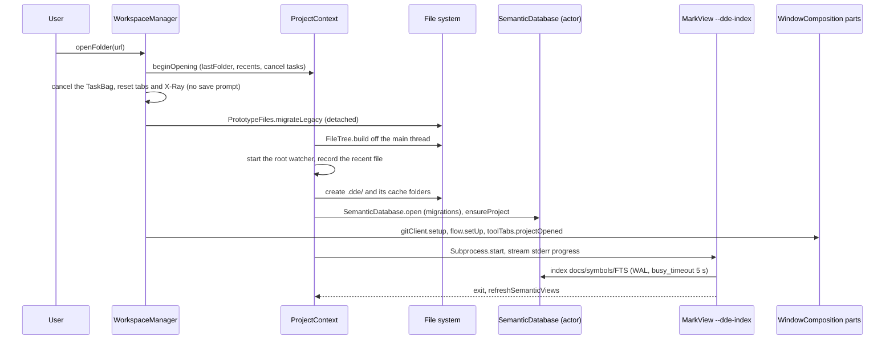

# Runtime Flows

These are the end-to-end paths across subsystems, checked against the code at `ac3001ba` (2026-11-15). Each flow gives the short
version and links to the module section with the detail. A flow names files and symbols, not line numbers.

## 1. Process launch

`DDEAppEntry.main` (`MarkView/App/MarkViewApp.swift`) reads the arguments and chooses a mode:

| Mode | Trigger | What happens |
|---|---|---|
| GUI | normal launch | `MarkViewApp.main()`, then the `WindowGroup` makes a `ContentView` per window, which owns a `WorkspaceManager` (a facade over one `WindowComposition`). `WindowSessionController.attach` restores the saved windows. `MarkViewAppDelegate` starts `FinderOpenRequests` (one app-wide poll of `markview_open_path.txt`) and queues Finder "Open With" URLs; the active window drains the queue once its session is restored |
| Headless indexer | `--dde-index <folder>` | `DDEIndexerRunner.run`: open `SemanticDatabase`, `StructuralIndexer.indexAll()`, print `[mvindexer] N/M` to stderr, `exit` |
| Agent tool servers and remote guards | `--mcp-browser`, `--mcp-project`, `--mcp-control`, `--project-call`, `--remote-workspace-mcp`, `--remote-workspace-guard` | A runner for that argument, which never returns |

Details: [app-shell §5.1](./modules/app-shell-and-workspace.md#51-launch).

## 2. Open a folder



The setup is one `Task` stored in the window's `TaskBag` under the key `openFolder`, so the next `openFolder` cancels it.

Details: [app-shell §5.2](./modules/app-shell-and-workspace.md#52-open-folder),
[semantic §5.1](./modules/semantic-index-and-insight.md#51-open-workspace-and-structural-index).

## 3. Open a file and render it

1. `WorkspaceManager.openFile(url)` shows the Files area; a `.md` file outside the workspace, with no project folder open, switches to
   a single-file workspace (`.dde/file_<name>.db`). `TabsController.openDocument` selects an existing tab or appends a tab: a PDF,
   an archive, a data file or an image gets its own tab kind; any other file is read in a task stored in the `TaskBag`.
2. `EditorView.Coordinator.loadContentIfNeeded` routes by tab kind and file type: code and notes view (`setCodeContent`), JSON, YAML
   and canvas (`setStructuredContent`), data files (`setDataContent`, which the page fetches from the `markview-data:` scheme), or
   Markdown (`setContent`). Pictures next to a document are not inlined: the page asks for them through `markview-doc:///<path>`
   (`DocumentFileSchemeHandler`, rule in `DocumentFiles`).
3. The page renders (markdown-it, DOMPurify, Mermaid, Prism, KaTeX) and reports `headingsUpdated` and
   `contentChanged` back to Swift. Each message is declared in `Editor/js/bridge-contract.json` and decoded by a type in
   `Bridge/PageMessages.swift`.

Details: [editor §6.1-6.2](./modules/editor-and-bridge.md#61-editor-load).

## 4. Edit and save

```
source or WYSIWYG edit ─► page: contentChanged{documentID, markdown}
   ─► EditorView.Coordinator.didUpdateContent ─► TabsController.updateTabContent
      (the tab is chosen by EditorDocumentRouting; isModified = content != originalContent)
WYSIWYG edits ─► on Cmd-S: Turndown HTML→Markdown ─► contentChanged ─► saveRequested{documentID}
   ─► TabsController.saveEditorDocument ─► saveFile(at:) ─► AtomicFile.write ─► .saved(url) event
```

A save failure sets `TabsController.lastSaveError`, which the window shows as a banner. Turndown is vendored
(`vendor/js/turndown.min.js`), so saving a WYSIWYG edit does not need the network. Details:
[editor §6.3](./modules/editor-and-bridge.md#63-edit--save-round-trip).

## 5. Any AI call

Every one-shot AI feature (X-Ray, Insight, features and bugs, Explain, translation, filters) runs through an `AIOperation`
(`MarkView/Models/AI/AIOperation.swift`), whose runner calls `CLICompletion.run`; lint rule `clicompletion` allows no other caller.

1. `CLICompletion.execute` resolves the CLI through `CLIToolLocator` (the user's path override, `settings.cli.extraPATH`, then the
   search directories).
2. Cline and Copilot (`tool.usesACP`) go to `ACPAssistant` (JSON-RPC over stdio, with a permission filter). Every other tool builds
   its arguments in its provider (`AssistantProvider.completion`): Claude runs `claude -p` with `stream-json` output and read-only
   tools only when the request reads files, with web tools only when `allowWeb` is set; Codex runs `exec --sandbox read-only
   --json` and takes a schema file for structured answers.
3. `Invocation` runs the child with `Subprocess.start`: stdout and stderr are drained concurrently, the timeout ends the child's
   process group, and cancelling the calling task terminates it.
4. The parser turns the stream into text, activity and a result; `AIJSONSalvage` extracts and decodes a JSON answer.
5. `AICallLog.record` appends one line (label, tool, model, seconds, tokens, cost, outcome, no prompt or answer text) to
   `Application Support/MarkView/ai-calls.jsonl`.

Details: [ai-assistants §6](./modules/ai-assistants-and-dictation.md#62-one-shot-completion-via-claudecodex).

## 6. X-Ray (architecture map)

1. `ArchitectureScanner` runs off the main thread: `git ls-files`, language heuristics, import edges, git metrics and co-change.
2. `ArchitectureStore` commits nodes and edges to the `arch_*` tables through the `SemanticDatabase` actor.
3. AI analysis runs in passes: grouping, naming, descriptions and edges.
4. The payload is JSON-encoded and sent to the page (`markview-architecture-*.js`, Cytoscape + ELK).
5. User actions come back as `arch` bridge messages: open a file, explain an edge, filters and PR actions. `CodeAndXRayCoordinator`
   handles the code and X-Ray actions of a window; PR reviews are in `ChangeReviewStore`.

Details: [architecture-and-xray §5](./modules/architecture-and-xray.md#51-open-the-tab-show-the-stored-map-rescan).

## 7. Recursive Insight

1. `InsightCoordinator` (one per window) starts a session; `InsightSession` classifies the content, then requests a skeleton with a
   JSON schema: sections and child topics.
2. It streams up to 5 section calls at once into a sandboxed iframe (`markview-insight-*.js`; `sandbox="allow-scripts"`, a nonce CSP).
3. Each node is cached in `<ws>/.markview-insight/` (`nodes/<UUID>.html`, `manifest.json`, `snapshot.json`).
4. Deep dive creates child nodes. Export zips the cache through `Subprocess`.
5. Closing the tab runs `InsightCoordinator.close`, the ordered cleanup.

Details: [semantic §5.4](./modules/semantic-index-and-insight.md#54-recursive-insight-session-lifecycle).

## 8. Feature and bug intake

1. `IntakeSheet` has five options (`IntakeKind`): New Feature, Quick Feature, New Bug, "I Need to Understand" and New Research. Its text field accepts dictation.
2. `FeatureAssistant` runs AI rounds that produce questions, requirements, decisions and findings; `FeatureFlowCoordinator` owns the
   flow of a window.
3. `FeatureStore` writes each object as a Markdown file under `docs/features/<slug>/` or `docs/bugs/BUG-nnn-<slug>.md`. An optional
   GitHub issue is created, and lifecycle events are appended.

Details: [feature-workflow §5](./modules/feature-workflow.md#51-new-feature-intake).

## 9. Terminal and link activation

1. `TerminalSession` runs `forkpty` with the user's shell as a login shell (`-l`) and sets `TERM_PROGRAM=MarkView`.
2. It streams the PTY through the `terminal` bridge channel into `terminal.html` (xterm.js).
3. A Cmd+click on a URL or OSC 8 link sends a link message. Cmd+click is captured before mouse reporting, so full-screen TUIs don't
   receive the click.
4. File paths are checked in Swift through `TerminalLink.resolve`, relative to the live shell cwd. Openable files go to a MarkView
   tab at the line; other files go to `NSWorkspace`.

This flow was the subject of [BUG-001](../bugs/BUG-001-terminal-clicking-an-https-link-does-not-open.md).
Details: [terminal §B.5](./modules/git-github-terminal-lifecycle-usage.md#b5-runtime-flows).

## 10. Close folder / quit

`closeFolder()` asks to stop running project operations, then asks about modified tabs once for all of them
(`TabsController.resolveUnsavedChanges`); it aborts when cancelled or when a save failed. It then cancels Insight sessions, stops
terminals, cancels the task bag, resets tabs, project, engines, X-Ray, Git and the flow. Opening another folder skips the prompt; see
[app-shell §10](./modules/app-shell-and-workspace.md#10-risks-tech-debt-and-oddities).

Quitting: `applicationShouldTerminate` stops project operations, finishes the remote relay, saves the window session and cancels
Cockpit agents before it lets the app exit; `applicationWillTerminate` stops the agent server and the child processes of the agents.
Details: [app-shell §5.7](./modules/app-shell-and-workspace.md#57-close-folder--remove-metadata).
