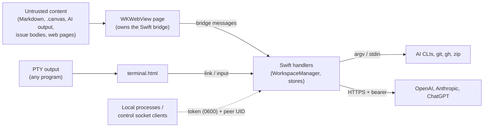

# Security Model

MarkView runs **without the App Sandbox**, with ATS arbitrary loads allowed. It can read any file
the user can read and can launch any binary. Its protections come from validation at each trust
boundary. This page lists those boundaries, what is enforced, and the known gaps. Severity
ordering and fix status are in [risks-and-tech-debt](./risks-and-tech-debt.md).

## 1. Trust boundaries

## 2. What is enforced

| Boundary | Control | Where |
|---|---|---|
| Bridge → file open | Paths must stay under the workspace or X-Ray root; `..` and absolute paths rejected for canvas and wikilinks; symlink escapes blocked | [app-shell](./modules/app-shell-and-workspace.md), [X-Ray](./modules/architecture-and-xray.md) |
| Bridge → URL open | `openURL` opens only `https://github.com…` | `WorkspaceManager.swift` |
| Bridge → PR actions | Operations and merge methods are allowlisted | `ArchitectureStore` |
| HTML & CSP (editor, book, discussion, canvas, code) | Rendered HTML sanitized with vendored DOMPurify (`fail closed` if unavailable, `afterSanitizeAttributes` strips `file:` and non-raster `data:`); no `'unsafe-inline'` in `script-src` | `markview-render.js`, `markview-book.js`, `markview-discussion.js`, `markview-canvas.js`, `markview-code.js` |
| Insight iframe | Sandboxed null-origin `allow-scripts` (no `allow-same-origin`); DOMPurify HTML sanitization; `postMessage` origin + source verification; nonce CSP without `'unsafe-inline'` and Mermaid `securityLevel: 'strict'` | `markview-insight-handlers.js`, `markview-insight-srcdoc.js`, `EditorView.swift` |
| Finder Quick Action handoff | `markview_open_path.txt` in `temporaryDirectory` / `/tmp` opened with `O_NOFOLLOW`, verified via `fstat` as a regular file owned by `getuid()`, then deleted | `MarkViewApp.swift` |
| Control socket (`markview-control`) | Per-instance `0600` token (read via `O_NOFOLLOW` + `fstat`), fail-closed constant-time verification, kernel peer UID (`== getuid()`) check, socket/token unlinked on quit | `AgentToolServer.swift`, `BrowserAgentTools.swift` |
| Terminal links | Only `http(s)` and existing local files; `javascript:`, `data:`, `ssh:`, remote `file:` rejected | `TerminalLink.swift` |
| AI CLIs | Read-only modes (Claude tool allowlist, Codex `--sandbox read-only`, ACP permission filter); prompt envelopes escape `<file>` tags; model-suggested paths checked for containment and existence | [ai-assistants](./modules/ai-assistants-and-dictation.md) |
| Subprocesses | Argument arrays, not shell strings (`git`, `gh`, `zip`); `gh`/git prompts disabled | module docs |
| Credentials & Logs | OpenAI key stored in Keychain (`WhisperClient`, UserDefaults fallback deleted only after Keychain save succeeds); dictation text and `/tmp/markview-insight-diag.log` removed from logs; Web Inspector gated on `#if DEBUG` | `WhisperClient.swift`, `EditorView.swift`, `WebViewBridge.swift` |
| Vendor bundles | Turndown, DOMPurify, CodeMirror, Cytoscape, xterm.js, etc. vendored locally in `Resources/Editor/vendor/` (no CDN loads in `index.html`) | `tools/web-vendor`, `index.html` |

## 3. Remaining open security work (tracked in architecture review)

| # | Weakness | Impact / Status |
|---|---|---|
| S4 | AI terminals pass full-access flags unless adjusted by the user/settings | Prompt injection risk in interactive agent terminals |
| S7 | "Open in Terminal.app" retains AppleScript string escaping fallback | Hardened escaping / terminal launch migration |
| S10 | ACP permission check edge cases for searches and un-resolved read symlinks | Scheduled for AI security hardening |
| S13 | Legacy `evaluateJavaScript` interpolations outside `JS.call` | Incremental migration to `JS.call` (Step E) |

## 4. Rules for contributors

- Validate every bridge payload at the Swift handler (type, containment, allowlist). Never trust JS
  ([editor §9](./modules/editor-and-bridge.md#9-error-handling-edge-cases-payload-validation)).
- Pass subprocess arguments as arrays, drain pipes, and never shell-interpolate user or repo strings.
  Project operations are the explicit exception: after a native confirmation of the exact
  command, MarkView passes that complete string as one argument to the user's login shell
  (`$SHELL -l -c <command>`) on a dedicated PTY. MarkView does not substitute or compose
  repository text into the command. All other subprocess call sites retain the array rule.
- Never log credentials, request headers or document contents (CLAUDE.md).
- Keep AI calls read-only unless the user explicitly starts an agent terminal.
- Load no new web dependency from a CDN; vendor it through `tools/web-vendor`.
