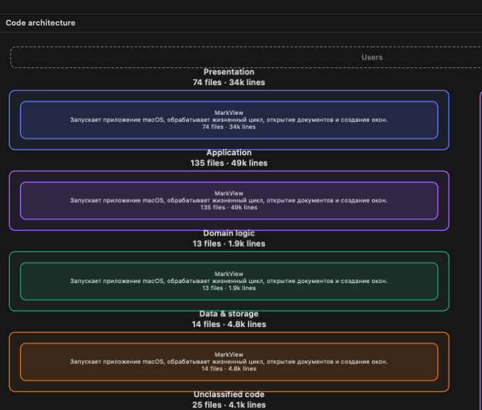

# Code architecture repeats the same MarkView container across layers and leaves files unclassified

## Summary

The Code architecture overview repeats the same MarkView container and startup description across four distinct layers, obscuring their responsibilities. The user also reports excessive unclassified code; the screenshot confirms 25 unclassified files, but their correctness cannot be assessed without their paths. Static inspection identifies ancestor cloning and fallback path classification as the strongest investigation leads.

## Steps to reproduce

1. Open the source project used in the screenshot; MarkView itself is the likely candidate, pending confirmation.
2. Open Project Map / X-Ray and select Code.
3. Observe the initial layered overview and record whether source analysis is pending, complete or failed.
4. Compare the component names and purpose text across Presentation, Application, Domain logic and Data & storage.
5. Inspect Unclassified code and its file paths. These are candidate reproduction steps derived from the screenshot, not independently verified.

## Expected

The initial Code overview should expose meaningful responsibilities within each supported layer, with descriptions appropriate to those responsibilities. Shared containers should not obscure the differences between layers. Supported source files should receive source-grounded classification where evidence permits; genuinely unresolved files should remain explicitly identifiable rather than being assigned arbitrarily. Zero unclassified files is not assumed.

## Actual

The screenshot shows a MarkView box with the identical application-startup purpose in Presentation (74 files, 34k lines), Application (135 files, 49k lines), Domain logic (13 files, 1.9k lines), and Data & storage (14 files, 4.8k lines). Unclassified code contains 25 files, 4.1k lines. The differing totals indicate layer-specific subsets; the screenshot does not establish duplicate file ownership.

## Environment

Native MarkView macOS application, X-Ray Code architecture view. The screenshot appears to show MarkView self-analysis, but the analyzed root, installed app version, macOS version, assistant and model are unconfirmed. Repository project.yml currently declares version 5.6.0; this does not establish the screenshot's version.

## Suspected code

- `MarkView/Models/CodeArchitecture.swift:35` — view selects the dedicated code model or falls back to the logical/modules hierarchy. At lines 62–69 it clones every ancestor per layer, replacing IDs, parent and role while retaining name and summary. This directly explains repeated MarkView containers when a shared ancestor spans multiple layers.
- `MarkView/Models/CodeArchitecture.swift:23` — guessedLayer uses a fixed list of directory names and SQL detection, otherwise returning other. At lines 58–59 it is used when no semantic ancestor role is available. Missing path categories can inflate Unclassified code.
- `MarkView/Resources/Editor/vendor/js/markview-architecture.js:712` — expandedSet automatically opens layer bands in the initial overview, leaving nested component expansion unchanged. Combined with the cloned ancestor hierarchy, it can foreground the same outer MarkView box in each band.
- `MarkView/Models/ArchitectureStore.swift:1090` — The logical fallback constructs component nodes with their stored names, purposes and layers. These become input to the Code projection when a dedicated codeModel is absent; the stored hierarchy should be inspected.
- `MarkView/Models/CodeArchitecture.swift:485` — validateModel permits 1–120 components and validates structural/source constraints without requiring full source ownership coverage or responsibility depth. An incomplete model can pass these checks.

## Likely causes

- Confirmed implementation mechanism: the Code projection clones every ancestor into each descendant file's layer and preserves its name and summary. A shared MarkView ancestor can therefore appear in several layers with the same startup description.
- Likely presentation cause: the initial overview exposes the shared outer ancestor while meaningful nested responsibilities remain collapsed.
- Possible classification cause: files without a semantic component role fall back to a limited path-based classifier; unrecognized paths become other. Common project folders such as Models and Resources have no explicit classification.
- Possible model-quality cause: validation checks component structure, paths and evidence, but does not require complete ownership coverage or meaningful responsibility decomposition. The saved model is needed to determine whether this contributes.

## Missing information

- Installed app version and exact analyzed project/folder.
- Whether automatic or manual code analysis completed successfully, and whether Refresh changes the result.
- The saved architecture snapshot, including codeModel, logical hierarchy and ownership assignments, to distinguish projection behavior from incomplete or stale analysis.
- Paths of the 25 unclassified files, to assess whether their classification is actually incorrect.

## Attachments

## Original description

Architecture code is not working properly. All layers have mark view, same mark view. It's weird, it's not supposed to be like that. And a lot of unclassified code, it's not supposed to be like that as well.
