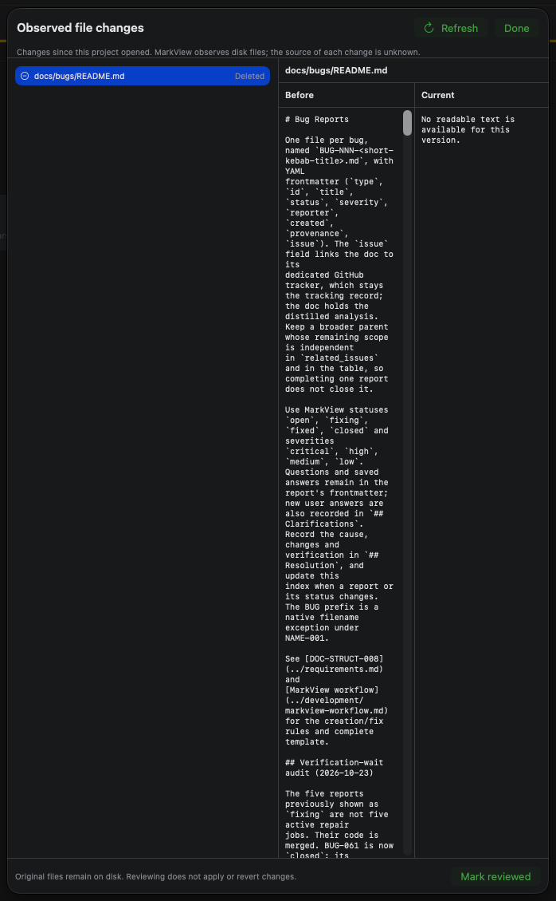

# Observed changes comparison is too narrow

## Summary

The side-by-side comparison in the Observed file changes review sheet is too narrow to read comfortably because the file list consumes a large portion of the sheet.

## Steps to reproduce

1. Open a project in MarkView.
2. After the project opens, delete a Markdown file containing several lines of text outside or inside the app.
3. Refresh observed file changes if needed, then click Review.
4. Select the deleted file and inspect the Before and Current columns.

## Expected

The Before and Current versions have enough horizontal space to read and compare content comfortably, including when a file is deleted.

## Actual

In the supplied screenshot, the file list occupies approximately half of the review sheet, leaving each comparison column only about a quarter of the sheet. The Before text wraps heavily, making it difficult to read and compare.

## Environment

MarkView on macOS. The screenshot shows the Observed file changes sheet with a deleted Markdown file selected. App version, macOS version, window dimensions, and display scaling are unknown.

## Suspected code

- `MarkView/Views/ProjectChangeReviewView.swift` — Defines the review sheet, the file list's minimum and ideal widths, the sheet's minimum width, and the equally expanding Before and Current columns.
- `MarkView/Views/ContentView.swift` — Hosts ProjectChangeReviewBar, the entry point that opens the review sheet; useful for checking available parent window context.
- `README.md` — Documents Review as a side-by-side diff for observed file changes, establishing the intended review workflow.

## Likely causes

- Likely layout cause: the file list and comparison share an HStack without an explicit width allocation that prioritizes the comparison.
- The sheet specifies a minimum width of 680 points but no larger preferred width. The two versions then share the remaining comparison area equally.

## Missing information

- The exact application and macOS versions, window dimensions, and display scaling are unknown.
- It is unknown whether the same width problem occurs for added and modified files or at larger window sizes.

## Attachments

## Original description

Look at attachment the Compare is too narrow - FIX

## Resolution

Cause: in ProjectChangeReviewSheet the file list (List with minWidth 210, idealWidth 260 and no upper bound) and the comparison pane were both flexible children of one HStack, so SwiftUI split the width equally: the list took half of the sheet and Before and Current a quarter each (the screenshot: list about 345 pt, each version about 170 pt of a 698 pt sheet). The sheet also had only a minimum width (680 pt) and no preferred size, so it opened at that minimum.

Change (MarkView/Views/ProjectChangeReviewView.swift, version 5.42.1): the list is bounded (minWidth 180, idealWidth 220, maxWidth 260) so the comparison gets the rest of the width, and the sheet has a minimum of 760 x 440 pt, opens at 1000 x 640 pt and can be resized larger. The sheet struct is no longer private so the layout test can host it.

Verification: tools/tests/project-change-review-layout-tests.sh hosts the shipping sheet off screen and measures it. The old sheet fails it (760 pt: list 380, Before 190, Current 188, comparison 49 %; 1300 pt: list 650, versions 324 each; opens at the minimum). The fixed sheet passes at 760 pt (list 260, versions 249 each, 65 %), at its opening size 1000 pt (list 260, versions 369 each, 73 %) and enlarged to 1600 pt (list 260, versions 669 each, 83 %). Debug build succeeds. Not checked by hand in the installed app: added and modified files use the same layout and are covered by the same measurement (two files are in the test).
