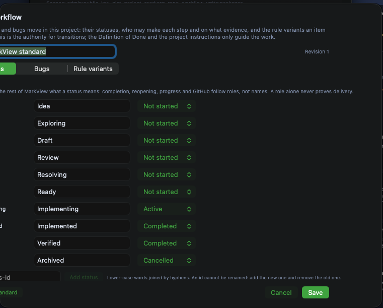

# Project workflow dialog is clipped on the left

## Summary

The Project Workflow editor was reported and shown clipped on the left, and the user says the clipping recurs after reopening. Validity against origin/main at 8d5d8d784d remains inconclusive: the presentation path and potentially conflicting width constraints remain, but no runtime check has established whether the defect still occurs. The separate request to relocate project configuration and add templates or custom processes is a feature request, not an established cause of clipping.

## Steps to reproduce

1. Open a project in MarkView.
2. Open DDE Settings and select Project Workflow….
3. Inspect the left edge of the workflow editor under the window and display conditions shown in the attachment.
4. Close and reopen the editor; the user reports the clipping recurs.

## Expected

The complete workflow editor and its controls are visible or otherwise accessible and usable within the available window or screen area, including when space is limited.

## Actual

The attached screenshot shows the left side of the sheet cut off, including parts of the title, explanatory text, workflow name, Features tab and status IDs. The user reports that the clipping recurs after reopening the editor.

## Environment

MarkView for macOS; the screenshot shows dark appearance. App version, macOS version, display configuration, settings window dimensions and interface text scale are unknown.

## Suspected code

- `MarkView/Views/WorkflowEditorSheet.swift` — Requests a fixed 760-point sheet width, fixes the scroll area height at 400 points, and uses fixed-width controls and fixed-size menus with a vertical ScrollView.
- `MarkView/Views/DDESettingsView.swift` — Presents the workflow editor as a sheet from the Project workflow section.
- `MarkView/App/MarkViewApp.swift` — Creates the settings window with an initial content width of at most 640 points, potentially constraining the presenting window.

## Likely causes

- Unverified hypothesis: the sheet requests a fixed width of 760 points, while the settings window initially has a content width of at most 640 points. The effect of these constraints on sheet positioning and clipping needs runtime verification.
- Unverified hypothesis: fixed-width controls and fixed-size menus may overflow in limited space; the editor's ScrollView defaults to vertical scrolling. The 400-point scroll-area height is a separate vertical constraint and does not by itself explain left-side clipping.

## Missing information

- A runtime check against origin/main at 8d5d8d784d under the reported or comparable window and display conditions would establish whether the clipping still occurs.
- The app and macOS versions, display configuration, window dimensions and text scale at the time of the report would help reproduce the original conditions.
- Observing whether resizing or moving the settings window changes the clipping, and inspecting sheet and window bounds at runtime, would help locate its cause.
- It is unknown whether the right edge is also clipped.

## Validity check

**Outcome:** Inconclusive (checked 2026-11-08). The status was not changed.

**Verified against:** `origin/main` @ `8d5d8d784d` (2026-11-08) — docs: lesson on merging without waiting for CI

**Reason:** The reported presentation path still exists. The settings window initially has a content width of at most 640 points, while the workflow sheet requests a fixed width of 760 points and provides only vertical scrolling. These constraints leave the reported clipping risk unresolved, but the code alone does not establish how macOS positions and clips the sheet under the unknown display and window conditions. A runtime check is needed to confirm whether the reported left-side clipping still occurs.

## Attachments

## Clarifications

**BQ-1** Когда вы открываете Project Workflow повторно, левая часть снова обрезана?
→ Всегда. Обрезается и после повторного открытия.

## Original description

Полностью обрезанная UI. 

Значит так, я хочу имплементировать такую вот фичу. Мне нужно, чтобы у нас в брокер фабрике, или вернее даже в Strike Desk, наверное, появился некий Trading Copilot. Значит, Trading Copilot должен быть устроен таким образом. Он нужен только в основном для меня, для обучения трейдингу. И он должен, кроме всего прочего, сохранять информацию обо мне. То есть, что я знаю, что не знаю, там профессионально, на каком уровне. То есть как мне отвечать и всё остальное. Кроме того, мы сделаем, чтобы у него был доступ к папочке, в которую мы будем скидывать обучающую информацию. И он, принимая эту обучающую информацию, на её основе будет нам выдавать теорию, использовать её для обучения, создавать, может быть, картинки, показывать, диаграммы, если они есть, или показывать, если они есть, или генерировать, если надо. Вот. То есть он может использовать всё вот это вот дело. И как он это будет делать? Это на заднем плане, так же как у нас AskMe, там будет бежать либо Claude, либо Codex, CLI, причём можно будет выбирать. Знаешь что, даже добавь туда кроме Claude и Codex также ещё Anti-Gravity. Ну и всё пока что. И значит. Человек выбирает, с чем работает. Причем это делается в конфигурации. У нас в конфигурации сейчас для RFI есть AskMe. Вот там же, где AskMe, параллельно с этим будет еще Trading Copilot. И этот Trading Copilot — ты выбираешь там, какую ты хочешь аппликацию иметь там: Zadi Codex или Claude, или Antigravity. Выбираешь модель, с которой ты хочешь работать. И после этого всё можно запускать. Дальше это... ну и еще оно должно быть как бы включенным, понимаешь? То есть я хочу, чтобы это было максимально, вернее минимально инвазивно для существующих пользователей. Это я только этим буду в основном пользоваться. Но когда она включена и справа есть такая маленькая иконка, какая-нибудь, куда я нажимаю, появляется диалог, где я могу общаться с этим AI. И кроме всего прочего, кроме того, что он будет мне отвечать на вопросы, основываясь на той информации, которая у меня есть, плюс еще он имеет возможность search в вебе, то после этого он может мне отвечать на вопросы, как умеет Codex, там, и картинками, и диаграммами, и Markdown, и всем остальным. То есть там диалог такой должен всё принимать: видео, Markdown и всё остальное. А у меня возможность написать ему, спросить там что-то или попросить что-то. И у него, понимаешь, он умеет пользоваться, он должен знать, что такое MCP нашего Broker Factory. И зная MCP нашего Broker Factory, он может им управлять. То есть он может... ну как управлять? То есть, например, он может мне предложить... Рассказывая, например, о каком-то трейде, вот говорит: вот давай откроем с тобой, или у тебя... он может посмотреть уже, что у меня открыт Pepper Money, и он говорит: давай на этом Pepper Money аккаунте, который у тебя, вот на этом underline, сделаем какой-нибудь трейд. И внутри Strike Desk он мне открывает прямо трейд виджет, и в этом трейд виджете выбирает трейд и говорит: обрати внимание там на анализ, например, или обрати внимание на то, на сё. Вот это значит это, то-то значит это. И я его могу спрашивать любые вещи касательно Mark View, ой, как Mark View, касательно Broker Finder, касательно Strike Desk, касательно вообще трейдинга. Он может мне объяснять, какой вот, допустим, если у меня выставлены на трейдинге, ну, трейды, ордера, он же тоже это видит через MCP, так он может мне объяснить, например, вот эти мои ордера, в чём их минусы, плюсы и всё остальное. То есть он реальный co-pilot, который знает мой уровень и помогает мне, и его цель — научить меня торговать как можно быстрее. Значит, абсолютно да, обрезано. Я хочу, чтобы ты мне починил это. То есть в общих сеттингах, где я сейчас тебе вот на Snapchat показываю, общие сеттинги, они нужны только для темплейтов. Вот, сама конфигурация проекта должна быть внутри проекта. Я буду, может, создать нам лучше MarkView Project там YAML или MarkView Project JSON, в котором мы бы всё это дело описали, и MarkView бы визуально показывал эти специфические вещи, и можно было бы настраивать, например, какие последовательности для каких типов: для feature, quick feature, bug там и так далее. Вот какой у нас процесс для каждого. Или, может быть, сделать strain процесс ещё один. То есть чтобы можно было делать процессы либо по темплейтам уже готовым, которые у нас есть общие, либо создавать как бы с нуля.

## Resolution

Reproduced off screen with tools/tests/workflow-editor-layout-tests.sh, which hosts the shipping sheet in a borderless window far outside the display (never shown) and measures it: on the Features tab the scroll area spanned -69…829 in a 760 pt sheet, and an off-screen snapshot showed the same cut-off text as the report's screenshot.

Root cause: the transitions list drew each rule's "From:" menu at its full label width (fixedSize). The standard cancellation rule starts from nine statuses, a 91-character label, so the list wanted 881 pt in a 724 pt space; the sheet's fixed 760 pt frame centred the overflow and cut about 70 pt on the left (and as much on the right). The settings window width (640 pt) and the 400 pt scroll height were not the cause, and the Bugs and Rule variants tabs were never affected. The three fixedSize actor menus under each rule had the same flaw.

Fix (5.44.1, PR #328): the From menu is as wide as its label up to 360 pt and truncates after that, the actor menus share the row and truncate, and both show the full text as a tooltip. The test now passes on all three tabs for the standard workflow and for one at its widest.
