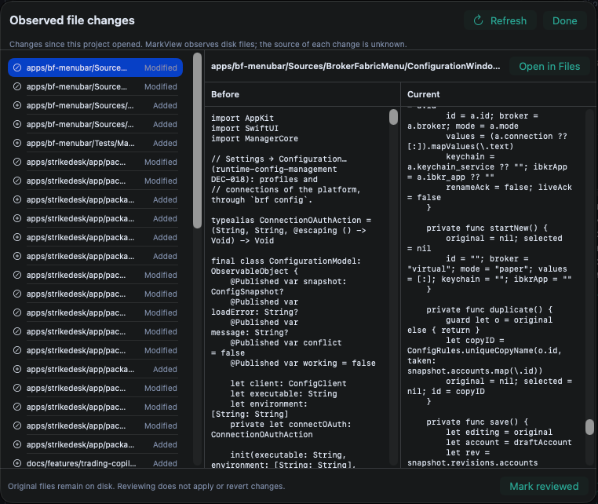

# Observed changes review lacks usable diff and explanations

## Summary

The observed file changes review presents plain snapshots without highlighting, change locations, or explanations. The user also reports that the review sheet cannot be enlarged; that resize failure remains unverified.

## Steps to reproduce

1. Open a project in MarkView 5.43.0.
2. Modify a readable text file after the project has opened.
3. Refresh observed file changes if necessary, then click Review in the observed changes bar.
4. Select the modified file and try to enlarge the review sheet.
5. Inspect how the Before and Current versions identify and explain the differences.

## Expected

The comparison can be enlarged and provides sufficient space to inspect changes. Each difference is visibly highlighted and located in the file, with an explanation of why it differs and its impact.

## Actual

The user reports that the review sheet cannot be enlarged and that individual changes are neither highlighted nor explained. The supplied screenshot shows a modified Swift file in narrow, heavily wrapped Before and Current columns at different scroll positions, without visible change locations or explanations. The inability to resize has not been independently reproduced.

## Environment

MarkView 5.43.0 on macOS. The screenshot shows a modified Swift file selected in the Observed file changes sheet. The macOS version, display configuration, and parent window size are unknown.

## Suspected code

- `MarkView/Views/ProjectChangeReviewView.swift` — Presents the SwiftUI sheet, specifies its dimensions, and displays the snapshots in separate plain-text scroll views.
- `MarkView/Models/ProjectChangeReview.swift` — Captures and classifies file-level snapshots without producing change-level comparisons; readable text capture is limited to files of at most 512 KiB.
- `MarkView/Views/ContentView.swift` — Hosts the observed changes bar and supplies the parent context for the review sheet.
- `docs/bugs/BUG-107-observed-changes-comparison-is-too-narrow.md` — Documents the related 5.42.1 layout fix and its off-screen verification, without a manual check of resizing in the installed app.
- `README.md` — Describes Review as a side-by-side diff.

## Likely causes

- The current review view renders each complete snapshot as plain monospaced text in a separate scroll view; it does not compute or highlight corresponding changes or provide explanations.
- The scanner records file-level classifications and snapshots, but no change-level comparison or semantic impact analysis.
- The cause of the reported inability to enlarge the sheet is unconfirmed. Flexible view dimensions and an off-screen layout test do not establish that the presented sheet is user-resizable.

## Missing information

- The resize gesture attempted and whether enlarging the parent window changes the sheet size are unknown.
- The macOS version, display size and scaling, and parent window dimensions are unknown.
- The resize failure has not been reproduced in a live app. Version 5.43.0 is later than the BUG-107 fix recorded for 5.42.1, but the installed build's behavior has not been independently verified.

## Validity check

**Outcome:** Still present on main (checked 2026-11-08).

**Verified against:** `origin/main` @ `8d5d8d784d` (2026-11-08) — docs: lesson on merging without waiting for CI

**Reason:** The review still displays the complete Before and Current text in separate scroll views without highlighting differences, identifying their locations, or explaining individual changes and their impact. ProjectChangeScanner records file-level snapshots and classifications but does not produce change-level comparisons. The sheet has flexible dimensions and a wider preferred size, but the code and off-screen layout test do not establish whether a user can enlarge the presented sheet; that part requires a live check.

## Attachments

## Clarifications

**BQ-1** Какая версия MarkView установлена? Её можно посмотреть в меню MarkView → About MarkView.
→ 5.43.0

## Original description

UI для сравнения это окошко ужасное. Во-первых, его невозможно расширить. Во-вторых, нет хайлайтинга, нет объяснения изменений. Это должно быть нормально, чтобы было объяснение на каждое изменение. То есть я должен запускать потом и показывать тебе разницу. Показывать где в этом файле разница, почему это разница, на что она влияет. А так это совершенно бессмысленное окошко.
