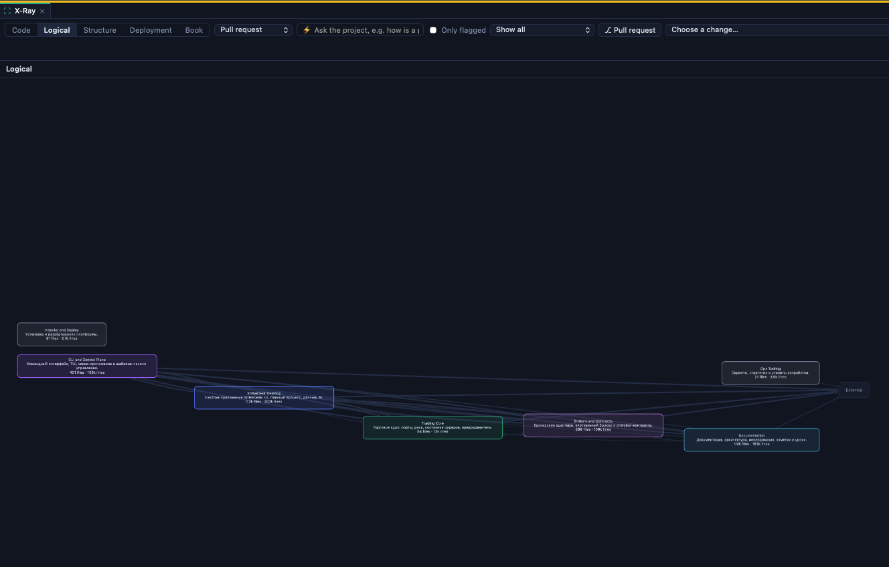

# Logical X-Ray graph is stretched and hard to read

## Summary

The reporter observed a stretched, hard-to-read Logical X-Ray graph immediately on opening in MarkView 5.43.0. Both the scale and component placement were problematic. Validity remains inconclusive: inspection of origin/main at dba403790f shows that this behavior is possible, but the affected graph and environment are unavailable, so it is not established whether the issue persists.

## Steps to reproduce

1. Open the affected project in MarkView 5.43.0.
2. Open X-Ray and select the Logical view.
3. Inspect the initial layout, component placement and label readability. The project and exact opening context are unavailable, so these steps are not independently reproducible.

## Expected

On opening the Logical view, components and relationships should have a useful relative arrangement, use the available canvas effectively, and have readable labels.

## Actual

On opening, the screenshot shows a wide, shallow graph low in the canvas, with very small labels, substantial empty space above it, and several converging or crossing connections. The reporter identified both scale and relative component placement as problems.

## Environment

MarkView 5.43.0 on macOS, X-Ray Logical view. The screenshot shows Pull request controls and a 'Choose a change...' field; whether a change was selected is unknown. The project, macOS version and canvas dimensions are unknown.

## Suspected code

- `MarkView/Resources/Editor/vendor/js/markview-architecture.js:1172` — The layout selects rectangle packing or a rightward layered ELK layout based on top-level connectivity and node count. The affected graph's path is unknown.
- `MarkView/Resources/Editor/vendor/js/markview-architecture.js:1202` — The layout automatically fits the graph when no target or preserved view is requested; fitting a wide graph could make labels small.
- `MarkView/Resources/Editor/vendor/js/markview-architecture.js:1267` — Rendering rebuilds the graph and invokes layout, making this relevant to the initial view and its viewport state.

## Likely causes

- Inference: A connected top-level graph may select the rightward layered ELK layout and become wide relative to the canvas.
- Inference: Automatic fitting of a wide graph may reduce its label size. The cause of the low vertical placement is unknown.

## Missing information

- The affected project or a shareable representative graph fixture, including its components and relationships.
- Whether the same graph shows the issue on the current MarkView version and whether the result recurs after reopening or using Fit.
- The opening context, canvas dimensions and macOS version.
- The layout path and viewport state used for the affected graph; these require reproduction or instrumentation to establish.

## Validity check

**Outcome:** Inconclusive (checked 2026-11-08). The status was not changed.

**Verified against:** `origin/main` @ `dba403790f` (2026-11-08) — docs: BUG-108 is fixed (PR #328, release v5.44.1), task log and a lesson; BUG-110 record

**Reason:** The Logical view still automatically fits the initial layout and can use a rightward layered layout for connected top-level components, so a wide graph with small labels remains possible. The code does not establish the actual scale, placement, or readability of the reported graph on this snapshot. The reporter identified the original version as MarkView 5.43.0, but the affected project or graph fixture, opening context, and canvas dimensions are still missing.

## Attachments

## Clarifications

**BQ-1** Когда появилось расположение, показанное на снимке?
→ При открытии. Так выглядит карта сразу после открытия.

**BQ-2** Что именно в расположении нужно исправить?
→ Оба. Мешают и масштаб, и взаимное расположение.

**BQ-3** Какой проект и версия MarkView использовались, и можно ли предоставить проект или пример карты для воспроизведения?
→ 5.43.0

## Original description

Неоптимальное размещение компонентов в логической разбивке внутри X-Ray.

## Resolution

Fixed in the batch branch fix/xray-and-review-batch (PR #331, 5.46.0). Cause reproduced: the top level of a connected graph always flowed to the right, so a chain of eight components laid out as 1374 × 210 on a 1119 × 792 canvas, fitted at 0.77, with the 8.5 px descriptions at about 6.5 px and the rest of the canvas empty. The top level (Logical, Structure and Deployment, 3 to 150 boxes) is now laid out both to the right and downwards on a copy that is never drawn, and the direction that can be shown larger wins (the same graph is 514 × 639 downwards, fitted at 1.15; a wide, low canvas keeps the rightward flow). Checked by the new tools/tests/xray-layout-web-tests.sh, which fails on the old script. The reporter's own project (BQ-4) was not available and the installed app was not checked (BQ-5 is still open).
