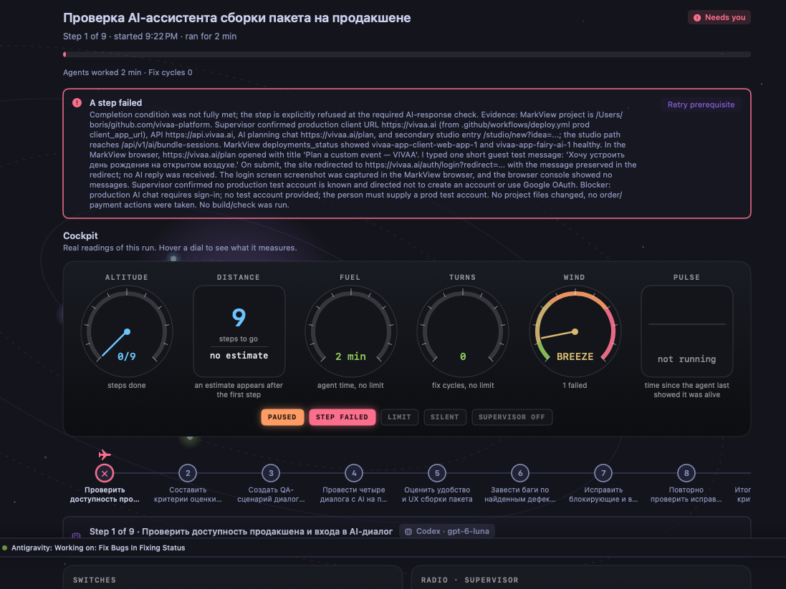

# Copilot offers only retry after a failed prerequisite and clips the step route

## Summary

A failed sign-in prerequisite leaves Copilot’s banner with retry as its only action. The reporter reached Plan but could not submit refinement text or save a step change, blocking recovery of the same run. Source review also found that an approved revision can select a later step while the prerequisite remains failed. The nine-step route clips waypoint 9 without an overflow cue, and the reporter’s scroll attempt did not reveal it.

## Steps to reproduce

1. Start a nine-step Copilot Cockpit QA run whose first step requires a response from the production AI chat. Use a signed-out session with no test account available to the run.
2. Submit a test message and let the sign-in redirect cause the prerequisite to fail. Inspect the paused run’s failure banner.
3. Open Plan. Enter a refinement for step 1 and click “Revise plan.” Test direct editing of step 1 separately. Record whether each control is enabled, whether the draft changes, and any progress or error. If a changed plan appears, try to review and approve it for the same run.
4. In a controlled run with the prerequisite still failing, submit an otherwise eligible revision with “Start from” set to a later dependent step. Check whether that step executes before the prerequisite passes.
5. With the route viewport below 1,044 points, narrow it until waypoint 9 is clipped. Check for an overflow cue, then try to scroll horizontally over the route and select waypoint 9.

## Expected

The failure state offers clear actions to provide missing context and open Plan to revise the remaining work. Submitting refinement text or editing a step produces a reviewable change or a visible explanation of what blocked it. Approval resumes the same run and preserves prior results with the plan versions that produced them. If the approved plan authorizes a bounded recovery attempt, Copilot can try it and rerun the prerequisite. If sign-in still blocks the check, Copilot requests the specific input or decision needed and keeps dependent steps paused until the check passes. At narrow widths, the route signals horizontal overflow and every waypoint can be reached and selected.

## Actual

The run paused on step 1 of 9. The screenshot shows “Needs you,” “A step failed,” and “Retry prerequisite” as the banner’s only action. The agent’s report in the screenshot says production redirected to sign-in, no test account was known, and the supervisor directed the agent to avoid account creation and Google OAuth. The reporter opened Plan and identified submission as the point where recovery stalled: they could not send the refinement text or save a change to the step. There is no evidence that a revision reached approval or the workflow. The screenshot shows waypoint 9 clipped without an overflow cue, and the reporter says their scroll attempt did not reveal it.

## Environment

MarkView for macOS, Copilot Cockpit, nine-step production QA run for vivaa.ai. The screenshot identifies the step agent as Codex with gpt-6-luna. The attachment, feature decisions, and local source matching the local origin/main ref at f32474da94 were reviewed. No live reproduction was performed. The installed MarkView and macOS versions are unknown.

## Suspected code

- `MarkView/Views/Cockpit/CockpitRunScreen.swift` — The live failure banner offers “Retry prerequisite.” Radio is rendered separately.
- `MarkView/Views/Cockpit/CockpitPlanScreen.swift` — The refinement button is disabled while busy or when the text is blank. Direct editing is a separate path. Reviewing an updated plan has additional eligibility checks.
- `MarkView/Models/Cockpit/CockpitSession.swift` — generate(refining:) can return without feedback if busy or the goal is blank, and planner failures populate the session error. applyRevision separately rechecks the prepared draft and can return before sending it.
- `tools/cockpit-temporal/workflow.go` — Results carry plan fingerprints. After a failed prerequisite, the loop waits for retry, revision, or stop. A valid revision assigns the selected step directly without checking the failed prerequisite.
- `MarkView/Views/Cockpit/CockpitFlightPath.swift` — The route uses fixed-width waypoint cells in a horizontal scroll view with indicators disabled. The source explains clipping and the missing cue, while gesture behavior requires reproduction.

## Likely causes

- The failure banner exposes retry alone. Providing guidance through Radio and revising the plan through Plan are separate interactions.
- Plan has separate paths for requesting a refinement, editing a step directly, and approving the resulting plan. The clarification narrows the reported failure to submission or saving, but does not establish which control failed or whether the planner ran. Approval and workflow guards remain separate possibilities to test after a changed plan is visible.
- The workflow has no bounded recovery branch or structured request for missing input. It also accepts a revision’s selected starting step without enforcing a previously failed prerequisite. REQ-003 and DEC-014 require the prerequisite to pass before proceeding, while DEC-016 permits a user-selected starting step. Their interaction during a paused revision is unspecified.
- Nine fixed 116-point cells require 1,044 points to fit in full. Hidden indicators explain the missing overflow cue. The failed scroll attempt remains unverified.

## Missing information

- The exact Plan control used, the attempted edit, and the visible outcome of the submission attempt.
- The original prerequisite instructions and authorized production sign-in options, already tracked by BQ-2.
- The route viewport width and installed app and macOS versions. The input device and scroll gesture are already tracked by BQ-5.

## Validity check

**Outcome:** Still present on main (checked 2026-11-25).

**Verified against:** `origin/main` @ `f32474da94` (2026-11-24) — Merge pull request #439 from t-boris/fix/bug-127-welcome-backdrop-restarts

**Reason:** On the supplied snapshot, CockpitRunScreen.swift still offers only “Retry prerequisite” in the failure banner. Radio accepts guidance separately. Plan supports editing, submitting a refinement, and approving an eligible revision on the same paused run, and the workflow preserves prior results under their original plan fingerprints. The report identifies submission as the point of failure, but the attempted edit, approval state, and any error are needed to identify what blocked it. In workflow.go, a failed prerequisite pauses the run until a manual retry, an accepted revision, or a stop. There is no bounded recovery branch or structured request for the specific missing input, and an accepted revision can start a later step before the prerequisite passes. CockpitFlightPath.swift lays out nine 116-point waypoints in a horizontal scroll view with hidden indicators, so a narrow viewport can clip waypoint 9 without an overflow cue. Whether the reported scroll gesture can reveal and select it remains unverified.

## Attachments

## Clarifications

**BQ-1** После остановки вы открывали экран плана и пробовали изменить текущий шаг?
→ Открыл, изменить не смог. На экране плана не удалось отправить или применить правку.

**BQ-3** Удалось ли прокрутить последовательность вправо и увидеть шаг 9?
→ Шаг 9 остался обрезан. Попытка прокрутить последовательность не показала последний шаг.

**BQ-4** На каком этапе в Plan вы остановились? Если на экране было сообщение, укажите его текст.
→ Отправка правки. Не удалось отправить текст правки или сохранить изменение шага.

**BQ-6** Что именно произошло в Plan, когда вы попытались отправить правку?
→ Кнопка недоступна. Текст был введён, но «Revise plan» нельзя было нажать.

## Original description

Капайлот, в принципе, не функционален, поскольку после остановки я могу только перезапустить его. Я не могу его изменить, сказать что-то там подправить и так далее. Он совершенно не функционален. И самое главное, понимаешь, он, капайлот, идея его в том, что он сам многие вещи делает. То есть, что он сам не смог догадаться, он остановился на том, что нужно залогиниться и не смог понять, что нужно создать аккаунт. То есть, это как-то странно. Мне кажется, капайлот подумай насчет имплементации этого капайлота, как оно сделано. Как зациклить некоторые вещи. То есть, есть ли что делать, если он падает. Он должен что? Фиксить это все, повторить заново, перейти на другой шаг сразу. Или ветка какая-то там должна быть. То есть, это должно быть более автоматизировано. Так что, это конкретный баг. Ну и, конечно, посмотри на UI баг, который я тебе скинул. Там последовательность не влазит по ширине.
