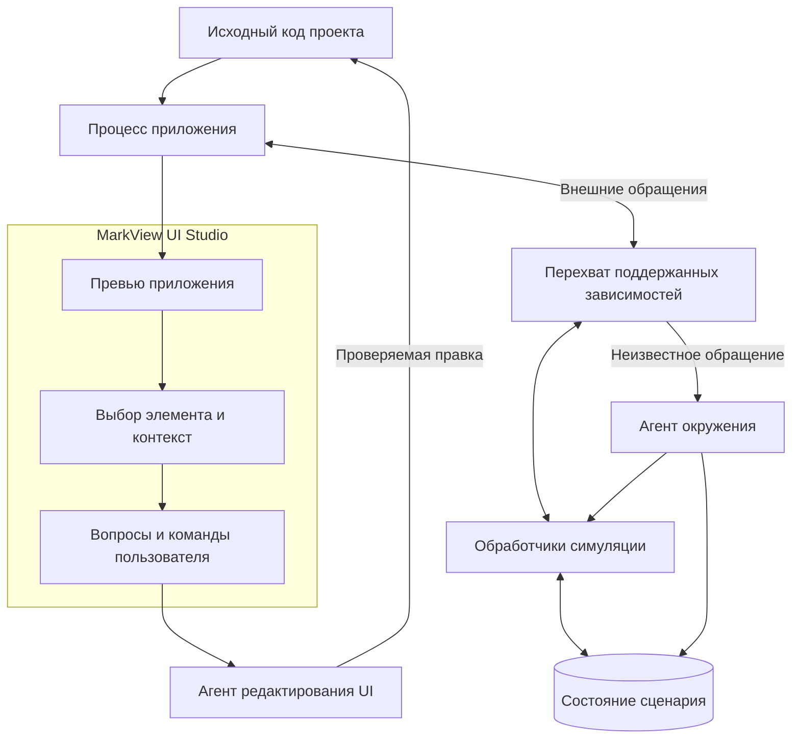
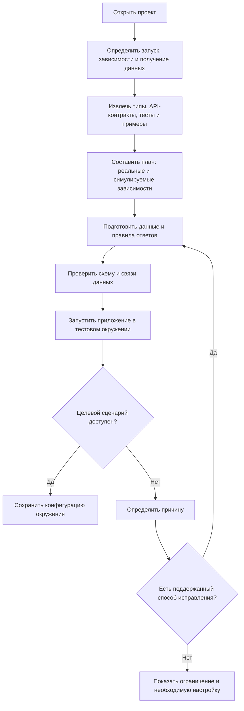
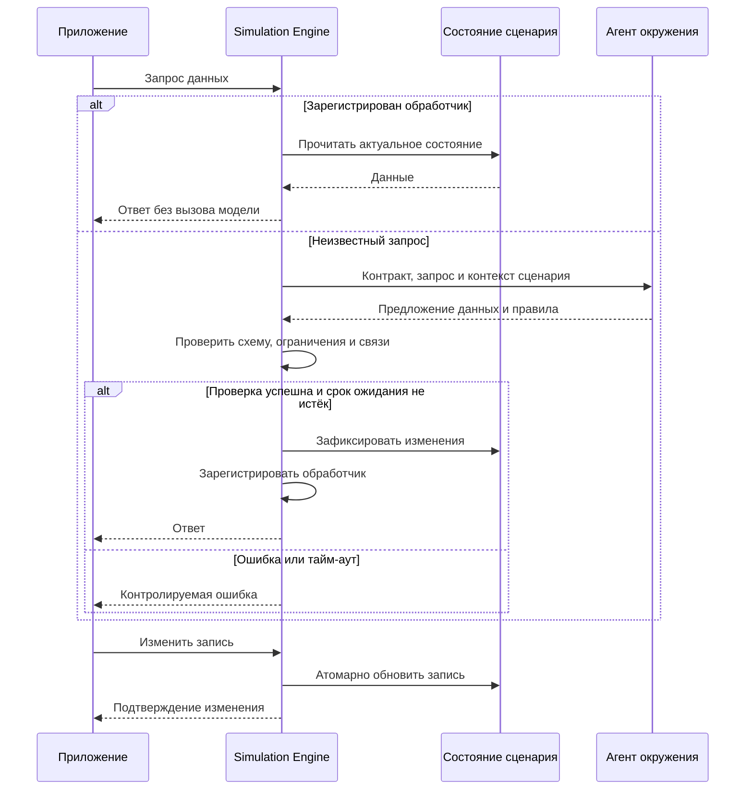
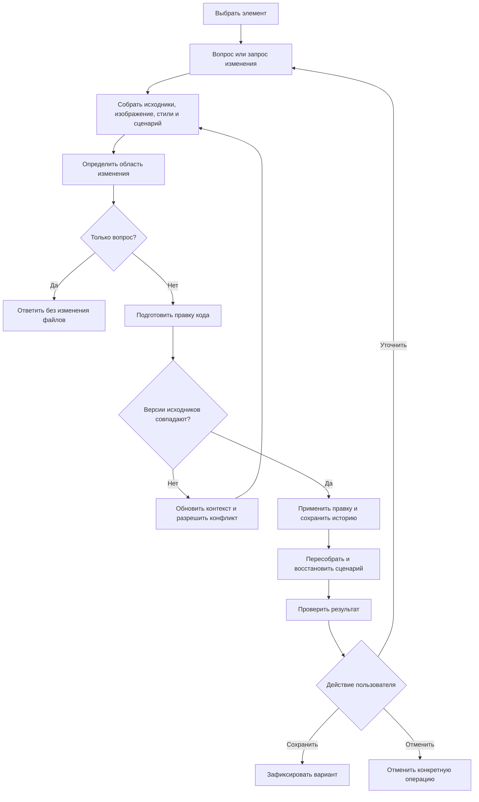
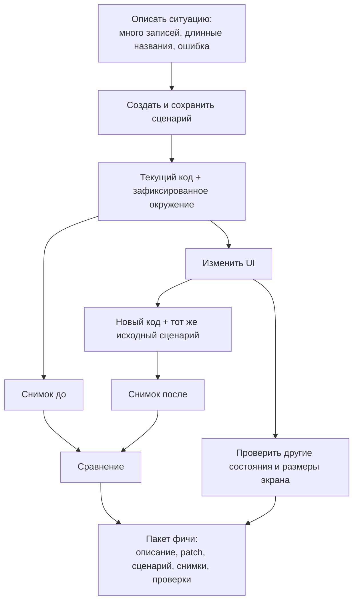

# MarkView UI Studio — технические требования

Версия: 0.1  
Дата: 2026-11-03  
Статус: проект требований для обсуждения и технического прототипа  
Основание: обсуждение концепции; текущая реализация MarkView не обследована.

## 1. Назначение

MarkView UI Studio должна запускать настоящий интерфейс проекта в управляемом тестовом окружении, предоставлять выбор элементов на экране и позволять изменять исходный код интерфейса через AI.

Окружение формируется при помощи агента, который анализирует зависимости приложения, создаёт согласованные тестовые данные и правила ответов, а затем дополняет симуляцию при обнаружении неизвестных обращений.

Основной пользовательский цикл:

> Открыть проект → запустить Studio → выбрать ситуацию → выбрать элемент → задать вопрос или запросить изменение → увидеть результат → сохранить или отменить.

Слово «виртуальное» обозначает управляемую среду исполнения и симуляцию зависимостей. Оно не предполагает обязательного использования виртуальной машины. Исполняться должны реальные компоненты, стили и клиентская логика приложения.

## 2. Принципы

1. Источником интерфейса служит код проекта. Постоянная отдельная HTML-копия интерфейса не создаётся.
2. Внутренняя логика UI выполняется реально. Подменяются явно выбранные границы: API, авторизация, внешние сервисы и другие поддержанные зависимости.
3. Известные обращения обслуживаются сохранёнными обработчиками без обращения к модели.
4. Агент подготавливает симуляцию и расширяет её по необходимости. Генерация ответа моделью для каждого запроса не является основным режимом.
5. Данные представляют единое изменяемое состояние: списки, детали объектов и операции изменения должны быть согласованы.
6. Команды изменения интерфейса и команды изменения тестовой ситуации имеют разные назначения и не должны смешиваться.
7. Превью показывает версию кода и сценария, из которых построено. Устаревший кадр не обозначается как актуальный.
8. Симуляция поддерживает разработку UI, но не подтверждает корректность реального backend или бизнес-правил.

## 3. Объём MVP

Базовый стек ниже — предлагаемое ограничение прототипа, а не установленный факт о MarkView. Его необходимо подтвердить после обследования проекта.

| Область | В MVP | После MVP |
|---|---|---|
| Приложения | React + TypeScript + Vite, клиентский рендеринг | Next.js/SSR, другие веб-стеки, SwiftUI |
| Размещение | Вкладка MarkView; адаптер оболочки для VS Code при необходимости | Другие оболочки |
| Зависимости | JSON REST API через fetch/XHR; тестовая сессия пользователя | GraphQL, WebSocket, SDK, серверные обращения, базы данных |
| Подготовка | Анализ кода + пробный запуск + дополнение неизвестных запросов | Импорт контрактов и записей реального трафика |
| Состояния | Наполненный список, пустой список, загрузка, ошибка, детали, редактирование | Сложные роли и многошаговые бизнес-процессы |
| Редактирование | Выбор DOM-элемента, переход к родителю, вопросы и изменения через AI | Панель свойств, drag-and-drop, несколько выделений |
| Отображение | Один активный экран, размер viewport, масштаб | Несколько живых экранов на холсте |
| История | Изменения файлов, снимки до/после, отмена отдельной операции | Несколько вариантов дизайна, совместная работа |

Не входят в MVP: универсальная симуляция произвольного приложения, полноценный редактор уровня Figma, реальная авторизация внешних провайдеров, выполнение платежей, доказательство эквивалентности production-среде.

## 4. Архитектура

### 4.1. Компоненты системы

| Компонент | Ответственность |
|---|---|
| Project Analyzer | Определяет стек, запуск, источники данных, доступные контракты и неподдержанные зависимости |
| Runtime Manager | Управляет процессами, портами, готовностью, журналом, остановкой и восстановлением |
| Preview Host | Размещает приложение, управляет viewport, масштабом и режимом взаимодействия |
| Inspector Bridge | Получает выбор, геометрию, сведения об элементе и его связи с исходниками |
| Environment Agent | Предлагает данные, сценарии и обработчики; объясняет предположения |
| Simulation Engine | Валидирует и исполняет зарегистрированные правила, обеспечивает операции над состоянием |
| Scenario Store | Хранит исходные наборы данных, изменяемые сессии и снимки сценариев |
| UI Editing Agent | Отвечает на вопросы, определяет область правки и предлагает изменения исходников |
| Change Manager | Проверяет версии файлов, применяет правки, хранит историю и выполняет отмену |
| Capture & Compare | Получает воспроизводимые снимки, сравнивает их и формирует пакет фичи |

Это логические роли. Для MVP они могут находиться в одном локальном сервисе. Два агента не обязательно означают два постоянно запущенных процесса или разных провайдера моделей.

## 5. Подготовка окружения

### 5.1. Требования к анализу

- **ENV-01.** Определять package manager, команды запуска, используемые framework и bundler, переменные окружения по именам, точки получения данных.
- **ENV-02.** Для каждого выявленного обращения сохранять источник, ожидаемые входы/выходы и основание вывода: контракт, тип, тест, пример либо предположение агента.
- **ENV-03.** Не считать TypeScript-тип гарантией реального формата API. Неизвестные свойства и смысловые допущения должны быть отмечены.
- **ENV-04.** Дополнять статический анализ наблюдением за пробным запуском. Не обещать обнаружение всех возможных обращений.
- **ENV-05.** Подготавливать тестовую авторизацию на поддержанной границе приложения. Реальную проверку внешнего провайдера такая сессия не заменяет.
- **ENV-06.** Выделять неподдержанные зависимости и останавливать автоматическое исправление после ограниченного числа попыток.

### 5.2. Жизненный цикл

Состояния сессии: `analyzing`, `preparing`, `starting`, `ready`, `degraded`, `failed`, `stopped`.

- В `ready` целевой сценарий загружен и обязательные зависимости обеспечены.
- В `degraded` интерфейс частично доступен, но присутствуют неизвестные запросы, устаревший кадр или неподдержанная часть сценария.
- Runtime Manager должен останавливать только принадлежащие сессии процессы и освобождать её ресурсы.
- Перезапуск должен предлагать восстановление сохранённого сценария, а не продолжение случайного промежуточного состояния.

## 6. Симуляция зависимостей

### 6.1. Известные и неизвестные обращения

- **SIM-01.** Выбор обработчика должен учитывать метод, путь и необходимые параметры запроса. Авторизация, тело и состояние участвуют в обработке, когда этого требует контракт.
- **SIM-02.** Хранить стабильные идентификаторы и связи сущностей. Детали и списки должны читать одно состояние.
- **SIM-03.** Поддержать создание, чтение, изменение и удаление записей; операции записи выполнять атомарно.
- **SIM-04.** Отделять неизменяемый исходный набор сценария от текущего состояния пользовательской сессии. Предоставлять Reset и сохранение снимка.
- **SIM-05.** Фиксировать seed, тестовое время и правила генерации. Зафиксированный сценарий воспроизводится без повторной генерации моделью.
- **SIM-06.** Проверять предложенные ответы по схеме и известным ограничениям: обязательные поля, типы, перечисления, ссылки на сущности.
- **SIM-07.** При неизвестном запросе создавать одну задачу подготовки для одинакового контракта; ограничивать параллелизм, число попыток и бюджет агента.
- **SIM-08.** При тайм-ауте не оставлять приложение в бесконечной загрузке. Показывать контролируемую ошибку и доступное действие: повторить, настроить или отключить сценарий.
- **SIM-09.** Не выполнять автоматический повтор изменяющей операции без защиты от дублей. Использовать идентификатор операции и журнал уже применённых изменений.
- **SIM-10.** Поздний ответ агента после отмены или Reset не должен менять новое состояние. Проверять версию сессии перед фиксацией.
- **SIM-11.** Поддержать задаваемую задержку, ошибку и пустой результат независимо от скорости ответа модели.
- **SIM-12.** Неизвестные обращения не должны автоматически уходить в реальные сервисы. Разрешённые локальные ресурсы, HMR и явно разрешённые адреса задаются отдельно.

### 6.2. Ограничения исполнения

Предпочтительный формат правил — декларативные операции над состоянием: выборка, фильтрация, создание, изменение, удаление и заданный ответ. Для MVP произвольный сгенерированный агентом код обработчиков не требуется.

Если последующие версии разрешают исполняемый код обработчиков, нужны отдельный изолированный исполнитель, лимиты времени и памяти, ограниченные возможности доступа к сети и файловой системе. Одно название «sandbox» не является гарантией изоляции.

Перехват в браузере не охватывает серверные запросы или прямое подключение к базе. Такие зависимости требуют собственного адаптера либо тестового backend и исключены из базового MVP.

## 7. Превью и выбор элементов

- **PRE-01.** Отображать приложение с исходными CSS, шрифтами, изображениями и layout. Стили оболочки MarkView не должны попадать внутрь приложения.
- **PRE-02.** Предоставить режимы «Взаимодействие» и «Выбор». В режиме выбора клик по элементу не должен одновременно выполнять бизнес-действие.
- **PRE-03.** Подсвечивать элемент, показывать его границы и разрешать переход к родительскому элементу или компоненту.
- **PRE-04.** Разделять масштаб холста и viewport приложения. Изменение масштаба не должно переключать responsive-breakpoint.
- **PRE-05.** Корректно переводить координаты при прокрутке и масштабировании. Оверлей не должен изменять layout приложения.
- **PRE-06.** Передавать агенту выбранный элемент, изображение области, существенные computed styles, маршрут, сценарий, текущую ревизию и доступную связь с исходниками.
- **PRE-07.** Для поддержанного стека связывать DOM с исходником через инструментирование сборки. Одного CSS-селектора или номера строки недостаточно для устойчивой идентификации.
- **PRE-08.** Различать идентичность исходного узла и конкретный экземпляр повторяющегося компонента.
- **PRE-09.** После изменения кода перепроверять связь выделения с исходником. При неоднозначности сбрасывать выбор или просить уточнение.
- **PRE-10.** Для canvas, закрытого Shadow DOM, сторонних iframe и других неподдержанных элементов обозначать границу выбора. Не заявлять доступность редактирования отдельных внутренних объектов.

Bridge между оболочкой и превью должен проверять источник сообщений, идентификатор сессии и схему полезной нагрузки. Инструментирование включается только в режиме разработки Studio.

## 8. Редактирование UI через AI

- **EDIT-01.** Поддержать вопросы без изменений файлов: происхождение стиля, причина отступа, используемый компонент.
- **EDIT-02.** Перед изменением определить область: данные одной записи, один экземпляр, общий компонент или общая тема. При существенной неоднозначности запросить уточнение.
- **EDIT-03.** Изменять устойчивый источник оформления в проекте, а не оставлять результат только во временном DOM.
- **EDIT-04.** Учитывать существующие компоненты, CSS-подход, responsive-правила и design tokens проекта.
- **EDIT-05.** Привязывать правку к исходной ревизии файлов. При параллельном изменении редактором или агентом не перезаписывать его молча.
- **EDIT-06.** Хранить изменения каждой операции, её запрос, затронутые файлы и результат проверки.
- **EDIT-07.** Отмена должна откатывать конкретную операцию и сохранять независимые пользовательские правки. При конфликте требуется разрешение конфликта, а не откат всего проекта.
- **EDIT-08.** После правки дождаться сборки и обновления превью, восстановить сценарий, проверить новые ошибки выполнения и получить снимок результата.
- **EDIT-09.** Если сборка не удалась, показать ошибку и возможность исправления или отмены. Последний успешный кадр обозначить как устаревший.
- **EDIT-10.** Поддержать рабочий режим прямых изменений с историей. Архитектура Change Manager должна допускать отдельную копию или ветку для будущих вариантов дизайна; способ её реализации выбирается после обследования MarkView.

## 9. Сценарии и фиксация фич

- **SCN-01.** Сценарий содержит маршрут, исходные данные, пользовательскую роль, правила ответов, viewport, тему, язык, seed и тестовое время.
- **SCN-02.** Сложное состояние UI задаётся явными шагами восстановления, а не только URL или произвольным снимком памяти браузера.
- **SCN-03.** Команды окружению, например «покажи пустой список», не должны изменять production-код интерфейса.
- **SCN-04.** После изменения API-контрактов сценарий проверяется на совместимость. Несовместимый сценарий помечается и обновляется отдельной операцией.
- **CAP-01.** Снимки до/после получают из одного исходного состояния и одинаковых шагов восстановления. Снимок изменяемой сессии не заменяет исходный сценарий автоматически.
- **CAP-02.** Фиксировать браузер и его версию, ОС, viewport, device pixel ratio, шрифты, локаль, часовой пояс и правила анимации.
- **CAP-03.** Перед захватом дождаться готовности данных, шрифтов и изображений; отключить оверлей выбора и стабилизировать динамические области.
- **CAP-04.** Поддержать просмотр рядом и изображение различий. Различие пикселей — средство анализа, а не доказательство корректности функции.
- **CAP-05.** Пакет фичи включает описание, изменения кода, базовую и итоговую ревизии, сценарий, параметры рендеринга, снимки и результаты проверок.
- **CAP-06.** При изменении базового кода помечать пакет как требующий повторной проверки. Старые снимки сохраняются как история.

## 10. Данные и интерфейсы модулей

### 10.1. Минимальные сущности

| Сущность | Обязательные данные |
|---|---|
| ProjectProfile | projectId, корень проекта, стек, команда запуска, адаптер, отпечаток конфигурации |
| EnvironmentSpec | версия схемы, зависимости, режим каждой зависимости, разрешённые адреса, версии обработчиков |
| Scenario | scenarioId, revision, маршрут, исходные данные, роль, seed, время, viewport, тема, локаль, шаги восстановления |
| Session | sessionId, generation, scenarioRevision, состояние, принадлежащие процессы, журнал операций |
| RequestTask | requestId, sessionGeneration, контракт, входные данные, статус, deadline, idempotencyKey при необходимости |
| SelectionContext | selectionId, sessionId, codeRevision, sourceNodeId, instanceId при наличии, границы, путь к исходнику, изображение |
| ChangeSet | changeId, запрос, исходная ревизия, patch, затронутые файлы, проверки, статус отмены |
| Capture | captureId, codeRevision, scenarioRevision, environmentFingerprint, изображение, время получения |

Идентификатор ревизии кода должен учитывать незакоммиченные изменения и применённые буферы редактора. Один Git commit SHA недостаточен.

### 10.2. Логические команды

Конкретный транспорт определяется оболочкой MarkView. Минимальные команды:

- `analyzeProject`, `prepareEnvironment`;
- `startSession`, `stopSession`, `resetSession`;
- `activateScenario`, `saveScenarioSnapshot`;
- `selectElement`, `resolveSelectionSource`;
- `askAboutSelection`, `proposeChange`, `applyChange`, `undoChange`;
- `capturePreview`, `compareCaptures`, `exportFeature`.

Асинхронные операции возвращают `operationId` и публикуют события прогресса. Изменяющие команды принимают ожидаемую ревизию. Ошибка содержит код, понятное описание, возможность повтора и диагностический идентификатор.

Минимальные события: `sessionStatusChanged`, `unknownDependencyDetected`, `simulationRuleReady`, `selectionChanged`, `changeApplied`, `previewReady`, `previewStale`, `operationFailed`.

### 10.3. Хранение

Предлагаемое размещение — `.markview/studio/` или существующее хранилище проекта MarkView, если оно обеспечивает эквивалентную структуру.

- Конфигурация, версии схем, сценарии и декларативные обработчики пригодны для хранения в Git.
- Сессионное состояние, журналы и кэш хранятся отдельно от исходных сценариев.
- Снимки и пакеты фич имеют явную политику хранения; большие изображения не добавляются в Git автоматически.
- Секреты и реальные пользовательские данные не входят в переносимый пакет окружения.

## 11. Надёжность и границы доступа

- Приложение, сгенерированные правила и команды агента должны иметь явно определённые права. Перехват HTTP сам по себе не изолирует исполняемый код проекта.
- Использовать тестовые учётные данные. Production-секреты не должны автоматически наследоваться процессом превью или включаться в контекст агента.
- Различать доступ приложения к внешней сети и доступ сервиса агентов к модели. Политики разрешений должны настраиваться отдельно.
- Содержимое страницы, ответы API и комментарии проекта считаются данными, а не командами для агента.
- Ошибка агента окружения не должна завершать работу оболочки или повреждать сценарий. Неуспешная подготовка не фиксируется частично.
- Конфиденциальные поля исключаются из журналов и контекста модели согласно конфигурации проекта.
- Состояния двух сессий не должны смешиваться; операции одной сессии не изменяют данные другой.

## 12. Целевые показатели прототипа

Это предварительные цели, подлежащие измерению на согласованном эталонном проекте и машине. Время модели, сборки и исходная скорость приложения учитываются отдельно.

| Показатель | Предварительная цель |
|---|---|
| Подсветка выбранного элемента | p95 не более 100 мс от события до оверлея |
| Известный mock-запрос | p95 накладных расходов симуляции не более 100 мс без искусственной задержки |
| Отображение статуса неизвестного запроса | Не позднее 1 секунды после обнаружения |
| Ожидание подготовки неизвестного запроса | Настраиваемый предел; начальное значение 30 секунд |
| Попытки автоматической подготовки | Не более 2 на одну задачу до показа проблемы |
| Генерация при повторном сценарии | 0 вызовов модели для уже зарегистрированных обработчиков |
| Готовность после изменения | Событие определяется сборкой и проверкой страницы; фиксированное время не обещается |

Если ожидание запроса превышает тайм-аут самого приложения, подготовка может завершиться отдельно, после чего пользователь повторяет загрузку. Поздний результат не должен незаметно повторять операцию записи.

## 13. Критерии приёмки MVP

Эталонный проект: страница проектов со списком, деталями, созданием, переименованием и удалением. Присутствуют повторяющиеся карточки, responsive-layout и тестовая роль пользователя.

| ID | Проверка | Ожидаемый результат |
|---|---|---|
| AC-01 | Запуск без реального backend | Приложение открывается во вкладке и показывает подготовленные данные |
| AC-02 | Открыть запись из списка | Название и связанные данные совпадают со списком |
| AC-03 | Переименовать и удалить запись | Все последующие чтения отражают изменение |
| AC-04 | Сбросить сценарий | Возвращаются исходные данные и UI-состояние |
| AC-05 | Обнаружить неизвестный endpoint | Видна подготовка; валидный обработчик сохраняется; повторный запрос не вызывает модель |
| AC-06 | Агент вернул неверный формат или не успел | Контролируемая ошибка, без частичной записи и обращения к production |
| AC-07 | Отменить подготовку и переключить сценарий | Поздний ответ не изменяет новый сценарий |
| AC-08 | Повторить операцию записи с тем же ключом | Не создаётся дубликат и не повторяется побочный эффект |
| AC-09 | Выбрать элемент при масштабе и прокрутке | Подсветка соответствует элементу; бизнес-действие не выполняется |
| AC-10 | Выбрать одну из повторяющихся карточек | Различаются экземпляр и общий компонент; область правки видна |
| AC-11 | Задать вопрос об элементе | Ответ получен, файлы не изменены |
| AC-12 | Попросить изменить отступ и текст | Изменён исходный код; результат сохраняется после перезапуска |
| AC-13 | Вручную изменить файл во время работы агента | Конфликт обнаружен; пользовательская правка не потеряна |
| AC-14 | Отменить изменение AI | Отменена эта операция без потери независимых изменений |
| AC-15 | Вызвать ошибку сборки | Статус ошибки виден; старое превью обозначено как устаревшее |
| AC-16 | Открыть состояния пусто, загрузка и ошибка | Состояния воспроизводятся без изменения production-кода |
| AC-17 | Получить до/после | Одинаковые сценарий и среда; снимки связаны с ревизиями и patch |
| AC-18 | Закрыть сессию | Принадлежащие ей процессы и ресурсы освобождены |

Результат считается принятым после сквозного прохождения этих сценариев, проверки основных модулей и визуальной проверки превью. Скриншоты не заменяют проверку состояния, исходников и отмены операций.

## 14. План реализации

1. **Обследование MarkView.** Установить оболочку, существующий механизм превью, интеграцию агентов, хранение фич и способ применения файловых изменений. Подтвердить эталонный стек.
2. **Вертикальный прототип.** Один экран, заранее подготовленный обработчик, выбор элемента, правка через агента, обновление и отмена. Проверить главную ценность до автоматизации окружения.
3. **Симуляция состояния.** Согласованные CRUD-операции, сценарии, Reset, контролируемые ошибки и задержки.
4. **Агент окружения.** Анализ контрактов, генерация правил, проверка результатов, обработка неизвестных запросов и ограничения ожидания.
5. **Воспроизводимость и фичи.** Захват до/после, метаданные среды, пакет изменений, статус устаревания.
6. **Расширение.** Прямые свойства UI, другие веб-стеки, серверные адаптеры, несколько экранов. SwiftUI — отдельный адаптер с нативным исполнением и отдельной проверкой реализуемости.

## 15. Решения, требующие подтверждения

- Реальная оболочка MarkView и допустимый способ встраивания приложения: iframe/Webview или управляемый браузер. Необходимо проверить origin, CSP, HMR, загрузку ресурсов и обмен сообщениями на прототипе.
- Первый поддерживаемый стек: предложенный React/Vite либо стек существующих целевых проектов.
- Режим изменения кода по умолчанию: рабочая копия с историей или отдельный черновик.
- Формат существующей фичи MarkView и точки подключения снимков, сценариев и patch.
- Доступный интерфейс вызова агентов, отмены задач, лимитов и передачи изображений.
- Требуемая степень изоляции процесса приложения и допустимые внешние подключения.

## 16. Технологические кандидаты и источники

Выбор ниже не является требованием использовать конкретный инструмент. Источники подтверждают отдельные механизмы, но не готовность всей предлагаемой архитектуры.

- [MSW](https://mswjs.io/docs/) — кандидат для симуляции сетевых зависимостей в браузере и Node.js. Состояние, агент, проверки и жизненный цикл строятся отдельно.
- [Storybook: mocking network requests](https://storybook.js.org/docs/writing-stories/mocking-data-and-modules/mocking-network-requests) — пример подготовки воспроизводимых компонентных состояний; возможная интеграция для проектов со Storybook.
- [VS Code Webview API](https://code.visualstudio.com/api/extension-guides/webview) — вариант размещения Studio в расширении VS Code; доступ к DOM приложения требует отдельного bridge.
- [Onlook: архитектура](https://github.com/onlook-dev/onlook#how-it-works) — пример визуального выбора, инструментирования и связи элементов с исходниками.
- [Playwright: visual comparisons](https://playwright.dev/docs/test-snapshots) — кандидат для снимков и сравнения; документация описывает зависимость изображения от среды исполнения.
